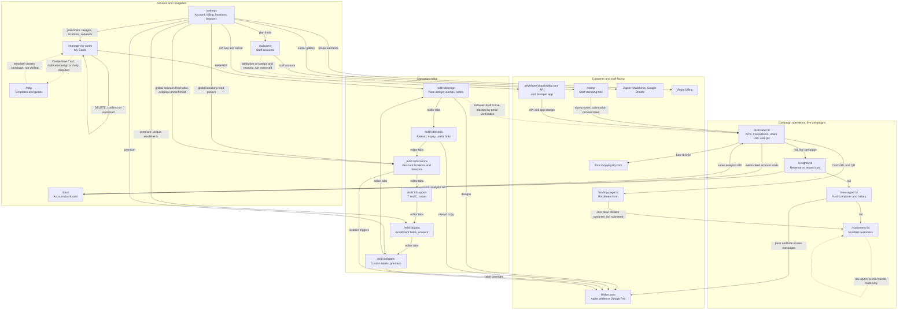

# Loopy Loyalty dashboard: final map

Date: 2026-10-17
App: https://app.loopyloyalty.com (AngularJS single-page app using ui-router). API host: https://api.loopyloyalty.com.
Sources: Cartographer page inventory (`pages.md`, `pages.json`), Linker relationship map (`links.md`), Verifier gate review (`review.md`). Where the Verifier corrected a member claim, the correction wins and is applied below.
Account used for observation: trial account "ibefehdi", email unverified, one draft campaign named COUNCIL TEST (id `wI4XeFr6rHCTUHGOEFazZ`). Screenshots live in `/Users/fahad/council/output/screenshots/`.

## 1. Executive summary

Loopy Loyalty is a SaaS loyalty product for small businesses. A business creates a digital stamp card (a wallet pass for Apple Wallet or Google Pay), customers join through a hosted enrollment page, staff stamp the card on each purchase, and the customer earns a reward after a set number of stamps. The dashboard observed here is the business side of that product.

The dashboard has six main modules:

- Campaign management: a card list (`/manage-my-cards`) and a six-tab campaign editor (`/edit/:campaignId/design|details|locations|support|data|labels`) that defines the pass design, the reward, enrollment fields, locations, terms, and label overrides.
- Campaign operations, available per campaign once it is live: Overview (`/overview/:campaignId`, KPIs plus transactions plus the share URL and QR), Insights (`/insights/:campaignId`, revenue versus reward cost), Messages (`/messages/:campaignId`, push messages to card holders), and Customers (`/customers/:campaignId`, the enrolled-customer list).
- Account dashboard: `/dash`, an account-level rollup of customers enrolled, stamps issued, and rewards issued and redeemed, with an acquisition trend chart. This is distinct from the per-campaign Insights page; the two share analytics APIs but are separate routes with different scopes.
- Account and billing: `/settings`, covering profile, business details, password, plan and Stripe billing, invoices, global locations and beacons, developer API credentials, Zapier integrations, and account deletion.
- Staff: `/subusers` (staff accounts with per-staff attribution, limited by plan: 3 / 10 / 50) and `/stamp` (scan or type a card id and stamp it).
- Customer-facing: `/landing-page/:campaignId`, the enrollment form reached from the campaign's `loyalty.is` share URL or QR code, whose fields mirror the editor's Data tab.

Core entities and how they connect: an account holds campaigns (loyalty programs). A campaign defines a pass design, a reward, stamp imagery and count (1 to 30), expiry, enrollment data fields, and terms. Customers enroll through the landing page and hold a wallet pass tied to the campaign. Stamps are issued against a customer's pass by staff (via `/stamp`, the Stamper mobile app, or the API) and accumulate toward a reward, which is issued and later redeemed. Locations and beacons are managed globally in Settings and attached per campaign in the editor's Locations tab to trigger lock-screen messages. Subusers are staff accounts scoped to locations. Messages are pushes sent to all customers or a segment, with history shown on both Messages and Overview. Every stamp, redemption, and signup becomes an event that feeds the Overview transaction table, Insights ROI figures, and the account Dashboard totals.

Observed state caveats: the trial account's email was unverified, which blocks campaign activation, so all live-campaign behavior (activation, real stamping, redemption, sending messages, customer profiles) is documented from the router and UI but marked UNVERIFIED where it was never executed.

## 2. Page map

The router inventory below was extracted from the client-side router (the authoritative source) and cross-checked live. Seventeen pages were exercised and screenshotted; the rest are route-only.

### 2.1 Account and top-level pages

| Page | URL pattern | Purpose | Main features |
|---|---|---|---|
| Manage My Cards | `/manage-my-cards` | Default landing after login; lists all campaigns | Card tiles with live pass preview and draft badge; MANAGE (opens editor); DELETE; "+"/Create New Card (destination disputed, see §7); reads `GET /campaigns`. Bug: tile list intermittently renders empty on reload |
| Dashboard | `/dash` | Account-level totals and acquisition trend | KPIs (Customers Enrolled, Stamps Issued, Rewards Issued, Rewards Redeemed); Acquisition chart grouped by day/month/year; Rewards Overview; `GET /events/analytics/all/:id?groupBy=` |
| Help / Templates | `/help` | Start a new card from a template | Template gallery (Cafe 8, Restaurant 10, Retail 19, Salon 13, Entertainment 22, Instructor 8, Service 3, Blank); resource links (Quick Start Guide, Tutorials & Support, Stamper App); `GET /images/stampTemplates` |
| Subusers | `/subusers` | Staff accounts that stamp and redeem, with attribution | Create Subuser modal (username with account prefix, password, notes, location); staff table (profile, username, created, notes, location, status) with pagination and search; plan limits 3/10/50. The page itself is directly reachable on the trial; only creation and plan headroom are gated. Profile route `/subuser/:subuserId` is route-only |
| Settings | `/settings` | Account, billing, locations, beacons, integrations | My Account tabs: General, Business, Privacy, Password, Developer Tools (API key and secret, disabled inputs, link to developer.loopyloyalty.com), Delete (reason checkboxes, password confirm). Billing: Plan (Starter US$25, Growth US$69, Ultimate US$95 monthly, annual toggle, Stripe Subscribe), Credit Card (Stripe Elements), Invoices (empty state). Locations with Google Maps picker; Beacons; embedded Zapier gallery (Mailchimp, Google Sheets; rendered twice, a bug). Known JS error overlay on this page (see §6) |
| Stamp | `/stamp` | Staff stamping tool | Card ID input ("Scan stamp-card to continue."); "Stamp Card!" button, disabled until an ID is entered |

### 2.2 Campaign editor (six tabs, per campaign)

All tabs live under `/edit/:campaignId/...`; a new card uses `/edit/new/design`. Each tab shows a live "Your Customers' View" pass preview, and Save / Save & Preview / Activate buttons (Activate only on saved campaigns).

| Tab | URL pattern | Purpose | Main features |
|---|---|---|---|
| Design | `/edit/:campaignId/design` | Design the wallet pass | Type radio (Single Reward / Multi Reward); Icon (87x87) and Logo (480x150) uploads; stamp count 1 to 30; pick from preset stamp gallery or upload stamped/un-stamped images (min 200x200); "Use Stamped Image" checkbox; color pickers for Card, Background, Stamp Circle, Stamp |
| Details | `/edit/:campaignId/details` | Card copy and reward definition | Card description; "How your customers earn 1 stamp"; business name; Reward Details (name, description, stamp success message requiring a `{#}` placeholder, reward success message); expiry (none / fixed date / fixed period after signup); Useful Links table (text, link, type: URL/Phone/Email/Address) |
| Locations | `/edit/:campaignId/locations` | Attach locations and beacons for lock-screen messages | Locations table (location, address on card, display, message) and Beacons table (beacon, message), both with add-row and empty states; pickers read the account-level `GET /locations` list |
| Support | `/edit/:campaignId/support` | Terms and issuer contact (Apple requirement) | T&C enabled checkbox plus textarea with default template; optional link to full T&C; Card Issuer Details (business name, email, phone) |
| Data | `/edit/:campaignId/data` | Enrollment data collection config | Data Collection table (description, format: text/number/date/email/URL/mobile, mandatory, delete; defaults: First Name, Email Address, Mobile Number); default country for phone fields; Unique Customer Enrollments (premium, up to 3 unique fields, blocks duplicate signups); Data Consent (enable, landing page text, checked-by-default); enrollment page preview. Note: the Verifier hit a runtime error overlay on this route during spot-check (see §6); the controls above rest on Cartographer screenshots |
| Custom (Labels) | `/edit/:campaignId/labels` | Personalize card fields and default strings (premium) | Add Custom Fields (label mapped to stamps-until-reward, total stamps, first name, email, mobile); Card Labels overrides for roughly 20 default strings (STAMPS REQUIRED UNTIL NEXT REWARD, LATEST UPDATES, REWARD DETAILS, Join Now!, and others) |

### 2.3 Campaign operations (per campaign)

Navigation to these pages sits in the left rail and is disabled while the selected campaign is a draft (status != 2), but the routes themselves resolve: the Verifier loaded `/overview/wI4XeFr6rHCTUHGOEFazZ` directly on a draft campaign and it rendered with zero data.

| Page | URL pattern | Purpose | Main features |
|---|---|---|---|
| Overview | `/overview/:campaignId` | Live campaign health | KPIs (Customers Signed Up, Stamps Issued, Rewards Issued, Rewards Redeemed); Latest Transactions table (date/time, customer, event, user) with pagination, entries-per-page, search; Push Message History (date, message, segment, reach); Your Card URL (`https://loyalty.is/<id>`) with Copy link, QR code, and three how-to links (save card, stamp, promote). This is the correct route; the `/edit/:id/overview` variant reported by the Linker redirects to `/manage-my-cards` |
| Insights | `/insights/:campaignId` | ROI view of one program | Revenue versus rewards-cost summary ("driven $X in revenue and cost $Y in rewards"), claimed versus outstanding reward value; all-time stats; ISO currency selector |
| Messages | `/messages/:campaignId` | Push messages to card holders | Audience selector (all customers or a segment); message composer with ~90-character best-practice hint and examples; Send Message (not exercised); Push Message History table. Audience count via `GET /card/cid/:id?count=true` |
| Customers | `/customers/:campaignId` | Enrolled customer list | Table (first name, email, mobile, signup date, card status, stamps earned, rewards earned, rewards redeemed) with pagination and search; rows link to `/customers/:campaignId/profile/:cardId` (UNVERIFIED, no enrolled customers in test data); list via `POST /card/cid/:id?count=false` |

### 2.4 Customer-facing pages

| Page | URL pattern | Purpose | Main features |
|---|---|---|---|
| Landing page | `/landing-page/:campaignId` | Enrollment form; target of the `loyalty.is` share URL and QR | Card description header; "Please enter your details" form whose fields come from the editor's Data tab (First Name*, Email*, Mobile* with country-code selector); T&C text and agreement checkbox; Join Now!; "powered by Loopy Loyalty". Reads `GET /campaign/public/:id` |
| Wallet pass | (Apple Wallet / Google Pay, off-dashboard) | The customer's live card | PDF417 barcode, stamps-until-reward counter, "Tap ... for details"; receives push and lock-screen messages; stamped via `/stamp`, the Stamper app, or the API |

### 2.5 Route-only pages (exist in the router, never exercised, all UNVERIFIED)

| Route | Apparent purpose |
|---|---|
| `/login`, `/signup`, `/get-started`, `/setup`, `/account` | Auth and onboarding wizard |
| `/verify/:code` | Email verification (the blocker for activation in this account) |
| `/forgot-password`, `/reset-password/:username/:code`, `/renew-subscription` | Account recovery and subscription renewal |
| `/customers/:campaignId/profile/:cardId` | Individual customer profile |
| `/subuser/:subuserId` | Individual subuser profile |
| `/invoice/:invoiceId` | Invoice view |
| `/csv-verify/:file` | CSV verification step, presumably part of a data-export flow |
| `/404` | Not found |

Also unverified: the Multi Reward card type flow (only a Single Reward draft existed during the run).

### 2.6 Global navigation and shared API surface

Present on every container page: a left icon rail (My Cards, Insights, Subusers, Start, Settings; replaced by Overview, Insights, Messages, Customers, Edit when a live campaign is selected), a top bar (trial-days banner with Upgrade Now pointing at `/settings`, an "In view" campaign selector, a "Your Cards" dropdown with Create New Card, Dashboard, Help pointing at docs.loopyloyalty.com, Settings, Logout), and a persistent "You haven't verified your email address" alert with a resend link.

Common endpoints (token auth held in session; no tokens were recorded): `GET /account` (called on every state change, 30+ times per page load), `GET /campaigns`, `GET /campaign/id/:id`, `GET /campaign/public/:id`, `GET /subusers`, `GET /locations`, `GET /images/stampTemplates`, `GET /card/cid/:id?count=`, `GET /events/analytics/all/:id?groupBy=`, `GET /events/analytics/stampTotals/:id`, `GET /events/pushHistory/:id`, `POST /events/analytics/transactions/:id`. Third parties: Stripe (billing), Google Analytics, MS Clarity (blocked by CSP), PassKit (utils.passkit.net barcode rendering), Google Maps (location picker).

## 3. Feature relationship map

### 3.1 Edge table

Link types: navigates-to (UI control changes route), shares-entity (two features read/write the same record), creates-data-for (one feature produces records another displays), shares-api (same endpoint behind both), gated-by (availability controlled by plan or state), external.

| From | To | Link type | Evidence |
|---|---|---|---|
| Rail: My Cards | `/manage-my-cards` | navigates-to | Live click (Linker), confirmed on other pages by Verifier |
| Rail: Insights label on account scope, top bar Dashboard | `/dash` | navigates-to | Live click (Linker); route confirmed by Verifier. Distinct from campaign `/insights/:campaignId` |
| Rail: Start (rocket) | `/help` | navigates-to | Live click (Linker) |
| Rail / top bar: Settings; trial banner "Upgrade Now" | `/settings` | navigates-to | Live click (Linker); banner observed by Cartographer |
| Rail: Subusers | `/subusers` | navigates-to | Verifier live check: full page renders (staff table, Create Subuser, plan-limit text). Linker's "premium dialog only" claim was ruled WRONG |
| Top bar: "Your Cards" dropdown | campaign selector; Create New Card | navigates-to | Cartographer observation |
| `/manage-my-cards`: MANAGE | `/edit/:campaignId/design` | navigates-to | Live click on COUNCIL TEST (Linker), URL `/edit/wI4XeFr6rHCTUHGOEFazZ/design` |
| `/manage-my-cards`: "+" Create New Card | `/edit/new/design` (Cartographer) or `/help` (Linker) | navigates-to | UNRESOLVED conflict; not re-clicked by the Verifier to avoid creating state. Both outcomes documented per the gate ruling |
| `/manage-my-cards`: DELETE | campaign record | creates-data-for (destructive) | Button observed; confirm flow never exercised |
| Editor tab bar | design / details / locations / support / data / labels | navigates-to | Live clicks (Linker); six tabs confirmed by Verifier |
| Editor: Save, Save & Preview | campaign draft persists | creates-data-for | Buttons observed; save call not captured (Linker's `POST /campaign` guess stays UNVERIFIED) |
| Editor: Activate | campaign status draft (1) to live (2); unlocks rail Overview/Insights/Messages/Customers | gated-by / navigates-to | UNVERIFIED: blocked by unverified email in this account; never executed |
| Rail (live campaign): Overview | `/overview/:campaignId` | navigates-to | Verifier live load of the draft's overview; corrected from `/edit/:id/overview`, which redirects to `/manage-my-cards` |
| Rail (live campaign): Insights / Messages / Customers | `/insights/:campaignId`, `/messages/:campaignId`, `/customers/:campaignId` | navigates-to | Router inventory plus Cartographer screenshots |
| Overview: Card URL, Copy link, QR | `https://loyalty.is/<id>` which resolves to `/landing-page/:campaignId` | navigates-to (external) | Verifier confirmed URL, copy control, and QR render on the live page |
| Overview: three how-to links | docs.loopyloyalty.com (save card, stamp, promote) | external | Verifier confirmed the links on the live page |
| Landing page: Join Now! | customer record, appears in `/customers/:campaignId` | creates-data-for | UNVERIFIED end-to-end: form rendered and confirmed live, but no enrollment was submitted |
| `/customers/:campaignId`: row click | `/customers/:campaignId/profile/:cardId` | navigates-to | UNVERIFIED, route-only (no enrolled customers) |
| `/stamp`: Card ID + Stamp Card! | stamp event on the customer's pass, surfaced in Overview transactions, Insights, and `/dash` totals | creates-data-for | Page and disabled-button state confirmed live; a stamp was never submitted |
| Stamper app / public API (developer.loopyloyalty.com) | same stamp events as `/stamp` | creates-data-for | Mentioned in Settings Developer Tools and `/help` resources; not exercised |
| `/subusers`: Create Subuser modal | subuser record with location scope; row links to `/subuser/:subuserId` | creates-data-for / navigates-to | Modal fields observed and screenshotted; never submitted; profile route is route-only |
| Messages: Send Message | push to enrolled customers or a segment; history rows on Messages and Overview | creates-data-for | Composer and history table observed; send never exercised |
| Messages: audience selector | `GET /card/cid/:id?count=true` | shares-api | Cartographer network observation |
| Settings: Locations (Google Maps picker) | editor Locations tab picker | shares-entity | Both UIs confirmed live; `GET /locations` observed from both contexts; exact assignment behavior not exercised (Verifier rated this PARTIAL) |
| Settings: Beacons | editor Locations tab beacons table | shares-entity | Beacons UI confirmed on both pages; the `/beacons` endpoint asserted by the Linker is UNVERIFIED (misspelled as `/becons` in links.md and never seen in a network trace) |
| Settings: Plan (Starter/Growth/Ultimate, Stripe) | limits on card designs (1/3/10), locations and beacons (1/3/10), subusers (3/10/50), label customization, unique enrollments, data export | gated-by | Plan prices, feature counts, and premium icons confirmed live; a paid transition was never performed |
| Settings: Developer Tools | developer.loopyloyalty.com API (key and secret) | external / shares-api | Confirmed live (disabled inputs plus docs link) |
| Settings: Zapier gallery | Mailchimp list add, Google Sheets enrollments and stamps | external | Gallery confirmed live (rendered twice) |
| `/help`: template selection | new campaign, appears in `/manage-my-cards` | creates-data-for | UNVERIFIED: never clicked (would create state) |
| `/dash`, Overview, Insights | `GET /events/analytics/all/:id` (plus stampTotals, pushHistory, transactions on the campaign pages) | shares-api | Cartographer network observation |
| Every page | `GET /account` | shares-api | Called on every state change; behaves as a session heartbeat |

### 3.2 Flowchart grouped by module

Solid arrows are confirmed edges. Dashed arrows are UNVERIFIED or unresolved (activation, creation flows that were never executed, and the disputed Create New Card destination).

## 4. Entity lifecycles

### Campaign (loyalty program / card)

Created by: template selection on `/help` (UNVERIFIED) or Create New Card from `/manage-my-cards` / the top-bar dropdown (destination disputed, §7). Configured by: the six editor tabs. Displayed on: card tiles in `/manage-my-cards`, the "Your Cards" dropdown, the "In view" selector, and the customer-facing pass and landing page. State: draft (status 1) until Activate makes it live (status 2, UNVERIFIED because email verification blocked it); the rail's campaign tools stay disabled while status != 2, though direct routes like `/overview/:id` still render. Reported on: Overview KPIs, Insights ROI, and account `/dash` totals. Deleted by: DELETE on `/manage-my-cards` (confirm flow never exercised). Exported: no export control was found on the dashboard; the plan feature list mentions data export and the router holds `/csv-verify/:file`, but the flow was never observed (see §6).

### Customer (card holder)

Created by: submitting Join Now! on `/landing-page/:campaignId`, with the collected fields defined in the editor's Data tab; Unique Customer Enrollments (premium) can dedupe on up to three fields. Displayed on: `/customers/:campaignId` table and the route-only profile `/customers/:campaignId/profile/:cardId`. Modified by: stamping and redemption events; consent captured at enrollment. Reported on: Overview transactions, Insights signups, `/dash` Customers Enrolled and Acquisition chart, Messages audience count. Exported: claimed plan feature (data export) and Zapier "Google Sheets enrollments" workflow; neither was exercised.

### Stamp

Configured by: Design tab (count 1 to 30, stamped/un-stamped imagery). Created by: staff via `/stamp` (Card ID plus Stamp Card!), the Stamper app, or the API. Displayed on: the customer's wallet pass counter and the Overview transaction table. Reported on: Stamps Issued on `/dash`, Overview, and Insights (including `GET /events/analytics/stampTotals/:id`). No stamp was actually submitted during this run, so the create leg is UNVERIFIED end to end.

### Reward

Defined by: Details tab (name, description, stamp success message with `{#}` placeholder, reward success message). Issued when stamps reach the target and redeemed by staff; both steps happen off-dashboard or on unexercised flows (UNVERIFIED). Displayed on: the pass ("REWARD DETAILS", "REWARDS EARNED") and the customers table columns. Reported on: Rewards Issued and Rewards Redeemed on `/dash`, Overview, and Insights, where Insights also values them against revenue in a chosen currency.

### Wallet pass

Produced from: the campaign's Design, Details, Labels, and Support configuration; rendered via PassKit (utils.passkit.net barcode). Held by: each enrolled customer. Receives: push messages from `/messages/:campaignId` and lock-screen messages triggered by locations and beacons attached in the editor. Stamped through: `/stamp`, the Stamper app, or the API. Never directly handled in this run beyond previews (UNVERIFIED for a real device).

### Location and beacon

Created by: Settings (Add Location with a Google Maps picker; Add Beacon), account-level and shared across campaigns. Attached per campaign by: the editor's Locations tab (address on card, display flag, message per location; message per beacon). Effect: lock-screen messages near the business. `GET /locations` was observed feeding both screens; a `/beacons` endpoint was asserted by the Linker but never seen in a trace, so treat the beacon API as unconfirmed.

### Subuser (staff account)

Created by: the Create Subuser modal on `/subusers` (username with account prefix, password, notes, location). Limited by plan: 3 / 10 / 50. Purpose: stamp and redeem with per-staff attribution (the Overview transaction table has a User column). Displayed on: the subusers table and route-only `/subuser/:subuserId`. Never created during this run (UNVERIFIED beyond the modal's fields).

### Message (push)

Created by: Send Message on `/messages/:campaignId`, addressed to all customers or a segment. Displayed after sending on: the Push Message History tables on both Messages and Overview (date, message, segment, reach). Never sent during this run.

### Account, plan, and billing

Managed entirely in `/settings`: profile and business details, password, privacy consent, Developer Tools credentials, Stripe plan subscription (Starter US$25, Growth US$69, Ultimate US$95 per month), invoices, and a Delete account workflow with reason capture and password confirmation. The plan gates card designs, locations, beacons, subusers, label customization, unique enrollments, and data export. Invoices were empty in this trial; `/invoice/:invoiceId` is route-only. No billing action was performed.

## 5. Key user journeys

Steps below describe the product as documented; steps the council never executed are marked (UNVERIFIED).

### 5.1 Create and launch a loyalty card

1. Open `/help` from the Start rail icon and pick a template (Cafe, Restaurant, Retail, Salon, Entertainment, Instructor, Service, or Blank), or use Create New Card (destination disputed, §7) (template click UNVERIFIED).
2. In `/edit/:id/design`, choose Single or Multi Reward, upload icon and logo, set the stamp count, pick or upload stamp imagery, and set colors while watching the live pass preview.
3. In `/edit/:id/details`, write the card description, how stamps are earned, and the reward copy, then set expiry and useful links.
4. In `/edit/:id/locations`, attach global locations and beacons with their messages.
5. In `/edit/:id/support`, enable terms and conditions and fill in issuer contact details.
6. In `/edit/:id/data`, choose enrollment fields, mandatory flags, the phone country default, and consent text.
7. Optionally in `/edit/:id/labels`, override default label strings and add custom front fields (premium).
8. Save, then Activate. Activation flips the campaign from draft to live and enables the rail tools (UNVERIFIED here: the account's unverified email blocked it).

### 5.2 Customer joins and collects stamps

1. The business shares the Card URL (`https://loyalty.is/<id>`) or QR from Overview, in store or online.
2. The customer lands on `/landing-page/:campaignId`, fills in the fields the Data tab defined, agrees to the T&C, and taps Join Now! (submission UNVERIFIED).
3. The pass is added to Apple Wallet or Google Pay (off-dashboard, UNVERIFIED).
4. On each purchase, staff scans or types the card ID on `/stamp` (or uses the Stamper app or API) and taps Stamp Card! (UNVERIFIED). The pass counter updates; at the target count the reward is issued with the configured success message (UNVERIFIED).
5. Staff redeems the reward (flow not observed, UNVERIFIED).
6. The customer appears in `/customers/:campaignId` with stamps and rewards tallied, and each event appears in Overview's Latest Transactions.

### 5.3 Check performance

1. `/dash` for the account rollup: totals plus acquisition trend grouped by day, month, or year.
2. `/overview/:campaignId` for one campaign: KPIs, the transaction table with search, push history, and the share URL and QR.
3. `/insights/:campaignId` for ROI: revenue driven versus reward cost, claimed versus outstanding value, all-time stats, in a chosen currency.

### 5.4 Message customers

1. Open `/messages/:campaignId`, choose all customers or a segment (audience count fetched live).
2. Write a message (the UI suggests around 90 characters) and Send (UNVERIFIED).
3. Check delivery in Push Message History, mirrored on Overview.

### 5.5 Set up locations and beacons

1. `/settings`, Locations: Add Location using the Google Maps picker (UNVERIFIED, not exercised).
2. `/settings`, Beacons: Add Beacon (UNVERIFIED).
3. In the editor's Locations tab, assign them to a campaign with an on-card address, display flag, and message.
4. Nearby customers get lock-screen messages (behavior UNVERIFIED).

### 5.6 Add staff

1. `/subusers`, Create Subuser: username (prefixed with the account), password, notes, location.
2. Staff use `/stamp` or the Stamper app; their stamps and redemptions are attributed per user in transaction tables (attribution UNVERIFIED).
3. Plan headroom: 3 on Starter, 10 on Growth, 50 on Ultimate.

### 5.7 Manage account, billing, and integrations

1. `/settings`, My Account: update profile, business details, privacy consent, or password.
2. Billing: pick a plan, pay by card through Stripe Elements, browse invoices. The trial banner's Upgrade Now also lands here.
3. Developer Tools: copy the API key and secret for developer.loopyloyalty.com; or wire Zapier workflows (Mailchimp list add, Google Sheets enrollments and stamps).
4. Delete account: choose reasons, confirm with password (never exercised).

## 6. Findings

Dead ends and orphan routes:

- `/csv-verify/:file` exists in the router and data export is listed as a plan feature, but no export button was found anywhere on the exercised pages. The export flow is effectively invisible from the dashboard; it may live behind a live-campaign view or the API.
- `/stamp` has no observed navigation entry from the rail or top bar; it appears to be reached by direct URL or from the Stamper app context. That makes the primary staff tool an orphan page from the dashboard's perspective.
- `/invoice/:invoiceId`, `/subuser/:subuserId`, and `/customers/:campaignId/profile/:cardId` are route-only; nothing exercised linked to them, and the invoices list was empty.
- `/renew-subscription` is reachable presumably from expiry emails or the trial banner flow, but no in-app link was observed.

Duplicated functionality:

- Three analytics views overlap: `/dash` (account totals), `/overview/:campaignId` (same four KPIs per campaign plus transactions), and `/insights/:campaignId` (all-time stats repeated, plus ROI). They share the `/events/analytics/all/:id` endpoint, so the duplication is in presentation, not data. The naming adds to the confusion: the rail item that goes to `/dash` was labeled "Insights" by the Linker while a different page at `/insights/:campaignId` also exists (ruled on in §7).
- The Settings page renders the three-card Zapier gallery twice. Confirmed live by the Verifier. A rendering bug, not an intentional layout.
- Locations and beacons are managed in two places (Settings globally, editor per card). This one is by design: a shares-entity assignment pattern, not duplication.

Broken behavior and errors:

- `/settings` throws a visible JavaScript error overlay: "[ll2 Error] Cannot set property isOpen of [object Object] which has only a getter". Confirmed live by the Verifier.
- `/manage-my-cards` intermittently renders an empty card tile list on reload, while the "Your Cards" dropdown still lists the campaign. Reported by the Cartographer.
- `/edit/:campaignId/data` showed a runtime error overlay during the Verifier's spot-check ("Cannot read properties of undefined (reading backgroundColor)"), blocking the form. Cartographer screenshots show the controls working earlier, so this may be state-dependent (possibly a draft with an incomplete design object).
- MS Clarity analytics is blocked by the app's own CSP.
- The Linker's report (`links.md`) arrived with widespread character corruption (dropped letters) and a malformed Mermaid block; its content was used only where it matched the Cartographer or survived the Verifier's checks, and its endpoint spellings were corrected per the gate (`/account`, `/campaigns`, `/campaign/id/:id`, `/images/stampTemplates`). The Linker's `/becons` endpoint is not asserted anywhere in this report.

Inconsistencies:

- Create New Card destination: the Cartographer says `/edit/new/design`, the Linker observed `/help`. Both reports are documented; the edge stays unresolved (§7E).
- Activation gating: the Linker treated Overview, Insights, Messages, and Customers as hard-gated behind activation. The Verifier showed the routes themselves render on a draft (Overview loaded with zero data); what is gated is the rail navigation and, presumably, meaningful data and actions. This report keeps activation-dependent behavior UNVERIFIED rather than confirmed.
- Subusers gating: the Linker reported a premium-only dialog; the Verifier found a fully reachable page. The page is reachable; plan limits (3/10/50) and creation headroom are the real gates.
- Empty states everywhere (no customers, transactions, messages, subusers, invoices) are coverage limits of a fresh trial, not product gaps.

Product observations worth flagging to an owner:

- `GET /account` fires on every state change and was seen 30+ times per page load. It behaves as a session heartbeat and is an obvious caching candidate.
- The card preview in the editor updates live as you type, which is the product's strongest affordance for non-technical business owners.
- The stamp success message requires a `{#}` placeholder, a small validation constraint embedded in the Details tab.

## 7. Council notes

Disagreements and rulings (from the Verifier's gate, applied throughout this report):

- A. Overview route. Cartographer said `/overview/:campaignId`; Linker said `/edit/:id/overview`. The Verifier navigated to the Linker's URL and was redirected to `/manage-my-cards`, while the Cartographer's URL rendered. Ruling: Cartographer correct; every occurrence fixed.
- B. "Insights" naming. Both members used the label for different things. Ruling: `/dash` is the account-level dashboard; `/insights/:campaignId` is the campaign-level ROI page. The report keeps them distinct and says so wherever the rail label could mislead.
- C. Subusers gate. Linker overstated it as a premium dialog. Ruling: the page is directly reachable in the trial; only plan limits and creation are gated.
- D. Beacons endpoint. The Beacons UI is confirmed in two places; the API endpoint is not (the Linker's `/becons` was misspelled and never traced). Ruling: keep the feature and the shares-entity relationship, downgrade the API edge to unconfirmed.
- E. Create New Card destination. `/edit/new/design` (Cartographer) versus `/help` (Linker). Not re-clicked by the Verifier because it could create state. Ruling: unresolved; both outcomes documented in §3.1 and §5.1, and settling it needs one controlled click in a COUNCIL-TEST-prefixed run.
- F. Activation unlocks. Both members described the intended dependency (draft to live unlocks the campaign tools), but email verification blocked any activation attempt. Ruling: keep as UNVERIFIED, which is how this report labels it.

The Verifier also required preserving the exact campaign identifier `wI4XeFr6rHCTUHGOEFazZ` (exploratory URLs elsewhere contained truncated variants) and using COUNCIL-TEST naming for any future created data. Both are honored here.

Remaining UNVERIFIED items, in one place: campaign activation and everything behind it (real stamping, reward issue and redemption, message sending, segments, rail enablement on a live campaign); the Create New Card destination; customer enrollment submission and the customer profile route; subuser creation and the subuser profile route; template-to-campaign creation; the `/beacons` endpoint; invoices and the invoice route; the CSV export flow; all auth and onboarding routes; the Multi Reward flow; the card DELETE confirmation; and any paid-plan transition.

Confidence per section (Verifier's scores, mapped to this report):

| Section | Confidence | Why |
|---|---|---|
| §2 Page map, route inventory | 0.90 | Router extracted from source; key routes live-checked; auth, onboarding, and detail routes are route-only |
| §2 Page map, feature detail | 0.84 | Settings, templates, stamping, landing page, overview, card list, and navigation independently spot-checked; Data tab detail rests partly on Cartographer screenshots because the Verifier hit a runtime error there |
| §3 Relationship map | 0.82 (navigation edges) / 0.76 (entity relationships) | Most edges align across members; the create-card conflict stays open and activation-dependent edges are unproven |
| §4 Entity lifecycles | 0.76 | Campaign, location, and settings relationships are well supported; customer, reward, and stamp lifecycles past the creation point were never executed |
| §5 Journeys | 0.70 to 0.82 | Configuration journeys are well evidenced; operational journeys (5.2, 5.4, 5.6) carry UNVERIFIED steps throughout |
| §6 Findings | 0.84 | Bugs and duplications confirmed live by the Verifier; export-flow and orphan-route conclusions rest on absence of evidence in a trial account |
| Overall map readiness | 0.82 | Gate passed with corrections; not sufficient to call route-only or activation-dependent claims live-confirmed |

## 8. Cleanup list

Records the council created in the live app:

| Record | Where it lives | State | How to remove |
|---|---|---|---|
| Campaign "COUNCIL TEST", id `wI4XeFr6rHCTUHGOEFazZ` | Trial account "ibefehdi" on https://app.loopyloyalty.com, visible at `/manage-my-cards` and `/edit/wI4XeFr6rHCTUHGOEFazZ/design` | Draft (status 1), never activated, no customers | DELETE button on `/manage-my-cards` (the confirm flow was never exercised, so its exact steps are unknown), or let the 15-day trial expire |

Nothing else was created in the app. The Verifier's run explicitly created, changed, and deleted nothing. The Create Subuser modal was opened and screenshotted (`screenshots/subusers-create-modal.png`) but never submitted; no locations, beacons, messages, enrollments, or billing actions were performed.

Local artifacts produced by the run (on the council machine, safe to keep or archive): `/Users/fahad/council/output/pages.md`, `pages.json`, `links.md`, `review.md`, this report, `screenshots/` (25 images), and crawl intermediates under `/Users/fahad/council/crawl-output/`.

One housekeeping note: `links.md` is corrupted text (dropped characters throughout). It was still usable as cross-reference, but if the council reruns the Linker, that encoding bug is worth chasing before the next round.
