# Loopy Loyalty dashboard: technical report

Deep technical pass by the council. Date: 2026-10-17.
App: https://app.loopyloyalty.com. API host: https://api.loopyloyalty.com.
Account observed: trial account "ibefehdi" (email unverified, 15-day trial, plan limit 1 card design, trial expiry 2026-11-01).
Test campaign: COUNCIL TEST, id `wI4XeFr6rHCTUHGOEFazZ`, draft (status 1).

Sources: the five deep-pass member reports in `/Users/fahad/council/output/technical/` (architecture.md, flows.md, reports.md, gaps.md, settings.md, plus the seed run seed.md and the audit log test-records.md), gated by the verifier's live re-check (technical/review.md). The first survey (FINAL_REPORT.md, pages.md, pages.json, links.md, review.md in `/Users/fahad/council/output/`) is the read-only baseline. Where members conflicted, the verifier's ruling wins and is applied throughout.

Conventions used in this document:

- Claims that could not be confirmed by live observation are labelled UNVERIFIED.
- Route parameters are normalized (`:campaignId`, `:cardId`). The exact campaign id is preserved as `wI4XeFr6rHCTUHGOEFazZ`.
- Endpoint spellings are normalized per the verifier's ruling. Early member drafts contained corrupted strings such as `/campains`, `/campign`, `/becons`, `/acount`; this report uses only the captured correct forms `/campaigns`, `/campaign`, `/beacons`, `/account` and never reproduces the malformed variants as endpoint names.
- KPI values are timestamped snapshots of live test data, not product constants.
- No tokens, cookies, auth header values, API secrets, or personal data values are reproduced anywhere in this report. Field names only.

FINAL_REPORT.md is unchanged. This document is its technical companion.

## 1. Scope and method

### 1.1 What this pass covered

The first survey mapped the product at feature level. This second pass went one level down: full route inventory with query parameters, form field inventories with validation messages, per-page network traces (method, path, status, key request and response field names), the entity model as observed in payloads, plan and permission gating, create and edit flows exercised end to end where safety rules allowed, and analytics data lineage.

The pass ran as a council of five workers plus a verifier:

| Worker output | Author | Content |
|---|---|---|
| technical/seed.md | linker | Seed data run: 8 customer enrollments, 1 location, failed stamp attempts via /stamp |
| technical/architecture.md | linker | Stack, auth, routing, API catalogue, entity model, per-page API map, connectivity |
| technical/flows.md | linker | Create and edit flows, form inventories, validation rules, lifecycles, propagation |
| technical/reports.md | cartographer | Analytics deep dive: /dash, overview, insights, customers, profile, push history, lineage |
| technical/gaps.md | cartographer | Resolution of every item the first survey left open, global chrome, list-page actions, gated features |
| technical/settings.md | cartographer | Settings deep pass: all tabs, billing, locations, beacons, Zapier, subusers, setup wizard |
| technical/review.md | verifier | Live re-check gate, verdicts, conflict rulings, propagation audit, test-record audit |

Live exploration used an authenticated Playwright session against the trial account. The verifier re-checked nine routes live (/dash, /settings, /overview/:id, /customers/:id, customer profile, /insights/:id, /edit/:id/data, /subusers, /messages/:id), validated all 18 Mermaid diagrams across the five inputs, and passed the gate with required synthesis corrections. Those corrections are applied in this report; section 1.5 lists them.

### 1.2 Method and safety rules

- Network captures recorded HTTP method, path, status, and field names only. Tokens, cookies, auth headers, and personal data values were excluded at capture time.
- Test records were created only under COUNCIL-TEST naming with fake contact details (council-test+name@example.com), logged append-only in technical/test-records.md.
- Stop rules were honored: no billing or plan changes, no payment detail changes, no password changes, no message sends to customers, no deletions, no account owner changes. Dialogs touching these were documented instead of confirmed.
- Settings edits were additive or reverted. Both reverts were API-verified (section 12.2).

### 1.3 What changed versus FINAL_REPORT.md

The first survey stays valid as a product map. This pass resolved, corrected, or extended the following items:

| Item | First survey said | Deep pass established | Status |
|---|---|---|---|
| Create New Card destination | Disputed: `/help` (linker) vs `/edit/new/design` (cartographer) | Controlled click on the "+" tile navigated to `/edit/new/design` | CONFIRMED `/edit/new/design`; the `/help` observation is stale |
| Beacons API | UI confirmed, endpoint unconfirmed (misspelled `/becons` in links.md) | `GET /beacons` 200, `GET /beacons/uuid/:value` duplicate check, `POST /beacon` 201 | CONFIRMED |
| Customer profile `/customers/:campaignId/profile/:cardId` | Route-only, UNVERIFIED | Fully documented live: tabs, stats, inline edit, pass preview, Give Stamps, transactions | CONFIRMED |
| Stamping | Never submitted | `POST /card/cid/:cardId/addStamps/:count` returns 200 from the profile Give Stamps tab. The /stamp page sends the literal string `undefined` as the count and gets 500 | CONFIRMED working via profile; /stamp submission is a page defect |
| Customer enrollment | Form confirmed, submission UNVERIFIED | 8 customers enrolled end to end via `/landing-page/:campaignId`; cards created server side; wallet redirect captured | CONFIRMED |
| CSV export | No export button found anywhere; flow "invisible" | Export buttons exist on `/customers/:campaignId` and `/overview/:campaignId`; both open an Ultimate-gated "Premium Feature" modal; no export request fires on this trial | CONFIRMED as gated. The earlier claim of a working client-side export (`vm.exportCsv()`, no network) is not observed in the current pass; client-side generation stays UNVERIFIED |
| Subusers gating | Page reachable, creation gating unclear | Page and Create Subuser dialog fully reachable on trial; `POST /subuser` returns 403 "The trial version does not allow for creating subusers" | CONFIRMED: view reachable, creation trial-blocked |
| /dash analytics endpoint | `GET /events/analytics/all/:id?groupBy=` | `GET /events/dashboard?groupBy=day` (month exercised; year pattern expected) | Corrected |
| GET /account chattiness | "30+ times per page load" | 2 to 3 calls per page load measured across all 17 pages visited | Corrected; the earlier count was not reproduced |
| Insights page | Three features recorded | Full ROI surface: revenue inputs writing `PATCH /campaign/:id` (stampValue, rewards[].cost), currency selector, Activity grouping (Day/Month only), Stamp Count Histogram (`GET /events/analytics/stampTotals/:id`), transactions table with profile drill-down | Extended |
| Overview groupBy | Unknown | Page sends the literal string `groupBy=undefined` (uninitialized AngularJS binding), server still answers 200 | New finding |
| Overview share URL | `https://loyalty.is/<id>` | Controls (link, Copy link, QR) confirmed; live value rendered as bare `https://loyalty.is/` with no suffix on the draft campaign | Control CONFIRMED; exact activated-campaign URL format UNVERIFIED |
| Messages segment | "segment" selector noted | Segment builder detail: metric combobox (Current Stamp Amount, Lifetime Stamps Earned, Rewards Earned, Rewards Redeemed), operator combobox (Greater than, Less than, Equal to, Greater than = to, Less than = to), value spinbutton, live reach count ("This message will reach 6 customers.") | New detail |
| Campaign rail gating | Rail disabled for drafts; routes resolve | Confirmed and sharpened: with a draft selected the campaign rail items do not render, yet all four routes serve real data by direct URL (8 customers, 2 stamps visible). Gating is navigational, not a data-permission boundary | CONFIRMED |

### 1.4 Current live data state used in this report

As of the verifier's live checks on 2026-10-17 (review completed around 11:45 local):

| Metric | Value | Seen consistently on |
|---|---|---|
| Customers enrolled | 8 | /dash, /overview/:id, /insights/:id, /customers/:id |
| Stamps issued | 2 (Alice 1, Helen 1) | /dash, /overview KPIs and transaction rows, /insights, per-customer list and profiles |
| Rewards issued | 0 | all analytics views |
| Rewards redeemed | 0 | all analytics views |
| Locations | 1 (COUNCIL TEST Location) | /settings |
| Beacons | 1 (COUNCIL TEST Beacon) | /settings |
| Subusers | 0 (creation trial-blocked) | /subusers |
| Invoices | 0 | /settings Invoices tab |
| Push messages sent | 0 | push history tables |

Member drafts captured earlier snapshots (0 stamps right after seeding, then 1 after Alice's stamp). Those values are historical. Per the verifier's ruling, this report uses 2 stamps as the current state and treats all KPI numbers as timestamped snapshots.

### 1.5 Verifier rulings on member conflicts

The gate (technical/review.md) resolved eight conflicts. Rulings applied in this report:

1. Data totals. reports.md described 0 then 1 stamps, gaps.md described 2, live shows 2. Ruling: 2 is current; older values are historical snapshots only.
2. Test-record completeness. Helen's successful stamp was visible live but missing from test-records.md. Ruling: audit incomplete until logged. Resolution: a clearly marked reconciliation entry was appended to technical/test-records.md during synthesis (chair, 2026-10-17), citing the verifier's live evidence and recording that the stamp's creator was not logged at creation time. Section 12 carries the same reconciliation.
3. Subuser gating. flows.md said the dialog opens with no POST; settings.md captured `POST /subuser` 403. Ruling: not contradictory. Page and dialog are reachable; actual creation is trial-blocked per the captured API evidence.
4. CSV export. reports.md called it a working client-side export; gaps.md observed the Ultimate-gated modal with no request fired. Ruling: use the newer live observation. Export is not available on this trial; client-side generation is unverified.
5. Create-card destination. Old links.md/review.md said `/help`; deep-pass evidence says `/edit/new/design`. Ruling: use `/edit/new/design`; the `/help` result is stale conflicting historical evidence.
6. Endpoint spellings. Corrupted forms in links.md and flows.md are normalized to `/campaigns`, `/campaign`, `/beacons`, `/account` wherever captured evidence supports the correct form. Malformed strings are never reproduced as endpoint names.
7. Overview share URL. The control is confirmed; the exact activated-campaign URL format is UNVERIFIED because the live draft rendered a bare `https://loyalty.is/`.
8. Error severity. The /settings `isOpen` error is a non-blocking toast (all sections stay interactive). The editor Data tab `backgroundColor` error is a blocking overlay for that route. This report distinguishes the two everywhere they appear.

Additional PARTIAL rulings carried through:

- Mobile number masking. reports.md asserted UI-masked phone values with full values in the API; the verifier's live snapshot showed an unmasked-looking phone value in accessibility text. The API-versus-UI masking distinction stays UNVERIFIED.
- Editor Data tab form detail rests on first-survey screenshots because the route now renders a blocking error overlay on every load for the test campaign.
- Location and beacon assignment propagation from global settings into the editor's Locations tab was not exercised; both UIs and both GET endpoints are confirmed, the persistence path is not.

### 1.6 Confidence summary

Verifier confidence per input file: settings.md 0.93, gaps.md 0.90, reports.md 0.88, architecture.md 0.87, flows.md 0.78. Overall technical map readiness: 0.86, PASS with required synthesis corrections. Mapped to this report's sections:

| Section | Confidence | Why |
|---|---|---|
| 2 System architecture | 0.87 | Routes, endpoint catalogue, stack facts live-observed; auth transport explicitly inferred and labelled |
| 3 Domain model | 0.85 | Field names captured from real payloads; a few entity details (reward event types) inferred and marked |
| 4 Module reference | 0.85 | Settings and analytics strongest (0.93 / 0.88); editor Data tab weakest because of the blocking runtime error |
| 5 Connectivity | 0.85 | Most edges live-clicked this pass; the editor "Edit" landing tab stays unresolved |
| 6 Settings reference | 0.93 | Strongest file; tabs, limits, error payloads, and API calls all matched live checks |
| 7 Analytics reference | 0.88 | UI and API claims mostly confirmed; KPI examples are point-in-time |
| 8 Flows | 0.78 | Useful inventory, but several legs were speculative or contradicted; normalized here, unexercised legs stay UNVERIFIED |
| 9 Lifecycles | 0.70 | Confirmed through enrollment and first stamps; everything past the reward threshold is unverified |
| 10 API catalogue | 0.88 | Every listed call was captured in a network trace with status; unobserved endpoints are listed separately |
| 11 Gaps and unknowns | 0.90 | Resolution table comes from controlled live checks |
| 12 Test records | 0.90 | Complete after the Helen reconciliation append |

## 2. System architecture

### 2.1 Frontend stack

| Layer | Technology | Version | Evidence |
|---|---|---|---|
| Framework | AngularJS | 1.5.11 ("princely-quest") | `angular.version.full` via browser_evaluate |
| DOM library | jQuery | 2.2.4 | `$.fn.jquery` via browser_evaluate |
| Routing | ui-router (AngularJS) | bundled in app.js | SPA state groups: container.*, edit.*, campaign.*, auth.*, public.*, setup.* |
| App module | `app` | (none) | `ng-app` attribute |
| Bundling | Grunt or gulp with fingerprinting | (none) | script names `lib-2353771e22.js`, `app-21db9b2f00.js` |
| Runtime config | `/config/environment.js` | (none) | loaded as a script; contains API base URL and feature flags; not inspected in detail |

AngularJS 1.x explains two behaviors documented later in this report: forms require native input events for ng-model binding (JavaScript value setting bypasses validation and was the reason two worker create-attempts did not fire a POST), and uninitialized bindings leak into requests as the literal string `undefined` (the overview `groupBy=undefined` bug).

### 2.2 Authentication and session

| Aspect | Detail | Evidence |
|---|---|---|
| Token format | JWT, HMAC-SHA256 algorithm header | token prefix observed in `sessionStorage.jwt` (value not recorded) |
| Token storage | sessionStorage, key `jwt` | session-scoped, not in cookies |
| Transport | Bearer auth header (inferred) | UNVERIFIED: the actual request header was not captured; no cookie auth was observed for API calls |
| Session check | `GET /account` on every page load, measured 2 to 3 times per load | network traces across all 17 visited pages |
| Cookies | Only third-party (GA, Clarity, Facebook, Stripe); no API auth cookies | cookie inspection |

sessionStorage keys observed (names only, values not reproduced): `jwt`, `uid`, `username`, `email`, `plan` ("trial"), `status` ("setup"), `business`, `expiryDate`, `trialDuration` (15), `limit` (1, the card design limit), `ihash` (integrity hash), `dateJoined`, `pkadmin` (PassKit admin flag, false), `templateOrganisation`. localStorage holds referrer tracking keys (`lastExternalReferrer`, `lastExternalReferrerTime`) and `zapier.visitor_id`.

Note: `GET /account` still reports `status: "setup"` for this account even though `/setup` and `/account` redirect to `/manage-my-cards` as completed. The exact condition driving that redirect is UNVERIFIED.

### 2.3 Routing

ui-router state groups (extracted from the client router, the authoritative source):

| Group | Routes |
|---|---|
| auth | `/login`, `/renew-subscription`, `/verify/:code`, `/forgot-password`, `/reset-password/:username/:code` |
| signup_setup | `/signup`, `/get-started`, `/setup`, `/account` |
| public | `/landing-page/:campaignId`, `/stamp` (no `GET /account` call observed on /stamp, i.e. no auth check on load) |
| container | `/dash`, `/help`, `/manage-my-cards`, `/settings`, `/subusers`, `/subuser/:subuserId`, `/invoice/:invoiceId`, `/csv-verify/:file`, `/404` |
| edit | `/edit/:campaignId/design`, `/edit/:campaignId/details`, `/edit/:campaignId/locations`, `/edit/:campaignId/data`, `/edit/:campaignId/labels`, `/edit/:campaignId/support` (new cards use `/edit/new/design`) |
| campaign | `/customers/:campaignId`, `/customers/:campaignId/profile/:cardId`, `/insights/:campaignId`, `/messages/:campaignId`, `/overview/:campaignId` |

Navigation is pure SPA: state transitions fire `GET /account` plus `GET /campaigns` as a warmup, then page-specific calls. No full page reloads between states.

### 2.4 Realtime behavior

No WebSocket or SSE connections were observed on any page. The app is request-response only; analytics data is stale until refresh. Push messages reach customers through Apple Wallet / Google Wallet via PassKit, not through the browser.

### 2.5 Component diagram

```mermaid
flowchart TD
    subgraph BROWSER["Browser: AngularJS 1.5.11 SPA"]
        APP["app.js, ui-router SPA"]
        LIBS["lib.js, jQuery 2.2.4 plus deps"]
        CONFIG["config/environment.js, API base URL and flags"]
    end

    subgraph API["Loopy Loyalty API, api.loopyloyalty.com"]
        ACCT["/account, auth and profile"]
        CAMP["/campaigns, /campaign/id/:id, /campaign/public/:id, /campaign/exists/:name, campaign writes"]
        EVT["/events/*, dashboard, analytics, transactions, pushHistory"]
        CRD["/card/*, customer list, detail, stamps, count"]
        LOCS["/location, /locations"]
        BCNS["/beacon, /beacons, /beacons/uuid/:value"]
        SUBS["/subuser, /subusers"]
        IMGS["/images, /images/stampTemplates"]
        INVS["/invoices"]
    end

    subgraph THIRD["Third-party services"]
        PK["PassKit: wallet passes, barcodes, pass images"]
        STRIPE["Stripe: payments and billing"]
        GMP["Google Maps: location picker"]
        ZAPIER["Zapier: integration gallery"]
        ANALYTICS["GA plus GTM, MS Clarity, Facebook Pixel, ProfitWell, Tapfiliate"]
        INTCM["Intercom: support chat"]
        VIMEO["Vimeo and YouTube: tutorial embeds"]
        HCAP["hCaptcha: Stripe anti-fraud"]
    end

    APP --> ACCT
    APP --> CAMP
    APP --> EVT
    APP --> CRD
    APP --> LOCS
    APP --> BCNS
    APP --> SUBS
    APP --> IMGS
    APP --> INVS
    APP --> STRIPE
    APP --> GMP
    APP --> ZAPIER
    APP --> ANALYTICS
    APP --> INTCM
    APP --> VIMEO
    APP --> HCAP
    CRD --> PK
    CAMP --> PK
    BCNS --> PK
    STRIPE --> HCAP
```

### 2.6 API hosts and style

- Business API: `https://api.loopyloyalty.com`. REST/JSON throughout, no GraphQL, no version prefix (no `/v1/`), no rate-limit headers observed.
- Response shapes are mixed: plain JSON for most endpoints; CouchDB-style pagination on `GET /campaigns` (`_offset`, `total_rows`, `rows[].value`), which suggests a CouchDB or CouchDB-compatible layer behind at least that endpoint; DataTables server-side protocol on `POST /events/analytics/transactions/:campaignId` and `POST /card/cid/:campaignId` (`draw`, `recordsTotal`, `recordsFiltered`, `data[]`, with request bodies carrying `draw`, `start`, `length`, `search`, `order`).
- Image rendering: `GET /images?json={...}` renders stamp strip images server-side from a JSON query parameter (PNG/SVG). Unusual pattern, confirmed 200 on /dash and /manage-my-cards.
- Public share domain: `loyalty.is` (card URLs and QR targets; the customer wallet pass also lives at `loyalty.is/:cardId`). The exact suffix format for activated campaigns is UNVERIFIED (section 1.5, ruling 7).
- Wallet and pass hosts observed: `client-f.passkit.net` (PassKit SDK, intl-tel-input), `s3.amazonaws.com` bucket `passkit-api-core-production` (pass and stamp images), `utils.passkit.net` (barcode rendering, from the baseline survey). Card ids are PassKit-style ids and enrollment redirects to a PassKit wallet-add URL, so PassKit is a deep architectural dependency, not a cosmetic one.
- Developer API: `developer.loopyloyalty.com` documented in Settings Developer Tools; authenticated with the account's API key and secret (values displayed disabled in the UI; not recorded here). Not exercised.

### 2.7 Third-party services

| Service | Purpose | Loaded on | Identifiers observed (public embed ids) |
|---|---|---|---|
| PassKit | Wallet pass management (Apple Wallet, Google Pay), barcodes, pass images | SDK on all pages; enrollment redirect on /landing-page | client-f.passkit.net; S3 bucket passkit-api-core-production |
| Stripe | Plan payments and billing | /settings billing; `m.stripe.com/6` beacon on all pages | js.stripe.com/v3, api.stripe.com, r.stripe.com, merchant-ui-api.stripe.com |
| hCaptcha | Bot detection for Stripe | /settings | site key 463b917e-e264-403f-ad34-34af0ee10294 |
| Google Maps | Location picker and geocoding in Settings | /settings; `gen_204` probe on all pages | maps/api/js with an account-scoped API key (redacted) |
| Zapier | No-code integration gallery | /settings embed | api.zapier.com/elements/zap-templates, templates 19506, 19501, 19502 |
| Intercom | Support chat widget | all pages | widget id p6uuiqym |
| Google Analytics / GTM | Page views and events, dual UA plus GA4 tracking | all pages | UA-56934929-1, G-TTHRRGSK6D, GTM-MLR2SL5 |
| Microsoft Clarity | Session recording and heatmaps | all pages (partly CSP-blocked) | project m8r3sxhiy8 |
| Facebook Pixel | Ad conversion tracking | all pages (error endpoint CSP-blocked) | pixel 908685596241622 |
| ProfitWell | Subscription analytics | all pages | public.profitwell.com |
| Tapfiliate | Affiliate tracking | all pages | script.tapfiliate.com |
| Vimeo | Tutorial video embeds | /dash | video ids 227213226, 227050025, 227060638, 227072189 (401 in headless capture; content UNVERIFIED) |
| YouTube | iframe embed API | all pages | www.youtube.com/iframe_api |

### 2.8 Content Security Policy observations

The app's own CSP blocks parts of its analytics stack: several `*.clarity.ms` subdomains fail (only `z.clarity.ms` succeeded during capture) and `connect.facebook.net//log/error` is blocked. Vimeo player iframes were initially aborted (ERR_ABORTED) and then loaded via a Cloudflare challenge. These are live inconsistencies between the tag stack and the CSP, worth flagging to whoever owns the frontend.

### 2.9 Feature gating

| Feature | Gate | Evidence |
|---|---|---|
| Card designs | Plan limit: 1 (trial), 1/3/10 (Starter/Growth/Ultimate) | `POST /campaign` 400 "Card limit reached..."; sessionStorage `limit` = 1 |
| Locations | Plan limit: 1 trial, then 1/3/10 | `POST /location` 400 "Location limit reached..." |
| Beacons | Plan limit: 1 trial, then 1/3/10 | `POST /beacon` 400 "Beacon limit reached..." |
| Subusers | Trial: creation blocked entirely (403). Paid: 3/10/50 by plan | `POST /subuser` 403 "The trial version does not allow for creating subusers..." |
| CSV export | Ultimate plan | Premium Feature modal on both export buttons; no request fires on trial |
| Custom labels (editor Custom tab) | Premium per plan includes | premium icon on tab (baseline; not re-tested) |
| Unique customer enrollments (Data tab) | Premium per plan includes | premium icon (baseline; Data tab currently blocked by runtime error) |
| Campaign tools rail (Overview, Insights, Messages, Customers, Edit) | Campaign activation (status 2) hides the rail entries, but direct URLs render with real data even for drafts | gaps.md and verifier live checks |
| Campaign activation | Email verification | persistent alert banner; Activate never pressed |

Limit-error payloads share a bug: the i18n placeholder `{{upgradeLink}}` is rendered raw into the JSON error string for card, location, and beacon limit errors.

## 3. Domain model

### 3.1 Entity relationship diagram

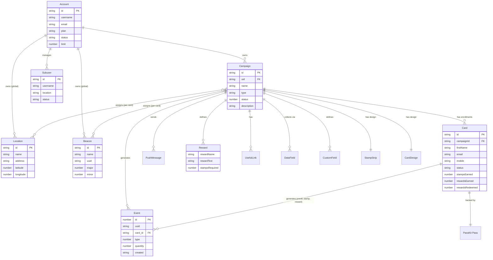

### 3.2 Class view

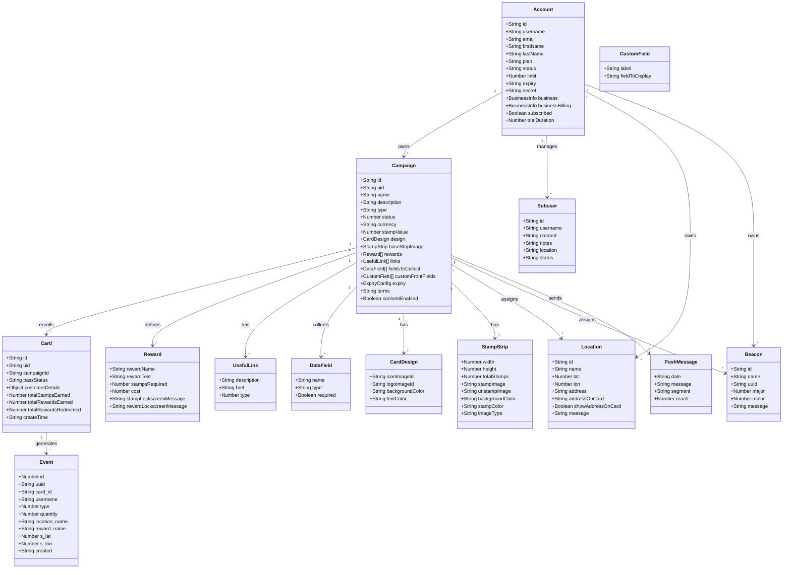

### 3.3 Entity reference

Field names below come from captured request and response payloads. Values shown are examples from the COUNCIL TEST data only.

Account (from `GET /account`, `PATCH /account`): id, username, email, firstName, lastName, plan ("trial" | "starter" | "growth" | "ultimate"), status ("setup" | "active" observed), limit (card design limit, 1 on trial), expiry (ISO 8601), trialDuration (15), subscribed (bool), secret (API secret, not reproduced), intercomId, ref (referral code), business and businessBilling (BusinessInfo: name, website, email, phone, addressLine1, country, taxId, AupCheckProcessed, AupCheckFailed), stripeInformation, discounts[], MailSubscriptions.

Campaign (from `GET /campaign/id/:id`, `GET /campaigns`, captured `POST /campaign` payload): id (Firestore-style string), uid (owner account id), name, shortCode, description, organisationName, type ("single" | "multi"), object ("campaign"), status (1 = draft, 2 = active), createTime, updateTime, pkCampaignName and pkTemplateName (PassKit linkage), collectValue (how stamps are earned), currency ("$"), isNFCEnabled, stampsRequiredForNextRewardReplacement, design (CardDesign: iconImageId "ll-icons/...", logoImageId "ll-logos/...", backgroundColor, textColor), baseStripImage (StampStrip: width 1125, height 432, padding 40, totalStamps, stampImage and unstampImage preset names such as "bagel", S3 URLs, background/stamp/unstamp colors and opacities, placeholder settings, rewardPositions, stampedStatus, imageType "svg"), rewards[] (Reward: rewardName, rewardText, stampsRequired, stampLockscreenMessage with a `{#}` placeholder, rewardLockscreenMessage; plus `cost` written by Insights), links[] (UsefulLink: description, href, type 0=Url 1=Phone 2=Email 3=Address), fieldsToCollect[] (DataField: name, type text/email/tel, required), customFrontFields[] (CustomField: label, fieldToDisplay), expiry (ExpiryConfig: noExpiry | fixedDate | fixedPeriod), package (empty object for single-reward), terms, disableTerms, business (name, website, email, aupCheckProcessed), consentEnabled, consentText, consentCheckboxEnabled, labels[]. Economics fields written by Insights: `stampValue` (number) and `rewards[].cost` (number) via `PATCH /campaign/:id`; zero values are dropped server-side and disappear from subsequent GETs.

Card, i.e. customer enrollment (from `GET /card/:cardId?includeEvents=true`, customer list responses): id (PassKit-style, e.g. xZuG0J01d5TGR2), uid, campaignId, passStatus ("issued" is the only observed status), firstName, email, mobile, signupDate, totalStampsEarned, totalRewardsEarned, totalRewardsRedeemed, customerDetails (map of collected field names to values, driven by the Data tab config), object ("card"), stripImage (design object), createYear/createMonth/createDay, createTime, updateTime, events[] when includeEvents=true. The UI list shows the same data as First Name, Email Address, Mobile Number, Signup Date, Card Status, Stamps Earned, Rewards Earned, Rewards Redeemed. Whether mobile values are masked by the product or were seeded that way is UNVERIFIED (section 1.5).

Event, i.e. transaction (from `POST /events/analytics/transactions/:id` and card events): id (auto-increment integer, e.g. 77922858), uuid, card_id (FK to Card), username (acting user, e.g. the account owner "ibefehdi"; subusers would attribute here), type (integer; 0 = enrollment confirmed by the UI label "Signed up", 1 = stamp confirmed by stamp rows; 2 = reward issue and 3 = reward redeem are inferred from the analytics columns and UNVERIFIED, no reward events were ever observed), quantity, location_name, reward_name, s_lat and s_lon (nullable floats, stamper GPS), ip, ua, referrer, created (ISO 8601).

Location (from `GET /locations`, captured `POST /location` payload): id, uid, name, lat, lon, address, alt, addressOnCard, showAddressOnCard, message (lock-screen message), isAppleWalletEnabled, isAndroidPayEnabled, object ("location").

Beacon (from `GET /beacons`, `POST /beacon`): id, name, uuid (client auto-generates a UUID at submit time, replacing what the user typed), major, minor, message.

Subuser (from `GET /subusers` and the create modal): id, profile (avatar), username (displayed with a fixed `<owner-username>+` prefix; subusers log in as owner+suffix), created, notes (the create payload field is `label`), location (assignment, create payload sends `locationId` plus the full location object), status.

PushMessage (from push history table columns; row fields UNVERIFIED because history is empty on this account): date, message, segment, reach.

## 4. Module technical reference

Route patterns, reachability, UI structure, fields, actions, API calls, and links for every page. Grouped by module. Evidence references point at the appendix.

### 4.1 Global chrome (every container page)

Verified present on /manage-my-cards, /edit/new/design, /subusers, /customers/:id, /settings, /overview/:id, /messages/:id, /insights/:id, /dash:

- Left icon rail: My Cards, an insights/graph icon (goes to /dash), a users icon (goes to /subusers, premium badge on trial), Start (rocket, goes to /help), Settings. When a live (status 2) campaign is in view the rail instead shows campaign tools: Overview, Insights, Messages, Customers, Edit. With the draft campaign selected those items do not render at all, yet the routes work by direct URL. The rail is a navigation gate, not an access gate.
- Top bar: clickable logo, trial banner ("15 days left on trial" plus Upgrade Now to /settings), cards icon link to /manage-my-cards, help icon link to http://docs.loopyloyalty.com/, and a "Your Cards" dropdown.
- "Your Cards" dropdown (opened live): heading, one entry per campaign (pass thumbnail, name, status emphasis such as "COUNCIL TEST - DRAFT"; clicking selects the in-view campaign), separator, "Create New Card" (to /edit/new/design), separator, Dashboard (/dash), Settings (/settings), Logout (not exercised).
- "In view: COUNCIL TEST": top-bar text (not a dropdown) on campaign-scoped pages when a campaign is selected; not clickable in this state.
- Persistent alert: "You haven't verified your email address. Resend verification email." (link not exercised).
- Global search: none exists. The only search inputs are per-table DataTables searches (overview transactions, push history, subusers, customers, profile transactions, insights transactions). Confirmed by absence across all pages this pass.
- Notifications: none (no bell or notification menu anywhere).
- Help: top-bar icon to docs.loopyloyalty.com only; no in-app help widget. Per-feature "Learn more" links exist, and each editor tab carries a "Watch video tutorial: ..." link (for example "Designing your Card" on the Design tab; first documented this pass).
- Setup checklist: none.

### 4.2 Account module

#### /manage-my-cards (My Cards)

- Reached from: default landing after login, rail My Cards, top-bar logo and cards icon, dropdown.
- Purpose: list all campaigns as card tiles; entry point to the editor.
- UI: one tile per campaign with a live pass preview (PDF417 barcode, "STAMPS REQUIRED UNTIL NEXT REWARD" counter, "Tap ... for details"), campaign name, DRAFT badge for status 1, plus a "+" tile to create a new card. No filters, sorting, bulk actions, or export. Known bug (baseline observation): the tile list intermittently renders empty on reload while the dropdown still lists the campaign.
- Actions: MANAGE (to `/edit/:id/design`), DELETE (destructive; confirm flow never exercised, UNVERIFIED), "+" (to `/edit/new/design`, confirmed by controlled click this pass).
- API: `GET /account`, `GET /campaigns` (CouchDB-style rows: id, name, design, status, createTime, updateTime, stampsRequiredForNextRewardReplacement, customFrontFields), `GET /campaign/id/:id` per preview, `GET /images?json=...` for strip images.
- Links out: editor, /settings via Upgrade Now, rail and dropdown destinations.
- Evidence: manage-my-cards.png.

#### /dash (account dashboard)

- Reached from: rail insights icon, dropdown Dashboard. Account-scoped; no "In view" selector.
- Purpose: aggregate KPIs across all campaigns plus acquisition trend.
- UI: "Total statistics" header with an icon button (clicking produced no network call; function UNVERIFIED); four KPI tiles (Customers Enrolled 8, Stamps Issued 2, Rewards Issued 0, Rewards Redeemed 0 at verifier check time); "Acquisition" chart with a Group by combobox (Day default, Month, Year) and an adjacent icon button with no visible effect (UNVERIFIED); "Rewards Overview" section (heading only, empty state on this account); four Vimeo tutorial embeds (401 in headless capture).
- API: `GET /account` (x2), `GET /campaigns`, `GET /events/dashboard?groupBy=day` 200 returning `{"enrol":{"2026-10-17":8}}`; selecting Month fires `groupBy=month` returning `{"enrol":{"2026-10":8}}`; Year not exercised (same pattern expected, UNVERIFIED). Whether stamp/reward keys appear in the response when nonzero is UNVERIFIED (the response was captured before the second stamp existed). This endpoint is distinct from the campaign-scoped `/events/analytics/all/:id`; the first survey conflated them.
- KPI tiles are not clickable; no drill-down from this page.
- Evidence: reports-deep-dash.png, deep-dash.yml.

#### /help (Start, templates)

- Reached from: rail Start (rocket), the "+" tile historically (stale claim, see ruling 5; the "+" goes to /edit/new/design).
- Purpose: start a new card from a template; resource links.
- UI: "Choose a Template" gallery with counts (Cafe 8, Restaurant 10, Retail 19, Salon 13, Entertainment 22, Instructor 8, Service 3, Blank); Resources (Quick Start Guide, Tutorials & Support, Stamper App).
- API: `GET /account`, `GET /campaigns`, `GET /images/stampTemplates`.
- Template click behavior (creates a campaign; reported to land in /edit/new/design prefilled) is UNVERIFIED: never clicked, because it creates state that cannot be named COUNCIL-TEST beforehand.
- Evidence: help-templates.png.

#### /subusers (staff accounts)

- Reached from: rail users icon (premium badge on trial). The page is fully reachable on trial; the old claim that it is premium-gated and inaccessible was ruled WRONG.
- Purpose: staff accounts that stamp and redeem, with per-staff attribution ("track stamps and rewards issued & redeemed by each staff member. You can create up to 10 subusers with the Growth plan and up to 50 subusers with the Ultimate plan."; no Starter mention in this copy although the Plan tab lists 3 for Starter).
- UI: DataTables grid, columns Profile (avatar, sortable, default ascending), Username, Created, Notes, Location, Status; Show 10/25/50/100 entries; search box; Previous/Next pagination; empty state "No data available in table" / "Showing 0 to 0 of 0 entries". No row actions observable (no rows exist; UNVERIFIED).
- Create Subuser modal ("Create a New Subuser"): Username* (fixed prefix "ibefehdi+", placeholder "e.g. staff1, john, restaurantA", validation "Please enter a value for this field."), Password* ("Please enter a password of at least 6 characters."), Notes (optional; payload field `label`), Location combobox fed by `GET /locations` (shows COUNCIL TEST Location). Cancel / Create Subuser. Empty submit shows a "Form is invalid" toast. The dialog opens on trial without a premium block.
- API: `GET /account`, `GET /campaigns`, `GET /subusers` 200 (empty), `GET /locations` 200; create attempt `POST /subuser` with payload `{username, password, label, locationId, location:{...}}` returned 403 `{"error":"The trial version does not allow for creating subusers. Please upgrade your account to one of our premium plans."}`. No record created, no invite sent.
- Row detail route `/subuser/:subuserId`: route-only, UNVERIFIED (no subuser can exist on trial).
- Evidence: subusers-deep.png, subusers.png, subusers-create-modal.png.

#### /settings

One page holding all account, billing, location, beacon, and integration settings. Full reference in section 6.

#### /stamp (staff stamping tool, public route)

- Reached from: direct URL only. No rail or top-bar entry exists; from the dashboard's perspective this primary staff tool is an orphan page. No auth check on load (no `GET /account` observed), no navigation chrome.
- Purpose: scan or type a card id and stamp it.
- UI: Card ID input ("Scan stamp-card to continue."), "Stamp Card!" button disabled until an id is entered. Accepts PassKit bundle ids.
- API on load: none (only GA/Clarity beacons). On submit: `POST /card/cid/:cardId/addStamps/undefined` returning 500. The page does not pass a stamp count. Reproduced across the seed run (43 attempts, all 500) and confirmed as a page defect by the verifier: the same endpoint with a real count returns 200 from the customer profile. The root-cause note in the seed run blamed draft-campaign context; the working profile flow on the same draft shows the defect is the undefined count, not campaign status. Direct submission via /stamp remains a reproducible defect; the profile Give Stamps tab is the verified workaround.
- Evidence: stamp.png; network captures in seed.md and test-records.md.

### 4.3 Campaign editor (six tabs)

All tabs live under `/edit/:campaignId/...`; new cards use `/edit/new/design`. Every tab shows a live "Your Customers' View" pass preview, the buttons Save / Save & Preview (Activate appears only on saved campaigns), a per-tab "Watch video tutorial" link, and the campaign rail when a live campaign is in view. Editor tab navigation was confirmed by live clicks.

Shared editor API on load: `GET /account`, `GET /campaigns`; the design tab additionally fetches `GET /images/stampTemplates`; editing an existing card fetches `GET /campaign/id/:campaignId`. Which endpoint persists tab edits was never captured (the one save attempt was stopped by validation, and Insights' `PATCH /campaign/:id` is the only confirmed campaign write), so the editor's save endpoint stays UNVERIFIED; `POST /campaign` is confirmed for creation attempts.

#### Design tab, `/edit/:campaignId/design`

| Field | Type | Options and validation |
|---|---|---|
| Type | radio | Single Reward (default) / Multi Reward. Multi Reward never selected and saved (UNVERIFIED) |
| Icon | file upload | 87x87 px, square, required for save |
| Logo | file upload | 480x150 px, min height 150 px, max width reported as height x 3.2 |
| Stamps count | combobox | 1 to 30, default 10 on new cards |
| Stamped Image | preset picker or upload | presets include "bagel"; uploads min 200x200 px |
| Un-stamped Image | preset picker or upload | same presets and minimums |
| Use Stamped Image | checkbox | reuses the stamped image for un-stamped |
| Colors | tabbed pickers | Card (Background, Text), Background, Stamp Circle, Stamp; each a color picker plus rgb() text input |

The linker observed the error overlay "Cannot read properties of undefined (reading 'backgroundColor')" once on design-tab load for the test campaign; whether the Design tab is generally affected is UNVERIFIED (the blocking, reproducible instance of this error is on the Data tab, section 4.3 below). Evidence: edit-design.png, create-new-card-design.png.

#### Details tab, `/edit/:campaignId/details`

| Field | Type | Required | Validation |
|---|---|---|---|
| Card description | textbox | no | placeholder "e.g. Collect stamps for cool rewards!" |
| How your customers earn 1 stamp | textbox | no | |
| Business Name | textbox | no | |
| Reward Name | textbox | no | placeholder "e.g. Free box of donuts" |
| Reward Description | textbox | no | |
| Stamp success message | textbox | conditional | must contain the `{#}` placeholder; error "You must include {#} in your stamp success message." |
| Reward success message | textbox | no | |
| Expiry | radio | no | None / Fixed date / Fixed period after signup |
| Useful Links rows | Text textbox, Link textbox, Type combobox | no | Type: Url / Phone / Email / Address; add and delete rows |

Evidence: edit-details.png.

#### Locations tab, `/edit/:campaignId/locations`

- Locations table: columns Location, Address on Card, Display, Message; add-row; empty state "No locations added".
- Beacons table: columns Beacon, Message; add-row; empty state "No beacons added".
- Pickers read the account-level lists: `GET /locations` and `GET /beacons` (both confirmed from this context). Doc links about location-based messages.
- Assignment persistence and propagation to passes was not exercised (PARTIAL per the verifier). Evidence: edit-locations.png.

#### Support tab, `/edit/:campaignId/support`

- Terms & Conditions: enabled checkbox plus textarea with default template text; optional link to full external T&C.
- Card Issuer Details (Apple requirement): Business Name, Email, Phone.
- Writes campaign `terms`, `disableTerms`, and business fields on save (save endpoint UNVERIFIED, see above). Evidence: edit-support.png.

#### Data tab, `/edit/:campaignId/data`

- Runtime state: this route renders a blocking error overlay on every load for the test campaign: "[ll2 Error] Cannot read properties of undefined (reading 'backgroundColor')". Reproduced twice with fresh navigation in the gaps run and again by the verifier. The form below could not be accessed in this pass; the inventory rests on first-survey screenshots (PARTIAL ruling).
- Documented controls (baseline screenshots): Data Collection table (Description, Format: Text/Number/Date/Email/URL/Mobile, Mandatory checkbox, delete; default rows First Name, Email Address, Mobile Number; add-row); Default country for phone fields; Unique Customer Enrollments (premium, up to 3 unique fields, blocks duplicate signups); Data Consent (enable, landing page consent text, checked-by-default option); enrollment page preview.
- Fields map to campaign `fieldsToCollect[]`, `consentEnabled`, `consentText`, `consentCheckboxEnabled`. Evidence: edit-data.png (baseline).

#### Custom (Labels) tab, `/edit/:campaignId/labels` (premium)

- Add Custom Fields table: Label mapped to Field to Display (stamps required until next reward, total stamps collected, First Name, Email Address, Mobile Number). Writes `customFrontFields[]`.
- Card Labels table: overrides for roughly 20 default strings (STAMPS REQUIRED UNTIL NEXT REWARD, LATEST UPDATES, HOW TO COLLECT STAMPS, REWARD DETAILS, REWARDS EARNED, USEFUL LINKS, TERMS & CONDITIONS, Join Now!, and others). Writes `labels[]`.
- Premium-gated per plan includes (not re-tested this pass). Evidence: edit-custom.png.

### 4.4 Campaign operations

All four routes render with real data for the draft campaign when opened by direct URL (confirmed live with 8 customers and 2 stamps visible). The rail entries that normally lead here render only for live campaigns.

#### /overview/:campaignId

- Reached from: campaign rail Overview (live campaigns), direct URL.
- Purpose: campaign health snapshot plus activity log plus share controls.
- KPIs: Customers Signed Up (8), Stamps Issued (2), Rewards Issued (0), Rewards Redeemed (0) at verifier check time.
- Latest Transactions DataTable: columns Date and Time (sortable, default descending), Customer (links to `/customers/:campaignId/profile/:cardId`), Event, User (acting account or subuser); Show 10/25/50/100 entries; server-side search; First/Previous/1/Next/Last pagination.
- Push Message History table: Date, Message, Segment, Reach; empty state on this account.
- Share block: "Your Card URL" link plus Copy link plus QR code; tip text about the Apple Wallet scanner; three docs links (save card, stamp, promote). Live value anomaly: the URL rendered as bare `https://loyalty.is/` with no campaign suffix on the draft; the first survey recorded `https://loyalty.is/<id>`. Controls CONFIRMED, exact activated-campaign format UNVERIFIED.
- CSV export: small icon button next to "Latest Transactions" opens the Ultimate-gated Premium Feature modal (section 7.5). No request fires on trial.
- API (all observed 200): `GET /account`, `GET /campaigns`, `GET /campaign/id/:id`, `POST /events/analytics/transactions/:id`, `GET /events/analytics/all/:id?groupBy=undefined` (literal string, AngularJS binding bug), `GET /events/pushHistory/:id` returning `{"events":[]}`.
- Evidence: reports-deep-overview.png, overview.png.

#### /insights/:campaignId

- Reached from: campaign rail Insights, direct URL.
- Purpose: ROI view. "Track sales you've generated from your digital stamp cards."
- UI: header summary sentence ("Your program has driven $X in revenue and cost $Y* in rewards. You have broken even." plus footnote "*$X worth of rewards have already been claimed, with $Y outstanding"); "All time stats" repeating the four KPIs with a refresh icon button; revenue inputs form (Currency combobox with roughly 120 ISO currencies, "US Dollar: USD" default; Stamp Value numeric spinbutton; Reward Cost spinbutton per reward labelled "#1 : $" with multi-reward campaigns presumably getting #2, #3, UNVERIFIED; Submit button); "Activity" chart with Group by combobox (Day / Month only, no Year here unlike /dash); "Stamp Count Histogram" (observed `{"stampTotals":[[0,8]]}`, pairs of [stampCount, customerCount], captured while all 8 customers held 0 stamps); Transactions DataTable with the same shape and drill-downs as Overview.
- API (all observed 200): `GET /account`, `GET /campaigns`, `GET /campaign/id/:id`, `GET /events/analytics/all/:id?groupBy=day|month`, `GET /events/analytics/stampTotals/:id`, `POST /events/analytics/transactions/:id`; Submit writes `PATCH /campaign/:id` carrying the full campaign object with `stampValue` and `rewards[].cost`.
- The write path was exercised and reverted (section 12.2): set 1.23 / 2.34, submitted, then reset to 0 and submitted again. `GET /campaign/id/:id` afterwards carries neither field; zero values are dropped server-side.
- Evidence: reports-deep-insights.png, reports-verify-insights.png, reports-deep-insights2.yml, reports-deep-insights3.yml, reports-verify-insights.yml.

#### /messages/:campaignId

- Reached from: campaign rail Messages, direct URL.
- Purpose: push messages to card holders ("These messages will appear on the lock screen and under 'Latest Updates' on your customers' digital stamp card.").
- Composer: "Who?" radios, "All of my customers" (default) or "A segment of my customers". Segment builder (revealed live): metric combobox (Current Stamp Amount, Lifetime Stamps Earned, Rewards Earned, Rewards Redeemed), operator combobox (Greater than, Less than, Equal to, Greater than = to, Less than = to), value spinbutton, and a live reach count ("This message will reach 6 customers." observed with 2 of 8 customers holding stamps). Message textarea with placeholder example, ~90-character best-practice hint, four static idea examples. "Send Message" is the only button; there is no Save Draft or schedule control anywhere. Send was never exercised (safety rule); the send endpoint is unobserved.
- Push Message History table below the composer: Date, Message, Segment, Reach; empty state.
- Right sidebar: "Unlock for more" premium teaser with the account name.
- API: `GET /account`, `GET /campaigns`, `GET /campaign/id/:id`, `POST /card/cid/:id?count=true` (audience count), `GET /events/pushHistory/:id`.
- Evidence: messages.png. gaps.md also references messages-segment.png and messages-segment-full.png, which are not on disk at synthesis time; the segment findings they supported were re-confirmed live by the verifier's /messages check.

#### /customers/:campaignId

- Reached from: campaign rail Customers, direct URL.
- Purpose: enrolled customer list with loyalty standing.
- Table columns: Actions (per-row link to the profile), First Name, Email Address, Mobile Number (see the masking caveat in section 1.5), Signup Date (y-m-d, sortable), Card Status (sortable; "issued"), Stamps Earned, Rewards Earned, Rewards Redeemed (all sortable). Show 10/25/50/100; server-side search (typing "Alice" fired a POST with `"search":"Alice"` and an incremented draw counter); full pagination. No bulk selection, no filters, no column menu.
- Live state: 8 rows (COUNCIL TEST Alice through Helen); Alice and Helen show 1 stamp each, the rest 0.
- CSV export icon button above the heading: opens the Ultimate-gated Premium Feature modal; no request fires on trial (section 7.5).
- API: `GET /account`, `GET /campaigns`, `GET /campaign/id/:id`, `POST /card/cid/:id?count=false` with a DataTables body (`{"dt":{"draw":N,"start":0,"length":10,"search":"...","order":{"column":"created","dir":"desc"}}}`).
- Evidence: reports-deep-customers.png, customers.png, page-2026-10-17T07-59-00-528Z.yml.

#### /customers/:campaignId/profile/:cardId (customer profile)

- Reached from: Actions link in the customers table; Customer links in Overview and Insights transaction rows. Route-only in the first survey; fully live this pass (opened for all 8 seeded cards).
- Sub-nav tabs: Profile, Send Messages, Give Stamps, (spacer), Delete Customer; Back button.
- Profile tab: stats block (Signed Up, Stamps Earned, Rewards Earned, Rewards Redeemed, Card Status "issued" with info tooltip, Last Stamp Earned / Last Reward Earned / Last Reward Redeemed); Personal Info section with inline edit via a pen icon (Email Address, First Name, Mobile Number; edit submission not exercised); "View this customers pass:" link to `https://loyalty.is/:cardId`; Latest Transactions DataTable (Event sortable, Quantity, Date and Time; entries-per-page, search); right panel with a live pass preview showing the STAMPS REQUIRED UNTIL NEXT REWARD counter (10 for this campaign) and a PDF417 barcode, with carousel buttons.
- Give Stamps tab: "Give this customer stamps" with current count, "Stamps to give:" spinbutton (default 1), Stamp button. Works on the draft campaign: `POST /card/cid/:cardId/addStamps/:count` returned 200; toast "Card Successfully Stamped"; Stamps Earned incremented; transaction row "1 stamp earned" recorded; pass counter moved 10 to 9.
- Send Messages tab: single-customer composer (textarea with example placeholder, ~90-char hint, four ideas, Send disabled until text is entered) plus a docs link (sending-messages-to-an-individual-customer) and an "Unlock for more" teaser. Single-customer messaging appears unrestricted in the UI; delivery UNVERIFIED (never sent).
- Delete Customer tab: present, never exercised (destructive).
- API: `GET /account`, `GET /campaigns`, `GET /campaign/id/:id`, `GET /card/:cardId?includeEvents=true` 200 returning `{"card":{...},"events":[...]}` (card fields listed in section 3.3).
- Evidence: customer-profile.png, reports-deep-customer-profile.png, page-2026-10-17T07-58-52-757Z.yml. Verifier live check on Helen: 1 stamp, last stamp 10:59, two events, pass URL present.

### 4.5 Customer-facing pages

#### /landing-page/:campaignId (enrollment, public)

- Reached from: the loyalty.is share URL and QR (Overview), direct URL. No auth: the page fires no `GET /account`, only `GET /campaign/public/:campaignId` 200.
- Purpose: customer enrollment into a campaign.
- Public API response fields: id, business{name,website,email,...}, description, design{iconImageId,logoImageId,backgroundColor,textColor}, disableTerms, fieldsToCollect[], consentEnabled, consentCheckboxEnabled, consentText, labels, rewards[], terms, uniqueEmailFieldName, uniquePhoneFieldName, uniqueTextFieldName, defaultCountryCode.
- Form (fields mirror the Data tab config): First Name* ("This field cannot be empty"), Email Address* ("Please enter a valid email address (e.g. yourname@example.com)"), Mobile Number* with country-code combobox defaulting to "United States: +1" ("Please enter a valid telephone number"; US format (XXX) XXX-XXXX shown by default), T&C checkbox* ("You must agree to our terms and conditions to proceed."), inline T&C text, "Join Now!" button, "powered by Loopy Loyalty". Summary validation toast: "The form is not valid. Please fill in the required fields and/or adjust the incorrect fields and try again."
- Submission: confirmed working end to end (8 cards created this pass). The exact enrollment POST path and status were not directly captured (the flows worker's attempt never fired a POST because JavaScript value setting bypasses AngularJS validation; the seed worker succeeded with native sequential typing). flows.md records the presumed path `POST /card/cid/:campaignId` as UNVERIFIED. After submit the browser redirects to a PassKit wallet-add URL (blocked by the local network content filter during seeding; card ids were recovered from the redirect URLs).
- Evidence: landing-page.png; seed.md network traces; test-records.md customer table.

#### Wallet pass (off-dashboard)

Produced from the campaign's Design, Details, Labels, and Support configuration via PassKit. Shows the PDF417 barcode, stamps-until-reward counter, "Tap ... for details". Receives push and lock-screen messages. Lives at `loyalty.is/:cardId`. Never handled on a real device in this pass (UNVERIFIED beyond in-dashboard previews).

### 4.6 Route-only pages (exist in the router, never exercised, all UNVERIFIED)

| Route | Apparent purpose | Note |
|---|---|---|
| `/login`, `/signup`, `/get-started` | Auth and signup | Session was pre-authenticated; login flows out of scope |
| `/setup`, `/account` | Onboarding wizard | Direct navigation redirects to /manage-my-cards (wizard complete), although `GET /account` still reports status "setup"; redirect condition UNVERIFIED |
| `/verify/:code` | Email verification | The blocker for activation on this account |
| `/forgot-password`, `/reset-password/:username/:code`, `/renew-subscription` | Recovery and renewal | No in-app link observed for /renew-subscription |
| `/subuser/:subuserId` | Subuser detail | No subusers can exist on trial |
| `/invoice/:invoiceId` | Invoice view | Invoices list empty; nothing links to it |
| `/csv-verify/:file` | Presumably the post-export CSV step | No successful export ever reached it; the export buttons are Ultimate-gated |
| `/404` | Not found | |

## 5. Page connectivity

### 5.1 Adjacency table

Status column: CONFIRMED = live-clicked or live-observed this pass or by the verifier; UNVERIFIED = never exercised.

| From | To | Trigger | Type | Status |
|---|---|---|---|---|
| any page | /manage-my-cards | rail My Cards, top-bar logo or cards icon, dropdown | navigate | CONFIRMED |
| any page | /dash | rail insights icon, dropdown Dashboard | navigate | CONFIRMED |
| any page | /help | rail Start | navigate | CONFIRMED |
| any page | /settings | rail Settings, top-bar Settings, trial banner Upgrade Now, dropdown | navigate | CONFIRMED |
| any page | /subusers | rail users icon (premium badge) | navigate | CONFIRMED (page reachable on trial) |
| any page | docs.loopyloyalty.com | top-bar help icon | external | CONFIRMED |
| any page | campaign in view | dropdown campaign entry | state select | CONFIRMED |
| dropdown | /edit/new/design | Create New Card | navigate | CONFIRMED (same destination as the "+" tile) |
| dropdown | (logout) | Logout | navigate | UNVERIFIED (not exercised) |
| /manage-my-cards | /edit/:id/design | MANAGE | navigate | CONFIRMED |
| /manage-my-cards | /edit/new/design | "+" tile | navigate | CONFIRMED by controlled click; the older /help observation is stale |
| /manage-my-cards | campaign record | DELETE | destructive | UNVERIFIED (confirm flow never exercised) |
| /help | /edit/new/design (reported) | template click creates a campaign | navigate + create | UNVERIFIED (never clicked) |
| /help | docs.loopyloyalty.com, Stamper App | resource links | external | CONFIRMED |
| editor tab bar | design / details / locations / support / data / labels | tabs | navigate | CONFIRMED |
| editor | campaign persists | Save, Save & Preview | write | create path CONFIRMED (POST /campaign observed, limit-blocked); edit-save endpoint UNVERIFIED |
| editor | campaign status 1 to 2 | Activate | gated write | UNVERIFIED (blocked by email verification, never pressed) |
| campaign rail (live campaigns) | /overview/:id, /insights/:id, /messages/:id, /customers/:id | rail items | navigate | rail hidden for drafts; routes CONFIRMED by direct URL with real data |
| /overview/:id | editor | rail Edit | navigate | landing tab unresolved (reported once as /edit/:id/labels, once as "last tab"); UNVERIFIED |
| /overview/:id | /insights/:id, /messages/:id, /customers/:id | rail | navigate | CONFIRMED (direct loads) |
| /overview/:id | loyalty.is share target | Card URL, Copy link, QR | external | controls CONFIRMED; URL value UNVERIFIED for activated campaigns |
| /overview/:id | docs.loopyloyalty.com | three how-to links (save card, stamp, promote) | external | CONFIRMED |
| /overview/:id | /customers/:id/profile/:cardId | transaction Customer cells | navigate | CONFIRMED live |
| /overview/:id | Premium Feature modal | transactions CSV icon | gated | CONFIRMED (no request fires) |
| /insights/:id | /customers/:id/profile/:cardId | transaction Customer links | navigate | CONFIRMED |
| /messages/:id | segment reach count | segment builder | shares-api | CONFIRMED (POST /card/cid/:id?count=true) |
| /messages/:id | customer passes | Send Message | creates-data-for | UNVERIFIED (never sent; endpoint unobserved) |
| /customers/:id | /customers/:id/profile/:cardId | row Actions link | navigate | CONFIRMED live |
| /customers/:id | Premium Feature modal | CSV export button | gated | CONFIRMED (no request fires) |
| profile | /customers/:id | Back | navigate | CONFIRMED |
| profile | loyalty.is/:cardId | "View this customers pass" | external | CONFIRMED (link renders) |
| profile | card record | Give Stamps submit | creates-data-for | CONFIRMED (POST addStamps/:count 200) |
| profile | single customer push | Send Messages tab | creates-data-for | UNVERIFIED (never sent) |
| profile | card record | Delete Customer | destructive | UNVERIFIED (never exercised) |
| /landing-page/:id | PassKit wallet-add URL | Join Now! submit | redirect | CONFIRMED (8 enrollments; redirect captured) |
| /settings | maps.google.com | location table links | external | CONFIRMED |
| /settings | zapier.com templates 19506/19501/19502 | Zapier gallery cards | external | CONFIRMED |
| /settings | developer.loopyloyalty.com | Developer Tools link | external | CONFIRMED |
| /settings | Stripe checkout | Plan Subscribe buttons | gated write | UNVERIFIED (never clicked, billing stop rule) |
| /subusers | /subuser/:subuserId | row click | navigate | UNVERIFIED (no rows) |
| /settings Invoices | /invoice/:invoiceId | row click (presumed) | navigate | UNVERIFIED (no invoices) |
| (none) | /stamp | direct URL only | orphan | CONFIRMED orphan; submission defective |

### 5.2 Navigation flowchart

Solid arrows are confirmed edges. Dashed arrows are UNVERIFIED or gated.

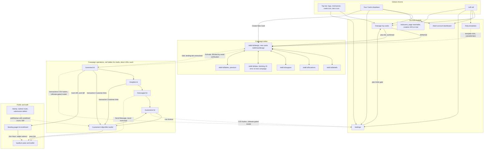

Note on the last two CSV edges: the modal's "Upgrade my Account" button leads toward plan upgrade (Settings billing); the export itself never fires on this trial. The /stamp edge is drawn to the profile only to show the verified workaround for the same operation; there is no UI navigation between /stamp and the profile.

### 5.3 API call heatmap

Unique Loopy API calls per page (deep-pass measurement):

| Page | Unique calls | Endpoints |
|---|---|---|
| /overview/:id | 6 | /account, /campaigns, /campaign/id/:id, POST /events/analytics/transactions/:id, GET /events/analytics/all/:id, GET /events/pushHistory/:id |
| /insights/:id | 6 | /account, /campaigns, /campaign/id/:id, POST /events/analytics/transactions/:id, GET /events/analytics/all/:id, GET /events/analytics/stampTotals/:id (plus PATCH /campaign/:id on Submit) |
| /messages/:id | 5 | /account, /campaigns, /campaign/id/:id, POST /card/cid/:id?count=true, GET /events/pushHistory/:id |
| /customers/:id | 4 | /account, /campaigns, /campaign/id/:id, POST /card/cid/:id?count=false |
| /customers/:id/profile/:cardId | 4 | /account, /campaigns, /campaign/id/:id, GET /card/:cardId?includeEvents=true |
| /settings | 4 plus tab-specific | /account, /campaigns, /locations, /beacons; Invoices tab adds GET /invoices; writes add PATCH /account, POST /location, POST /beacon, GET /beacons/uuid/:value |
| /edit/:id/locations | 4 | /account, /campaigns, /locations, /beacons |
| /subusers | 4 | /account, /campaigns, /subusers, /locations |
| /dash | 3 | /account, /campaigns, GET /events/dashboard?groupBy=day |
| /manage-my-cards | 3 | /account, /campaigns, /campaign/id/:id (plus GET /images strip rendering) |
| /edit/:id/design, details, support, data, labels | 2 each | /account, /campaigns (design adds /images/stampTemplates; existing campaigns add /campaign/id/:id) |
| /help | 2 | /account, /campaigns (plus /images/stampTemplates) |
| /landing-page/:id | 1 | GET /campaign/public/:id |
| /stamp | 0 on load | submit fires POST /card/cid/:cardId/addStamps/undefined (500) |

## 6. Setup and settings reference

### 6.1 Shape and reachability

All settings live on one page, `/settings`, rendered as vertically stacked sections. "My Account" and "Billing" are angular-ui tab groups whose inputs all sit in the DOM at once with one tab visible. There is no per-tab URL. Reachable from: top-bar Settings link, rail gear icon, trial banner Upgrade Now, dropdown Settings. Staff management (/subusers) and the setup wizard (/setup, /account) live on separate routes.

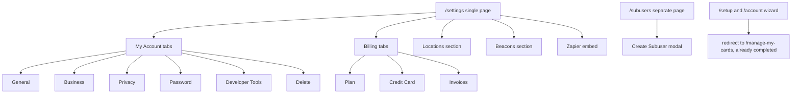

### 6.2 My Account tabs

General: `username` "Username (cannot be changed)" (disabled), `firstName` "First Name*", `lastName` "Last Name*", `email` "Email*". Update button fires `PATCH /account` with the full account object (payload field names in section 3.3), then `GET /account` refresh; 200 observed twice (edit plus revert, section 12.2). Affects the name shown in the app; the `business` block feeds the Business tab and billing address defaults.

Business: `businessName`*, `website`*, `addressLine1`*, `addressLine2`, `city`*, `stateProvinceRegion`, `zip`, Country* select (~250 countries). Same Update path; fields ride inside the `business` object. Feeds invoice and billing address prefill (`businessBilling` mirrors `business`).

Privacy: single `toggle` checkbox "Subscribed*" with marketing-consent copy (opt-out and deletion-request language). Update writes `subscribed` / `MailSubscriptions` via `PATCH /account`. Marketing consent only; no other UI consumes it. Not toggled this pass.

Password: `currentPassword` (Show/Hide toggle), `newPassword`, `confirmNewPassword`; validation list "8 characters minimum", "1 number". Not exercised (stop rule). Login credentials only.

Developer Tools: alert copy about the Stamper App for iOS and Android and the API for POS/CRM integration; "API Key" and "API Secret" disabled text inputs (values present in the DOM, not recorded); link to https://developer.loopyloyalty.com. Read-only display, no save. The key/secret pair authenticates external integrations (Zapier, Stamper App, custom POS/CRM).

Delete: exit-survey checkboxes (`technology` "Technology is hard to understand", `interest` "Customers not interested", `features` "Not enough features"), free-text "Other please specify", `password` confirmation, warning that "all of your personal information and customer data will be lost", Delete button (btn-danger). Viewed, never executed (stop rule). No second confirm dialog observed beyond the password field. Destroys the whole account.

### 6.3 Billing tabs

Plan: copy "Try out any plan. No commitment. Cancel anytime." Three plan cards, each with a Month-to-Month / Billed Annually combobox and a Subscribe button, plus a warning that clicking Subscribe outside a free trial immediately charges the card.

| Plan | Price (monthly as displayed) | Card designs | Locations | Beacons | Subusers | Feature list |
|---|---|---|---|---|---|---|
| Starter | US$25 | 1 | 1 | 1 | 3 | label text customisation, unique customer enrollments, data export |
| Growth | US$69 | 3 | 3 | 3 | 10 | same |
| Ultimate | US$95 | 10 | 10 | 10 | 50 | same |

All three prices and every stated limit were confirmed live by the verifier. Subscribe buttons never clicked (billing stop rule); the subscribe endpoint is UNVERIFIED. Stripe assets load with the page (js.stripe.com, api.hcaptcha.com, merchant-ui-api.stripe.com wallet-config), so checkout is Stripe-based. Note the inconsistency confirmed this pass: every plan card lists "Data Export", but the actual CSV export UI is gated to Ultimate (section 7.5).

Credit Card: Stripe Elements iframe (card number, MM/YY, CVC, Link autofill) plus own fields `addressLine1`*, `addressLine2`, `city`*, `stateProvinceRegion`, `zip`, Country* (~250 options), `phone` "Mobile Number" (country-code combobox plus masked textbox, helper text about subscription issue notifications), `taxId` "Tax ID" (shown on invoices). "Update Payment Details" not exercised (payment stop rule).

Invoices: empty state "You have no invoices."; data source `GET /invoices` 200 fired when the tab is shown. `/invoice/:invoiceId` route-only.

### 6.4 Locations section

Copy: "Display lock screen messages when customers are near your location(s)." Table columns: Location (links to maps.google.com/?q=lat,lon), Display Address, actions (pencil edit, trash delete; neither exercised beyond opening and cancelling the edit modal). "Add Location" button opens a large modal: `Location Name`; `Search for location by address` (Google Maps geocode search with map, Pegman/Street View, satellite); "Advanced" disclosure with `Latitude`/`Longitude` spinbuttons prefilled from the map centre; `Address to display`. Footer: Create Location / Cancel.

Create API `POST /location`, captured payload fields: `{name, lat, lon, address, alt, addressOnCard, message, isAppleWalletEnabled, isAndroidPayEnabled}`. Observed outcomes: 201 (seed run) and 400 `{"error":"Location limit reached. Would you like to {{upgradeLink}} your account to enable more locations?"}` (settings run; placeholder rendered raw, no record created). List entity fields: `id, uid, name, lat, lon, address, addressOnCard, showAddressOnCard, object:"location"`. Edit modal mirrors create and warns that "changes made to this location will be updated on all of your card designs that use this location."

Affects: the card editor Locations tab pickers, lock-screen messages on customer passes near the location, and the subuser Location dropdown.

Seeded record quirk: searching "221B Baker Street, London" geocoded to coordinates 22.287614, 114.148313 (Hong Kong), and that is what the record stores. A Google Maps geocoding quality issue for this query, recorded for completeness.

### 6.5 Beacons section

Copy: "Display lock screen messages when your customers are in proximity to your bluetooth beacon(s). Learn more." Table columns: Name, UUID, Major, Minor, actions (pencil, trash). "Add Beacon" modal fields: `name` "Name of Beacon", `uuid` "UUID", `major` spinbutton, `minor` spinbutton; validation "Please enter a valid uuid." (an all-zero UUID is rejected) and "Please enter a minor.".

Submit behavior (observed twice): the UI first runs a uniqueness check `GET /beacons/uuid/:value`, but sends the beacon NAME as the value (captured: `/beacons/uuid/COUNCIL-TEST%20Beacon%202`), a bug. The UUID field is then silently replaced with a client-generated UUID before `POST /beacon` (payload `{name, uuid, major, minor}`). Outcomes: 201 Created (cartographer, 11:07, record COUNCIL TEST Beacon with generated UUID F7826DA6-4FA2-4E98-8024-BC5B71E0893E, major 1, minor 1, followed by a `GET /beacons` refresh) and 400 `{"error":"Beacon limit reached. Would you like to {{upgradeLink}} your account to enable more beacons?"}` (second attempt, no record).

Affects: beacon-triggered lock-screen messages on customer passes (the `message` field shared with locations).

### 6.6 Zapier section

Embedded Zapier widget: `GET api.zapier.com/elements/zap-templates/?...&service_slugs=Loopy-Loyalty` and `GET /elements/apps/Loopy-Loyalty/` (each observed 4x, a chattiness note). Three featured workflows render twice in the DOM (confirmed rendering bug): "Add new Loopy Loyalty customers to a Mailchimp list" (template 19506), "Save Loopy Loyalty customer enrollments as Google Sheets rows" (19501), "Log new Loopy Loyalty stamps to a Google Sheets spreadsheet" (19502). Outbound links only (zapier.com create-zap web intents, "Learn more about Zapier"); no in-app state.

### 6.7 Setup wizard

`/setup` and `/account` both redirect to `/manage-my-cards`: the onboarding states are complete for this account. Caveat: `GET /account` still reports `status:"setup"` and the email is unverified, so the redirect is driven by something else (email or campaign setup progress). Exact condition UNVERIFIED.

### 6.8 Setting to affected features

```mermaid
flowchart TD
  PLN["Plan limits Starter Growth Ultimate"] --> CARDS["card designs count"]
  PLN --> LOCN["locations count"]
  PLN --> BCON["beacons count"]
  PLN --> SUBC["subusers count and trial block"]
  PLN --> EXP["CSV export, Ultimate in practice"]
  GEN["General profile PATCH /account"] --> INV["business block feeds billing address and invoices"]
  CC["Credit Card tab"] --> SUBSCR["plan subscription charging"]
  TAX["Tax ID field"] --> INV2["tax id printed on invoices"]
  LOC["Location records"] --> EDITLOC["card editor Locations tab pickers"]
  LOC --> LSM["lock-screen message near location on passes"]
  LOC --> SUBLOC["subuser Location dropdown"]
  BCR["Beacon records"] --> BSM["lock-screen message near beacon on passes"]
  DT["Developer Tools API key and secret"] --> API["POS and CRM plus Zapier plus Stamper App auth"]
  PRIV["Privacy consent"] --> MKT["marketing consent only"]
  DEL["Delete tab"] --> DEST["destroys account and all customer data"]
  PW["Password tab"] --> LOGIN["account login"]
  SETUP["/setup wizard completed"] --> HOME["redirects to /manage-my-cards"]
```

In words: plan choice gates the counts of card designs, locations, beacons, and subusers, and in practice gates CSV export to Ultimate. The General and Business tabs feed billing addresses and invoices. Locations feed three consumers (editor pickers, pass lock-screen messages, the subuser location dropdown). Beacons feed pass lock-screen messages. Developer Tools credentials authenticate every external integration. Privacy consent affects marketing only. Password and Delete affect login and account existence respectively.

### 6.9 Settings-area defects

- "[ll2 Error] Cannot set property isOpen of [object Object] which has only a getter": toast on /settings load. Non-blocking; every section stayed interactive (verifier ruling 8).
- Raw `{{upgradeLink}}` i18n placeholder in card, location, and beacon limit error payloads.
- Beacon uniqueness check queries `GET /beacons/uuid/:value` with the beacon NAME instead of the UUID.
- Beacon UUID silently auto-generated at submit, overwriting the user's typed value.
- Zapier gallery rendered twice; Zapier template and app endpoints each fetched 4x.

## 7. Analytics reference

### 7.1 Catalogue

Loopy Loyalty has no report library, no saved views, no favourites, no scheduled email reports, no report builder, and no date-range, location, or staff filters anywhere in analytics. The only filters that exist are time grouping and per-table server-side search. The full surface:

| # | View | Category | Route | Gated | Export |
|---|---|---|---|---|---|
| 1 | Dashboard (Total statistics, Acquisition, Rewards Overview) | Account-level stats | /dash | No | None |
| 2 | Overview (per campaign) | Campaign health | /overview/:campaignId | Rail entry hidden for drafts; route open | CSV button, Ultimate-gated modal |
| 3 | Insights (per campaign) | ROI / finance | /insights/:campaignId | Rail entry hidden for drafts; route open | None |
| 4 | Customers (per campaign) | Customer list | /customers/:campaignId | Route open | CSV button, Ultimate-gated modal |
| 5 | Customer profile (drill-down) | Single-customer history | /customers/:campaignId/profile/:cardId | Reachable from tables | None |
| 6 | Push Message History (table on Overview and Messages) | Messaging log | /overview/:campaignId, /messages/:campaignId | Same as Overview | None |

### 7.2 Metrics, filters, and grouping per view

| View | Metrics | Grouping options | Filters | Refresh controls |
|---|---|---|---|---|
| /dash | Customers Enrolled, Stamps Issued, Rewards Issued, Rewards Redeemed; Acquisition trend; Rewards Overview | Day / Month / Year | none | icon button with no observed network effect (UNVERIFIED) |
| /overview/:id | Customers Signed Up, Stamps Issued, Rewards Issued, Rewards Redeemed; Latest Transactions; Push Message History | none on KPIs | table search only | none |
| /insights/:id | Revenue driven vs reward cost (claimed vs outstanding); All time stats (same four KPIs); Activity chart; Stamp Count Histogram; Transactions | Day / Month only (no Year) | table search only | refresh icon buttons on stats and histogram |
| /customers/:id | Per-customer Stamps Earned, Rewards Earned, Rewards Redeemed, Card Status, Signup Date | none | table search only | none |
| profile | Per-customer totals, last event timestamps, transaction history | none | table search only | none |
| push history | Date, Message, Segment, Reach | none | none | none |

Notable asymmetries: /dash offers Year grouping while /insights does not; /dash reads a dedicated account-level endpoint while the campaign views read campaign-scoped ones; no view exposes a date-range picker; no view can filter by location or by staff member even though events carry `location_name` and `username`.

### 7.3 Table protocol

Transactions and customer tables use the DataTables server-side protocol. Request body (transactions): `{"draw":1,"start":0,"length":10,"search":"","order":{"column":"created","dir":"desc"}}`; the customers list wraps the same object under a `dt` key and the URL carries `?count=false` (list) or `?count=true` (count only, used by Messages). Response: `{"draw":1,"recordsTotal":8,"recordsFiltered":8,"data":[...]}`. Search, sort, and pagination are all server-side.

### 7.4 Data lineage

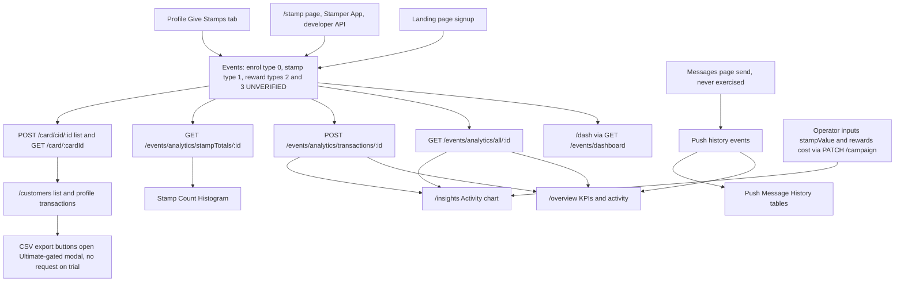

Lineage in words:

- "Customers Enrolled / Signed Up" comes from enrol events (type 0, created at landing-page signup) whose fields come from `campaign.fieldsToCollect`.
- "Stamps Issued" comes from stamp events carrying quantity, location_name, s_lat/s_lon, and username (the acting account or subuser). Sources: the profile Give Stamps tab (verified), /stamp (defective), the Stamper App, or the developer API (both unexercised).
- "Rewards Issued / Redeemed" would come from reward events when stamping completes a card and redemption happens at the POS. Never observed; UNVERIFIED.
- Acquisition chart: `GET /events/dashboard?groupBy=day|month|year`, account-wide period-keyed counts (observed key: `enrol`).
- Insights revenue and cost: operator-entered `campaign.stampValue` and `campaign.rewards[].cost` (written by `PATCH /campaign/:id`) multiplied against event counts; "claimed vs outstanding" derives from reward issue/redeem events.
- Stamp Count Histogram: `GET /events/analytics/stampTotals/:id` returning [stampCount, customerCount] pairs.
- Transactions tables: `POST /events/analytics/transactions/:id` (DataTables protocol).
- Customers list: `POST /card/cid/:campaignId?count=false`.
- Push history: `GET /events/pushHistory/:campaignId`, fed by messages sent on /messages/:campaignId.
- CSV export: no data path observed on this trial (gated modal, zero requests).

### 7.5 Export surface (CSV gating)

Exactly two export controls exist in the whole product surface: the icon button above the Customers heading and the small icon button next to Latest Transactions on Overview. Both open the same "Premium Feature" modal: "Unlock CSV Exports - available with the Ultimate plan", links to two docs pages (export-data-in-csv-format, how-to-try-out-premium-features-during-your-free-trial), and buttons "Upgrade my Account" / Cancel. No export request fires on this trial, so `/csv-verify/:file` was never reached and stays route-only. An earlier member observation of a client-side export (`ng-click="vm.exportCsv()"` producing a download with zero API calls) was ruled WRONG/PARTIAL by the verifier against the newer live evidence: treat client-side generation as not observed in the current pass. Every Settings plan card lists "Data Export" as included, while the working export UI demands Ultimate; that inconsistency is confirmed from live text on both screens. Export via the developer API is UNVERIFIED.

### 7.6 Analytics gating and permissions

The campaign rail hides Overview/Insights/Messages/Customers while the selected card is a draft, but all routes load by direct URL with zero data restrictions: the draft campaign served real seeded rows (8 customers, 2 stamps) to every analytics view. Gating is navigational, not a data-permission boundary. No plan gating was observed on any analytics view on this trial (the only plan-gated analytics feature is CSV export). No role or staff-member filter exists anywhere despite events carrying the acting username.

## 8. Create and edit flows

One sequence diagram per flow, then validation rules and the propagation matrix. Flows marked "not exercised" were stopped by safety rules or by plan limits; their unexercised legs stay UNVERIFIED.

### 8.1 Create a card

Steps: "+" on /manage-my-cards (or dropdown Create New Card) opens `/edit/new/design` with template defaults; configure Design (type, icon 87x87, logo 480x150, stamp count 1 to 30 default 10, stamped/un-stamped images, colors); Details (copy, reward, expiry, useful links); then Locations, Support, Data, Custom tabs; Save opens the "Save Card Design" dialog with a required Name field and the note "This name is for internal use only. Note: this cannot be changed after you save your card."; Save Card submits.

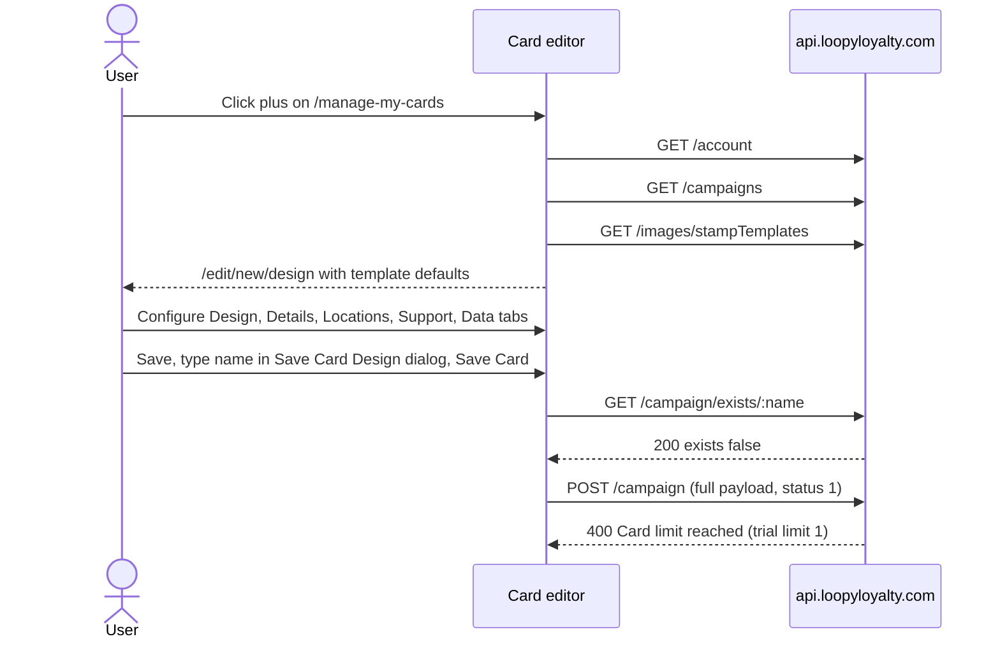

Outcome on this account: BLOCKED by the plan limit. `POST /campaign` returned 400 `{"error":"Card limit reached. Would you like to {{upgradeLink}} your account to enable more card designs?"}` (raw placeholder in the payload). The full create payload was captured and its field list appears in section 3.3 (Campaign). A successful create response was never observed (UNVERIFIED). The seed run's earlier template-based attempt failed silently with no POST at all; the blank editor requires an icon upload before saving.

### 8.2 Edit a card

Steps: MANAGE on a tile opens `/edit/:id/design` prefilled (fetches `GET /campaign/id/:id` and `GET /images/stampTemplates`); edit any tab; Save persists silently for existing cards (no name dialog; the dialog is new-cards-only); Save & Preview generates a preview; Activate (saved campaigns only) flips status 1 to 2.

Observed attempt: changed stamp count 10 to 8 on the Design tab, clicked Save, got the validation toast "Please make sure to fill out the required fields in the form correctly." and no request was made. AngularJS validation blocked the save; nothing persisted. The endpoint that persists editor tab edits was therefore never captured (UNVERIFIED); the only confirmed campaign write is Insights' `PATCH /campaign/:campaignId`. Activate was never pressed (blocked by unverified email; UNVERIFIED).

### 8.3 Create a location and a beacon (Settings)

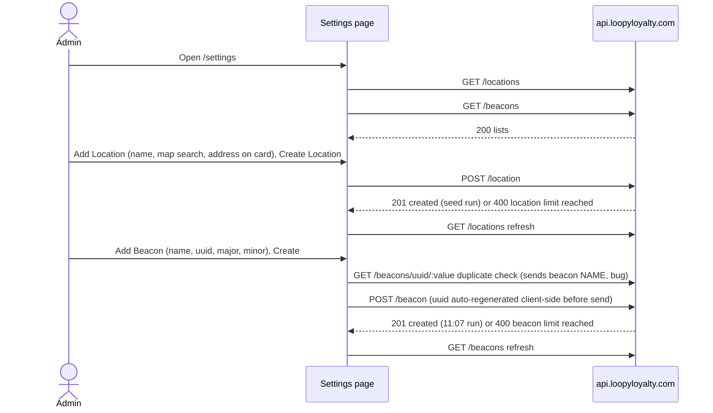

Both creates succeeded once each (records in section 12) and were limit-rejected on second attempts, which documents both the happy path and the plan gate. Edit modals for both entities mirror the create fields; the location edit warns that changes propagate to all card designs using the location. Delete icons exist on both tables; never exercised.

### 8.4 Customer enrollment (landing page)

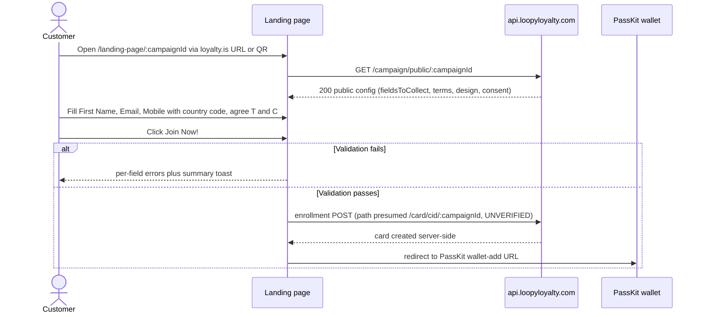

Confirmed working: 8 cards created this pass (Alice through Helen, ids in section 12). Phone input required native sequential keystrokes; JavaScript value setting does not trigger AngularJS ng-model binding, which is why one later attempt (Iris) never fired a POST and created nothing. Card ids were recovered by base64-decoding the PassKit redirect URLs.

### 8.5 Give stamps

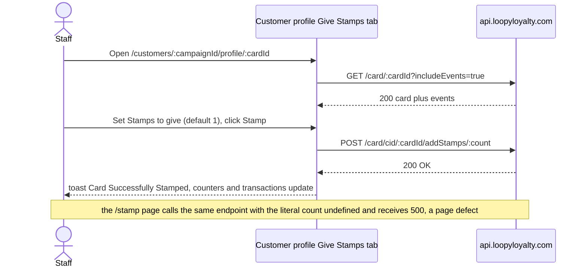

Two stamps exist this way (Alice logged at creation, Helen reconciled at synthesis; section 12). The count is a path parameter, not a query or body field. The /stamp page's 43 failed attempts all hit `addStamps/undefined` with 500; do not read that as proof the endpoint fails on drafts, since the profile flow succeeded on the same draft campaign.

### 8.6 Edit Insights economics

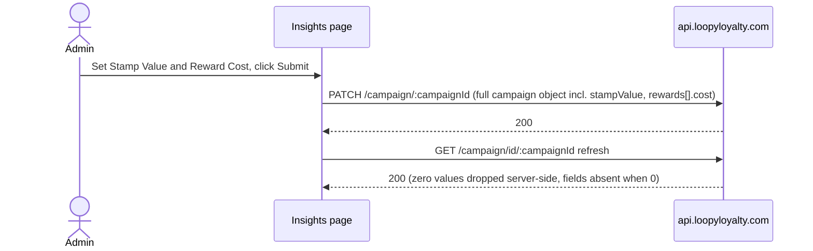

Exercised and reverted (1.23 / 2.34, then back to 0). The currency selector writes `campaign.currency` through the same path.

### 8.7 Edit account profile

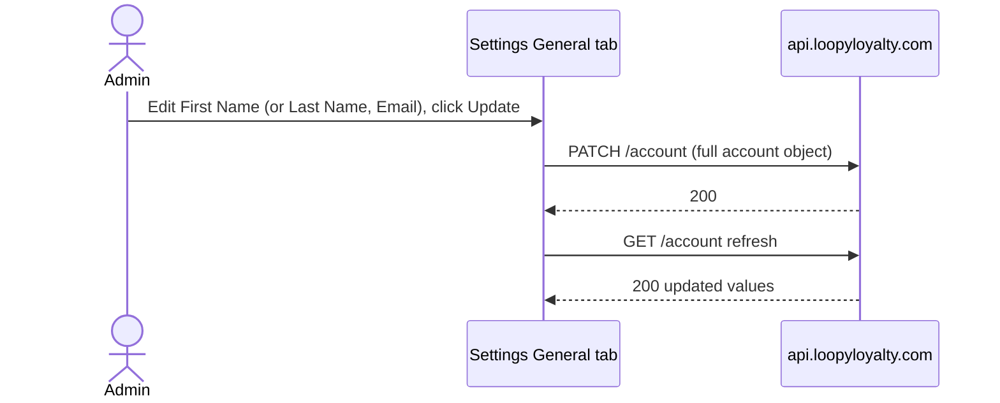

Exercised and reverted (firstName to "COUNCIL-TEST" and back to the original; both PATCHes 200; the captured payload diff was the single field).

### 8.8 Create a subuser (blocked on trial)

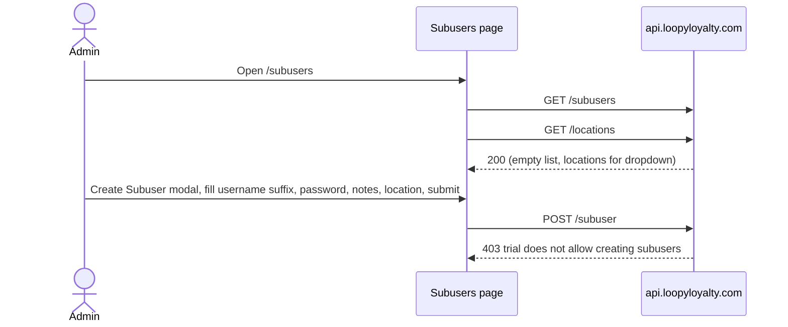

No record created, no invite sent. The modal itself opens without a premium block; the gate is server-side.

### 8.9 Send a message (never exercised)

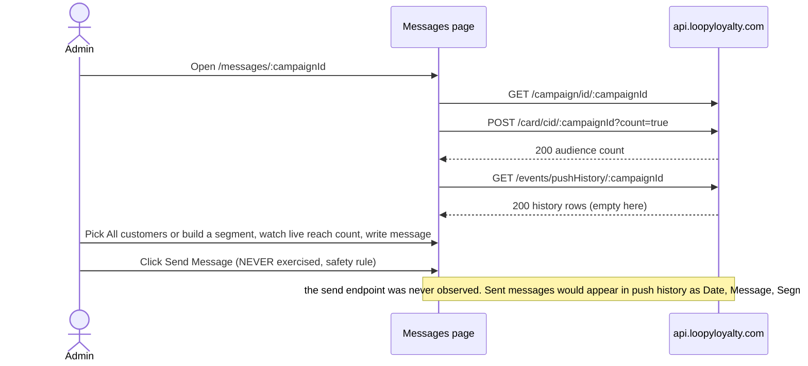

There is no draft or schedule capability: Send Message is the only button, on both the campaign Messages page and the profile's single-customer Send Messages tab.

### 8.10 Validation rules master table

| Form | Field | Rule | Message |
|---|---|---|---|
| Save Card dialog (new cards) | Name | required, non-empty, correct format (dashes rejected in one seed attempt) | "Please provide the card name in the correct format." |
| Card editor Save | required fields and images | all required fields filled | "Please make sure to fill out the required fields in the form correctly." |
| Details tab | Stamp success message | must contain `{#}` | "You must include {#} in your stamp success message." |
| Landing page | First Name | required | "This field cannot be empty" |
| Landing page | Email Address | required, valid email | "Please enter a valid email address (e.g. yourname@example.com)" |
| Landing page | Mobile Number | required, valid phone for selected country | "Please enter a valid telephone number" |
| Landing page | T&C checkbox | required | "You must agree to our terms and conditions to proceed." |
| Landing page | whole form | all fields valid | "The form is not valid. Please fill in the required fields and/or adjust the incorrect fields and try again." |
| Add Beacon | UUID | valid UUID, not all-zero | "Please enter a valid uuid." |
| Add Beacon | Minor | required | "Please enter a minor." |
| Create Subuser | Username | required | "Please enter a value for this field." |
| Create Subuser | Password | min 6 characters | "Please enter a password of at least 6 characters." |
| Create Subuser | whole form | valid | "Form is invalid" toast |
| Settings Password | New Password | 8 characters minimum, 1 number | inline validation list |

### 8.11 Propagation matrix

Where each record type shows up, verified with the two live stamp records (current state: 2 stamps, Alice and Helen):

| Record | /manage-my-cards | /dash | /customers/:id | profile | /overview/:id | /insights/:id | /messages/:id | /settings |
|---|---|---|---|---|---|---|---|---|
| Campaign | tile with DRAFT badge | aggregate stats | header context | header context | KPIs | KPIs and ROI | header context | plan limits apply |
| Customer (card) | none | enrollment count | table row | full profile | signup transaction rows | signup rows, histogram | audience count | none |
| Stamp | none | Stamps Issued total (2) | Stamps Earned column (Alice 1, Helen 1, rest 0) | Stamps Earned, last stamp time, transaction row | Stamps Issued KPI (2) plus stamp transaction rows | Stamps Issued (2), histogram input | none | none |
| Reward | none | issued/redeemed totals (0/0) | rewards columns (0) | rewards counts (0) | rewards KPIs (0) | rewards KPIs and cost math | none | none |
| Location | none | none | none | none | none | none | none | table plus map |
| Beacon | none | none | none | none | none | none | none | table |
| Subuser | none | none | none | none | User column attribution (would-be) | same | none | none (separate /subusers page) |
| Message | none | none | none | single-customer composer | push history table | none | composer plus history | none |

Verifier propagation audit: Helen's stamp is CONFIRMED across profile, customer list, overview transactions, and account totals. Alice's stamp is PARTIAL (confirmed by prior member evidence; individual attribution not re-opened in the verifier run, though the totals reconcile at 2). Enrollment propagation CONFIRMED (8 everywhere). Redemption NOT CREATED / NOT EXERCISABLE (threshold never reached).

## 9. Lifecycles

Confirmed legs come from live observation; everything else is explicitly UNVERIFIED per the gate ruling that lifecycle transitions must not be presented as confirmed behavior when they were never observed.

### 9.1 Campaign (loyalty program)

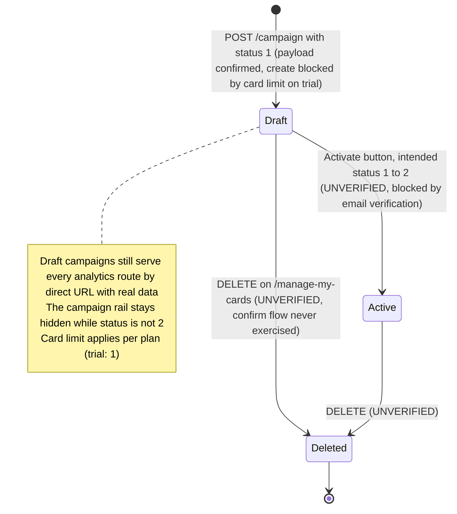

Created by: `POST /campaign` (full payload captured) or template selection on /help (UNVERIFIED). Configured by: the six editor tabs. Displayed on: card tiles, dropdown, in-view selector, landing page, wallet pass. Reported on: Overview, Insights, /dash. Activation requires a verified email; the account's email was never verified, so the Draft to Active leg was never crossed.

### 9.2 Customer card (pass)

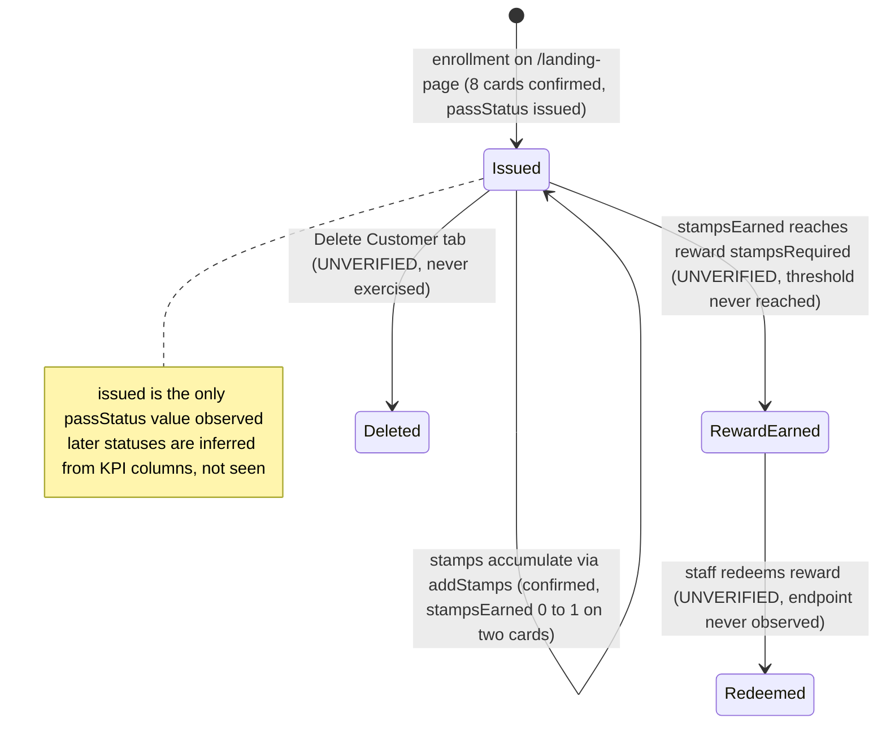

Created by: landing-page enrollment (confirmed). Displayed on: customers table, profile, wallet pass preview. Modified by: stamp events (confirmed), inline personal-info edit (affordance confirmed, submission not exercised), redemption (UNVERIFIED). Reported on: every analytics view. Deleted by: profile Delete Customer tab (never exercised).

### 9.3 Reward

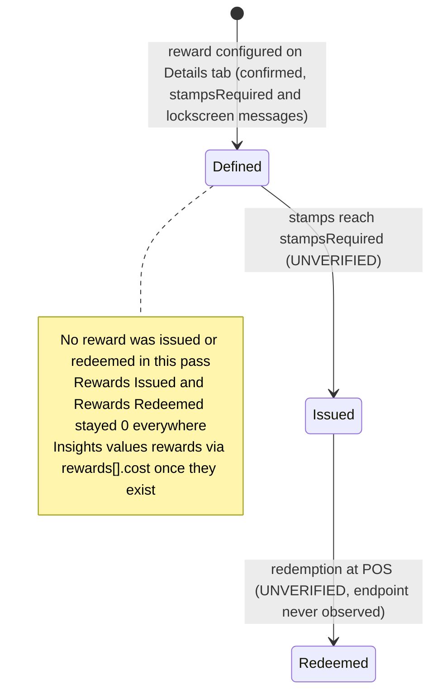

The reward threshold for the test campaign is `stampsRequired: 10` (strip totalStamps also 10, while the reward copy text mentions 8 stamps; the baseline tile preview showed 8 and the profile pass preview showed 10, a quirk of this test campaign's configuration). With a maximum of 1 stamp on any card, no reward logic could fire. The redemption endpoint and the stamp-counter reset behavior after redemption are unknown.

### 9.4 Event types

| type | Meaning | Evidence |
|---|---|---|
| 0 | Enrollment ("Signed up" in the UI) | CONFIRMED: 8 signup rows in transactions |
| 1 | Stamp | CONFIRMED: 2 stamp-earned rows |
| 2 | Reward issued (inferred) | UNVERIFIED, never observed |
| 3 | Reward redeemed (inferred) | UNVERIFIED, never observed |

## 10. API endpoint catalogue

Every row below was captured in a network trace during this pass or the seed run, with the statuses shown. Paths are normalized; ids are parameters. No tokens or personal values are included.

| # | Method | Path | Status observed | Purpose | Called from | Key request params | Key response fields |
|---|---|---|---|---|---|---|---|
| 1 | GET | /account | 200 | account object, doubles as session check | every authenticated page, 2-3x per load | none | id, username, email, firstName, lastName, plan, status, limit, expiry, trialDuration, subscribed, business, businessBilling, stripeInformation, discounts, secret (name only) |
| 2 | PATCH | /account | 200 | save profile/business/privacy | /settings General, Business, Privacy | full account object | updated account |
| 3 | GET | /campaigns | 200 | list campaigns | nearly every page | none | _offset, total_rows, rows[].value{id, name, design, status, createTime, updateTime, customFrontFields} (CouchDB style) |
| 4 | GET | /campaign/id/:campaignId | 200 | single campaign detail | overview, insights, messages, customers, profile, editor | path id | full Campaign object (section 3.3); zero-valued stampValue/rewards[].cost absent |
| 5 | GET | /campaign/public/:campaignId | 200 (no auth) | landing page config | /landing-page/:id | path id | public subset: business, description, design, fieldsToCollect, terms, consent fields, labels, rewards, unique*FieldName, defaultCountryCode |
| 6 | GET | /campaign/exists/:name | 200 | name availability on save | Save Card dialog | URL-encoded name | {"exists":bool} |
| 7 | POST | /campaign | 400 (limit); success never observed | create campaign | editor save (new card) | full campaign payload, status 1 | error string with raw upgradeLink placeholder |
| 8 | PATCH | /campaign/:campaignId | 200 | update campaign fields | /insights Submit | full campaign object with stampValue, rewards[].cost, currency | none captured |
| 9 | GET | /locations | 200 | list global locations | /settings, editor Locations tab, subuser modal | none | location objects (id, uid, name, lat, lon, address, addressOnCard, showAddressOnCard, object) |
| 10 | POST | /location | 201, 400 (limit) | create location | /settings Add Location | name, lat, lon, address, alt, addressOnCard, message, isAppleWalletEnabled, isAndroidPayEnabled | created record or limit error |
| 11 | GET | /beacons | 200 | list global beacons | /settings, editor Locations tab | none | beacon objects |
| 12 | GET | /beacons/uuid/:value | 200 | beacon duplicate check (called with the NAME, bug) | Add Beacon submit | name or uuid in path | availability |
| 13 | POST | /beacon | 201, 400 (limit) | create beacon (singular path) | /settings Add Beacon | name, uuid (client-regenerated), major, minor | created record or limit error |
| 14 | GET | /subusers | 200 | list subusers | /subusers | none | table rows (Profile, Username, Created, Notes, Location, Status) |
| 15 | POST | /subuser | 403 (trial) | create subuser (singular path) | Create Subuser modal | username, password, label, locationId, location object | trial-block error string |
| 16 | GET | /invoices | 200 | invoice list | /settings Invoices tab | none | empty on this account |
| 17 | GET | /events/dashboard | 200 | account-level analytics | /dash | ?groupBy=day or month (year unexercised) | {"enrol":{"period":count}} (stamp/reward keys UNVERIFIED) |
| 18 | GET | /events/analytics/all/:campaignId | 200 | campaign analytics | /overview (sends literal groupBy=undefined, bug), /insights (day, month) | ?groupBy= | period-keyed counts per event type |
| 19 | GET | /events/analytics/stampTotals/:campaignId | 200 | stamp distribution | /insights histogram | path id | {"stampTotals":[[stampCount, customerCount]]} |
| 20 | POST | /events/analytics/transactions/:campaignId | 200 | transaction list (DataTables) | /overview, /insights | draw, start, length, search, order | draw, recordsTotal, recordsFiltered, data[] (Event fields, section 3.3) |
| 21 | GET | /events/pushHistory/:campaignId | 200 | push message history | /overview, /messages | path id | {"events":[]} (row fields UNVERIFIED, history empty) |
| 22 | POST | /card/cid/:campaignId | 200 | customer list (?count=false) or audience count (?count=true) | /customers, /messages | DataTables body (under "dt" for the list) | card rows or count |
| 23 | GET | /card/:cardId | 200 | single card with events | customer profile | ?includeEvents=true | {"card":{...},"events":[...]} (section 3.3) |
| 24 | POST | /card/cid/:cardId/addStamps/:count | 200 (real count), 500 (literal undefined from /stamp) | issue stamps | profile Give Stamps (works), /stamp (defect) | count as path parameter | success toast; event recorded |
| 25 | GET | /images/stampTemplates | 200 | stamp image presets | /help, editor Design tab | none | template image list |
| 26 | GET | /images | 200 | server-side stamp strip rendering | /dash, /manage-my-cards previews | ?json={baseStripImage params} | PNG/SVG image |

Endpoints implied but never observed (all UNVERIFIED): the message send endpoint (Send Message blocked by safety rule), any CSV export endpoint (gated modal fires nothing), the plan subscribe endpoint (Stripe-based, never clicked), Update Payment Details, password change, account delete, campaign delete, reward redemption, the editor tab-edit save call, and the enrollment POST's exact path (presumed `POST /card/cid/:campaignId`).

Style notes: REST/JSON only, no GraphQL anywhere; no API version prefix; mixed response conventions (plain JSON, CouchDB-style on /campaigns, DataTables on the two POST list endpoints); singular POST paths for creates (/location, /beacon, /subuser) against plural GET paths (/locations, /beacons, /subusers).

## 11. First-survey misses and remaining unknowns

### 11.1 Items the first survey missed or left open, and how they were resolved

| Item (first-survey reference) | Old status | Resolution this pass |
|---|---|---|
| Create New Card destination (§7E of FINAL_REPORT) | UNRESOLVED conflict | Controlled click: "+" goes to /edit/new/design. CONFIRMED |
| Beacons endpoint (§7D) | UNVERIFIED, misspelled /becons in links.md | GET /beacons, GET /beacons/uuid/:value, POST /beacon 201 all captured. CONFIRMED |
| CSV export flow and /csv-verify/:file | orphan, invisible | Export buttons found on /customers and /overview; both open the Ultimate-gated Premium modal; no request fires; /csv-verify/:file still route-only. FOUND and characterized |
| Customer profile route | route-only | Fully documented live for all 8 seeded cards. CONFIRMED |
| Stamping end to end | UNVERIFIED (only the /stamp 500 was known) | Profile Give Stamps works (200); the /stamp 500 is a page defect (undefined count), not an API limit. CONFIRMED |
| Customer enrollment submission | UNVERIFIED | 8 enrollments completed through the landing page. CONFIRMED |
| Editor Data tab error | seen once by the first verifier | Reproducible blocking overlay on every load for this campaign; distinguished from the non-blocking /settings toast. CONFIRMED persistent |
| Subusers reachability | disputed | Page fully reachable; creation trial-blocked server-side with 403. CONFIRMED |
| Insights page depth | three features recorded | Revenue inputs with PATCH write path, currency selector, Day/Month activity grouping, stamp histogram, transactions table. Documented |
| /dash endpoint | recorded as /events/analytics/all | Corrected to /events/dashboard?groupBy=. CONFIRMED |
| Messages segment builder | "a segment" noted | Metric/operator/value controls with live reach count. Documented |
| Overview groupBy bug | unknown | Literal groupBy=undefined sent by the page. New finding |
| Share URL value | loyalty.is/<id> recorded | Draft renders bare loyalty.is/; activated format UNVERIFIED. Corrected with caveat |

### 11.2 Remaining unknowns

- Campaign activation and everything behind it: the Activate transition, rail enablement on a live campaign, whether the share URL gains its campaign suffix, whether /stamp works on activated campaigns, and any live-only messaging or segment behavior. Blocked by the unverified account email; never attempted.
- Redemption: threshold never reached, no redemption endpoint observed, counter-reset behavior unknown, event types 2 and 3 unconfirmed.
- Destructive flows: card DELETE confirm, Delete Customer, account Delete (viewed, never submitted).
- Billing: subscribe endpoint, payment update, invoice rendering, /invoice/:invoiceId.
- Route-only pages: /subuser/:subuserId, /csv-verify/:file, auth and onboarding routes, /verify/:code, /renew-subscription, /404.
- Multi Reward card type (radio observed, never selected and saved); template-click creation on /help; the editor tab-edit save endpoint.
- Mobile number masking: whether the product masks phone values in UI or API (conflicting observations, section 1.5).
- Push history row fields (table always empty here); /events/dashboard response keys for stamp and reward events; Year grouping response shape.
- The editor "Edit" rail item's landing tab (/edit/:id/labels vs last-visited tab; two member accounts disagree).
- Location/beacon assignment persistence from the editor Locations tab into passes.
- Anything requiring a real wallet: pass delivery, lock-screen messages from locations and beacons, push notification rendering.

## 12. Test records and cleanup

Canonical audit log: `/Users/fahad/council/output/technical/test-records.md` (append-only), including the chair's reconciliation entry for Helen's stamp appended during synthesis as the gate required.

### 12.1 Durable records (created and not reverted)

| Record | Identifier | Created by | Where it lives | Notes |
|---|---|---|---|---|
| Campaign "COUNCIL TEST" | wI4XeFr6rHCTUHGOEFazZ | cartographer (first-survey run) | /manage-my-cards tile, /edit/wI4XeFr6rHCTUHGOEFazZ/design | Draft (status 1), never activated. Config quirk: stampsRequired 10 and strip totalStamps 10, reward copy mentions 8 stamps |
| Location "COUNCIL TEST Location" | id not captured | linker (seed run) | /settings Locations table | "221B Baker St, London NW1 6XE", geocoded to 22.287614, 114.148313 (Hong Kong). POST /location 201 |
| Beacon "COUNCIL TEST Beacon" | UUID F7826DA6-4FA2-4E98-8024-BC5B71E0893E, major 1, minor 1 | cartographer 2026-10-17 11:07 | /settings Beacons table | POST /beacon 201; UUID was client-generated at submit |
| 8 customers "COUNCIL TEST Alice..Helen" | cards xZuG0J01d5TGR2 (Alice), LtUUN2mxP5cDdg (Bob), eiVH1t0LE058Li (Charlie), OkossS0uRwTfPF (Diana), ioPyLW887pmNQT (Edward), lYWxtjodR51CUv (Fiona), Kr54wYnVCU7mNM (George), RTgLMCuFyOvpMH (Helen) | linker (seed run) via /landing-page/wI4XeFr6rHCTUHGOEFazZ | /customers/wI4XeFr6rHCTUHGOEFazZ and per-card profiles | Emails council-test+name@example.com; all passStatus "issued", signup 2026-10-17 |
| Stamp event: Alice +1 | POST /card/cid/xZuG0J01d5TGR2/addStamps/1, 200 | cartographer 2026-10-17 11:06 | Alice's profile, transactions, all analytics totals | Logged at creation |
| Stamp event: Helen +1 | not captured at creation | unattributed council member, ~10:59 per profile timestamp | Helen's profile (1 stamp, two events), customers list, overview transactions, /dash and /insights totals (2) | Missing from the log at creation; reconciled by chair append during synthesis per the verifier gate |

### 12.2 Changes made and reverted (both API-verified)

| Change | Where | Revert evidence |
|---|---|---|
| Account firstName set to "COUNCIL-TEST" | /settings General, PATCH /account 200 | Set back to the original value, second PATCH /account 200, field value verified post-revert; payload diff was the single field |
| Insights Stamp Value 1.23 and Reward Cost 2.34 | /insights Submit, PATCH /campaign/:id | Both reset to 0 and submitted; GET /campaign/id/:id afterwards carries neither field (zeros dropped server-side); UI shows 0/empty, currency USD. Screenshot reports-verify-insights.png |

### 12.3 Blocked attempts (no record created)

| Attempt | Outcome |
|---|---|
| Card "COUNCIL TEST Stamp Card 2" via /edit/new/design | GET /campaign/exists/:name 200 {"exists":false}, then POST /campaign 400 "Card limit reached" |
| Beacon "COUNCIL-TEST Beacon 2" (major 2, minor 2) | POST /beacon 400 "Beacon limit reached" |
| Location "COUNCIL-TEST Location 2" | POST /location 400 "Location limit reached" |
| Subuser "ibefehdi+council-test" | POST /subuser 403 trial-blocked; no invite sent |
| Subuser "council-test-stamper" (flows run) | AngularJS validation rejected JS-set values; no POST fired |
| Customer "COUNCIL TEST Iris" enrollment | same validation issue; no POST fired; not created |
| Card edit stamp count 10 to 8 | validation toast on Save; no request; not persisted |
| 43 stamp attempts via /stamp | POST .../addStamps/undefined 500 every time; no data created |
| Message sends (campaign-wide and single-customer) | never attempted per safety rules |
| Billing, password, delete, plan changes | never attempted per stop rules |

### 12.4 Cleanup checklist

Everything the council left in the live app, and how to remove it:

1. Campaign "COUNCIL TEST" (wI4XeFr6rHCTUHGOEFazZ): DELETE on /manage-my-cards. The confirm flow was never exercised, so its exact steps are unknown, and whether deleting the campaign cascades to the 8 enrolled cards and their events is UNVERIFIED. If it does not cascade, delete the customers from their profiles (Delete Customer tab) first.
2. The 8 customer cards (ids in 12.1): live under the campaign; removable via each profile's Delete Customer tab if the campaign delete does not cascade.
3. Location "COUNCIL TEST Location": trash icon on its row in /settings Locations.
4. Beacon "COUNCIL TEST Beacon": trash icon on its row in /settings Beacons.
5. The two stamp events: no delete UI was observed for transactions; they disappear only with their cards/campaign.
6. Alternative to all of the above: let the trial expire (expiryDate 2026-11-01). No billing instrument was ever attached, so nothing charges.
7. Account profile and Insights economics: already reverted and API-verified; nothing to do.
8. Local artifacts (council machine, safe to keep or archive): `/Users/fahad/council/output/technical/` (seven member reports, briefs, test-records.md, screenshots), `/Users/fahad/council/screenshots/` (reports-pass images and snapshots, console logs), `/Users/fahad/council/output/screenshots/` (baseline images), and this report.

## Appendix A: Evidence index

Baseline survey screenshots, `/Users/fahad/council/output/screenshots/`:

| Page | File |
|---|---|
| /manage-my-cards | manage-my-cards.png |
| Editor Design (existing and new) | edit-design.png, create-new-card-design.png |
| Editor Details / Locations / Support / Data / Custom | edit-details.png, edit-locations.png, edit-support.png, edit-data.png, edit-custom.png |
| /dash | dash.png |
| /overview/:id | overview.png |
| /insights/:id | insights.png |
| /messages/:id | messages.png |
| /customers/:id | customers.png |
| /subusers and its modal | subusers.png, subusers-create-modal.png |
| /settings and tabs | settings.png, settings-business.png, settings-privacy.png, settings-developer-tools.png, settings-delete.png, settings-credit-card.png, settings-invoices.png |
| /landing-page/:id | landing-page.png |
| /stamp | stamp.png |
| /help | help-templates.png |

Deep-pass screenshots, `/Users/fahad/council/output/technical/screenshots/`: customer-profile.png (profile drill-down), settings-beacons.png (Beacons section with the created record), settings-deep-general.png (General tab), subusers-deep.png (reachable /subusers page on trial).

Reports-pass captures, `/Users/fahad/council/screenshots/`: reports-deep-dash.png, reports-deep-overview.png, reports-deep-insights.png, reports-deep-customers.png, reports-deep-customer-profile.png, reports-verify-insights.png (post-revert verification). Accessibility/DOM snapshots: deep-dash.yml, reports-deep-insights2.yml, reports-deep-insights3.yml, reports-verify-insights.yml, page-2026-10-17T07-58-52-757Z.yml (customer profile), page-2026-10-17T07-59-00-528Z.yml (customers list), plus the full page-2026-10-17T*.yml and console-2026-10-17T*.log capture series from all runs.

Referenced but not on disk at synthesis time: messages-segment.png, messages-segment-full.png, insights-live.png (cited by gaps.md). The findings they supported (segment builder controls, live Insights state) were independently re-confirmed by the verifier's live checks of /messages and /insights.

Written sources: technical/architecture.md, flows.md, reports.md, gaps.md, settings.md, seed.md, test-records.md (with the chair reconciliation append), review.md (gate). Baseline: FINAL_REPORT.md, pages.md, pages.json, links.md, review.md. All Mermaid diagrams in this report were validated with `node /Users/fahad/council/check-mermaid.mjs`.
