# Loopy Loyalty Dashboard — Feature Link Map

Generated by: linker (council member t_e1d16065)
Date: 2026-10-17
Account: ibefehdi (trial, 15 days remaining)
Existing card: COUNCIL TEST - DRAFT (campaignId: wI4XeFr6rHCTUHGOEFazZ)

## Core Entities

### 1. Card / Campaign
The central entity. A loyalty card design with its configuration, analytics, and customer base.

Pages that touch this entity:
- `/manage-my-cards` — list all cards; MANAGE and DELETE actions
- `/dash` — aggregate insights across all cards
- `/edit/new/design` — create new card (wizard)
- `/edit/:campaignId/design` — edit card design (Type, Images, Stamps, Colors)
- `/edit/:campaignId/details` — edit card details (Business Name, Reward Details, How to Earn)
- `/edit/:campaignId/locations` — edit locations and beacons
- `/edit/:campaignId/data` — configure data collection fields
- `/edit/:campaignId/labels` — custom fields and card label text
- `/edit/:campaignId/support` — terms & conditions, card issuer details
- `/overview/:campaignId` — card stats, transactions, push history, card URL
- `/customers/:campaignId` — customer list for this card
- `/insights/:campaignId` — per-card analytics (revenue, activity, stamp histogram)
- `/messages/:campaignId` — push messages to card customers

### 2. Customer
A person who has installed/linked a loyalty card. Has a profile with stamps earned.

Pages:
- `/customers/:campaignId` — list of customers for a card
- `/customers/:campaignId/profile/:cardId` — individual customer profile (Angular state: container.customer-profile)
- `/overview/:campaignId` — shows latest customer transactions

### 3. Stamp
Earned by customers. Configured per-card (1-30 stamps).

Pages:
- `/edit/:campaignId/design` — stamp count selection (1-30), stamped/unstamped images, colors
- `/overview/:campaignId` — Stamps Issued metric
- `/insights/:campaignId` — Stamp Count Histogram
- `/dash` — aggregate Stamps Issued

### 4. Reward
Redeemed by customers after collecting required stamps.

Pages:
- `/edit/:campaignId/details` — Reward Details configuration
- `/overview/:campaignId` — Rewards Issued and Rewards Redeemed metrics
- `/insights/:campaignId` — Rewards Overview
- `/dash` — aggregate rewards stats

### 5. Location
Physical locations where the card can be used; triggers lock-screen messages.

Pages:
- `/edit/:campaignId/locations` — manage locations and beacons
- `/settings` — global locations management (under Settings > Locations heading)

### 6. Beacon
Bluetooth beacons for proximity-based lock-screen messages.

Pages:
- `/edit/:campaignId/locations` — beacon configuration under Locations tab
- `/settings` — global beacons (under Settings > Beacons heading)

### 7. Message
Push notifications sent to card customers.

Pages:
- `/messages/:campaignId` — compose and send messages, view push message history
- `/overview/:campaignId` — Push Message History table

### 8. Subuser
Team member with access to manage cards.

Pages:
- `/subusers` — subuser list and management
- `/subuser/:subuserId` — individual subuser profile (Angular state: container.subuser-profile)

### 9. Transaction
Customer activity record (stamp earned, reward redeemed, etc.).

Pages:
- `/overview/:campaignId` — Latest Transactions table (paginated, searchable)
- API: POST /events/analytics/transactions/:campaignId

### 10. Account / Settings
The authenticated user's account and business profile.

Pages:
- `/settings` — General, Business, Privacy, Password, Developer Tools, Delete tabs
- `/settings` — Billing section: Plan, Credit Card, Invoices tabs
- `/settings` — Locations, Beacons, Zapier sections

---

## Edge Table

| From Feature | To Feature | Link Type | Evidence |
|---|---|---|---|
| Dashboard (`/dash`) | Create New Card (`/edit/new/design`) | navigates-to | "Create New Card" button on dashboard; click navigates to card design editor |
| Dashboard (`/dash`) | Insights (aggregate) | navigates-to | Dashboard itself shows aggregate stats; Insights nav item links to `/dash` |
| Manage My Cards (`/manage-my-cards`) | Card Editor (`/edit/:id/design`) | navigates-to | MANAGE button on each card; click opens design tab of editor |
| Manage My Cards | Delete Card | navigates-to (action) | DELETE button on each card |
| Card Editor — Design tab | Details tab | navigates-to | Tab navigation: Design, Details, Locations, Support, Data, Custom |
| Card Editor — Design tab | Save Card | creates-data-for | Save button persists card; card then appears in manage-my-cards list |
| Card Editor — Design tab | Save & Preview | navigates-to | "Save & Preview" button |
| Card Editor — Design tab | Activate Card | depends-on/gated-by | Activate button only after card is saved/configured |
| Card Editor tabs | Overview | navigates-to | Top nav: Overview link visible when viewing a card |
| Card Editor tabs | Insights (per-card) | navigates-to | Top nav: Insights link per-card |
| Card Editor tabs | Messages | navigates-to | Top nav: Messages link per-card |
| Card Editor tabs | Customers | navigates-to | Top nav: Customers link per-card |
| Card Editor tabs | Edit (back to editor) | navigates-to | Top nav: Edit link returns to design tab |
| Design tab (Stamps config) | Overview (Stamps Issued) | creates-data-for | Stamp count configured in design; stamps issued appear in overview |
| Design tab (Colors/Images) | Customer Card View | shares-entity | Design changes affect the customer-facing digital card |
| Details tab (Reward config) | Overview (Rewards metrics) | creates-data-for | Reward details set here; reward issuance/redeem stats show in overview |
| Details tab (Business Name) | Customer Card View | shares-entity | Business name appears on customer-facing card |
| Locations tab | Settings > Locations | shares-entity | Card-level and account-level locations share same entity type |
| Locations tab | Beacons (per-card) | filters/scopes | Locations page has Beacons subsection |
| Data tab (Data Collection) | Customers | creates-data-for | Data fields configured here; collected data appears in customer profiles |
| Labels tab (Custom Fields) | Customer Card View | shares-entity | Custom fields appear on customer-facing cards |
| Support tab (Issuer Details) | Customer Card View | shares-entity | Support contact info appears on customer-facing cards |
| Overview (per-card) | Customers | shares-entity | Overview shows latest customer transactions |
| Overview | Messages | shares-entity | Overview shows Push Message History |
| Insights (per-card) | Overview | shares-entity | Both show card stats (Customers, Stamps, Rewards) |
| Messages | Customers | filters/scopes | Messages can be targeted to "All customers" or segments |
| Customers list | Customer Profile | navigates-to | Click customer row -> `/customers/:id/profile/:cardId` |
| Settings (General) | Settings (Business) | navigates-to | Tab navigation within /settings (Angular tabs, same URL) |
| Settings (Plan) | Settings (Credit Card) | depends-on/gated-by | Billing requires plan selection before credit card |
| Settings (Plan) | Settings (Invoices) | depends-on/gated-by | Invoices only relevant after subscription |
| Settings (Locations) | Card Editor > Locations | shares-entity | Global locations and per-card locations share entity |
| Settings (Beacons) | Card Editor > Locations > Beacons | shares-entity | Global beacons and per-card beacons share entity |
| Subusers | Subuser Profile | navigates-to | Click subuser row -> `/subuser/:subuserId` |
| Subusers | Premium Modal | depends-on/gated-by | Subusers page shows "Premium Feature" modal on trial accounts |
| Start (`/help`) | Create New Card | navigates-to | Choose a template -> creates card based on template |
| Start (`/help`) | Card templates | navigates-to | 8 templates: Cafe, Restaurant, Retail, Salon, Entertainment, Instructor, Service, Blank |
| Manage My Cards | Insights (nav item) | depends-on/gated-by | Insights nav item appears only when a card exists |
| Manage My Cards | Dashboard | navigates-to | Sidebar has Dashboard link (ui-sref: container.dash) |
| Any page | Settings | navigates-to | Top nav: Settings link (`/settings`); also sidebar |
| Any page | Help/Docs | navigates-to | Sidebar: Help link -> http://docs.loopyloyalty.com/ |
| Any page | Logout | navigates-to | Sidebar: Logout with cc.logout() |

---

## Shared API Endpoints

Evidence from network request capture during crawling:

| Endpoint | Used By | Evidence |
|---|---|---|
| GET /campaigns | Manage My Cards, Dashboard, Insights | Fetched on page load of manage-my-cards, dash; returns card list |
| GET /account | Settings (all tabs), Top Nav | Fetched on settings page load; returns user/business profile |
| GET /images | Card Editor (Design tab) | Fetched for icon, logo, stamp images |
| GET /locations | Settings, Card Editor (Locations tab) | Fetched on locations/beacons pages |
| GET /beacons | Settings, Card Editor (Locations tab) | Fetched alongside locations |
| GET /events/dashboard | Dashboard (`/dash`) | Fetched for aggregate stats |
| POST /events/analytics/transactions/:id | Overview (per-card) | Fetched for Latest Transactions table |
| GET /campaign/id/:campaignId | All card-specific pages | Returns 403 for "new" (unsaved); returns card data for saved cards |

---

## Feature Graph (Mermaid)

```mermaid
graph TD
    subgraph "Top Navigation"
        DASH["Dashboard /dash"]
        CARDS["My Cards /manage-my-cards"]
        INSIGHTS_NAV["Insights (aggregate)"]
        SUBUSERS["Subusers /subusers"]
        START["Start /help"]
        SETTINGS["Settings /settings"]
    end

    subgraph "Card Editor (tabbed)"
        EDIT_DESIGN["Design Tab"]
        EDIT_DETAILS["Details Tab"]
        EDIT_LOCATIONS["Locations Tab"]
        EDIT_DATA["Data Tab"]
        EDIT_LABELS["Labels/Custom Tab"]
        EDIT_SUPPORT["Support Tab"]
    end

    subgraph "Card Management"
        OVERVIEW["Overview /overview/:id"]
        CARD_INSIGHTS["Insights /insights/:id"]
        MESSAGES["Messages /messages/:id"]
        CUSTOMERS["Customers /customers/:id"]
        CUST_PROFILE["Customer Profile /customers/:id/profile/:cardId"]
    end

    subgraph "Settings Tabs"
        SET_GENERAL["General"]
        SET_BUSINESS["Business"]
        SET_PRIVACY["Privacy"]
        SET_PASSWORD["Password"]
        SET_DEVTOOLS["Developer Tools"]
        SET_DELETE["Delete"]
        SET_PLAN["Plan"]
        SET_CC["Credit Card"]
        SET_INVOICES["Invoices"]
        SET_LOCS["Locations (global)"]
        SET_BEACONS["Beacons (global)"]
    end

    subgraph "Actions"
        CREATE_CARD["Create New Card /edit/new/design"]
        SAVE["Save"]
        ACTIVATE["Activate"]
        DELETE["Delete"]
    end

    %% Top nav
    DASH -->|"Create New Card btn"| CREATE_CARD
    DASH --> INSIGHTS_NAV
    CARDS -->|"MANAGE btn"| EDIT_DESIGN
    CARDS -->|"DELETE btn"| DELETE
    START -->|"Choose Template"| CREATE_CARD

    %% Card editor tabs
    EDIT_DESIGN --> EDIT_DETAILS
    EDIT_DETAILS --> EDIT_LOCATIONS
    EDIT_LOCATIONS --> EDIT_DATA
    EDIT_DATA --> EDIT_LABELS
    EDIT_LABELS --> EDIT_SUPPORT
    EDIT_DESIGN --> SAVE
    EDIT_DESIGN --> ACTIVATE
    SAVE --> CARDS

    %% Card management tabs
    OVERVIEW --> CARD_INSIGHTS
    OVERVIEW --> MESSAGES
    OVERVIEW --> CUSTOMERS
    CUSTOMERS --> CUST_PROFILE
    EDIT_DESIGN -->|"Overview nav"| OVERVIEW
    EDIT_DESIGN -->|"Edit nav"| EDIT_DESIGN

    %% Settings tabs
    SETTINGS --> SET_GENERAL
    SETTINGS --> SET_BUSINESS
    SETTINGS --> SET_PRIVACY
    SETTINGS --> SET_PASSWORD
    SETTINGS --> SET_DEVTOOLS
    SETTINGS --> SET_DELETE
    SETTINGS --> SET_PLAN
    SETTINGS --> SET_CC
    SETTINGS --> SET_INVOICES
    SETTINGS --> SET_LOCS
    SETTINGS --> SET_BEACONS

    %% Shared entities
    SET_LOCS -.->|shares-entity| EDIT_LOCATIONS
    SET_BEACONS -.->|shares-entity| EDIT_LOCATIONS
    EDIT_DETAILS -.->|creates-data-for| OVERVIEW
    EDIT_DATA -.->|creates-data-for| CUSTOMERS
    OVERVIEW -.->|shares-entity| CUSTOMERS
    OVERVIEW -.->|shares-entity| MESSAGES

    %% Gating
    SUBUSERS -.->|"depends-on: Premium"| SET_PLAN
```

---

## Top User Journeys

### Journey 1: Create a Loyalty Card (New User)
1. Login to dashboard -> lands on `/dash` (Welcome page)
2. Click "Create New Card" button -> `/edit/new/design`
3. Design tab: Select Single or Multi Reward, upload Icon/Logo images, choose stamp count (1-30), select stamped/unstamped images, pick colors
4. Navigate to Details tab: Enter Business Name, card description, how to earn stamps, reward details
5. Navigate to Locations tab: Add locations and beacons (optional)
6. Navigate to Data tab: Configure data collection fields (optional)
7. Navigate to Labels/Custom tab: Add custom fields, customize card label text (optional)
8. Navigate to Support tab: Configure terms & conditions, card issuer contact details (optional)
9. Click "Save" -> card appears in Manage My Cards list
10. Click "Activate" -> card goes live
11. Share card URL with customers

### Journey 2: Manage Existing Cards
1. Navigate to "My Cards" -> `/manage-my-cards`
2. See list of all cards with STAMPS REQUIRED count and MANAGE/DELETE buttons
3. Click MANAGE on a card -> `/edit/:campaignId/design`
4. Edit any aspect across tabs: Design, Details, Locations, Data, Labels, Support
5. Use Overview tab to see stats: Customers Signed Up, Stamps Issued, Rewards Issued, Rewards Redeemed
6. View Latest Transactions table (paginated, searchable, sortable by date)
7. View Push Message History
8. Copy card URL for sharing

### Journey 3: Engage Customers with Push Messages
1. Navigate to a card -> Click "Messages" tab -> `/messages/:campaignId`
2. Compose message
3. Select target audience: "All of my customers" (or segments)
4. Click "Send Message"
5. Message appears on customers' lock screen and under "Latest Updates"
6. Track delivery in Push Message History on Overview tab

### Journey 4: Analyze Card Performance
1. Navigate to "Insights" (aggregate) -> `/dash`
2. View Total statistics: Customers Enrolled, Stamps Issued, Rewards Issued, Rewards Redeemed
3. View Acquisition chart (grouped by Day/Month/Year)
4. Or navigate to card-specific Insights -> `/insights/:campaignId`
5. View per-card analytics: revenue tracking, activity, Stamp Count Histogram
6. View Rewards Overview

### Journey 5: Configure Account Settings
1. Navigate to Settings -> `/settings`
2. My Account section: General (username, name, email), Business, Privacy, Password, Developer Tools, Delete
3. Billing section: Plan (Starter $25/mo, Growth, Ultimate), Credit Card, Invoices
4. Locations section: manage global locations
5. Beacons section: manage global beacons
6. Zapier section: integration settings

### Journey 6: Use a Template to Create a Card
1. Navigate to Start -> `/help`
2. Browse templates: Cafe (8 stamps), Restaurant (10), Retail (19), Salon (13), Entertainment (22), Instructor (8), Service (3), Blank
3. Click a template -> creates new card with pre-configured design
4. Edit and customize as needed

---

## Surprising Findings

### 1. Insights Nav Item Only Appears When Cards Exist
When the account has no cards, the top navigation shows 4 items: My Cards, Subusers, Start, Settings. After creating at least one card, a 5th item "Insights" appears. This is a dynamic nav — UNVERIFIED exactly how, but observed during crawling.

### 2. Card Editor Uses Both Tab Systems Simultaneously
The card editor has TWO sets of tabs:
- **Editor tabs** (horizontal): Design, Details, Locations, Support, Data, Custom — for editing card configuration
- **Management tabs** (top nav): Overview, Insights, Messages, Customers, Edit — for managing the live card

These overlap: "Edit" in the management tabs returns you to the editor tabs.

### 3. Settings Tabs Use Same URL
All settings sub-tabs (General, Business, Privacy, Password, Developer Tools, Delete, Plan, Credit Card, Invoices) stay at `/settings` — they use Angular tab navigation without URL changes. This means direct deep-linking to specific settings tabs is not possible via URL alone.

### 4. Trial Account Feature Gating
Subusers, Start (templates), and some Settings features show "Premium Feature" modals with "Subscribe to a plan" and "Cancel" buttons on trial accounts. The page content loads behind the modal but is inaccessible without dismissing or subscribing.

### 5. Card Creation Flow Changes Based on State
- No cards exist: "Create New Card" button on dashboard navigates to `/edit/new/design`
- Cards exist: Dashboard shows card list; MANAGE button goes to editor
- The "new" campaignId returns 403 from GET /campaign/id/new (expected for unsaved)

### 6. Dashboard Dual-Role
The `/dash` page serves two purposes:
- Welcome/onboarding when new (Getting Started guide, Create New Card button)
- Aggregate insights when cards exist (Total statistics, Acquisition chart)

### 7. Global vs Per-Card Entities
Locations and Beacons exist at TWO levels:
- **Global** (Settings page): account-wide locations and beacons
- **Per-card** (Card Editor > Locations tab): card-specific locations and beacons
They share the same API endpoints (GET /locations, GET /beacons) but are scoped differently (UNVERIFIED exact scoping mechanism).

### 8. No Explicit "Stamps" or "Rewards" Management Pages
Stamps and Rewards are configured in the card editor, but there is no standalone page to view all stamps issued or all rewards across the system. They appear only as metrics in Overview and Insights, and as transactions in the Latest Transactions table.

### 9. Orphan/Incomplete Pages
- `/customers/:campaignId` showed "Could not load campaign" error for the "new" campaign (expected)
- The "Design" page had a JavaScript error: `[ll2 Error] Cannot read properties of undefined (reading 'backgroundColor')` — a potential bug when the card has no saved color settings

### 10. No Clear "Program" Entity
The term "program" appears in the app copy ("Your program has driven $0.00 in revenue") but there is no separate Program entity — the Card/Campaign serves as the program. The app conflates "card," "campaign," and "program" into one entity.

---

## Evidence Log

All observations based on live browser crawling of https://app.loopyloyalty.com on 2026-10-17 using account ibefehdi (trial). Data collected via Playwright headless browser with DOM inspection, network request capture, and Angular $state enumeration. Key files:

- `/Users/fahad/council/crawl-output/interactive-crawl.json` — Angular state list (35 states), nav mappings
- `/Users/fahad/council/crawl-output/final-pages.json` — 5 captured page states
- `/Users/fahad/council/crawl-output/full-text-dump.txt` — DOM text dump

API evidence from intercepted network requests: GET /campaigns, GET /account, GET /images, GET /events/dashboard, GET /locations, GET /beacons, POST /events/analytics/transactions/:id.