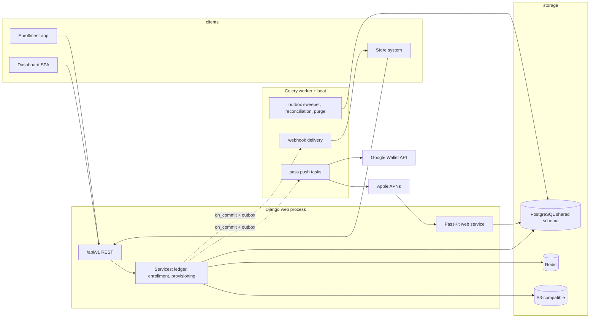

# Conventions

The build team's single source of truth for how this product is written. Authority order: `decisions.md` (ADRs) > this file > the skills in `skills/`. Visual design (colors, typography, spacing, component look) comes from the owner's separate **Airbnb design skill** — nothing here or in the repo defines visual style; frontend code composes the design skill's primitives (ADR-41).

## 1. Architecture overview

One Django service owns everything server-side: tenants, memberships, programs, customers, the ledger, passes, the tenant API, and the PassKit web service. One Postgres (shared schema, `tenant_id` on every tenant-owned row, ADR-32). One Redis (Celery broker, cache). One S3-compatible bucket (pass assets, ADR-20). A separate Celery worker process signs and pushes wallet passes, delivers webhooks, and runs beat jobs; web and worker deploy independently so a bad worker release never blocks counter writes (backend §1.3).

Three clients, all speaking HTTP to `/api/v1/`:
- Merchant dashboard + platform-admin area — one React SPA, session-cookie auth (ADR-2).
- Public enrollment app — separate tiny React build, no auth (ADR-3).
- Store systems — tenant API with HMAC-signed requests + outbound signed webhooks (ADR-1).

The ledger is the source of truth; the wallet pass is an asynchronously updated projection delivered through a durable outbox (ADR-4, ADR-17). The React apps never touch Postgres, Redis, or S3 directly; uploads go through the API, which returns server-generated keys (ADR-20).



## 2. Repository layout

```
repo/
  backend/
    config/            # settings/{base,development,staging,production}.py, urls.py, celery.py, wsgi.py
    apps/
      tenants/         # Tenant, Location, Membership, MembershipLocation, ApiCredential, platform.py (admin services)
      users/           # User (extends AbstractUser), auth endpoints, permissions.py
      programs/        # Program, style config tables, ProgramDesign, ProgramLocation, Reward, EnrollmentField, ...
      customers/       # Customer, Enrollment, enrollment service
      ledger/          # LedgerEntry, Balance, earn/redeem/issue/void services
      passes/          # Pass, DeviceRegistration, PassUpdate (outbox), signer.py, web_service.py, tasks.py
      webhooks/        # WebhookSubscription, WebhookDelivery, delivery tasks
      analytics/       # read-only aggregates (no models)
      audit/           # AuditEvent (ADR-42)
    manage.py
  frontend/
    dashboard/         # merchant SPA + /admin routes; e2e/ (Playwright)
    enrollment/        # public enrollment app
    packages/
      api-types/       # DTOs + validators/ (Zod mirrors, ADR-37)
      messages/        # en.json, ar.json (shared catalogs)
    pnpm-workspace.yaml
  deploy/              # docker-compose (dev), k8s manifests/helm, CI config
  docs/                # runbooks (cert rotation, dead letters), API guide for store developers
```

One Django app per domain; cross-app FKs use string references (`"customers.Customer"`). No circular imports between apps; shared abstractions (the tenant base model, manager, permissions) live in `apps/tenants/`.

## 3. Naming

### Database
- Tables: snake_case plural — `ledger_entries`, `balances`, `passes`, `program_locations`. Set `Meta.db_table` explicitly.
- Models: PascalCase singular (`LedgerEntry`, not `LedgerEntries`). Canonical domain names are binding (decisions.md, top table; ADR-44).
- FK fields: `customer`, `program` (Django adds `_id`). Exception with an ADR behind it: `pass_record` (`db_column="pass_id"`) on `LedgerEntry` (ADR-5).
- Constraints/indexes named explicitly: `uq_<table>_<fields>`, `ck_<table>_<rule>`, `idx_<table>_<fields>`.
- Every tenant-owned table: `tenant_id` FK, `created_at`, `updated_at` (timestamptz, UTC). The PK is declared on each **concrete** model — UUID for public-facing tables, bigserial (`BigAutoField`) for internal join tables (ADR-33); the abstract base declares no pk (round 2 F-DB-3/F-verifier-3).

### Python
- Functions/variables snake_case; classes PascalCase; constants UPPER_SNAKE.
- Services are module-level functions in `apps/<app>/services.py`, keyword-only arguments (`def earn(*, balance_id, quantity, ...)`) — no service classes, no business logic in views, serializers, models, or tasks.
- Domain exceptions in `apps/<app>/exceptions.py` (`InsufficientBalance`, `IdempotencyConflict`, `StyleNotYetAvailable`), mapped to API error codes in one place.
- Type hints on every service and signer function.

### TypeScript
- `strict: true`, `noUncheckedIndexedAccess: true`, no `any` in app code (`@typescript-eslint/no-explicit-any` = error).
- Components `PascalCase.tsx` matching the component name; hooks `useX.ts`; files kebab-case except components; query keys only from the `qk` factory; DTO types only from `packages/api-types`.
- API field names are snake_case on the wire (DRF default) and stay snake_case in DTOs — do not camelCase at the boundary; component-internal state may be camelCase.

### i18n keys
- `feature.context.message`, dot-namespaced (`counter.search.placeholder`, `program.design.stampCount.label`). Placeholders `{{name}}`; counted strings use plural suffixes including all six Arabic forms; no HTML in messages; no concatenated fragments. en/ar key parity is CI-enforced (ADR-39).

### Files and branches
- Branches: `feat/<phase>-<slug>`, `fix/<slug>`, `chore/<slug>` (see §10).
- Migrations: Django-generated names, never hand-renamed after merge.

## 4. API conventions

- Prefix `/api/v1/` (ADR-14); Apple's PassKit web service under `/passkit/` with Apple's fixed paths; health at `/health/`, `/health/ready/`.
- Resources are plural nouns; mutations that are business actions get verb sub-paths: `POST /api/v1/ledger/earn/`, `/api/v1/ledger/redeem/`, `/api/v1/ledger/issue/`, `/api/v1/ledger/void/`, `POST /api/v1/programs/{id}/publish/`.
- FK inputs in request bodies use `<entity>_id` (`customer_id`, `program_id`, `location_id`). The tenant is **never** a request field (ADR-11, §5).
- Pagination: cursor-based (`?cursor=`), default page size 50, max 200. Transaction lists are server-side searchable/filterable.
- OpenAPI: drf-spectacular at `/api/schema/`; CI diff-checks generated examples against serializers (ADR-14).
- Every view declares `permission_classes` explicitly; bases: `IsOwner`, `IsManager` (owner or location manager), `IsStaff`, `IsStaffOrApiCredential`, `AllowAny` (enrollment/public endpoints only, scope-derived).

### Error model
One shape, stable machine codes, localized human messages:

```json
{
  "error": {
    "code": "INSUFFICIENT_BALANCE",
    "message": "Customer has 3 stamps; the reward needs 10.",
    "details": { "current": 3, "required": 10 }
  }
}
```

| Code | HTTP | When |
|---|---|---|
| VALIDATION_ERROR | 400 | serializer validation (includes missing Idempotency-Key) |
| NOT_AUTHENTICATED | 401 | missing/invalid session or HMAC |
| PERMISSION_DENIED | 403 | authenticated, insufficient role or out-of-scope location |
| NOT_FOUND | 404 | unknown id **or** an id belonging to another tenant (never 403 for cross-tenant reads — do not reveal existence) |
| IDEMPOTENCY_CONFLICT | 409 | reused Idempotency-Key with a different payload fingerprint (ADR-13) |
| INSUFFICIENT_BALANCE | 422 | redeem exceeds balance |
| PROGRAM_INACTIVE | 422 | program draft/paused/archived |
| PASS_VOIDED | 422 | action on a voided/expired pass |
| STYLE_NOT_AVAILABLE | 422 | program style not issuable in this release (ADR-25) |
| RATE_LIMITED | 429 | throttle hit; `Retry-After` header |

Localization: the API returns `message` in the tenant/user language when resolvable (Accept-Language or session preference); codes never change per language. Field errors use DRF's `{field: [messages]}` under `details.fields`.

### Money, numbers, dates on the wire
- Money: decimal **string** with the currency exponent plus `currency` (`{"cost": "12.500", "currency": "KWD"}`); stored as integer minor units (ADR-21).
- Stamps/points: integers, always.
- Timestamps: ISO-8601 UTC (`...Z`). The frontend renders in the location timezone from API data (ADR-22); the API never pre-converts.

## 5. Tenancy rules

1. The server derives the tenant from the authenticated session, the HMAC credential, or the enrollment path — never from a body field, query param, or client-controlled header (ADR-1, ADR-2, ADR-3).
2. Every tenant-owned model inherits `TenantOwnedModel` (direct `tenant_id`, `TenantScopedManager`, `cross_tenant` escape hatch); each concrete model declares its own PK: UUID for public-facing tables, `BigAutoField` for internal/join tables per ADR-33 — the abstract base declares no pk — ADR-10, ADR-11, ADR-33.
3. Tenant context is a contextvar set by middleware and reset in `finally`. Services, management commands, and Celery tasks call `.for_tenant(tenant)` explicitly; implicit filtering is the safety net, not the contract.
4. No tenant set → reads return `none()`, writes raise `TenantNotSupplied`.
5. `cross_tenant` is restricted by an **attribute-access AST checker** (`scripts/check_cross_tenant.py` in the CI backend job), not an import grep — `Model.cross_tenant` is attribute access and cannot be import-checked (round 2 F-DB-5/F-verifier-2). Allowlist: `apps/tenants/platform.py`, `apps/passes/tasks.py` and `apps/webhooks/tasks.py` (outbox-driven tasks only, by primary key, each use audited), migrations, and the reconciliation job. Every use writes an `AuditEvent` (ADR-11, ADR-19).
6. Multi-parent relations carry composite same-tenant FKs (ADR-10). Adding a relation without one fails the model-suite test (§9).
7. Location scope: `request.location_scope` (set of location ids, ADR-12) filters customer discovery, ledger writes, analytics, and exports. `?loc=` from the client is a requested filter, validated against that set (ADR-40).
8. Cross-tenant access attempts return 404, never 403 (data-model §5.3 rule kept).

## 6. Data access rules (what the frontend may do)

- The frontend talks only to `/api/v1/` through `apiFetch` (auth, CSRF, typed `ApiError`). No direct Postgres/Redis/S3 access, ever; no S3 credentials in the browser; uploads go through `POST /api/v1/uploads/` and use the returned key (ADR-20).
- Server state lives only in the TanStack Query cache; keys only from `qk`; invalidate after every mutation at the narrowest key; optimistic updates only on the counter with visible rollback and same-key retry (ADR-36, ADR-38).
- URL state (filters, active location, tab) in search params; form state in React Hook Form; ephemeral UI state local; language in the i18next instance. No other global client state.
- Route guards are UX; the API is the only authority. A guard never substitutes for a permission class.
- The enrollment bundle never imports dashboard code (lint-enforced) and stays under 150 KB gzip first load.

## 7. Ledger and idempotency rules

1. All balance movement goes through `ledger.services` (`earn`, `redeem`, `issue_pass`, `void_pass`, `reward` auto-issue). One `transaction.atomic()`: lock the `Balance` row (`select_for_update`) → idempotency check → compute signed delta centrally (ADR-6) → append `LedgerEntry` → update `Balance` → insert outbox rows (`PassUpdate`, `WebhookDelivery`) → audit event if applicable. `transaction.on_commit` enqueues Celery with the outbox row id.
2. `LedgerEntry` rows are immutable. The DB trigger rejects UPDATE/DELETE; corrections are `correction` entries (ADR-8).
3. `Idempotency-Key` header required on every ledger-mutating POST, from every client (dashboard, counter, tenant API). Same key + same fingerprint → original result, `200` + `Idempotent-Replay: true`. Same key + different fingerprint → `409`. Concurrent duplicates resolve via the unique constraint + re-read (ADR-13).
4. Balances are integers, non-negative, reconcilable: nightly job recomputes from the log and reports drift (ADR-8, ADR-27).
5. Coupon/generic/ticket passes have no balance; their lifecycle events (`issue`, `void`, `check_in`) store NULL balances (ADR-5, ADR-6). Single-use coupon consumption is atomic redeem+void (ADR-31).
6. A failed wallet push never blocks or rolls back a ledger write; the outbox sweeper retries and dead-letters visibly (ADR-17).
7. Webhooks are at-least-once, signed (`X-Webhook-Id`, `X-Webhook-Timestamp`, `X-Webhook-Signature` = HMAC-SHA256 over `{id}\n{timestamp}\n{sha256(body)}` with the subscription secret), versioned payloads (`"version": "1"`), events: `enrollment.created`, `ledger.earn`, `ledger.redeem`, `pass.issued`, `pass.voided`, `pass.update.failed`. Consumers dedupe on event id. Retries 2/4/8/16/32 s, then dead-letter to the tenant-visible delivery log with manual retry.

## 8. Wallet pass rules

- `SignerInterface` (ADR-24) is the only place wallet formats are built; style-specific projection functions read `Program`, its style config, `ProgramDesign`, `Balance`, and the location attachments. Adding a style adds a config table + projection function + enum activation; it never changes `Pass`, `LedgerEntry`, or the push tasks (ADR-25 contract test).
- Apple: one Pass Type ID per style per environment; per-pass auth token stored on `Pass`; devices register/unregister through the PassKit web service; pushes are empty-payload APNs pings that make the device re-fetch the `.pkpass`. A `410` from APNs deletes the `DeviceRegistration`.
- Google: one class per program created at publish (`google_class_for(program)` derivation, ADR-23); one object per pass; updates are idempotent PATCHes; issuance is a signed-JWT "Add to Wallet" URL.
- Relevant locations: max 10, enforced at program validation and again in the projector (ADR-15).
- Secrets (Apple certs/keys, APNs .p8, Google service-account JSON) live in secret storage, loaded at call time; the repo and images contain none (ADR-24).

## 9. Testing standards

Backend (pytest, pytest-django, factory boy):
- Every model: the tenant-isolation trio — cross-tenant read returns nothing, cross-tenant write rejected, cross-tenant relation attach rejected at the DB level (composite FK). A suite-level test enumerates tenant-owned models and fails on any missing `tenant_id`, manager, isolation test, **or intended PK class** (UUID public-facing vs `BigAutoField` internal/join, ADR-33 — round 2 F-verifier-3). The `cross_tenant` AST checker (`scripts/check_cross_tenant.py`, ADR-11) runs in CI with fixtures proving it fails `.cross_tenant` use in a forbidden file and passes the allowlisted ones (round 2 F-verifier-2).
- Every ledger service action: happy path, idempotent replay, fingerprint conflict, concurrent duplicate (two threads, one key), insufficient balance, voided pass, wrong location scope. Reward auto-issue: threshold, cycle rollover, lifetime counter (ADR-7).
- A concurrency test proving contextvar tenant isolation under two parallel requests (ADR-11).
- API tests: auth required, permission per role, tenant isolation (404 not 403), pagination, error codes, OpenAPI example validity. Out-of-scope lookup: staff at location A scanning a pass whose events are only at location B gets 404 with no PII, while a two-location staff member can act at either selected location (round 2 F-COV-5).
- Celery task-routing test: every registered task lands on its declared queue (ADR-50).
- Signer tests: golden-file `pass.json` per style; 10-location cap; Google class derivation table (ADR-23).
- The append-only trigger is tested (UPDATE/DELETE raise at the DB level).
- Coverage gate: 90% statements on `apps/ledger`, `apps/passes`, `apps/tenants`; 80% elsewhere. `makemigrations --check` in CI.

Frontend (Vitest + Testing Library; Playwright e2e):
- Forms and validators, counter mutation/idempotency logic (same-key retry, timeout path, rollback), and the shared formatters: KWD 3-decimal, a 2-decimal currency, all six Arabic plural forms, location-timezone rendering (ADR-39).
- Mixed-direction rendering (round 2 F-COV-4): an en/ar component or Playwright case with Arabic names beside Latin phone numbers/digits asserting `dir` handling, bidi isolation, and formatter output; layout uses CSS logical properties throughout.
- Playwright golden journeys run in **`en` and `ar`** (never one language only — ADR-57): login per role → correct landing; stamp → reward → redeem incl. throttled and offline cases; program create → design → publish; enrollment on a phone viewport in both languages with RTL snapshot comparison (dashboard **and** enrollment, per verifier); platform-admin provisioning; two-location staff scope switching.
- Evidence screenshots: every user-facing epic's evidence pack includes light and dark screenshots in both `en` and `ar` (four variants, plus a phone viewport where the surface is phone-first), taken via `playwright.evidence.config.ts` (ADR-57).
- en/ar key-parity check and the stylelint logical-properties rule fail the build.
- Bundle budgets CI-checked (enrollment ≤150 KB gzip first load; dashboard initial route ≤300 KB gzip).

Evidence pipeline (ADR-57, the GlowDesk rhythm — round 2 F-PIPE-1/F-CONSISTENCY-14/15/16): every phase runs on `plan/evidence/phase-<n>-progress.md` (one row per task — task id, branch, commit SHA, checks run, deviations — written in that task's own commit; after a context reset, reread it first and never redo a finished task). `scripts/phase<n>-check.sh <task-id>` runs the phase's checks with full logs under `/tmp/phase<n>-check/<task>/`, never in the repo. The last task of each epic writes `plan/evidence/<epic>/REVIEW.md` plus numbered artifacts proving the acceptance criteria; the last task of each phase writes `plan/evidence/phase-<n>-gates/` (`GATES.md`, `run-gates.sh`, per-gate results and exit codes). Phase 0 creates the harness.

Performance acceptance (requirements NFR): counter scan→confirm <1.5 s p95 (ledger commit gate; push async); analytics <2 s p95 at 100k events/tenant. Load-test both in Phase 3 and Phase 4 exit criteria.

## 10. Git workflow

- Trunk: `main`, always deployable, protected. Feature branches `feat/p<n>-<slug>` off `main`; one PR per backlog task (the plan's backlog is sized for this); squash-merge.
- Commit message: `<type>(<scope>): <subject>` — types `feat|fix|refactor|perf|test|docs|chore|ops`, scope = app or area (`ledger`, `passes`, `dashboard`, `enrollment`, `ci`), subject imperative, ≤72 chars. Body: what/why, ADR references where a decision is implemented (`ADR-13`). Breaking API changes note the version impact.
- PR checklist (template, all required):
  - [ ] Implements exactly one backlog task; links it.
  - [ ] ADRs followed; any deviation has a new/updated ADR in this PR.
  - [ ] Tenant scoping: new models have `tenant_id`, manager, composite FKs; isolation tests included.
  - [ ] Ledger writes go through services; no direct `Balance`/`Pass` mutation; idempotency honored.
  - [ ] Migrations reviewed by hand (constraint names, no destructive ops without a plan); forward-compatible per ADR-53 (expand/contract; data backfills are management commands, never inside schema migrations; drops need a two-deploy cycle).
  - [ ] Tests: backend trio + service cases; frontend states + formatters; new strings in en **and** ar.
  - [ ] No secrets, no client-trusted tenant/location ids, no physical-direction CSS.
  - [ ] OpenAPI regenerated; frontend DTO/validator mirrors updated or codegen'd.
- Code review: one approval minimum; ledger/tenancy/signer changes need a second approver from the backend owners. Reviewers check the checklist, not just the diff.

## 11. Definition of done (every task)

A task is done when: code merged to `main` behind no dead flags; migrations applied in staging; tests green in CI including the new ones; en/ar strings complete; OpenAPI + DTO mirrors updated; audit events wired for sensitive actions; docs/runbooks touched if behavior changed; the phase's acceptance criteria still hold (no regressions); and for anything user-visible, the loading/empty/error states render through `<QueryState>`. "Works on my machine" without the CI suite passing is not done.

Evidence (ADR-57): the task's row in `plan/evidence/phase-<n>-progress.md` names the commit SHA, the checks run (`scripts/phase<n>-check.sh`), and any deviation; epics close with `plan/evidence/<epic>/REVIEW.md` plus numbered artifacts, and phases close with `plan/evidence/phase-<n>-gates/GATES.md` and its gate results. A phase without its gate pack is not done.

## 12. Skills

The skills in `skills/.cursor/skills/` and `skills/.claude/skills/` (identical trees) are the working conventions for coding agents and new engineers: `loyalty-platform-architecture` (start here), `loyalty-domain-glossary` (naming authority), `django-data`, `django-backend`, `react-frontend`, `i18n-rtl`, `feature-delivery` (end-to-end task recipe). They follow `decisions.md` and this file; if a skill ever disagrees, the ADR wins and the skill gets fixed in the same PR.
