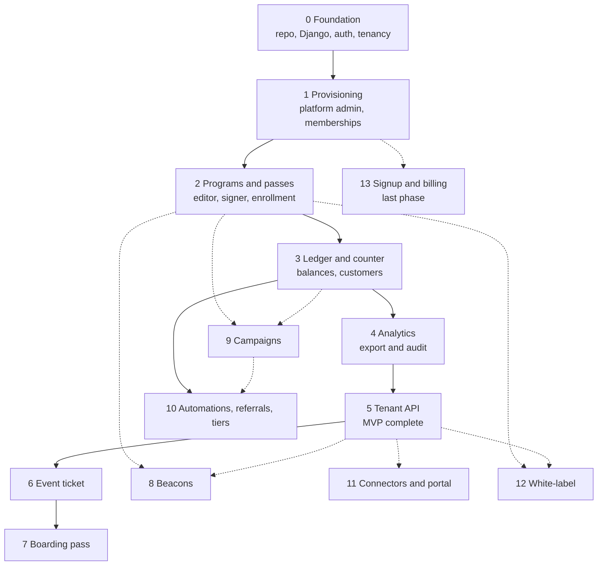
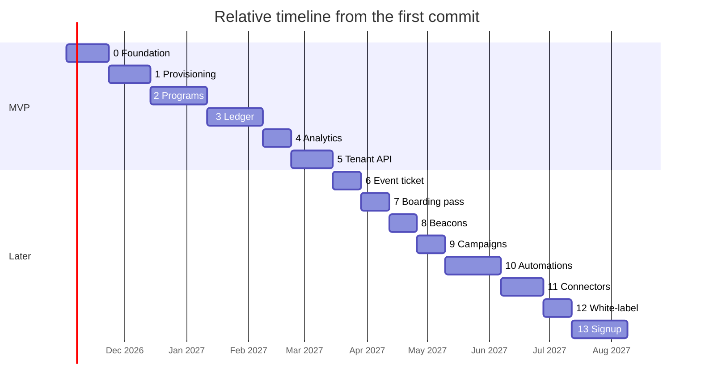

# Implementation plan

Phase-based plan from an empty repository to the first business live on a real program, then to a sellable multi-tenant product. Authority: `decisions.md` (ADRs) and `CONVENTIONS.md`; this plan never contradicts them. Release labels match `requirements.md`: MVP = Phases 0–5; P1 = event ticket (Phase 6); P2 = boarding pass (Phase 7); P3 = beacons (Phase 8); P4 = campaigns (Phase 9); P5 = automations/referrals/tiers (Phase 10); P6 = named connectors + developer portal (Phase 11); P7 = white-label (Phase 12); P8 = self-serve signup + subscription billing (Phase 13, the last phase — nothing earlier depends on it).

## Team and estimation assumptions

- Team: 2 backend engineers, 1 frontend engineer (+1 frontend from Phase 2), 0.5 DevOps, QA embedded via the test plan of each phase. Visual design comes from the owner's Airbnb design skill, so no designer headcount is planned; the frontend engineer consumes the skill's primitives.
- Sizes are **engineer-weeks** (person-weeks of effort). Durations assume the team above working in parallel; a phase's duration is roughly its size divided by 3.5 effective engineers plus integration slack.
- Estimation basis: the signer + PassKit web service is the largest unknown (mitigated in Phase 2 with a sandbox spike in week 1); everything else is conventional Django/React work.

## Phase dependency diagram

Solid = hard dependency (Phases 0–5 are strictly linear; automations (Phase 10) hard-require the Phase 3 ledger). Dotted = soft reuse: beacons (Phase 8) reuse the Phase 2 projection pipeline and the shipped MVP; campaigns (Phase 9) build on ledger events and segmentation data from Phase 3 and the Phase 2 push plumbing; connectors (Phase 11) extend the Phase 5 API seam; white-label (Phase 12) rethemes the Phase 2 enrollment app and the Phase 5 email/integration surface; signup (Phase 13) reuses the Phase 1 provisioning service (ADR-28). Round 2 F-PLAN-3: the diagram no longer draws a false solid chain through the later phases — their real dependencies are the subsets named in each phase's "Dependencies" line. The Gantt below is a **staffing serialization**: later phases are staffed sequentially, not dependency-ordered.

Every phase also runs on the ADR-57 evidence pipeline (round 2 F-PIPE-1): a `plan/evidence/phase-<n>-progress.md` row per task with its commit SHA, `scripts/phase<n>-check.sh` with logs in `/tmp`, an epic `REVIEW.md` + numbered artifacts pack at the end of every epic, and a `plan/evidence/phase-<n>-gates/` pack at the end of every phase. User-facing journeys are Playwright-tested in `en` **and** `ar`, with light and dark evidence screenshots in both languages (ADR-57, round 2 F-PIPE-2/F-verifier-4).

## Timeline (relative durations)

Week 1 starts 2026-11-02. The first business can go live at the end of Phase 5 (~week 21). Post-MVP phases sell the roadmap; none of them blocks the MVP. The Gantt orders later phases by staffing, not by dependency (see the diagram above — round 2 F-PLAN-3).

---

# MVP (Phases 0–5)

## Phase 0 — Foundation

**Goal.** An empty repo becomes a deployable, tested, observable skeleton with the tenancy machinery already correct, so no later phase retrofits isolation.

**Scope.** Monorepo bootstrap; Django 5.2 project + DRF + drf-spectacular; Postgres 16 + Redis via Docker Compose; Celery worker + beat wiring; the tenant base model (no pk on the abstract base — every concrete model declares UUID or `BigAutoField` per ADR-33), `TenantScopedManager` with contextvars (ADR-11), `TenantMiddleware`, `cross_tenant` fence via the attribute-access AST checker `scripts/check_cross_tenant.py` (ADR-11, not an import grep — round 2 F-DB-5/F-verifier-2); `User` (email login) + session auth + `GET /api/v1/auth/me/`; i18n baseline (Django en/ar, frontend i18next + catalogs + RTL `dir` switching + stylelint logical-properties rule); design-skill integration (primitives vendored into `shared/ui` re-export layer, ADR-41); structured JSON logging, health endpoints, Sentry/GlitchTip, error model + exception→code mapping (CONVENTIONS §4); CI pipelines (backend: pytest, ruff, `makemigrations --check`, `check_cross_tenant.py`; frontend: vitest, eslint, stylelint, key parity, bundle budgets); k8s/helm skeletons for web + worker naming the three environments (ADR-48: local compose, synthetic staging, production); secret-storage pattern wired with dummy wallet certs; the evidence harness (ADR-57, round 2 F-PIPE-1): `plan/evidence/` tree, `scripts/phase0-check.sh` (the pattern all later `phase<n>-check.sh` copy), and `frontend/dashboard/playwright.evidence.config.ts` (workers 1, screenshot project, runs against a built preview).

**Database work.** `tenants` app migrations: `Tenant` (UUID pk, slug, name, currency, IANA-validated timezone default `Asia/Kuwait`, is_active), `Location` (composite-unique `(id, tenant_id)` per ADR-10, unique `(tenant, name)`), `Membership`, `MembershipLocation` (ADR-12); `users.User`; `audit_events` (ADR-42). All with the tenant base pattern; the suite-level "every tenant-owned model" test lands here (ADR-32).

**Django services and API.** `apps/tenants/platform.py` (provisioning service stub used by Phase 1); auth endpoints (`login`, `logout`, `me`); permissions bases (`IsOwner`, `IsManager`, `IsStaff`); rate-limit throttles (ADR-43 defaults).

**Celery tasks.** `sweep_outbox` skeleton (no-op until Phase 2), nightly `reconcile` skeleton, beat schedule.

**Frontend screens.** Vite workspaces (dashboard, enrollment, packages); login page; app shell with role-based routing guards, `LocationSwitcher` reading/writing `?loc=` (ADR-40), language switcher with full RTL flip, `<QueryState>`; `apiFetch` + `qk` factory + typed `ApiError`.

**Acceptance criteria.** CI green from an empty clone in one command (`docker compose up` + migrate + runserver + worker); two parallel requests with different tenant contexts never see each other's rows (concurrency test, ADR-11); logging in as a seeded owner/manager/staff lands on the role's page; switching to `ar` flips the whole shell RTL with zero physical-direction CSS (stylelint enforced); `/health/ready/` checks DB + Redis; the AST attribute-access checker fails `.cross_tenant` outside the allowlist (fixtures for one allowed and one forbidden file prove the gate — round 2 F-verifier-2); the evidence harness exists and has produced its first artifacts (`phase-0-progress.md` T0 row, a passing `phase0-check.sh` run, and the first en/ar light/dark evidence screenshots — ADR-57).

**Test plan.** Tenant-isolation trio for all four models; contextvar concurrency test; auth/permission tests per role; frontend: `apiFetch` error mapping, guard behavior, RTL snapshot of the shell, key-parity CI.

**Dependencies.** None (start of the chain).
**Risks.** Contextvar scoping bugs under gunicorn threads → mitigated by the concurrency acceptance test and fail-closed `none()` default. Design-skill primitives mismatch → integration week is scheduled before any feature work.
**Size.** 12 engineer-weeks (~3 weeks duration).
**Exit criteria / what the first business can do.** Nothing customer-facing yet; the team can build every later phase on rails that enforce tenancy by construction. The phase is not done without `plan/evidence/phase-0-gates/` (`GATES.md`, `run-gates.sh`, per-gate results and exit codes — ADR-57).

**Backlog (epic → PR-sized tasks).**
- Epic 0.1 Repo & CI: [Ops] monorepo layout + docker compose (pg/redis); [Ops] backend CI (pytest, ruff, migrations check); [Ops] frontend CI (vitest, eslint, stylelint, i18n parity, bundlesize); [Ops] helm/k8s skeletons + secret pattern (three environments named per ADR-48, synthetic staging seed fixture).
- Epic 0.2 Tenancy core: [DB] `Tenant`, `Location` migrations + composite uniques; [DB] `TenantOwnedModel` (no pk on the base; concrete models declare UUID or `BigAutoField` per ADR-33 — round 2 F-DB-3) + `TenantScopedManager` + contextvars + middleware; [API] `cross_tenant` AST attribute-access checker `scripts/check_cross_tenant.py` + allowed/forbidden fixtures + CI wiring (ADR-11, round 2 F-DB-5/F-verifier-2); [DB] the model-enumeration isolation suite test (asserts tenant fence **and** intended PK class per model — round 2 F-verifier-3).
- Epic 0.3 Auth: [DB] `User`, `Membership`, `MembershipLocation`; [API] login/logout/me + permission bases + throttles; [Frontend] login + `apiFetch` + `qk` + `ApiError`.
- Epic 0.4 Frontend baseline: [Frontend] workspace scaffolding; [Frontend] app shell, guards, `?loc=`, `<QueryState>`; [Frontend] design-skill `shared/ui` layer; [Frontend] i18next + catalogs + RTL flip.
- Epic 0.5 Observability: [API] JSON logging + health endpoints + Sentry; [Worker] beat skeletons (`sweep_outbox`, `reconcile`); [API] error-code mapping + validation suite; [Ops] metrics + alerting baseline (ADR-55: thresholds in config, alerts routed); [Ops] backup + WAL config and a restore-drill runbook (ADR-45, round 2 F-GOLIVE-1).
- Epic 0.6 Evidence harness (ADR-57, round 2 F-PIPE-1): [Ops] `plan/evidence/` skeleton + `phase-0-progress.md` with the T0 baseline row (one row per task, commit SHA, written in each task's commit); [Ops] `scripts/phase0-check.sh` (compose up, migrate, pytest, ruff, `makemigrations --check`, `check_cross_tenant.py`, vitest, eslint, stylelint, key parity — one PASS/FAIL line per step, full logs under `/tmp/phase0-check/<task>/`, never in the repo); [Ops] `frontend/dashboard/playwright.evidence.config.ts` + first light/dark en/ar screenshot spec; [Ops] phase-0 gate pack `plan/evidence/phase-0-gates/`.

## Phase 1 — Tenancy and provisioning (platform admin)

**Goal.** We can create a business account end to end: tenant, owner, first location — the account-opening flow from requirements §6, with no public signup anywhere (ADR-28).

**Scope.** Platform-admin area (`/admin/*` routes in the dashboard SPA): tenant list, tenant detail (metadata + counts), create-tenant wizard, suspend tenant (reversible, US-PA-2); owner credential-setup link (one-time, expiring — the MVP owner activation mechanism per ADR-49); tenant settings screens (business identity, currency, timezone, language defaults, issuer contact per ADR requirements); **locations management screens for owner (all locations) and manager (own locations): add, edit (name, address, coordinates, display address, lock-screen relevance text), deactivate with program-detach warning (US-LOC-1 — round 2 F-PLAN-1; the admin wizard creates only the first location)**; staff management for owners/managers (create staff with locations, roles; deactivate); support-session impersonation (explicit, audited, time-bounded, ADR-19); audit-log screen (tenant-visible events).

**Database work.** No new tables beyond Phase 0's; add `Tenant.status` states (active/suspended) if not modeled as `is_active`; `AuditEvent` rows for `tenant.provisioned`, `tenant.suspended`, `support_session.*`, `staff.*`.

**Django services and API.** `platform.provision_tenant(business, owner, location)` — one atomic transaction creating tenant + owner User + Membership(role=owner) + first Location + credential-setup token + audit event (US-PA-1); `platform.suspend_tenant` / `reactivate`; location CRUD services + endpoints (owner all / manager own-scope, ADR-12 scope tests; deactivate warns which programs would detach — round 2 F-PLAN-1); staff CRUD services with location-scope validation; support-session service setting the contextvar tenant with expiry and audit; `GET/POST /api/v1/admin/tenants/...`, `/api/v1/locations/`, `/api/v1/staff/`, `/api/v1/tenant/settings/`.

**Celery tasks.** Send credential-setup email through the provider abstraction (console backend in dev, ADR-49); expire unused setup links (beat, daily); setup-link resend is rate-limited and audited (ADR-49).

**Frontend screens.** `/admin/tenants`, `/admin/tenants/new` (wizard: business → owner → first location, en/ar), `/admin/tenants/:id` (metadata, counts, suspend, support session); `/staff` (list, create/edit with multi-location picker, role select); `/settings/*` (business profile, currency, timezone, language); `/settings/locations` (list + create/edit: name, address, map picker, display address, lock-screen relevance text; deactivate with program-detach warning — en/ar, round 2 F-PLAN-1); audit log screen; role landing pages wired (owner/manager → analytics placeholder, staff → counter placeholder).

**Acceptance criteria.** A platform admin creates a tenant; owner receives the setup email, sets a password, lands in a tenant-scoped dashboard; the tenant's first location exists and is editable; **an owner adds a second location and it is immediately attachable in the Phase 2 program editor (integration note in Epic 2.3 — round 2 F-PLAN-1)**; a manager edits only their own locations; deactivating a location shows which programs detach; suspending a tenant blocks its logins and (from Phase 5) its API credential, and is reversible; staff created with two locations can act at both (scope tests, ADR-12); support sessions appear in the audit log with actor, tenant, reason, and duration; no anonymous route can reach any provisioning endpoint; an expired setup link is rejected and resend works (ADR-49).

**Test plan.** Provisioning atomicity (partial failure rolls back all three records); permission matrix tests per requirements §3 (every row, plus the location-CRUD rows for owner/manager scope); support-session expiry and audit; staff two-location scope unit + API tests; setup-link expiry/resend (ADR-49); Playwright journeys in `en` **and** `ar`: admin creates tenant, owner first login, owner adds a second location (evidence pack: light/dark × en/ar — ADR-57).

**Dependencies.** Phase 0.
**Risks.** Email deliverability for owner setup → one-time links with expiry + resend action. Role matrix gaps → the requirements §3 table is transcribed into parametrized permission tests, run against every endpoint.
**Size.** 12 engineer-weeks (~3 weeks).
**Exit.** We can onboard a real business's account data by hand; the business's owner can log in and see an empty, correctly scoped dashboard. The phase is not done without `plan/evidence/phase-1-gates/` (ADR-57).

**Backlog.**
- Epic 1.1 Provisioning: [API] `provision_tenant` service + admin endpoints; [Frontend] create-tenant wizard; [Worker] setup-email task + expiry beat (ADR-49); [API] suspend/reactivate + login blocking.
- Epic 1.2 Staff & roles: [API] staff CRUD services + endpoints with scope validation; [Frontend] `/staff` screens + location multi-select; [API] parametrized permission-matrix suite.
- Epic 1.3 Tenant settings & locations: [API] settings endpoints (currency, tz validation, issuer contact); [Frontend] `/settings` screens en/ar; [API] location CRUD endpoints (owner all / manager own-scope; ADR-12 scope tests — round 2 F-PLAN-1); [Frontend] `/settings/locations` list + create/edit (name, address, map picker, display address, lock-screen relevance text) en/ar; [API] location deactivate with program-detach warning.
- Epic 1.4 Platform-admin safety: [API] support-session service + expiry + audit; [Frontend] admin tenant list/detail + support-session UI; [DB] audit-event indexes.
- Epic 1.5 Phase evidence (ADR-57): [Ops] evidence `plan/evidence/1.x/`: numbered artifacts (saved pytest/vitest output, Playwright screenshots light+dark × en+ar) + `REVIEW.md` per epic naming what shipped, the commit SHAs, and deviations; [Ops] `plan/evidence/phase-1-gates/` pack.

## Phase 2 — Programs, pass pipeline, enrollment

**Goal.** A tenant can create and publish store-card (stamps/points), coupon, and generic programs with full design, and a customer can enroll by link/QR and land the pass in Apple Wallet and Google Wallet with relevant locations. The signer pipeline is style-generic and already accepts event ticket/boarding pass interfaces (ADR-25).

**Scope.** Program editor (details, per-style rule sections via discriminated union, design tab with uploads + live Apple/Google previews, locations tab with the 10-cap, enrollment-fields + consent tab, terms); publish flow (validation → status `active` → Google class creation → enrollment URL/QR goes live, US-PRG-1..5); the pass pipeline: `SignerInterface` + `SelfSigner` (ADR-24), `.pkpass` build/sign, PassKit web service (register/unregister/serials/pass download with `ApplePass` auth), `DeviceRegistration`, APNs token-based push, Google class/object + signed-JWT "Add to Wallet" URL, idempotent object PATCH; public enrollment app (mobile-first, en/ar RTL, form from `EnrollmentField` config, consent, wallet buttons, duplicate handling US-ENR-3); uploads endpoint with server-generated tenant-prefixed keys (ADR-20); `PassUpdate` outbox + sweeper live (ADR-17); wallet-certificate ops: sandbox + production provisioning, expiry calendar alerts, runbooks.

**Database work.** `programs` app: `Program` (style enum all five; `google_class` derived, ADR-23), `StoreCardConfig`, `CouponConfig`, `GenericConfig`, `ProgramDesign`, `Reward` (money as minor units, ADR-21), `EnrollmentField`, `ProgramLocation` (unique + composite tenant FKs), `UsefulLink`, `CustomField`, `StampImage`, `ProgramSettings`. `passes` app: `Pass` (tenant FK!, no balance columns, ADR-4/10), `DeviceRegistration`, `PassUpdate` (outbox). `customers` app: `Customer` (soft delete), `Enrollment` (unique `(customer, program)`). All tenant-owned tables follow the ADR-10 pattern; check constraints for statuses.

**Django services and API.** `programs.services.publish/pause/archive` (+ audit); `passes.signer` (per-style projection functions, 10-location cap, relevant date plumbing no-op for MVP styles); `passes.web_service` (Apple endpoints); `customers.services.enroll()` (ADR-9 transaction); enrollment public API (`GET /api/v1/public/programs/{tenant_slug}/{program_slug}/` config, `POST .../enroll/` with signed optional `?t=` location tag, rate limits ADR-43); uploads; `GET /api/v1/passes/{id}/status/` (poll endpoint, ADR-36); program/design/locations/fields CRUD endpoints.

**Celery tasks.** `apple_push_pass` (outbox-row-driven, idempotent, 410 handling deletes registrations), `google_push_pass` (idempotent PATCH, 4xx no-retry), `sweep_outbox` live (re-enqueue pending >30 s, retry failed ≤5, dead-letter + `push_status=failed`), cert-expiry check (beat weekly).

**Frontend screens.** `/programs` list; `/programs/:id` overview; editor tabs (details, style rules, design with live previews, locations, enrollment form, support links); publish confirmation with QR display + download; `/customers` placeholder wired to enrollment data; enrollment app: form, consent, wallet buttons, success/re-add states, full RTL; pass-preview component (fixed LTR wallet rendering, ADR-39 exception).

**Acceptance criteria.** Owner creates + publishes each MVP style with design assets; enrollment on a phone (iOS Safari + Android Chrome) puts the pass in the wallet with correct style, design, barcode, relevant locations, localized strings (`localized`/`localized*`) in ar and en; re-enrollment re-adds the same pass (no duplicate customer/pass); detaching a location updates issued passes via outbox; killing the worker mid-flow and restarting delivers the pending pass update (outbox proof); Apple sandbox and Google production-issuer checklists from ADR-24 all pass; event_ticket/boarding_pass program creation returns `STYLE_NOT_AVAILABLE` (422) and the style-additivity contract test passes (ADR-25).

**Test plan.** Signer golden files per style; web-service auth (per-pass token) tests; enrollment transaction races (two devices, same unique field) → one customer/pass; outbox crash-recovery test; 10-cap validation + projection tests; Playwright enrollment journey in `ar` with RTL snapshots on a phone viewport; load: 20 concurrent enrollments/program.

**Dependencies.** Phase 1 (a tenant exists to own programs).
**Risks.** Apple/Google issuer approval latency → start certificate and issuer applications in Phase 1 week 1 (ops lead time, not code); APNs/auth-token edge cases → sandbox spike in week 1 of the phase; image spec churn per style → Apple's per-style image table encoded in one validator.
**Size.** 24 engineer-weeks (~4.5 weeks with 2 FE from here).
**Exit.** Passes exist in real wallets and update; enrollment links can be printed. No balances move yet — that is Phase 3.

**Backlog.**
- Epic 2.1 Programs: [DB] program + config tables migrations; [API] program CRUD + publish/pause/archive + audit; [Frontend] editor shell + details/rules tabs; [Frontend] style discriminated union + Zod validators.
- Epic 2.2 Design & assets: [API] uploads service + tenant-prefixed keys; [DB] `ProgramDesign`, `StampImage`; [Frontend] design tab + live Apple/Google previews; [API] per-style image validators.
- Epic 2.3 Locations on passes: [DB] `ProgramLocation` composite FKs + unique; [API] attach/detach + 10-cap validation; [Frontend] locations tab with cap UX.
- Epic 2.4 Signer & Apple: [Worker] `SignerInterface` + `SelfSigner` pkpass build/sign; [API] PassKit web service + `DeviceRegistration`; [Worker] `apple_push_pass` + APNs client; [Ops] cert provisioning per env + expiry alerts + runbook.
- Epic 2.5 Google: [Worker] class create on publish + object payloads + JWT URL; [Worker] `google_push_pass` idempotent PATCH; [Ops] issuer approval + service-account rotation rehearsal.
- Epic 2.6 Outbox: [DB] `PassUpdate` model; [Worker] `sweep_outbox` live + dead-letter + `push_status`; [API] pass status poll endpoint.
- Epic 2.7 Enrollment: [DB] `Customer`, `Enrollment`; [API] enroll transaction (ADR-9) + public config endpoint + rate limits; [Frontend] enrollment app (form, consent, wallet buttons, RTL); [Worker] first-projection task.

## Phase 3 — Ledger and counter

**Goal.** Money-equivalent truth: stamps, points, coupons moving through an append-only, idempotent ledger, with the staff counter tool as the daily driver and pass updates flowing from every event.

**Scope.** `Balance` aggregate + `LedgerEntry` log with the full ADR-4/5/6/7/8 machinery (immutability trigger, signed deltas, fingerprinted idempotency, reward auto-issue, reconciliation); counter tool (scan/search/code, earn, redeem, coupon consume = atomic redeem+void, "pass updating…" chip, offline banner floor, optimistic-with-rollback, ADR-38); void flows with reason (manager+; staff coupon exception, ADR-31); customer list + customer profile with full ledger history, pass status, manual repush; customer CSV import with validation, dedupe, and balance provenance (`import` events, verifier scope item); pass expiry (`purge_expired_passes` voids per program expiry rules).

**Database work.** `ledger_entries` (+ UPDATE/DELETE trigger via RunSQL, unique `(tenant, idempotency_key)`, fingerprint column, indexes `(pass_id, created_at)`, `(tenant, created_at)`, `(customer, created_at)`, balance-events check constraint per ADR-5); `balances` (unique `(customer, program)`, non-negative checks); `Pass.status` transitions; `AuditEvent` actions for voids.

**Django services and API.** `ledger.services.earn/redeem/issue_pass/void_pass/reward` (single atomic pattern, `_signed_delta`, `select_for_update`, outbox rows for pass update + webhooks-to-be); `POST /api/v1/ledger/earn|redeem|issue|void/` (all require `Idempotency-Key` header, ADR-13), `GET /api/v1/ledger/entries/` (filters: customer, program, location, staff, date range in location tz, ADR-22); `GET /api/v1/customers/` (list with per-program balances, location-scoped discovery, staff see search-by-code only + masked PII per data-model §5.4), `GET /api/v1/customers/{id}/` + `/transactions/`; customer import service (CSV template: name, phone, email, program, balance → `import` entries with `metadata.provenance="import"`); counter endpoints: recent-customers per staff, code lookup constrained to scope (out-of-scope code → 404).

**Celery tasks.** `reconcile` nightly live (recompute balances, report drift, page on mismatch); `purge_expired_passes` (void + push); webhook delivery stays dark until Phase 5 (outbox rows accumulate only if subscriptions exist — none yet).

**Frontend screens.** `/counter` (the hard screen per frontend §6: scan via BarcodeDetector + manual fallback, debounced search, code entry, balance card with target/cycle, eligible rewards, earn/redeem mutations with idempotency treatment, timeout "sent, unconfirmed" flow, offline banner); `/customers` (search, status, balances, scope-filtered); `/customers/:id` (profile, history newest-first, pass push status + repush button, masked PII for staff); import screen (upload → validation report → confirm); void dialog with reason (role-gated).

**Acceptance criteria.** Double-tap on earn credits once (replay returns 200 + `Idempotent-Replay`); same key + changed payload → 409; redeem beyond balance → 422 `INSUFFICIENT_BALANCE`; stamp target hit → `reward_issued` consumes the target, cycle increments, lifetime untouched, pass shows reward message; coupon single-use consume is atomic (crash between redeem and void is impossible — one transaction); ledger UPDATE/DELETE raise at the DB level; reconciliation finds an artificially corrupted balance and reports it; scan→confirm <1.5 s p95 under load test; staff at two locations must pick the acting location, and the event records it + the actor; imported customers show balances with `import` provenance visible in history.

**Test plan.** Full ledger matrix per ADR-6 (each type × happy/replay/conflict/concurrent/insufficient/voided/wrong-scope); concurrency: 2 threads one key → one entry; reward cycle tests; trigger tests (raw SQL UPDATE rejected); counter Playwright journeys incl. throttled network and offline banner; import validation (bad phone, duplicate row, unknown program); p95 load test (k6/locust) as exit gate.

**Dependencies.** Phase 2 (passes exist to project onto).
**Risks.** Counter UX under flaky shop networks → the timeout/re-query/same-key-retry protocol is specified and Playwright-tested with throttling; lock contention on hot passes → single-row lock, short transactions, `nowait` retry once; import dirty data → validation report before commit, dry-run mode.
**Size.** 20 engineer-weeks (~4 weeks).
**Exit.** A real store can run a day of trade: enroll, stamp, reward, redeem, void — with the wallet pass reflecting each event and the ledger provably consistent.

**Backlog.**
- Epic 3.1 Ledger core: [DB] `balances` + `ledger_entries` + trigger + constraints; [API] `ledger.services` earn/redeem + `_signed_delta` + fingerprint idempotency; [API] reward auto-issue (ADR-7); [API] issue/void services + audit.
- Epic 3.2 Ledger API: [API] earn/redeem/issue/void endpoints + `Idempotency-Key` enforcement; [API] entries list with filters + location-tz day buckets; [API] error-code conformance suite.
- Epic 3.3 Counter: [Frontend] search/scan/code entry + scope-safe lookup; [Frontend] earn/redeem mutations + optimistic rollback + timeout protocol; [Frontend] offline banner + queue stretch; [API] recent-customers endpoint.
- Epic 3.4 Customers: [API] customer list/detail/transactions with PII masking + scope; [Frontend] `/customers` + `/customers/:id` + repush; [API] CSV import service + `import` events; [Frontend] import screen.
- Epic 3.5 Integrity ops: [Worker] `reconcile` live + drift report; [Worker] `purge_expired_passes`; [API] load-test harness + p95 gate in CI (nightly).

## Phase 4 — Analytics, export, audit polish

**Goal.** The owner sees the business: KPIs, program performance, transactions with location/staff filters (the gap Loopy never closed, ADR-30), reward-cost view, CSV exports, and a complete audit trail.

**Scope.** Tenant dashboard KPIs (enrolled, active passes, earns, redemptions, voids, acquisition trend day/month/year in location tz); program overview (per-program KPIs + transaction table, server-side search/pagination); reward-cost/ROI screen (KWD 3dp strings, zero values persist, ADR-21 formatting); CSV export (customers, ledger; owner tenant-wide, manager location-scoped; async job + download link + audit); audit-log screen completion; location-scoped privacy rules on exports (verifier item).

**Database work.** No new tables; indexes verified for aggregate queries (`ledger_entries (tenant, created_at)`, `(pass_id, created_at)`, `passes (program, status)`, `customers (tenant, created_at)`); export job rows (`export_jobs`: status, scope, requested_by, file key) if needed.

**Django services and API.** `analytics.services` (dashboard, program stats, histogram, trend with tz-aware TruncDate); `GET /api/v1/analytics/dashboard/`, `/analytics/programs/{id}/`, `/analytics/reward-cost/`; `POST /api/v1/exports/` (kind, scope) → job → signed download URL; audit `export.completed`.

**Celery tasks.** `run_export` (streamed CSV to S3, tenant-prefixed key, expiring URL); analytics cache warm (optional, 60 s cache per data-model §7.1).

**Frontend screens.** `/analytics` (KPI cards, trend chart, filters: program/location/staff/date-range shared components); program overview tab; reward-cost screen; export center (request, progress, download); audit log screen polish.

**Acceptance criteria.** Every analytics view honors the requester's location scope (manager sees only their locations, staff none); a midnight-boundary Kuwait event buckets into the correct location-local day; analytics <2 s p95 at 100k events (load gate); exports contain exactly the scoped rows (no cross-location leak test); zero-value reward costs persist and render as "0.000 KWD"; charts and tables fully translated en/ar.

**Test plan.** Aggregate correctness vs hand-computed fixtures; tz boundary tests (ADR-22); scope-leak tests per role; export streaming test at 100k rows; Playwright analytics journey with filters; perf gate in CI nightly.

**Dependencies.** Phase 3 (events to aggregate).
**Risks.** Aggregate performance drift → indexes + EXPLAIN review in PR checklist for analytics queries; chart library bundle weight → budget-checked, tree-shaken choice.
**Size.** 10 engineer-weeks (~2.5 weeks).
**Exit.** The owner can answer "is this program working?" per location and per staff member, and take their data with them.

**Backlog.**
- Epic 4.1 Analytics: [API] analytics services + endpoints with tz-aware buckets; [Frontend] dashboard KPIs + trend + shared filter components; [Frontend] program overview + transaction table; [API] perf load gate.
- Epic 4.2 ROI: [API] reward-cost aggregation (minor units → decimal strings); [Frontend] reward-cost screen (KWD formatting tests).
- Epic 4.3 Export: [DB] `export_jobs`; [Worker] `run_export` streamed CSV; [API] export endpoints + audit + expiring URLs; [Frontend] export center.
- Epic 4.4 Audit polish: [Frontend] audit log screen (filter by action/actor); [API] audit list endpoint (owner scope).

## Phase 5 — Tenant API and signed webhooks (MVP complete)

**Goal.** A store with an existing system connects without us: per-tenant credential, HMAC-signed calls that drive the same ledger services, signed outbound webhooks with a delivery log. MVP ships; the first business goes live (go-live checklist below).

**Scope.** `ApiCredential` management (create → secret shown once, rotate with 24 h grace, revoke; scopes: enroll, earn, redeem, issue, void, read:balance; ADR-18); HMAC auth middleware (ADR-1 canonical string, ±300 s window, constant-time compare, per-credential throttles); tenant API endpoints reusing ledger/enrollment services (`POST /api/v1/ledger/*` already exist — enable credential auth alongside session via `IsStaffOrApiCredential`; `POST /api/v1/enroll/`, `GET /api/v1/balances/` by code or customer); `WebhookSubscription` CRUD (encrypted secret, write-only, rotate); webhook delivery (signed, versioned, at-least-once, retries 2/4/8/16/32 s, dead-letter + tenant-visible delivery log + manual retry); one-page developer guide in `docs/` (backend §9.4 shape, corrected contract); tenant suspension blocks credentials (US-PA-2 completion).

**Database work.** `api_credentials` (tenant FK, `key_id` unique, `secret_hash`, scopes jsonb, is_active, expires_at, last_used_at, grace-period columns); `webhook_subscriptions` (encrypted secret, events jsonb, is_active); `webhook_deliveries` (outbox-style: event id, type, payload, status, attempts, response code/body snippet, next_retry_at).

**Django services and API.** HMAC authentication class + middleware setting `request.tenant` from the credential; webhook fan-out service (subscriptions × event → delivery rows in the ledger transaction, ADR-17); delivery signer; `GET/POST/DELETE /api/v1/credentials/`, `/api/v1/webhooks/`, `/api/v1/webhooks/{id}/deliveries/`, `POST .../deliveries/{id}/retry/`; audit events for credential/webhook lifecycle.

**Celery tasks.** `deliver_webhook` (idempotent per delivery row, dead-letter after 5), `retry_webhook` (manual), `expire_credentials` (beat).

**Frontend screens.** `/integrations` (credentials: create/rotate/revoke with one-time secret display; webhooks: subscribe, event picker, secret rotation, delivery log with status/response and retry button); developer-guide link.

**Acceptance criteria.** A simulated POS (script, not code in repo) enrolls a customer, earns, redeems, and voids over HMAC with idempotency replay behaving per ADR-13; a wrong signature, a stale timestamp, and a revoked credential each fail with the documented code; rotation keeps the old secret working through the grace window; the store's endpoint receives `ledger.earn` within seconds of a dashboard stamp, validates the signature per the documented scheme, and a failing endpoint shows retries → dead-letter → manual retry success in the delivery log; a suspended tenant's credential is rejected; rate limits return 429 + Retry-After.

**Test plan.** HMAC canonicalization table tests (method/path/body hash/timestamp); replay window boundaries; grace-period rotation; webhook signature + dedupe (same event id delivered twice on retry); delivery state machine incl. dead-letter; tenant-isolation: credential A cannot touch tenant B's ledger (404); contract tests generated from the OpenAPI doc against a mock POS client.

**Dependencies.** Phase 3 (services to expose), Phase 4 not strictly required but sequenced for a coherent MVP release.
**Risks.** Store-side integration friction → the developer guide + a downloadable Postman/curl collection ship with the phase; clock skew at POS terminals → ±300 s window documented, 401 error message names the cause; webhook floods on bulk import → imports emit webhooks batched per job, documented.
**Size.** 14 engineer-weeks (~3 weeks).
**Exit — MVP complete.** The first business runs live: provisioned account, published program, customers enrolling from printed QR, staff stamping at the counter, passes updating in both wallets, owner watching analytics, and their POS talking to the tenant API. See the go-live checklist below.

**Backlog.**
- Epic 5.1 Credentials: [DB] `api_credentials`; [API] HMAC auth class + middleware + throttles; [API] credential CRUD + rotation grace + audit; [Frontend] `/integrations` credentials tab.
- Epic 5.2 Tenant API: [API] enable credential auth on ledger/enroll/balance endpoints; [API] `read:balance` endpoint; [API] contract tests + mock POS suite; [Ops] developer guide + curl collection.
- Epic 5.3 Webhooks: [DB] `webhook_subscriptions` + `webhook_deliveries`; [API] fan-out in ledger transaction + signing; [Worker] `deliver_webhook` + retries + dead-letter; [Frontend] webhooks tab + delivery log + manual retry.
- Epic 5.4 Suspension & limits: [API] tenant suspension blocks credentials/logins; [API] per-tenant throttle config; [Worker] `expire_credentials` beat.

---

# Post-MVP phases

## Phase 6 — Event ticket (P1)

**Goal.** Ticketed events on the same pipeline: prove ADR-25's additivity contract with a real style.
**Scope.** `EventTicketConfig` (event name, venue, address, start/end, seat-label toggle); per-pass seat data in `pass_data`; `relevantDate` live (auto from event start); semantic tags (Apple) + eventTicketClass fields (Google); check-in flow (`check_in` event type activated; staff scan at the door; duplicate check-in visible but allowed-with-warning per venue policy setting); void on entry refusal; poster-layout support where Apple offers it.
**Database work.** `event_ticket_configs` migration; `check_in` enum activation; no changes to `Pass`/`LedgerEntry`/outbox (contract test enforces).
**Celery tasks.** No new task types: check-in and void ride the existing outbox-driven `apple_push_pass`/`google_push_pass` tasks and sweeper.
**Services/API/frontend.** Projection function `event_ticket`; `POST /api/v1/ledger/check-in/`; editor section for the style; check-in screen (scan-first, offline-tolerant list of today's tickets per location).
**Acceptance criteria.** Creating an event-ticket program requires zero changes outside the style's config/projection/editor files (additivity test); a ticket pass shows relevant date behavior on the lock screen near event time; check-in records actor + location + time; double check-in warns; entry-refusal void pushes to the wallet.
**Test plan.** Projection golden files; relevant-date math in event-location tz; check-in concurrency (two gates, one ticket).
**Dependencies.** Phase 5 (MVP pipeline). **Risks.** Venue-scale scan throughput → check-in is a ledger write with the same p95 budget; load-test at 500 scans/min.
**Size.** 10 engineer-weeks (~2.5 weeks). **Exit.** An event business sells tickets to Wallet and gates entry with our check-in.

**Backlog.** [DB] config table + enum activation; [API] projection function + golden tests; [API] check-in endpoint + service; [Frontend] editor style section; [Frontend] check-in screen; [Worker] relevant-date expiry behavior; [Ops] venue load test.

## Phase 7 — Boarding pass (P2)

**Goal.** Flights and ground transit with semantic tags and live-ish updates, Apple boardingPass → Google flight/transit derivation (ADR-23).
**Scope.** `BoardingPassConfig` (transport_type flight|train|bus|ferry, carrier, origin/destination, departure/boarding times, gate, seat per pass); semantic tags for Apple; `flightClass`/`transitClass` payloads for Google; departure-change flow (tenant API or dashboard edits departure data → outbox pushes updated passes to all holders — the first broadcast-update use of the pipeline); check-in/void as with tickets.
**Database work.** `boarding_pass_configs`; per-pass fields in `pass_data`.
**Celery tasks.** Existing outbox push tasks, plus a chunked broadcast job for departure changes: the update service writes one `PassUpdate` outbox row per holder and enqueues in rate-limited batches (the first broadcast use of the pipeline).
**Acceptance criteria.** A flight program issues boardingPass on Apple and flightClass on Google from one program definition; a bus program derives transitClass; a departure-delay update reaches every holder's pass via the outbox without per-pass manual action; additivity contract holds.
**Test plan.** Derivation table tests (`google_class_for`), broadcast update at 10k passes (worker throughput), tz handling across origin/destination zones.
**Dependencies.** Phase 6 (check-in patterns). **Risks.** Airline data quality → fields optional except carrier/route/time; broadcast storms → outbox batching + worker concurrency tuned.
**Size.** 10 engineer-weeks (~2.5 weeks). **Exit.** A ferry/bus operator or airline-adjacent business issues real boarding passes.

**Backlog.** [DB] config table; [API] projection + derivation tests; [API] departure-update service (broadcast via outbox); [Frontend] editor section + departure-edit screen; [Worker] batch push tuning; [Ops] 10k-pass broadcast drill.

## Phase 8 — Beacons (P3) and the NFC seam

**Goal.** Proximity triggers: passes wake on the lock screen near a beacon; NFC designed as a seam, not built (Apple approval gate).
**Scope.** `Beacon` (tenant, uuid/major/minor, unique) + `ProgramBeacon` (composite tenant FKs); beacon projection into pass.json (`beacons` array with `relevantText`); beacon management screens; verification tooling (a test mode showing "this pass would fire here"); NFC: `nfc` payload seam in the signer behind a config flag + documented Apple-approval process — no issuance until approved.
**Database work.** `beacons`, `program_beacons` (both ADR-10 pattern).
**Celery tasks.** None new: beacon projection rides the existing pass-update tasks; no beacon-specific worker.
**Acceptance criteria.** A pass with a beacon fires lock-screen relevance in a physical device test (staging checklist, real iPhones); beacon rows cannot cross tenants (composite FK test); NFC-disabled builds emit no `nfc` key.
**Test plan.** Projection golden files with beacons; device lab checklist; tenant-isolation trio.
**Dependencies.** Phase 2 pipeline (projection), Phase 5 (MVP done). **Risks.** Beacon hardware variance → supported-vendors doc; Apple NFC approval lead time → application filed early, feature flag off until granted.
**Size.** 8 engineer-weeks (~2 weeks). **Exit.** Mall kiosks and cafes get lock-screen moments when a loyalty customer walks up.

**Backlog.** [DB] beacon tables; [API] beacon CRUD + program attach; [Worker] projection incl. beacons; [Frontend] beacon screens + test mode; [Ops] device-lab checklist; [Ops] NFC approval application + flag.

## Phase 9 — Push campaigns (P4)

**Goal.** Wallet push messages to segments of pass holders: broadcast and targeted, with Apple/Google message mechanics and full audit.
**Scope.** `PushMessage` (tenant, program, message en/ar, segment_criteria jsonb, sent_by/at, reach_count); segmentation v1 (filters: program, balance range, last-event window, location of last event, enrolled-since); campaign composer with preview + test-send to the operator's own pass; delivery via APNs (message field per Apple push-message rules) and Google object `state`/generic messaging where supported — platform asymmetry documented per ADR-23; scheduling (send-at in location tz); campaign results (sent/delivered estimates, failures).
**Database work.** `push_messages`, `push_message_deliveries` (outbox pattern).
**Celery tasks.** `send_campaign` (chunked, rate-limited against APNs limits), delivery tracking.
**Acceptance criteria.** A 5k-holder campaign completes within its schedule window, respects APNs rate limits, records per-pass delivery state, and is audible in the audit log; Arabic messages render correctly on device; test-send reaches only the operator.
**Test plan.** Chunking + retry under simulated APNs throttling; segment filter unit tests vs fixture ledgers; tz send-at tests.
**Dependencies.** Phase 3 (events to segment on), Phase 2 (push plumbing). **Risks.** APNs message-field restrictions → content validation before send; spam/abuse → per-tenant daily send caps in settings.
**Size.** 10 engineer-weeks (~2.5 weeks). **Exit.** "Double stamps Thursday" goes out to everyone within 2 km of a branch — or to everyone who hasn't visited in 30 days.

**Backlog.** [DB] message + delivery tables; [API] segment service + validation; [Worker] `send_campaign` chunked + rate-limited; [Frontend] composer + preview + test-send; [Frontend] results screen; [API] caps + audit.

## Phase 10 — Automations, referrals, tiers (P5)

**Goal.** Rule-driven loyalty: event-triggered automations, customer referrals, and tier levels above points. Plus the templates gallery (nice-to-have per requirements).
**Scope.** Automations: trigger (earn count, balance threshold, birthday from enrollment data, inactivity window) → action (issue coupon pass, push message, award points) with per-tenant enable/disable and run log; referrals: referral codes on enrollment (attributed via the enrollment tag seam from ADR-3), reward both sides via ledger events (`reward_issued` with metadata referrer), fraud floor (device/IP heuristics + rate limits); tiers: tier definitions per points program (thresholds, names en/ar, tier benefits text on pass), tier computed from `stamps_lifetime`/points history, tier change emits an event and a pass update; templates gallery: pre-made program templates by vertical (coffee, salon, restaurant) creating draft programs.
**Database work.** `automation_rules`, `automation_runs`, `referral_codes`, `referral_rewards`, `tier_definitions`, `tier_assignments`; new ledger event subtypes via metadata (no enum churn beyond ADR-6 process).
**Celery tasks.** `evaluate_automations` (beat: trigger evaluation over recent ledger events), `run_automation_action` (issue coupon / push message / award points — always through the ledger services, idempotent per automation run row), referral reward grants via the same service path.
**Acceptance criteria.** An inactivity automation issues a win-back coupon pass that lands in the wallet; a referred friend's enrollment credits both parties exactly once (idempotent on referral code + referee pair); crossing a tier threshold updates the pass and emits the event; every automation run is logged and attributable.
**Test plan.** Rule engine table tests; double-referral race; tier boundary tests; automation idempotency under duplicate triggers.
**Dependencies.** Phases 3 + 9 (events, messaging, coupon issuance). **Risks.** Rule-engine scope creep → v1 is a fixed trigger/action matrix, no expressions language; referral fraud → caps + manual review queue.
**Size.** 18 engineer-weeks (~4 weeks). **Exit.** Loyalty runs itself between visits: win-backs, referrals, and status tiers all move without staff action.

**Backlog.** [DB] automation tables + run log; [Worker] trigger evaluator beat + action executor; [Frontend] automation composer + runs screen; [DB] referral tables; [API] referral attribution on enroll + rewards; [Frontend] referral screens; [DB] tier tables; [API] tier computation + pass projection; [Frontend] tier editor + customer tier display; [Frontend] templates gallery.

## Phase 11 — Named connectors and developer portal (P6)

**Goal.** The seam becomes a product: a public developer portal, and named connectors only for systems real signed businesses use (requirements rule: no speculative connectors).
**Scope.** Developer portal (public docs site generated from the OpenAPI schema, credential self-service screens move tenant-facing docs inline, sandbox mode: a test program + test passes that never reach real wallets); named connector framework (a connector = an outbound adapter translating a store system's events into tenant-API calls, configured per tenant, with mapping UI); first connector(s) chosen from actual pipeline businesses (candidates from backend §9.4: regional POS/e-commerce — decision at phase start, driven by signed demand); connector health monitoring (last sync, errors, replay).
**Database work.** `connector_configs`, `connector_sync_logs`.
**Celery tasks.** `connector_sync` per configured connector (scheduled + on-demand replay, idempotent via the ledger's `Idempotency-Key` contract); outbound delivery reuses the existing webhook tasks.
**Acceptance criteria.** A store developer integrates from the portal alone (guide-tested with an external volunteer team); a configured connector syncs real orders → earns with idempotency intact; connector failures are visible to the tenant and replayable.
**Test plan.** Contract tests per connector against vendor sandboxes; replay/dedupe tests; portal link + example validation in CI.
**Dependencies.** Phase 5 (API/webhooks). **Risks.** Vendor API churn → adapter isolation + pinned API versions; connector sprawl → one-connector-per-signed-business rule enforced at phase planning.
**Size.** 14 engineer-weeks (~3 weeks, portal 60%). **Exit.** Integration stops being our services time: stores self-serve or run a maintained connector.

**Backlog.** [Ops] portal site from OpenAPI + guides; [API] sandbox mode (test program/passes); [Frontend] credential self-service polish; [DB] connector config tables; [Worker] connector framework + first adapter; [Frontend] connector mapping UI + health screen.

## Phase 12 — White-label (P7)

**Goal.** Tenant-branded operator surfaces: enrollment pages and dashboard chrome carry the business's brand within design-system bounds.
**Scope.** Per-tenant branding config (logo, brand colors mapped onto design-skill tokens, custom domain for enrollment CNAME, email sender identity + templates, Arabic/English brand copy overrides); branding validation (contrast checks against the design skill's rules — the Airbnb design skill stays the layout/typography authority; tenants recolor tokens, never restructure); custom-domain TLS via the ingress cert-manager flow.
**Database work.** `tenant_branding` (token overrides jsonb, domain, email config).
**Celery tasks.** Existing email tasks switch to the tenant's branded templates and sender identity; certificate/TLS provisioning for custom domains runs through cert-manager, not Celery.
**Acceptance criteria.** `enroll.brand.example` serves the tenant's branded enrollment over HTTPS with their sender identity; contrast validation blocks unreadable brand colors; the default theme is untouched for tenants without branding.
**Test plan.** Token-override rendering snapshots (both themes × both languages); domain/SSL ops runbook drill; email deliverability checklist.
**Dependencies.** Phases 2 + 5. **Risks.** Brand-color accessibility → enforced contrast gates; domain ops burden → cert-manager automation + documented CNAME flow.
**Size.** 10 engineer-weeks (~2.5 weeks). **Exit.** A business can hand us their brand kit and their customers never see our name.

**Backlog.** [DB] branding model; [API] branding CRUD + validation; [Frontend] token-override theming in enrollment + dashboard; [Ops] custom-domain ingress + cert-manager; [Worker] branded email templates.

## Phase 13 — Self-serve signup and subscription billing (P8, last)

**Goal.** The only phase with public signup and money: a business creates its own tenant, picks a plan, pays, and gets plan limits enforced. Nothing before this phase depends on it (ADR-28).
**Scope.** Public marketing/signup funnel (outside the dashboard bundle; separate app or static site + API); signup creates tenant + owner + first location via the **same** `provision_tenant` service the platform admin uses (requirements US-P8 acceptance); plan catalog (feature/count limits now enforced — the gate keys that defaulted unlimited since MVP, PD-scope-4); subscription billing via the provider chosen against ADR-28 criteria (Kuwait rails, KWD 3dp, subscription API); invoices/receipts; trial policy if chosen commercially; dunning (failed payment → grace → suspend via the existing suspension machinery, which already voids nothing and strands no passes — suspension blocks logins/API, passes keep working read-only until voided per US-PA-2 semantics); plan-change upgrade/downgrade with limit reconciliation.
**Database work.** `plans`, `subscriptions`, `invoices`, `plan_limit_overrides`; limit-check middleware reading plan config.
**Celery tasks.** Billing-provider webhook processing (replay-safe, dedupe on provider event id), dunning scheduler (failed payment → grace → suspend via the existing suspension machinery), invoice/receipt generation.
**Acceptance criteria.** An anonymous business completes signup → owner login → first program without any human from us; a downgraded plan enforces limits at the next check (no retroactive data deletion — limits gate creation, never destroy); failed payments follow the documented dunning path; every money amount respects ADR-21.
**Test plan.** Signup funnel e2e incl. ar; billing webhook handling (provider callbacks, replay-safe); limit enforcement matrix; dunning state machine; provisioning-service reuse test (admin path and signup path hit identical code).
**Dependencies.** Everything (by design, it is last). **Risks.** Provider choice slip → criteria fixed since ADR-28, decision gate at phase start; abuse (fake businesses minting tenants) → KYC-lite checks (business fields + phone verification) + rate limits; limit retrofit regressions → the gate keys existed since MVP, enforcement behind flags tested from Phase 10.
**Size.** 18 engineer-weeks (~4 weeks). **Exit.** The product sells itself: public signup, plans, billing, and limits — the SaaS is commercially autonomous.

**Backlog.** [API] plan/subscription/invoice models + services; [Ops] billing provider integration + webhooks; [Frontend] signup funnel app (en/ar); [API] limit-enforcement middleware + matrix tests; [API] dunning + suspension wiring; [Frontend] billing screens (plan, invoices, payment method); [Ops] KYC-lite verification (phone/SMS).

---

# Go-live checklist — first business

Run once per tenant, owned by the platform admin + the tenant's owner. Every item is a product feature or a documented runbook by end of Phase 5.

1. **Provisioning.** Tenant created via the admin wizard (business identity, currency KWD or GCC alternative, timezone, en/ar preference); owner credential-setup email delivered and password set; first location(s) with coordinates and lock-screen relevance text entered (US-LOC-1).
2. **Wallet certificates (platform, one-time per environment, verified per tenant onboarding).** Apple Pass Type IDs + pass certificate valid (expiry date >90 days out or rotation scheduled); APNs .p8 key working against production; Google Wallet issuer approved for production, service-account key current; secret store access from prod verified; cert-expiry alerts armed (ADR-24 ops criteria).
3. **Program setup.** Program created for the agreed style(s); design assets uploaded (logo/icon/strip at Apple's sizes); rules configured (stamp target or points earn/redeem; coupon single-use flag); rewards with cost values in minor units; relevant locations attached (≤10, verified on a real device lock screen); enrollment fields + consent text (ar + en) reviewed by the business; terms text/URL set.
4. **Proof passes.** Owner and one staff member enroll test passes on a real iPhone and a real Android; earn → pass updates within seconds on both; reward auto-issue observed; void observed; Arabic pass strings verified on device.
5. **Publish.** Program published; enrollment QR printed/displayed at each location; QR location tags verified in the enroll-event attribution.
6. **Staff.** All staff accounts created with correct locations and roles; counter training done (scan, search, code entry, earn, redeem, coupon consume, what "pass updating…" means, offline behavior); two-location staff tested the location picker; PIN/password setup confirmed for every account.
7. **Integrations (if the store has an API).** Credential created, secret handed over securely, HMAC guide + curl collection delivered; sandbox calls for enroll/earn/redeem/void/balance pass; webhook endpoint registered, signature validation confirmed on their side, delivery log green after a test day; rotation procedure agreed.
8. **Operations.** Analytics baseline visible after day one; export smoke-tested (CSV downloads, scoped correctly); audit log reviewed with the owner; support-session procedure explained to our support; rate limits confirmed for their expected volume.
9. **Rollback that does not strand passes.** If we must roll back the release or suspend: passes already in wallets keep working (they are signed artifacts; Apple devices re-fetch only on push); a deploy rollback re-runs the outbox sweeper so pending updates deliver after the rollback; suspension blocks dashboard/API but does not void issued passes — voiding is an explicit, audited, per-pass or per-program action (US-PA-2); certificate compromise triggers the key-rotation runbook (re-sign pending updates; issued passes remain valid because the pass certificate's signature is verified against Apple's chain, and a re-keyed Pass Type ID requires re-issuing only on next update). Database rollback = restore point + outbox replay; the append-only ledger means no balance can be silently lost.
10. **Sign-off.** Owner confirms items 3–7 in writing; we record a `tenant.provisioned` → go-live audit note; first-week daily check-in scheduled.

# Risk register

| # | Risk | Phase(s) | Likelihood | Impact | Mitigation | Owner |
|---|---|---|---|---|---|---|
| R1 | Apple cert / Google issuer approval delays onboarding | 2 | Medium | High — no wallet passes | File applications in Phase 1 week 1; sandbox-first development; ADR-24 ops checklist gates Phase 2 exit | Ops |
| R2 | Tenant data leak via a forgotten scope | all | Low (fail-closed manager + composite FKs + suite tests) | Critical | ADR-10/11/32 enforcement layers; the model-enumeration test fails CI on any unscoped model; security review per release | Backend |
| R3 | Counter double-credit under flaky networks | 3, 5 | Medium | High — trust | ADR-13 fingerprinted idempotency + same-key retry protocol + concurrency tests + DB unique constraint | Backend/Frontend |
| R4 | Wallet push outages strand stale passes | 2+ | Medium | Medium — ledger stays true | Outbox + sweeper + dead-letter visibility + manual repush (ADR-17); push failure never blocks the counter | Backend |
| R5 | Ledger corruption (bug or bad migration) | 3+ | Low | Critical | Append-only trigger (ADR-8), nightly reconciliation with paging, immutable-row policy, correction entries only | Backend |
| R6 | APNs rate limits during campaigns/broadcasts | 7, 9 | Medium | Medium | Chunked sends with provider-limit backpressure; per-tenant daily caps; broadcast drill in Phase 7 | Worker |
| R7 | Arabic/RTL quality slips under deadline | all | Medium | High — market requirement | CI key-parity gate, six-plural-form tests, RTL Playwright snapshots from Phase 0 (ADR-39) | Frontend |
| R8 | KWD/money precision bugs | 3, 4, 13 | Medium | High | Minor-unit integers (ADR-21) + decimal-string wire format + formatter tests incl. 2dp currencies | Backend/Frontend |
| R9 | Store-side integration friction stalls the API seam's value | 5, 11 | Medium | Medium | One-page guide + curl collection + contract tests from a mock POS; portal in Phase 11 | Backend |
| R10 | Scope creep pulls signup/billing forward | any | Medium | High — violates the brief | ADR-28 is a hard gate; plan-level gate keys stay dark; PR checklist asks "does this depend on billing?" | Chair/PM |
| R11 | Beacon/NFC hardware variance and Apple NFC approval | 8 | Medium | Low — later phase | Vendor support matrix; NFC behind flag + early application (ADR Phase 8) | Ops |
| R12 | Single-issuer branding limits (shared Pass Type ID) confuse wallets/users | 2, 12 | Low | Medium | Per-program design data under shared issuer (ADR-24); documented path to per-tenant certs post-MVP | Ops |
| R13 | Performance targets missed at real volume | 3, 4 | Low | Medium | p95 gates in CI nightly from Phase 3/4; indexes reviewed in PRs; materialized views deferred but designed for (ADR-30) | Backend |
| R14 | Key-person knowledge (signer, wallet ops) | 2+ | Medium | Medium | Runbooks are acceptance criteria, not extras; signer behind interface (ADR-24); pair rotation on wallet-ops tasks | Eng lead |
