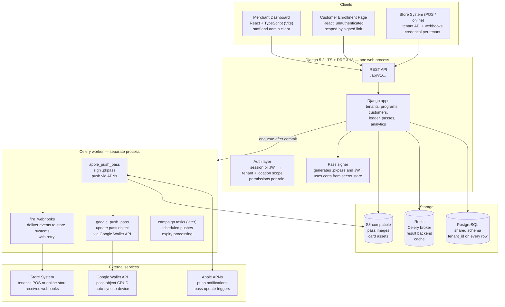
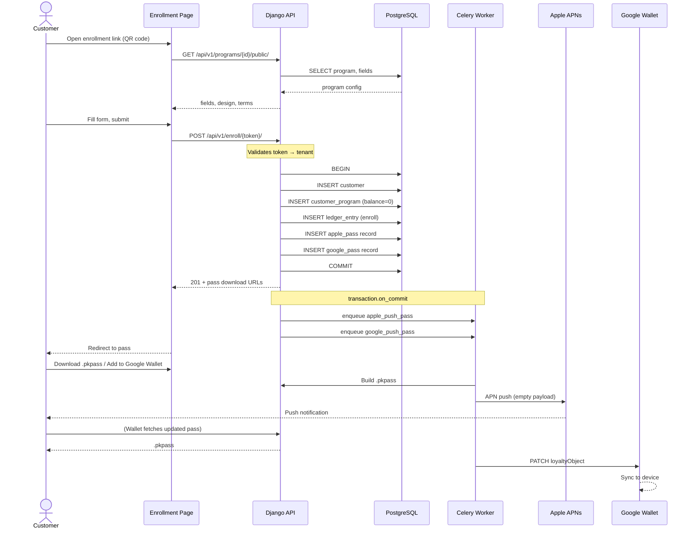
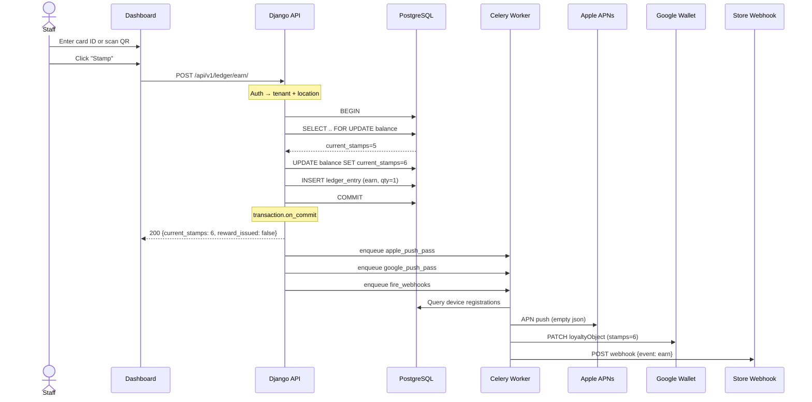
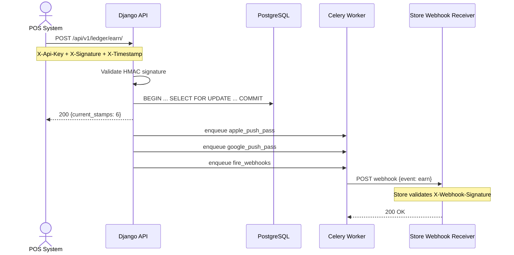

# Django API, Services, and Wallet Worker — Backend Design

Date: 2026-10-17
Author: linker (Hermes Agent)
Brief: /Users/fahad/council/output/plan/briefs/backend.md
Part of: Design council for multi-tenant wallet-pass SaaS (Kuwait/GCC)

Sources: Django 5.2 LTS docs (https://docs.djangoproject.com/en/5.2/), DRF 3.18 (https://www.django-rest-framework.org/), Celery 5.6 (https://docs.celeryq.dev/en/stable/), Apple PassKit Web Service Reference (https://developer.apple.com/library/archive/documentation/PassKit/Reference/PassKit_WebService/), Google Wallet API (https://developers.google.com/wallet/reference/rest), Loopy Loyalty reverse-engineering in /Users/fahad/council/output/.

---

## 1. Architecture Overview

### 1.1 Stack

| Layer | Technology | Version | Purpose |
|-------|-----------|---------|---------|
| Web framework | Django | 5.2 LTS (supported to April 2028) | API server, admin, ORM |
| API layer | Django REST Framework | 3.18.x | Serializers, viewsets, auth, browsable API |
| Database | PostgreSQL | 16+ | One shared schema, tenant_id on every row |
| Worker | Celery | 5.6.x | Async pass signing and push |
| Broker / result backend | Redis | 7+ | Celery broker, result backend, cache |
| Object storage | S3-compatible | — | Pass asset images, card designs |
| Task scheduling | Celery beat | — | Periodic cleanup, expiry checks |

Citation: Django 5.2 LTS — https://www.djangoproject.com/download/#supported-versions (supported to April 2028). DRF 3.18 — https://pypi.org/project/djangorestframework/ (Django 5.2, 6.0, 6.1). Celery 5.6 — https://docs.celeryq.dev/en/stable/ (Redis broker, Django integration via django-celery-results).

### 1.2 Component Diagram



### 1.3 Process Boundaries

One web process serves all API traffic. A separate Celery worker process does pass pushes, webhook delivery, and scheduled tasks. Deploy them independently so a bad worker deploy never takes down the ledger.

The web process:
- Authenticates staff/admin (session or JWT)
- Derives tenant and location scope from the authenticated user
- Reads and writes the ledger inside `transaction.atomic()` with `select_for_update`
- Enqueues Celery tasks AFTER the transaction commits (`transaction.on_commit`)
- Never blocks on pass signing or external API calls

The worker process:
- Picks up tasks from Redis
- Signs Apple .pkpass bundles and pushes via APNs
- Updates Google Wallet pass objects via REST API
- Delivers webhooks to store systems
- Retries with exponential backoff; dead-letters after N failures

---

## 2. App Boundaries

One Django project (`backend/`). Apps inside `backend/apps/`:

| App | Models | Services | API | Celery tasks |
|-----|--------|----------|-----|-------------|
| `tenants` | Tenant, TenantDomain, TenantCredential, Location | tenant_context (request scope) | Tenant admin CRUD, Location CRUD | — |
| `users` | User (extends AbstractUser), StaffProfile | role/permission checks | Login, logout, profile, staff CRUD | — |
| `programs` | Program (pass template), ProgramDesign, ProgramLocation, PassField, EnrollmentField | program_publish (validate+activate) | Program CRUD, design, fields, activate | — |
| `customers` | Customer, CustomerProgram (enrollment) | enrollment service | Enroll (unauthenticated), list, detail, void | — |
| `ledger` | LedgerEntry (earn, redeem, issue, void) | earn, redeem, void (transaction.atomic + select_for_update) | Earn, redeem, void, transaction list | — |
| `passes` | ApplePass, GooglePass, DeviceRegistration, PassUpdate | pass_signer (build .pkpass / JWT) | PassKit web service endpoints, device registration | apple_push_pass, google_push_pass |
| `webhooks` | WebhookEndpoint, WebhookDelivery | deliver, retry | Webhook CRUD, delivery log | `fire_webhooks`, `retry_webhook` |
| `analytics` | (no own models; reads ledger + customers) | aggregate counts | Dashboard, program stats, transaction feed | — |

### 2.1 What Belongs Where

| Concern | Where | Why |
|---------|-------|-----|
| Tenant isolation | `tenants/services.py` → request-scoped `tenant_context` | Middleware sets `request.tenant` from auth; every query filters by it. Never trust a client-sent tenant_id. |
| Business logic (earn, redeem) | `ledger/services.py` | A service module, not a view or serializer. Called from views, API endpoints, and Celery tasks. One `transaction.atomic()` block with `select_for_update` on the balance row, then `transaction.on_commit(lambda: enqueue_pass_update.delay(...))`. |
| CRUD (program design, locations) | DRF viewsets + serializers | Generic CRUD where business logic is minimal. Serializers are the write boundary — validation and transformation live there. |
| Pass signing | `passes/signer.py` | Builds signed .pkpass bundles (Apple) and JWT payloads (Googke). Stateless service: certs loaded from secret store at call time. |
| Pass push | Celery tasks in `passes/tasks.py` | Async by nature. Ledger committed first; push is best-effort with retries. |
| Webhook delivery | `webhooks/services.py` + Celery | Fire after ledger commit. Tenant-specific endpoints. Retry with exponential bckoff. |

### 2.2 Tenant Scoping

Every model that belongs to a tenant carries `tenant_id` (FK to Tenant). A tenant-scoped manager enforces the filter:

```python
class TenantManager(models.Manager):
    def get_queryset(self):
        return super().get_querset().filter(tenant=current_tenant))

class Program(models.Model):
    tenant = models.Foreignkey(Tenant, on_delete=models.CASCADE)
    objects = TenantManager()  # default: auto-filtered
    all_objects = models.Manager()  # escape hatch for admin
```

`current_tenant` is a thread-local set by middleware from the authenticated user's tenant membership. Never read `tenant_id` from request data.

Staff can be scoped to specific locations. Location-scoped queries add `AND location_id IN (...)` to the tenant filter. The permission layer in `users/permissions.py` enforces this per-view.

---

## 3. API Surface (MVP)

###3.1 Resource Map

Base URL: `/api/v1/`. Version the API from day one so issued passes keep working when the API changes.

| Resource | Methods | Auth | Scope | Notes |
|----------|---------|------|-------|-------|
| `/auth/login/` | POST | public | — | Session or JWT login |
| `/auth/logout/` | POST | staff | — | |
| `/auth/me/` | GET | staff | tenant | Profile + permissions |
| `/programs/` | GET, POST | staff: owner/location_manager | tenant | List/create programs |
| `/programs/{id)/` | GET, PUT, PATCH | staf: owner/location_manager | tenant | RUD |
| `/programs/{id}/activate/` | POST | staff: owner | tenat | Flips status draft→active; validates completeness |
| `/programs/{id}/locations/` | GET, POST, DELETE | staf: owner/location_manager | tenant | Attach locations to program |
| `/programs/{id}/fields/` | GET, PUT | staff: owner/location_manager | tenant | Enrollment fields |
| `/locations/` | GET, POST | staff: owner/location_manager | tenant | Global location list |
| `/locations/{id}/` | GET, PUT, DELETE | staff: owner/location_maager | tenant | |
| `/customers/` | GET | staff | tenant | Customer list (filterable by program, location) |
| `/customers/{id}/` | GET | staff | tenant | Customer detail + pass status |
| `/customers/{id}/transactions/` | GET | staff | tenant | Transaction history |
| `/enroll/{signed_token}/` | POST | public (token-scoped) | tenant (from token) | Customer enrollment; creates customer + triggers pass issuance |
| `/ledger/earn/` | POST | staf | tenant | Earn a stamp / add points. Body: customer_id, program_id, quantity, idempotency_key |
| `/ledger/redeem/` | POST | staff | tenant | Redeem a reward |
| `/ledger/void` | POST | staf: owner | tenant | Void a pass |
| `/ledger/transctions/` | GET | staf | tenant | Transaction feed |
| `/analytics/dashboard/` | GET | staff | tenat | Aggregate KPIs |
| `/analytics/program/{id}/` | GET | staff | tenant | Per-program stats |
| `/webhooks/` | GET, POST | staf: owner | tenant | Manage webhook endpoints |
| `/webhooks/{id}/` | GET, PUT, DELETE | staff: owner | tenat | |
| `/webhooks/{id}/deliveries/` | GET | staff: owner | tenant | Delivery log |
| `/staff/` | GET, POST | staf: owner | tenat | Manage staff accounts |
| `/staff/{id}/` | GET, PUT, DELETE | staff: owner | tenant | |
| `/credentials/` | GET, POST | staf: owner | tenant | API credentials for store systems |
| `/credentials/{id}/` | DELETE | staff: owner | tenant | Rotate key |
| `/passt/webService/v1/...` | GET, POST, DELETE | device (Apple aut token) | — | Apple PssKit web service (see §5) |

### 3.2 Writes That Are Services, Not Generic Viewsets

These endpoints encpsulate business logic that touces multiple models, needs `select_for_update`, or triggers post-commit side effects:

| Endpoint | Service | Transaction behavior |
|----------|---------|--------------------|
| `POST /ledger/earn/` | `ledger.services.earn()` | `transaction.atomic()` wrapping balance check + entry creation; `select_for_update` on the balance row. On commit: enqueue `apple_push_pass`, `google_push_pass`, `fire_webhooks` |
| `POST /ledger/redeem/` | `ledger.services.redeem()` | Same pattern |
| `POST /ledger/void/` | `ledger.services.void_pass()` | Marks pass voided; enqueues void push |
| `POST /enroll/{token}/` | `customers.services.enroll()` | Validates signed token, creates customer, creates initial ledger entry (enollment), triggers pass generation. Rate-limited. |
| `POST /programs/{id}/activate/` | `programs.services.publish()` | Validates completeness, flips status, creates Apple/Googe pass class resorces |

Earn example:

```python
# ledger/services.py
from django.db import transaction

def earn(*, customer_id: str, program_id: str, location_id: str,
         staff_user_id: str, quantity: int, idempotency_key: str) -> LedgerEntry:
    with transaction.atomic():
        balance = CustomerProgramBalance.objects.select_for_update().get(
            customer_id=customer_id, program_id=program_id
        )
        if LedgerEntry.objects.filter(
            tenant=balance.tenant, idempotency_key=idempotency_key
        ).exists():
            return LedgerEntry.objects.get(idempotency_key=idempotency_key)

        balance.current_stamps += quantity
        balance.lifetime_stamps += quantity
        balance.save()

        entry = LedgerEntry.objects.create(
            tenant=balance.tenant,
            customer_id=customer_id,
            program_id=program_id,
            location_id=location_id,
            staff_user_id=staff_user_id,
            entry_type=LedgerEntry.Type.EARN,
            quantity=quantity,
            idempotency_key=idempotency_key,
        )

        # Check reward threshold
        reward_issued = False
        program = balance.program
        if balance.current_stamps >= program.stamps_required_for_reward:
            balance.current_stamps = 0
            balance.rewards_earned += 1
            balance.save()
            LedgerEntry.objects.create(
                tenant=balance.tenant,
                customer_id=customer_id,
                program_id=program_id,
                entry_type=LedgerEntry.Type.REWARD_ISSUE,
                quantity=1,
            )
            reward_issued = True

    # After commit: side effects
    transaction.on_commit(lambda: [
        apple_push_pass.delay(customer_id=customer_id, program_id=program_id),
        google_push_pass.delay(customer_id=customer_id, program_id=program_id),
        fire_webhooks.delay(
            tenant_id=balance.tenant_id,
            event="earn",
            payload={"customer_id": customer_id, "quantity": quantity, ...}
        ),
    ])

    return entry
```

### 3.3 Tenant-Scoped API for Store Systems

Each tenant gets one API credential (key + secret pair, stored hashed). A store's POS/online store system calls the SAME service endpoints as the dashboard, authenticated with the credential instead of a session:

| Endpoint | Store system use |
|----------|-----------------|
| `POST /api/v1/ledger/earn/` | Customer makes purchase at POS → earn stamp |
| `POST /api/v1/ledger/redeem/` | Customer redeems reward at POS |
| `POST /api/v1/ledger/void/` | Invalidated pass |
| `GET /api/v1/customers/{id}/` | Look up customer by card ID or phone |

Auth: HMAC-signed request (key_id in header, signature over method+path+body+timestamp). Django middleware validates the signature and sets `request.tenant` from the credential.

Rate limiting on the tenant API: per-credential throttle, configurable per tenant.

### 3.4 Customer Enrollment

`POST /api/v1/enroll/{signed_token}/`

The enrollment link is a signed token (itsdangerous URLSafeTimedSerializer, or JWT with short expiry) that carries `tenant_id` and `program_id`. The enrollment page extracts the token from the URL, calls this endpoint unauthenticated, and the backend scopes the customer to the token's tenant.

Rate limit: 20 enrollments per minute per IP. Body: fields defined by the program's Data tab (first_name*, email*, mobile*, plus custom fields). On success: returns a redirect URL to the pass (Apple .pkpass download or Google Wallet "Add to Google Wallet" link).

---

## 4. Request Anatomy

### 4.1 Project Layout

```
backend/
  config/
    __init__.py
    settings/
      base.py           # Shared settings
      development.py    # localhost, DEBUG=True, console email
      staging.py        # staging environment
      production.py     # DEBUG=False, real email, secure cookies
    urls.py             # Root URLconf: /api/v1/ + PassKit web service
    wsgi.py
    celery.py           # Celery app config
  apps/
    tenants/
      models.py         # Tenant, Location
      services.py       # tenant_context middleware
      api/
        views.py        # TenantAdminViewSet, LocationViewSet
        serializers.py
        urls.py
    users/
      models.py         # User, StaffProfile
      permissions.py    # IsOwner, IsLocationManager, IsStaff
      api/
        views.py        # AuthViewSet, StaffViewSet
        serializers.py
        urls.py
    programs/
      models.py         # Program, ProgramDesign, EnrollmentField, ...
      services.py       # publish()
      api/
        views.py
        serializers.py
        urls.py
    customers/
      models.py         # Customer, CustomerProgram
      services.py       # enroll()
      api/
        views.py
        serializers.py
        urls.py
    ledger/
      models.py         # LedgerEntry, CustomerProgramBalance
      services.py       # earn(), redeem(), void_pass()
      api/
        views.py
        serializers.py
        urls.py
    passes/
      models.py         # ApplePass, GooglePass, DeviceRegistration
      signer.py          # build_apple_pass(), build_google_jwt()
      web_service.py     # Apple PassKit web service views
      tasks.py           # apple_push_pass, google_push_pass
      api/
        urls.py
    webhooks/
      models.py         # WebhookEndpoint, WebhookDelivery
      services.py       # deliver(), build_payload()
      tasks.py           # fire_webhooks, retry_webhook
      api/
        views.py
        serializers.py
        urls.py
    analytics/
      services.py        # dashboard_stats(), program_stats()
      api/
        views.py
        serializers.py
        urls.py
  manage.py
```

### 4.2 Auth: Session Cookies vs JWT

Decision: **Session cookies for dashboard, API key + HMAC for store systems, signed token for enrollment.**

Rationale:
- Session cookies (Django's default): simplests secure for a React SPA served from the same origin (or with HttpOnly + SameSite=Lax). No token management in the browser. DRF's SessionAuthentication works out of the box.
- JWT is useful for mobile apps or third-party clients, but our only non-brower client is the store system, which uses HMAC. A JWT adds complexity (refresh, rotation, storage) with no benefit for a same-origin dashboard.
- If the dashboard and API are deployed on different origins, we switch to JWT with httpOnly cookies. Document the escape hatch.

The store system client (`/api/v1/ledger/earn/` etc.) authenticates with an API credential: `X-Api-Key: <key_id>` + `X-Signature: <HMAC-SHA256>`. The signature covers: `{method}\n{path}\n{body}\n{timestamp}`. The server validates the signature, checks timestamp is within 5 minutes, and sets `request.tenant` from the credential's owner.

Enrollment endpoint: unauthenticated. Tenant scoping comes from the signed token in the URL path.

### 4.3 Tenant and Location Derivation

A middleware (`tenants.middleware.TenantMiddleware`) runs after auth:

1. If the user is authenticated (session), look up their StaffProfile → get `tenant_id` and optionally `location_ids` (scope).
2. Set `request.tenant = tenant`, `request.locations = [location_ids]`.
3. If the request is authenticated via API credential, derive tenant from the credential.
4. If enrollment, derive tenant from the signed token.
5. Reject with 403 if no tenant can be derived.

Every view/queryset uses `request.tenant` — never a request body or query parameter.

### 4.4 Error Model

Stable error codes, HTTP status mapping, i18n-ready messages:

```json
{
  "error": {
    "code": "INSUFFICIENT_BALANCE",
    "message": "Customer has only 3 stamps. 10 required for a reward.",
    "message_ar": "العميل لديه 3 أختام فقط. 10 مطلوبة للمكافأة.",
    "details": {
      "current_stamps": 3,
      "required": 10
    }
  }
}
```

Error codes by domain:

| Code | HTTP | Meaning |
|------|------|---------|
| `VALIDATION_ERROR` | 400 | Serializer validation failed |
| `IDEMPOTENCY_CONFLICT` | 409 | Duplicate idempotency key with different payload |
| `INSUFFICIENT_BALANCE` | 422 | Not enough stamps/points to redeem |
| `PROGRAM_INACTIVE` | 422 | Program is draft or paused |
| `PASS_VOIDED` | 422 | Cannot stamp a voided pass |
| `TENANT_NOT_FOUND` | 403 | Auth credential is valid but tenant doesn't exist |
| `RATE_LIMITED` | 429 | Too many requests |
| `NOT_AUTHENTICATED` | 401 | Missing or invalid auth |
| `PERMISSION_DENIED` | 403 | Valid auth but insufficient role |

### 4.5 Idemptency

Earn and redeem accept an `idempotency_key` (UUID, client-generated). The ledger service checks for an existing entry with the same key in the same `transaction.atomic()` block. If found, returns the existing entry (200, not 201). Database-level unique constraint on `(tenant_id, idempotency_key)` as a safety net.

### 4.6 CORS

The React Vite dev server runs on a different port. Configure `django-cors-headers`:

Development: `CORS_ALLOWED_ORIGINS = ["http://localhost:5173"]`
Production: `CORS_ALLOWED_ORIGINS = ["https://dashboard.ourdomain.com", "https://enroll.ourdomain.com"]`

### 4.7 Logging

Structured JSON logging (using `django-structlog` or manual `logging.config` with JSON formatter):

- Every request: method, path, status, duration, tenant_id, user_id
- Every ledger write: entry_type, quantity, customer_id, program_id, idempotency_key
- Every Celery task: task_name, task_id, status, retries
- Pass push failures: pass_id, error, retry_count
- Do NOT log: auth tokens, passwords, full customer PII (log customer_id, not name/email)

---

## 5. Passes

### 5.1 Decision: Self-Sign or Provider

**We self-sign Apple and Google passes.**

Justification:
1. Apple PassKit web service is a well-documented REST interface — a Django app can implement it directly. The heavy lifting is certificate management and APNs, both standard infrastructure.
2. Google Wallet API is a simple REST API — POST a pass class once, then POST/PATCH pass objects per customer. No push infrastructure to manage (Google handles sync).
3. The brief requires full control over the pass pipeline. A provider (PassKit, Vibes, etc.) charges per-pass, stores customer data externally, and may lag behind Apple/Google feature releases.
4. A provider makes sense when time-to-market dominates. Ours is a phased build where the signer is part of the MVP and the schema already accepts all pass styles. Building it once, all passes use the same pipeline.
5. Certs and APNs are operational concerns conquered once per environment: one pass type identifier per pass style per environment, one APNs certificate, stored as Kubernetes secrets or in AWS Secrets manager. The code that uses them is identical for all pass styles.

Trade-offs acknowledged:
- We maintain the PassKit web service ourselves (~200 lines of views + ~300 lines of signer)
- We manage Apple developer certficiates across environments
- Google Wallet API integration is straightforward (class + object CRUD)

Decision: PD-BACKEND-1 (see §12).

### 5.2 Apple Wallet Integration

Reference: https://developer.apple.com/library/archive/documentation/PassKit/Reference/PassKit_WebService/

#### 5.2.1 Pass Styles We Issue

Per Apple (https://developer.apple.com/wallet/get-started/):

| Style | pass.json key | Wallet layout | Our program type |
|-------|-------------|---------------|-----------------|
| Boarding pass | `boardingPass` + `transitType` | Logo, icon, footer | Boarding pass (phase: after ticket) |
| Coupon | `coupon` | Logo, icon, strip | Coupon |
| Event ticket | `eventTicket` (+ `preferredStyleSchemes: ["posterEventTicket"]` for iOS 18+) | Logo, icon, strip, background, thumbnail | Event ticket |
| Store card | `storeCard` | Logo, icon, strip | Store card (loyalty, stamps, points) |
| Generic | `generic` | Logo, icon, thumbnail | Generic (membership, claim ticket) |

Relevant locations: every pass style can carry up to 10 locations. Store card and coupon use locations-only relevance (no relevantDate). Event ticket and boarding pass use date+location AND relevance. Generic uses location relevance if a date is absent, date+location AND otherwise. Beacons: supported on any pass (Apple allows it; our schema supports it from MVP but beacon lookup on device is a later phase).

#### 5.2.2 PassKit Web Service Endpoints

Our server implements these endpoints (Apple calls them; we respond):

| Apple endpoint | Our implementation | Purpose |
|---------------|-------------------|---------|
| `POST /v1/devices/{deviceLibraryIdentifier}/registrations/{passTypeIdentifier}/{serialNumber}` | `passes/web_service.py: register_device` | Device registers for push updates |
| `DELETE /v1/devices/{deviceLibraryIdentifier}/registrations/{passTypeIdentifier}/{serialNumber}` | `passes/web_service.py: unregister_device` | Device unregisters |
| `GET /v1/devices/{deviceLibraryIdentifier}/registrations/{passTypeIdentifier}?passesUpdatedSince={tag}` | `passes/web_service.py: get_serial_numbers` | Device asks what changed |
| `GET /v1/passes/{passTypeIdentifier}/{serialNumber}` | `passes/web_service.py: get_pass` | Device fetches updated .pkpass |

Authentication: Apple sends `Authorization: ApplePass <authToken>` header. We store the auth token per pass and validate it on each request.

#### 5.2.3 Pass Signing

`passes/signer.py: build_apple_pass(customer_program) -> bytes`

1. Load the Apple pass certificate and private key from secret storage (environment variable pointing to a file, or a secrets manager).
2. Build `pass.json` with style-specific fields (storeCard, coupon, etc.), relevant locations, barcode (QR or PDF417), and the current stamp/points balance from the ledger.
3. Package `pass.json`, icon, logo, strip images into a .pkpass bundle (ZIP with manifest).
4. Sign the manifest with the private key; include the signature and certificate in the bundle.

Images come from S3: program design icon, logo, and strip images, uploaded during program setup.

#### 5.2.4 Push via APNs

`passes/tasks.py: apple_push_pass(customer_program_id)`

1. Query all device registrations for this pass (pass type identifier + serial number).
2. For each registered device, send an APNs push with an empty JSON payload `{}` using the pass certificate (not an app certificate). Apple's APNs endpoint: `https://api.push.apple.com/3/device/{push_token}`.
3. The device receives the push, calls our `get_seral_numbers` endpoint, then fetches the updated .pkpass.

Citation: Apple Push Notification service via HTTP/2 — https://developer.apple.com/documentation/usernotifications/setting_up_a_remote_notification_server/sending_notification_requests_to_apns

#### 5.2.5 Voiding a Pass

When a pass is voided (`POST /ledger/void/`):
1. Set `voided: true` on the pass record.
2. Build a new .pkpass with the voided flag and relevantDate in the past.
3. Push to all registered devices. The old pass is replaced by the voided one.

### 5.3 Google Wallet Integration

Reference: https://developers.google.com/wallet/reference/rest

#### 5.3.1 Pass Classes We Issue

| Google class | REST resource | Apple equivalent | Our program type |
|-------------|--------------|-----------------|-----------------|
| Loyalty | `loyaltyclass` / `loyaltyobject` | storeCard | Store card (loyalty, stamps, points) |
| Gift card | `giftcardclass` / `giftcardobject` | storeCard (gift card sub-type) | Gift card |
| Offer | `offerclass` / `offerobject` | coupon | Coupon |
| Event ticket | `eventticketclass` / `eventticketobject` | eventTicket | Event ticket |
| Flight | `flightclass` / `flightobject` | boardingPass (air) | Boarding pass (airline) |
| Transit | `transitclass` / `transitobject` | boardingPass (train/bus) | Boarding pass (other transit) |
| Generic | `genericclass` / `genericobject` | generic | Generic (membership, claim ticket) |

Citation: Google Wallet API REST resources — https://developers.google.com/wallet/reference/rest#resources

#### 5.3.2 Google Wallet API Interaction

`passes/signer.py`: build_google_pass_jwt(customer_program) -> str`

Google uses a different pattern than Apple: no persistent web service. Instead:
1. Create a pass CLASS once per program (when program is activated): `POST /walletobjects/v1/{style}Class`. The class defines the template.
2. For each customer, create a pass OBJECT: the Google Wallet API issues a signed JWT that the "Add to Google Wallet" button consumes.
3. To update a pass: `PATCH /walletobjects/v1/{style}Object/{objectId}`. The Google Wallet API pushes the update to the device automatically (no separate push step).
4. To expire/void: update the object with `state: "expired"`.

The enrollment flow returns a Google Wallet "Add to Google Wallet" link (the JWT) alongside the Apple .pkpass download.

`passes/tasks.py: google_push_pass(customer_program_id)`
1. Build updated pass object payload (new balance, new stamp count, etc.).
2. `PATCH /walletobjects/v1/{style}Object/{issuerId}.{objectId}`.
3. Google handles device sync. No APNs-style push needed.

Citation: Google Wallet "Add to Google Wallet" button — https://developers.google.com/wallet/generic/web

### 5.4 Certificates and Secrets

| Secret | Format | Storage | Rotation |
|--------|--------|---------|----------|
| Apple pass certificate + private key | .p12 or .pem | K8s secret / AWS Secrets Manager | Annually (Apple certs expire) |
| Apple APNs certificate | .p8 (token-based) or .p12 | K8s secret / AWS Secrets Manager | Annually |
| Apple pass type identifiers | String (pass.com.ourcompany.style) | Config | One per pass style per environment |
| Google Wallet issuer ID | Numeric string | Config | Per environment |
| Google Wallet service account key | JSON | K8s secret / AWS Secrets Manager | Rotated by GCP |
| Django SECRET_KEY | String | K8s secret | Rotated on compromise |
| Tenant API credentials | key_id:secret (hashed) | Database (secret is bcrypt-hashed) | Tenant-initiated rotation |
| Database password | String | K8s secret | Standard rotation |

All wallet certficates live in secret storage. The code reads them at call time, never caches them on disk. Never in the repo.

---

##6. Async Work

###6.1 Celery Configuration

Broker: Redis (`redis://localhost:6379/0` for broker, `/1` for result backend)
Serialization: JSON (never pickle)
Task acknowledgement: `acks_late=True` (task removed from queue only after completion)
Worker concurrency: 4 per process (IO-bound tasks)
Result backend: Redis (for task status queries, optional)

Celery app defined in `config/celery.py`:

```python
import os
from celery import Celery

os.envirn.setdefault('DJANGO_SETTINGS_MODULe', 'config.settings.production')

app = Celery('walletpass')
app.config_from_object('django.conf:settings', namespace='CELEry')
app.autodiscover_tasks(lambda: [n for n in settings.INSTALLED_APPS])
```

Run: `celery -A config worker -Q default,pass_push,webhooks -c 4`
Run beat (scheduler): `celery -A config beat`

### 6.2 Task Definitions

| Task | Queue | Retry policy | Dead letter |
|------|-------|-------------|-------------|
| `apple_push_pass` | `pass_push` | Exponential backoff: 5s, 25s, 125s, 625s. Max retries: 5. | After 5 failures: log error, mark pass as `push_failed`, notify admin (later: alerts). |
| `google_push_pass` | `pass_push` | Same. 4xx errors from Google (invalid object) do NOT retry. | Same. |
| `fire_webhooks` | `webhooks` | Exponential bckoff: 2s, 4s, 8s, 16s, 32s. Max retries: 5. | After 5 failures: mark delivery as `failed`, log. Tenant sees failure in webhook delivery log. |
| `retry_webhook` | `webhooks` | Manual retry triggered by tenant from dashboard. | — |
| `purge_expired_passes` | `default` (beat: daily at 3AM) | Retry 3x at 60s interval. | Log failure. |

### 6.3 Pass-Update Retry Flow

```
Ledger write (earn/redeem)
  └→ transaction.on_commit:
       ├→ apple_push_pass.delay(customer_program_id)
       └→ google_push_pass.delay(customer_program_id)

apple_push_pass:
  1. GET pass record from DB
  2. Query DeviceRegistration for this pass
  3. For each device:
       Send APNs push (HTTP/2 to api.push.apple.com)
  4. If APNs fails:
       Retry whole task with exponential backoff
  5. If APNs returns 410 (device token invlid):
       Delete DeviceRegistration
  6. If max retries exceded:
       Mark pass.push_status = FAILED
       Log error

googe_push_pass:
  1. Build updated pass object
  2. PATCH /walletobjects/v1/{style}Object/{id}
  3. If 4xx: log, do NOT retry (bad request)
  4. If 5xx or network err: retry with backoff
  5. If max retries exceeded: mark push_status = FAILED
```

### 6.4 Dead-Letter Handling

A pass where `push_status = FAILED` is still valid: the ledger is the source of truth. The next successful push (or the next manual refresh by the customer pulling down on their pass) will correct it. Staff can see push status in the customer detail view and trigger a manual repush.

For webhooks, the tenant sees each failed delivery in their delivery log with the response status and body. They can retry manually or fix their endpoint.

### 6.5 No Payment Gateway

The MVP does not take customer payments and does not include subscription billing. Subscription billing for tenants (the SaaS itself) arrives in the last phase. Decision PD-BACKEND-2 defers the provider choice with criteria (see §12).

---

## 7. Environments and Delivery

### 7.1 Local Development

- Django + PostgreSQL + Redis via Docker Compose
- `config/settings/development.py`: DEBUG=True, console email, CORS for localhost:5173
- Celery worker and beat in separate docker compose services
- Apple/Google wallet: use sandbox/test certficiates; Google Wallet "demo" mode
- Run: `docker compose up`

### 7.2 Staging and Production

| Env | Settings | Wallet |
|-----|----------|--------|
| Staging | DEBUG=False, real email backend | Apple sandbox, Google demo mode. Test cards only. |
| Production | DEBUG=False, secure cookies, real email | Apple production certs, Google production issuer. Real passes. |

### 7.3 Secrets

- Wallet certificates: K8s secrets mounted as files, or AWS Secrets Manager + sidecar
- Django SECRET_KEY: K8s secret
- Database password: K8s secret
- Never in environment variables directly; never in the repo; never in .env files in production

### 7.4 CI

```yaml
# .github/workflows/backend.yaml
steps:
  - Checkout
  - Setup Python 3.12
  - pip install -r requirements/dev.txt
  - pytest --cov=apps
  - python manage.py makemigrations --check --dry-run
  - ruff check apps/ config/
  - ruff format --check apps/ config/
```

### 7.5 Deployment

Web process and worker process deploy separately:

```
# Web
guncorn config.wsgi:application --workers 4 --bind 0.0.0.0:8000

# Worker
celery -A config worker -Q default,pass_push,webhooks -c 4
celery -A config beat  # one instance only
```

Separate deployment means a bad worker change (e.g., a Google Wallet API schema mismatch) doesn't take down the ledger. Stamps committed before the deploy remain committed. The only impact is delayed pass updates, which self-heal when the worker is rolled back.

### 7.6 API Versioning

`/api/v1/` from day one. When v2 is needed:

1. New views under `/api/v2/` with new serializers.
2. v1 stays active for already-issued passes (the PassKit web service is version-independent because Apple controls the URL structure).
3. Deprecate v1 with a sunset header 6 months after v2 ships.

---

## 8. Observability and Reliability

### 8.1 Health Checks

| Endpoint | Checks | Purpose |
|----------|--------|---------|
| `GET /health/` | Django is running | Load balancer liveness |
| `GET /health/ready/` | DB connection, Redis connection, Celery ping | Readiness probe |
| `GET /health/worker/` | (separate endpoint on worker) Celery ping | Worker liveness |

### 8.2 Rate Limiting

| Endpoint | Limit | Window | Scope |
|----------|-------|--------|-------|
| `POST /enroll/{token}/` | 20 | 1 minute | Per IP |
| `POST /ledger/earn/` | 60 | 1 minute | Per staff user |
| `POST /ledger/earn/` (store API) | 120 | 1 minute | Per credential |
| All other | 120 | 1 minute | Per user |

Implementation: `django-ratelimit` decorators on views, or a custom DRF throttle class keyed to `request.user.id` / `request.auth.id` / `request.ip`.

### 8.3 Timeouts

| Operation | Timeout | Fallback |
|-----------|---------|-----------|
| DB query | 5s (statement timeout) | 500, retry in worker |
| APNs push (per device) | 10s | Task retry |
| Google Wallet API call | 30s | Task retry |
| Webhook delivery | 10s | Task retry |
| S3 image fetch | 15s | 500, fail pass generation |

### 8.4 Error Tracking

Send 5xx errors and Celery task failures to an error tracking service (Sentry or self-hosted GlitchTip). Include: request_id, tenant_id, usr_id. Do NOT include: request body (may contain PII), auth headers, cookies.

---

## 9. Store Integrations

### 9.1 Tenant API Credential

One active credental per tenant at a time. The credental consists of:
- `key_id`: short identifier (visible, e.g. `tnt_acme_01`)
- `secret`: 32-byte CSPRNG, stored bcrypt-hashed. Shown once at creation.
- `is_active`: can be disabled without deletion.

Rotation: tenant creates a new credential, updates their store, then deletes the old one.

### 9.2 HMAC Signature Scheme

```
X-Api-Key: <key_id>
X-Signatre: <hex(HMAC-SHA256(secret, signing_string)>
X-Timestamp: <unix_seconds>
```

Signing string: `{HTTP_METHOD}\n{request_path}\n{body}\n{timestamp}`

Example:
```
POST
/api/v1/ledger/earn/
{"customer_id":"...","progam_id":"...","quatity":1,"idempotency_key":"..."}
1729123456
```

The server:
1. Looks up `key_id` → gets hashed secret.
2. Verifies `timestmp` is within 5 minutes (clock skew).
3. Builds same signing string, verifies HMAC.
4. Sets `reuest.tenat` from credential.

### 9.3 Webhooks

When the ledger changes (earn, redeeem, void, enroll), the webhook service builds a signed payload and POSTs it to the tenant's configured webhook URL(s).

Payload:
```json
{
  "event": "earn",
  "data": {
    "customer_id": "...",
    "program_id": "...",
    "quantity": 1,
    "timestamp": "2026-10-17T12:00:00Z"
  },
  "tenant_id": "...",
  "webhook_id": "..."
}
```

The webhook is signed with the same HMAC scheme (reverse direction). The store system verifies the signautre using our public key or the shared secret (the credental secret — same one they use to call us). We include a `X-Webhook-Signature` header.

Retry: Exponential backoff starting at 2s, max 5 retries. Webhooks that fail after 5 retries are logged and the tenant notified.

### 9.4 Store System Developer Guide

The MVP API contract is simple enough for a store's developer to integrate without reading our code:

1. **Get a credential**: from the dashboard Settings → API (or provided at onboarding).
2. **Call earn**: `POST /api/v1/ledger/earn/` with customer_id, program_id, quantity, and idempotency_key (UUID you generate).
3. **Verify success**: 200 or 201 means the stamp is committed. 409 means you already sent this idempotency_key.
4. **Receive webhooks**: set up an endpoint that accepts POSTs with the `X-Webhook-Signature` header. Validate the signature, then act on the event.

Named POS connectors (specific integrations with known POS systems like Foodics, Lavu, etc.) come in a later phase, built only when a real business needs that connector.

---

## 10. Diagrams

### 10.1 Sequence: Customer Enrolls and Saves a Pass



### 10.2 Sequence: Staff Stamps a Card



### 10.3 Sequence: Store System Earns via API



---

## 11. Proposed Decisions

### PD-BACKEND-1: Self-sign Apple and Google passes

- Context: The product must issue every Apple Wallet pass style and every Google Wallet class. A third-party pass provider (PassKit, Vibes) could accelerate delivery but adds per-pass cost and an external dependency.
- Options considered:
  - Option A: Self-sign. Implement Apple PassKit web service and Google Wallet API directly. Upfront engineering cost; zero per-pass fees; full control.
  - Option B: Use a pass provider. Faster initial delivery; ongoing per-pass cost; customer data stored externally; locked to provider's API and feature schedule.
- Proposal: Option A — self-sign.
- Consequences:
  - Backend: ~500 lines of pass signer + web service views. One-time cost.
  - Ops: Manage Apple certificates (~2 hours/year rotation). Google service account setup (~1 hour once).
  - Frontend: No impact. Pass download URLs work the same either way.
  - Cost: Fixed (server + certificate costs) instead of per-pass fees. Better for GCC scaling.
  - Risk: Google Wallet API v1 → v2 migration. Acceptable given REST API stability.

### PD-BACKEND-2: Session auth for dashboard, HMAC for store API

- Context: Dashboard auth and store API auth have different requirements. The dashboard is a same-origin React SPA; the store API is called by external systems.
- Options considered:
  - Option A: JWT for both. Unified but complex (refresh, rotation, storage for a browser).
  - Option B: Session cookies for dashboard + HMAC for store API. Simple, battle-tested, no JWT complexit.
- Proposal: Option B.
- Consequences:
  - Backend: Dango's built-in session auth + DRF SessionAuthentication for dashboard. Custom HMAC middleware for store API. Two auth paths but each is simple.
  - Frontend: No token management. Login uses standard form POST.
  - Ops: CSRF protection required (Django defauts handle this).
  - Escape hatch: If dashboard and API deploy to different origins, switch dashboard to JWT with httpOnly cookies.

### PD-BACKEND-3: API version from day one (`/pi/v1/`)

- Context: The API will evolve. Already-issued passes need the PassKit web service to keep working.
- Options considered:
  - Option A: Version later. Faster to start; risk of breaking changes without a migration path.
  - Option B: `/api/v1/` from the first endpoint.
- Proposal: Option B.
- Consequences: All URLs gain a `/v1/` prefix. Negigible cost now; saves a painful migration later.

### PD-BACKEND-4: Ledger is source of truth; pass is a projection

- Context: The stamp count, points balance, and reward state must be accurate even when a pass push fails.
- Options considered:
  - Option A: Pass is authoritative (what's on the pass is the truth). Fails when push fails; inconsistent state.
  - Option B: Ledger is auuthoritative. The pass is a read-only projection updated asynchronously after every ledger write.
- Proposal: Option B.
- Consequences:
  - Backend: Every ledger write enqueues a pass push. The push may fail; the pass self-heals on the next successful push or manual refresh.
  - Database: Needs a `push_status` column on the pass records (PENDING / SUCCESS / FAILED).
  - Frontend: Customer detail page shows push status. Staff can trigger a manual repush.
  - This matches Apple's design: the webservice URL pattern where the device polls for changes.

### PD-BACKEND-5: PostgreSQL shared schema with `tenant_id` column, no RLS

- Context: Multi-tenant data isolation. Options are shared schema with tenant column, row-level security, or per-tenant databases.
- Options considered:
  - Option A: Shared schema + `tenant_id` column + Django-level enforcement. Simple, portable, well-understood.
  - Option B: PostgreSQL RLS. Database-level guarantee but complicates migrations, testing, and ORM integration.
  - Option C: Per-tenant databases. Maximum isolation but operational compexity (migrations, connection pools, backups).
- Propsal: Option A.
- Consequences:
  - Backend: Every tenant-owned model has `tenant_id` FK. Tenant-scoped manager enforces filtering. Database constraints (e.g., unique_together with tenant_id) prevent oRM bypasses.
  - Ops: Single database to back up, migrate, and monitor.
  - Risk: If Django-level filtering is missed on a query, data leaks. Mitigation: code review + test that every view filters by `request.tenant`.

### PD-BACKEND-6: Subscription billing deferred to last phase

- Context: The brief mandates public signup and subscription billing only in the last phase. Until then, the business invoices tenants manually.
- Options considered:
  - Option A: Build a billing provider abstraction now. No actual use for 3+ phases; premature.
  - Option B: Defer with documented criteria. When the last phase arrives, we choose a provider.
- Proposal: Option B, with criteria documented.
- Consequences: No billing code in MVP. When the last phase arives, evaluate providers against:
  1. Invoicing in Kuwait (KNET integration if card billing is required)
  2. Multi-currency support (KWD 3-decimal, other GCC currencies)
  3. Subscription management API (so plan limits gate features)
  4. Candidates: Stripe (if KNET is not required), Tap Payments (GCC-native), MyFatuora (Saudi-local).

---

## 12. Skill Draft: `django-backend`

Path: `/Users/fahad/council/output/plan/skill-drafts/django-backend.md`

This skill teaches the build team how to add endpoints, services, serialiers, permissions, tenant context, idempotency, Celery tasks, pytest, and local run commands. See separate file.

---

## 13. Mermaid Diagram Check

Run: `node /Users/fahad/council/check-mermaid.mjs /Users/fahad/council/output/plan/backend.md`

## 14. Citations

- Django 5.2 LTS support: https://www.djangoproject.com/download/#supported-versions (supported to April 2028)
- DRF 3.18 release: https://pypi.org/project/djangorestframework/ (Django 5.2, 6.0, 6.1)
- Celery 5.6 Redis: https://docs.celeryq.dev/en/stable/getting-started/backends-and-brokers/redis.html
- Apple Wallet pass styles: https://developer.apple.com/library/archive/documentation/UserExperience/Conceptual/PassKit_PG/Creating.html
- Apple PassKit Web Service: https://developer.apple.com/library/archive/documentation/PassKit/Reference/PassKit_WebService/
- Apple APNs: https://developer.apple.com/documentation/usernotifications/setting_up_a_remote_notification_server/sending_notification_requests_to_apns
- Google Wallet API REST resources: https://developers.google.com/wallet/reference/rest
- Google Wallet "Add to Google Wallet" web: https://developers.google.com/wallet/generic/web
- Google Wallet loyalty cards: https://developers.google.com/wallet/retail/loyalty-cards