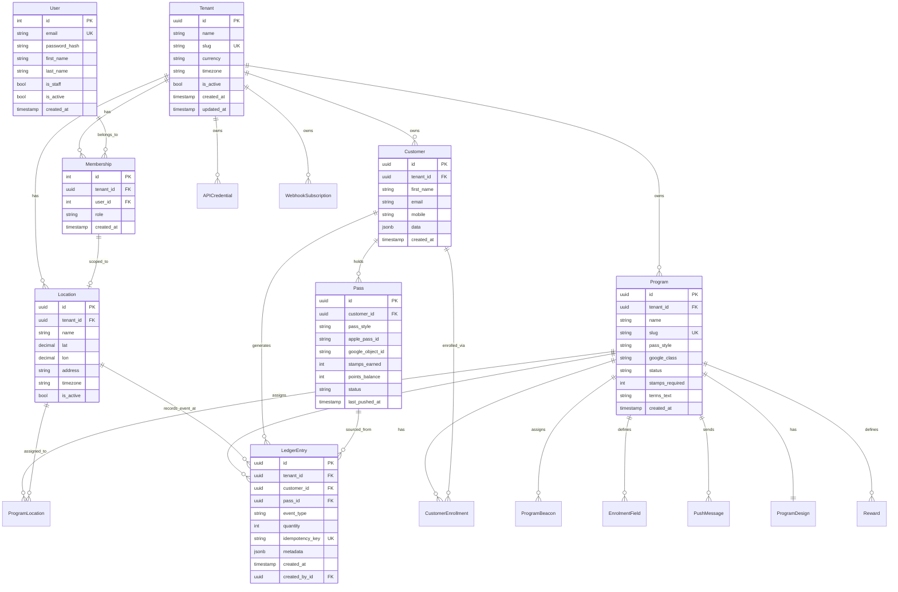
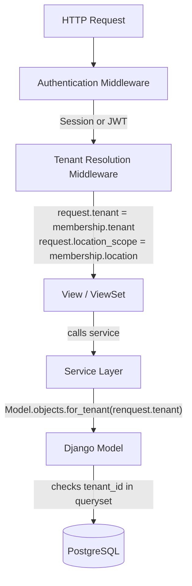
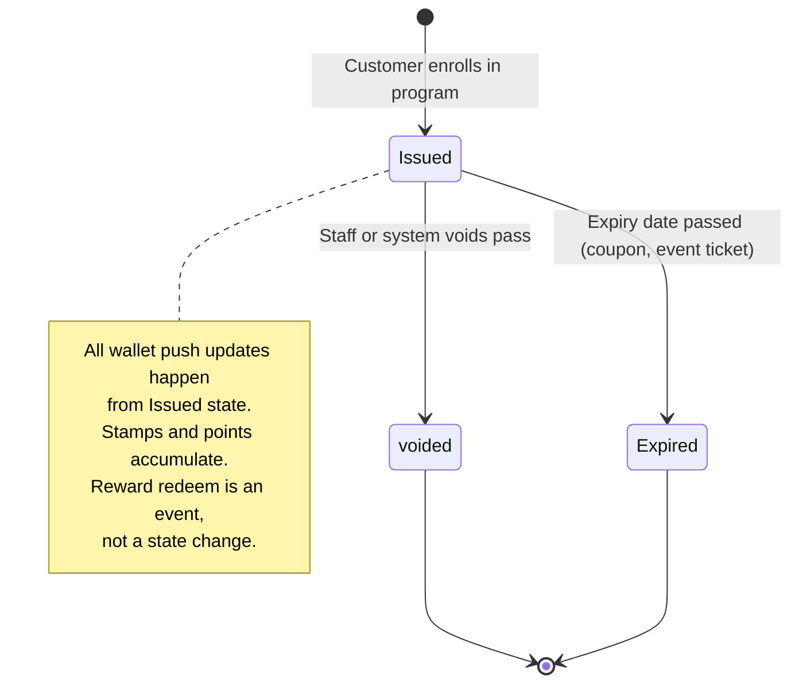
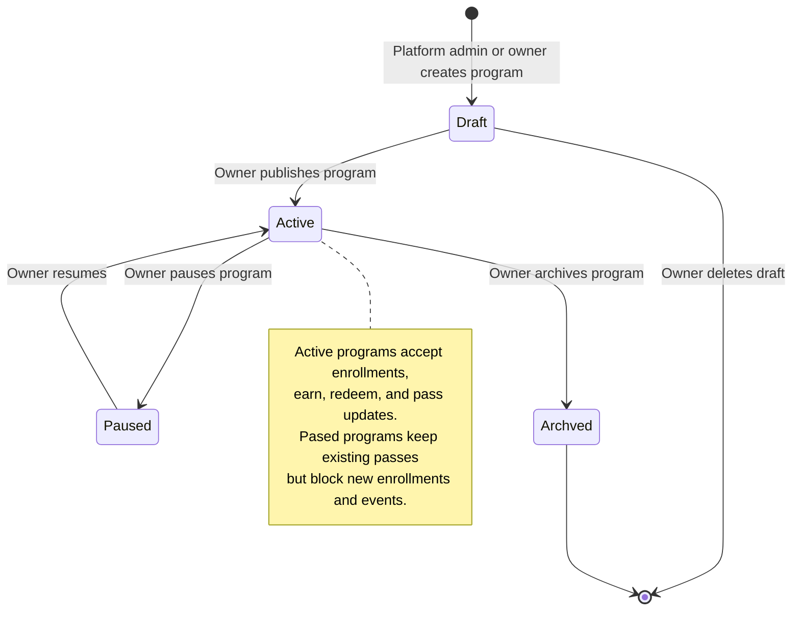

# Data model, multi-tenancy, and Django models

> **SUPERSEDED / ILLUSTRATIVE (round 2, F-CONSISTENCY-1..11/13).** This round-1 member file is an illustrative draft, not binding. ADR-44 demotes it and the `django/*.py` drafts: canonical names (`Membership`, `LedgerEntry`, `Balance`, `Pass`), the UUID-public / `BigAutoField`-internal PK rule (ADR-33), contextvars tenancy (ADR-11), and composite FKs via `db_constraint=False` + migration `RunSQL` (ADR-10) are defined in `decisions.md` and `CONVENTIONS.md`, and taught copy-safe in the `django-data` / `django-backend` skills. Phase 0 rewrites the models from those sources. Do not copy code from this file.

Author: linker (council data-model brief)
Date: 2026-10-17
Inputs: common.md, data-model.md, FINAL_REPORT.md, TECHNICAL_REPORT.md
Sources: Django 5.2 LTS docs, Apple Wallet PassKit docs, Google Wallet API docs

## 1. Technical choices

### 1.1 Django version

Django 5.2 is the current LTS release (April 2025 – April 2028). Django 4.2 LTS reached end of life on April 7, 2026.

Source: https://www.djangoproject.com/download/#supported-versions

### 1.2 Apple Wallet pass styles

Apple documents five pass styles (source: https://developer.apple.com/wallet/get-started/):

1. **Boarding pass** — flight, train, bus boarding
2. **Coupon** — single-use voucher or offer
3. **Event ticket** — concert, movie, sporting event ticket
4. **Store card** — loyalty, membership, points, stamps, gift card (one style for all)
5. **Generic pass** — membership card, claim ticket, anything not covered above

Geolocation (relevant locations) is a property any pass style can carry, not a sixth style.Any pass can have relevant locations so the phone shows it on the lock screen nearby.

### 1.3 Google Wallet classes

Google Wallet API defines these pass classes (source: https://developers.google.com/wallet/reference/rest):

1. **Loyalty** (loyaltyclass/loyaltyobject) — loyalty cards, points, stamps
2. **Gift card** (giftcardclass/giftcardobject) — stored-value cards
3. **Offer** (uses the generic infrastructure) — coupons, promotions
4. **Event ticket** (eventticketclass/eventicketobject) — event tickets
5. **Flight** (flightclass/flightobject) — airline boarding passes
6. **Transit** (transitclass/transitobject) — public transport tickets
7. **Generic** (genericclass/genericobject) — anything not covered above

### 1.4 Apple-to-Google mapping

| Apple style | Google class | Notes |
|---|---|---|
| Store card (stamps, points) | Loyalty | One Apple style maps to Loyalty + Gift Card |
| Store card (gift) | Gift card | |
| Coupon | Offer (via generic) | |
| Event ticket | Event ticket | |
| Boarding pass | Flight (air) or Transit (ground) | |
| Generic | Generic | |

Where one side lacks an equivalent, we still issue on the side that supports it. A Coupon has no Google-equivalent class with coupon-specific fields; we use the generic/offer infrastructure. A Boarding pass for a bus uses Google Transit; for a flight uses Google Flight.

### 1.5 Pass signer decision

**Proposal: Sign passes ourselves (not through a pass provider).**

- Context: We must issue every Apple Wallet and Google Wallet pass style. A pass provider (PassKit, etc.) adds a dependency and per-pass cost that scales with volume.
- Options:
  A. Use a pass provider (PassKit, Vouchery, etc.) — faster to initial build, but adds ongoing per-pass costs, limits design control, and ties us to a single vendor.
  B. Sign passes ourselves — more initial work (certificate management, Apple Pass Type ID, Google Issuer account), but zero per-pass cost, full design control, and no vendor lock-in.
- Proposal: B. Self-sign..
- Consequences:
  - DB: We store pass external ids, last-pushed timestamps, and push status per pass.
  - Backkend: Celery task signs and pushes. Certificates live in secret storage (AWS Secrets Manager / HashiCorp Vault).
  - Ops: Apple Pass Type ID and Google Issuer account per tenant (in a later phase) or one shared issuer with tenant-scoped branding. Start with one issuer; document the path to per-tenant issuance.
  - MVP scope: Start with a single Apple Pass Type ID and Google Issuer account for the platform. Per-tenant certificates are a later phase.

## 2. Tenancy model

### 2.1 Design

One shared PostgreSQL schema. Every tenant-owned row has a `tenant_id` foreign key. Tenant isolation is enforced in Django through:

1. **Tenant-scoped manager**: Every tenant-owned model uses a custom manager that filters by `tenant_id`. The base manager raises `TenantNotSupplied` on create if no tenant is set.
2. **Request-to-tenant resolution**: The authenticated user has a `Membership` record for the current tenant. The server derives the tenant from `request.user.membership.tenant`. Never trust a client-sent tenant id.
3. **Location scoping**: Staff with a location-scoped membership see only rows for their assigned location(s).

### 2.2 How a request learns its tenant

- Dashboard (staff): Django session auth. The user logs in; the middleware reads `request.user`, resolves the user's active membership (user can belong to multiple tenants), and sets `request.tenant` and `request.location_scope`.
- Tenant API: JWT auth. The JWT carries the tenant id and the credential's allowed scopes. The API auth class validates the JWT, looks up the tenant and the API credential, and sets `request.tenant`.
- Enrollment (unauthentcated): The enrollment link carries a signed token with the program id and tenant id. The view validates the token, sets `request.tenant`.

`TenantNotSupplied` on a queryset without a tenant returns an empty queryset (for reads) and raises an error (for writes) so a forgotten manager is caught early.

### 2.3 Multi-tenant user membership

A user can belong to several tenants. The `Membership` model links `User x Tenant x Role x LocationScope`. On login, if the user has one membership, that tenant is active. If several, they pick (or the last-used is stored in a cookie). The middleware resolves membership from session key `active_membership_id`.

### 2.4 What a forgotten manager would leak

Without the tenant-scoped manager, a view that does `Program.objects.filter(status='active')` returns programs from every tenant. A staff member of tenant A would see (and potentially modify) tenant B's programs, customers, and passes. The manager is the single choke-point: every tenant-owned ModelAdmin, ViewSet, and service uses it. The base class (defined in section 5.1) forces tenant at object creation.

## 3. MVP schema

### 3.1 Entity-relationship diagram



###3.2 Full field tables

#### Tenant

| Field | Type | Constaints | Notes |
|---|---|---|---|
| id | UUID | PK, default uuid_generate_v4 | |
| name | varchar(255) | NOT NULL | The business name, e.g. “Alshaya” |
| slug | varchar(100) | NOT NULL, UNIQUE, regex `^[a-z0-9-]+$` | For URLs and API namespaces |
| currency | varchar(3) | NOT NULL, default 'KWD' | ISO 4217 currency code |
| timezone | varchar(50) | NOT NULL, default 'Asia/Kuwaitt' | IANA timezone |
| is_active | boolean | NOT NULL, default true | Soft-disable a tenant |
| created_at | timestamptz | NOT NULL, auto_now_add | |
| updated_at | timestamptz | NOT NULL, auto_now | |

Indexes: UNIQUE (slug)

#### Location

| Field | Type | Constaints | Notes |
|---|---|---|---|
| id | UUID | PK | |
| tenant | FK -> Tenant | NOT NULL | |
| name | varchar(255) | NOT NULL | |
| lat | decimal(9,6) | NULL | WGS84 latitude |
| lon | decimal(9,6) | NULL | WGS84 longitude |
| address | text | NOT NULL, default '' | Human-readable address |
| timezone | varchar(50) | NOT NULL, default 'Asia/Kuwaitt' | Per-location tz |
| is_active | boolean | NOT NULL, default true | |
| created_at | timestamptz | NOT NULL | |
| updated_at | timestamptz | NOT NULL | |

Indexes: (tenant, name), (tenant, is_active)
Unique: (tenant, name)

#### User (Django's auth user, extended)

| Field | Type | Constaints | Notes |
|---|---|---|---|
| id | serial | PK | Django default |
| email | varchar(255) | NOT NULL, UNIQUE | Used as username |
| first_name | varchar(150) | NOT NULL | |
| last_name | varchar(150) | NOT NULL | |
| is_staff | boolean | default false | Django admin access |
| is_active | boolean | default true | |
| date_joined | timestamptz | NOT NULL | |

#### Membership

| Field | Type | Constaints | Notes |
|---|---|---|---|
| id | serial | PK | |
| user | FK -> User | NOT NULL | |
| tenant | FK -> Tenant | NOT NULL | |
| role | varchar(50) | NOT NULL | One of: owner, manager, staff |
| location | FK -> Location | NULL | NULL = all locations for this tenant |
| is_active | boolean | NOT NULL, default true | |
| created_at | timestamptz | NOT NULL | |

Indexes: UNIQUE (user, tenant) — one membership per user per tenant
Indexes: (tenant, role)

#### Program

| Field | Type | Constaints | Notes |
|---|---|---|---|
| id | UUID | PK | |
| tenant | FK -> Tenant | NOT NULL | |
| name | varchar(255) | NOT NULL | |
| slug | varchar(100) | NOT NULL | Auto-generated from name, unique per tenant |
| pass_style | varchar(30) | NOT NULL | Apple style: store_card, coupon, event_ticket, boarding_pass, generic |
| google_class | varchar(30) | NOT NULL | Google class: loyalty, gift_card, offer, event_ticket, flight, transit, generic |
| status | varchar(20) | NOT NULL, default 'draft' | draft, active, paused, archived |
| stamps_required | int | NULL, CheckConstraint >= 0 | For store_card stamp campaigns |
| points_per_stamp | int | NULL, CheckConstraint >= 0 | For store_card points campaigns |
| currency | varchar(3) | NULL | Overrides tenant currency when set |
| terms_text | text | NULL | Terms displayed on enrollment |
| terms_url | url | NULL | Link to full T&C |
| consent_enabled | bool | default false | Whether enrollment shows a consent checkbox |
| consent_text | text | NULL | |
| expiry_type | varchar(20) | NULL | none, fixed_date, fixed_period |
| expiry_date | date | NULL | |
| expiry_period_days | int | NULL | |
| business_name | varchar(255) | NULL | Issuer name (Apple requirement) |
| business_email | varchar(255) | NULL | |
| business_phone | varchar(50) | NULL | |
| is_nf c_enabled | boolean | default false | For later beacon phase |
| created_at | timestamptz | NOT NULL | |
| updated_at | timestamptz | NOT NULL | |

Indexes: (tenant, slug UNIQUE), (tenant, status)

Style-specific fields (in separate tables to avoid NULL-column bloat):

**StoreCardConfig** (1:1 with Program when pass_style = store_card)

| Field | Type | Notes |
|---|---|
| program | OneToOne FK | |
| card_type | varchar(20) | stamps or points |
| stamps_required | int | Same as program.stamps_required; mirrored for query speed |
| points_balance_max | int | NULL = unlimited |

**CouponConfig** (1:1 with Program when pass_style = coupon)

| Field | Type | Notes |
|---|---|
| program | OneToOne FK | |
| single_use | bool | default true. False = multi-use coupon |

**EventTicketConfig** (later phase, but columns designed now)

| Field | Type | Notes |
|---|---|
| program | OneToOne FK | |
| event_name | varchar(255) | |
| venue_name | varchar(255) | |
| venue_address | text | |
| event_start | timestamptz | |
| event_end | timestamptz | |
| seat_label_enabled | bool | Whether seats are assigned per-pass |

**BoardingPassConfig** (later phase)

| Field | Type | Notes |
|---|---|
| program | OneToOne FK | |
| transport_type | varchar(20) | flight, train, bus, ferry |
| departue_station | varchar(255) | |

#### ProgramDesign

| Field | Type | Notes |
|---|---|
| program | OneToOne FK -> Program | |
| icon_image_key | varchar(500) | S3 key for 87x87 icon |
| logo_image_key | varchar(500) | S3 key for logo |
| strip_image_key | varchar(500) | S3 key for hero/strip image |
| background_color | varchar(7) | Hex color, e.g. "#123456" |
| text_color | varchar(7) | |
| stamp_color | varchar(7) | |
| unstamp_color | varchar(7) | |
| stamp_cirle_color | varchar(7) | |

#### Reward

| Field | Type | Notes |
|---|---|
| id | serial | PK |
| program | FK -> Program | |
| name | varchar(255) | NOT NULL | "Free coffee" |
| description | text | NULL | |
| stamps_required | int | CheckConstraint >= 1 | For store_card; NULL for coupon/generic |
| cost | decimal(12,3) | NULL | Optional monetary value in program currency; 3 decimal places for KWD |
| stamp_message | varchar(500) | NULL | Must contain {#} placeholder if set |
| reward_message | varchar(500) | NULL | |
| sort_order | int | default 0 | |

Indexes: (program, sort_order)

#### EnrollmentField

| Field | Type | Notes |
|---|---|
| id | serial | PK |
| program | FK -> Program | |
| name | varchar(100) | e.g. "First Name", "Email Address" |
| field_type | varchar(20) | text, number, date, email, url, mobile |
| is_required | bool | default true |
| sort_order | int | default 0 |
| is_unique | bool | default false | Premium feature: deduplicate enrollment on this field |

#### ProgramLocation

| Field | Type | Notes |
|---|---|
| id | serial | PK |
| program | FK -> Program | |
| location | FK -> Location | |
| address_on_card | varchar(500) | NULL | Overide display address |
| show_on_card | bool | default true | |
| lock_screen_message | varchar(500) | NULL | |

Indexes: UNIQUE (program, location)

#### ProgramBeacon (later phase, columns now)

| Field | Type | Notes |
|---|---|
| id | serial | PK |
| program | FK -> Program | |
| beacon | FK -> Beacon | |
| lock_screen_message | varchar(500) | NULL | |

#### UsefulLink

| Field | Type | Notes |
|---|---|
| id | serial | PK |
| program | FK -> Program | |
| label | varchar(255) | |
| url | text | |
| link_type | varchar(20) | url, phone, email, address |
| sort_order | int | default 0 |

#### CustomField (label overides, premium)

| Field | Type | Notes |
|---|---|
| id | serial | PK |
| program | FK -> Program | |
| key | varchar(100) | The label key being overidden |
| value | varchar(500) | The custom text |

#### StampImage

| Field | Type | Notes |
|---|---|
| id | serial | PK |
| program | FK -> Program | |
| stamped_key | varchar(500) | S3 key for stamped image |
| unstamped_key | varchar(500) | S3 key for un-stamped image |
| preset_name | varchar(100) | If using a preset instead of upload |

#### Customer

| Field | Type | Notes |
|---|---|
| id | UUID | PK |
| tenant | FK -> Tenant | NOT NULL |
| first_name | varchar(255) | NOT NULL | From enrollment |
| email | varchar(255) | NULL | PII |
| mobile | varchar(50) | NULL | PII |
| data | jsonb | NOT NULL, default '{}' | All enrollment fields (the ones in EnrolmentField) |
| is_de leted | boolean | default false | Soft delete |
| deleted_at | timestamptz | NULL | |
| created_at | timestamptz | NOT NULL | |

Indexes: (tenant, email) WHERE is_deleted = false (for unique-enrolment lookups)
Indexes: (tenant, created_at)

PPI note: Email and mobile are tenant-scoped. A location-scoped role (e.g. a stamper) sees only the first name and pass status unless their role needs full contact data (see permissions, section 4).

#### CustomerEnrollment

| Field | Type | Notes |
|---|---|
| id | serial | PK |
| customer | FK -> Customer | |
| program | FK -> Program | |
| enrolled_at | timestamptz | NOT NULL | |
| enrollment_method | varchar(20) | link, qr, api, manual |

Indexes: UNIQUE (customer, program) — a customer can be enrolled in a program once

#### Pass

| Field | Type | Notes |
|---|---|
| id | UUID | PK |
| customer | FK -> Customer | NOT NULL |
| program | FK -> Program | NOT NULL (derivable from CustomerEnrolment, but denormalized for queries) |
| pass_style | varchar(30) | NOT NULL | |
| apple_pass_type_id | varchar(255) | NULL | Apple pass type identifier |
| apple_pass_serial | varchar(255) | NULL | Apple pass serial number |
| google_class_id | varchar(255) | NULL | Google Wallet class id |
| google_object_id | varchar(255) | NULL | Google Wallet object id |
| stamps_earned | int | NOT NULL, default 0, CheckConstraint >= 0 | |
| points_balance | int | NOT NULL, default 0, CheckConstraint >= 0 | |
| status | varchar(20) | NOT NULL, default 'issued' | issued, redeemed, voided, expired |
| last_pushed_at | timestamptz | NULL | Last success ful push to wallet |
| push_status | varchar(20) | NULL | ok, pending, failed |
| push_error | text | NULL | Last error message |
| voided_at | timestamptz | NULL | |
| voided_re ason | varchar(500) | NULL | |
| created_at | timestamptz | NOT NULL | |
| updated_at | timestamptz | NOT NULL | |

Indexes: (customer, program UNIQUE), (program, status), (push_status WHERE push_status = 'failed')

Style-specific pass fields (jsonb columns to avoid explosion; the pass serialization layer reads them):

| Field | Type | Notes |
|---|---|
| pass_data | jsonb | NOT NULL, default '{}' | Style-specific fields: seat info, gate, departure time, etc. |

#### LedgerEntry

| Field | Type | Notes |
|---|---|
| id | UUID | PK |
| tenant | FK -> Tenant | NOT NULL |
| customer | FK -> Customer | NOT NULL |
| pass | FK -> Pass | NOT NULL |
| location | FK -> Location | NULL | Where the event happened |
| event_type | varchar(30) | NOT NULL | enroll, earn, redeem, issue, void |
| quantity | int | NOT NULL | Always positive; a redeem is still positive quantity with event_type redeem |
| previous_balance | int | NOT NULL | Balance before this entry (for audit) |
| new_balance | int | NOT NULL | Balance after this entry |
| idempotency_key | varchar(255) | NOT NULL | Client-supplied key |
| metadata | jsonb | NOT NULL, default '{}' | Free-form data attached to the event |
| created_by | FK -> User | NULL | Staff member who performed the action |
| created_by_api | bool | default false | True when created via tenant API |
| created_at | timestamptz | NOT NULL | |

Indexes: UNIQUE (tenant, idempotency_key) — the hard idempotency constraint
Indexes: (pass, created_at), (tenant, created_at), (customer, created_at)

**CheckConstraint**: `new_balance >= 0` (enforced by the service with `select_for_update()`, not just the DB, because the constraint applies to the state AFTER the event, which the service computes).

#### Beacon

| Field | Type | Notes |
|---|---|
| id | UUID | PK |
| tenant | FK -> Tenant | NOT NULL |
| name | varchar(255) | NOT NULL |
| uuid | UUID | NOT NULL | iBeacon UUID |
| major | int | NOT NULL | |
| minor | int | NOT NULL | |
| created_at | timestamptz | NOT NULL | |

Indexes: (tenant, uuid, major, minor UNIQUE)

#### PushMessage

| Field | Type | Notes |
|---|---|
| id | serial | PK |
| program | FK -> Program | |
| message | text | NOT NULL |
| segment_critera | jsonb | NULL | The segment filter, or NULL = all customers |
| sent_by | FK -> User | |
| sent_at | timestamptz | |
| reach_count | int | NULL | How many passes received it |

#### APICredential

| Field | Type | Notes |
|---|---|
| id | serial | PK |
| tenant | FK -> Tenant | NOT NULL |
| name | varchar(255) | NOT NULL | "POS at Alshaya Branch 1" |
| key | varchar(255) | NOT NULL, UNIQUE | Public key |
| secret_hash | varchar(255) | NOT NULL | Hashed secret; raw value never stored after creation |
| scopes | jsonb | NOT NULL | ["enroll", "earn", "redeem", "void", "read:balance"] |
| is_active | bool | default true | |
| last_used_at | timestamptz | NULL | |
| expires_at | timestamptz | NULL | |
| created_at | timestamptz | NOT NULL | |

#### WebhookSubscription

| Field | Type | Notes |
|---|---|
| id | serial | PK |
| tenant | FK -> Tenant | NOT NULL |
| url | url | NOT NULL | The store's webhook endpoint |
| secre t | varchar(255) | NOT NULL | HMAC signing secret |
| events | jsonb | NOT NULL | ["enroll", "earn", "redeem", "void"] |
| is_active | bool | default true | |
| last_delivered_at | timestamptz | NULL | |
| failed_count | int | default 0 | Consecutive failures |
| created_at | timestamptz | NOT NULL | |

#### ProgramSettings (key-value settings per program)

| Field | Type | Notes |
|---|---|
| id | serial | PK |
| program | FK -> Program | |
| key | varchar(100) | |
| value | jsonb | |

Indexes: UNIQUE (program, key)

## 4. Integrity

###4.1 Hard constraints

| Rule | Implementation | Notes |
|---|---|---|
| Balance updated only by ledger event | No direct write to `Pass.stamps_earned` or `Pass.points_balance`; service layer is the only code path | The view calls `LedgerService.earn()` which writes the LedgerEntry and updates the Pass in one atomic block |
| Idemotency: one event per key | DB: `UniqueConstraint(fields=['tenant', 'idempotency_key'])` on LedgerEntry | Two POSTs with the same key: second returns the existing entry (200, not 409) |
| Balance cannot go negative | Service: `select_for_update()` on Pass, compute new balance, raise `Insuffic ientBalance` if negative | The CheckConstraint on Pass validates at commit time as a safety net |
| Reward threshold met before redeem | Service: before `redeem()`, check `pass.stamps_earned >= reward.stamps_required` | Raise `RewardNotEarned` |
| Money is Decimal(12,3) | Django: `DecimalField(max_digits=12, decimal_places=3)` | 3 decimal places for KWD; sufficient for any GCC currency |
| Timestamps are UTC | Django: `USE_TZ = True`, `TIME_ZONE = 'UTC'` | Display times in the location's timezone |
| Soft delete for customers | `Customer.is_delleted` boolean; all tenant-scoped managers include `.filter(is_deleted=False)` | A soft-deleted customer is excluded from lists, but their passes and ledger entries survive (audit trail) |
| ID strategy | Public-facing: UUIDv4. Internal: auto-increment (smaller index footprint) | Pass.customer_id is UUID; LedgerEntry.id is UUID but FK references use UUID |
| created_by | Every mutating model has `created_by FK -> User, NULL` | NULL when created by API (tracked via `created_by_api` flag) or during data migration |

###4.2 The ledger is append-only

No row in LedgerEntry is ever updated or deleted. A void or correction is a new entry (event_type `void` or `correct`). The balance on Pass is the sum of the ledger, computed by the service and stored denormalized on Pass for fast reads. A periodic reconciliation job verifies `SUM(ledger.quantity) GROUP BY pass` equals `Pass.stamps_earned` (or points_balance).

###4.3 The earn/redeem atomic block

```python
# Pseudocode of the service
from django.db import transaction, models

def earn(pass_id, quantity, idempotency_key, location_id=None, created_by=None):
    with transaction.atomic():
        # Check idempotency first
        existing = LedgerEntry.objects.filter(
            tenant_id=pass.customer.tenant_id,
            idempotency_key=idempotency_key,
        )..first()
        if existing:
            return existing  # idempotent retry

        # Lock the pass row
        pass_obj = Pass.objects.select_for_update().get(id=pass_id)

        new_balance = pass_obj.stamps_earned + quantity
        if new_balance < 0:
            raise InsufficientBalance()

        entry = LedgerEntry.objects.create(
            tenant=pass_obj.customer.tenant,
            customer=pass_obj.customer,
            pass=pass_obj,
            location_id=location_id,
            event_type='earn' if quantity > 0 else 'redeem',
            quantity=abs(quan tity),
            previous_balance=pass_obj.stamps_earned,
            new_balance=new_balance,
            idempotency_key=idempotency_key,
            created_by=created_by,
        )

        pass_obj.stamps_earned = new_balance
        pass_obj.save(update_fields=['stamps_earned', 'updated_at'])

    # After commit, enqueue pass update
    enqueue_pass_update.delay(pass_obj.id)
    return entry
```

## 5. Permissions

###5.1 Role definitions

| Role | Scope | Capabilities |
|---|---|---|
| platform_admin | Platform-wide (our team) | Create tenants, view all tenants. No access to tenant data (customers, passes, ledger) without explicit tenant selection |
| owner | Tenant | Full access: programs, customers, passes, ledger, staff management, settings, API credentials, billing. Can delete the tenant (destructive). |
| manager | Tenant | Same as owner except: cannot delete tenant, cannot manage billing, cannot create/delete API credentials |
| staff | Location(s) | Earn, redeem, void passes. View assigned location's customers and their pass status. See first name + pass balance, not full PII. |

###5.2 Permission pattern (Django)

Every tenant-owned model uses a permission mixin:

```python
class TenantScopedPermission(permissions.BasePermission):
    """API permission class for tenant-scoped viewsets."""
    def has_perrmission(self, request, view):
        if not request.user.is_authenticated:
            return False
        # platform_admin has access via a separate permission
        if request.user.is_platform_admin:
            return True
        return hasattr(request, 'tenant') and request.tenant is not None

    def has_object_permission(self, request, view, obj):
        if request.user.is_platform_admin:
            return True
        # Every tenant-owned model has a .tenant_id attribute
        return obj.tenant_id == request.tenant.id
```

Queryset filtering (in the ViewSet, not in the permission):

```python
class ProgramViewSet(ModelViewSet):
    def get_queryset(self):
        if self.request.user.is_platform_admin:
            return Program.objects.all()
        return Program.objects.filter(tenant=self.request.tenant)
```

Location scoping for the `staff` role:

```python
class CustomerViewSet(ModelViewSet):
    def get_queryset(self):
        qs = Customer.objects.filter(tenant=self.request.tenant)
        if self.request.user.membership.role == 'staff':
            location = self.request.user.membership.location
            if location:
                # Staff see customers who have a pass tied to a program at their location
                qs = qs.filter(passes__program__locations=location).distinct()
                # Limitted fields: staff get only first_name + pass status
        return qs
```

###5.3 Tenant isolation pytest

```python
def test_tenant_isolation(db, api_client, create_ten ant, create_user):
    tenant_a = create_tenant(name='Tenant A')
    tenant_b = create_tenant(name='Tenant B')

    user_a = create_user(tenant=tenant_a, role='owner')
    user_b = create_user(tenant=tenant_b, role='owner')

    # Create a program in tenant A
    api_client.force_auth(user_a)
    resp = api_client.post(f'/api/tenants/{tenanta.id}/programs/', {...})
    assert resp.status_code == 201

    # User B cannot see it
    api_client.force_auth(user_b)
    resp = api_client.get(f'/api/tenants/{tenant_b.id}/programs/')
    assert len(resp.data) == 0

    # User B cannot access it by id even if they guess it
    resp = api_client.get(f'/api/tenants/{tenant_b.id}/programs/{program_id}/')
    assert resp.status_code == 404  # not 403: we don't reveal existence
```

###5.4 Customer PII rule

- `owner` and `manager`: full customer record (name, email, mobile, enrollment data).
- `staf` (location-scoped): first name, last initial, pass status, stamps/points balance. Email and mobile are masked (e.g. `c***@example.com`).
- `platform_admin`: no access to customer PII unless explicitly acting within a tenant (impersonation). This is enforced by the ViewSet, not the model.

## 6. Diagrams

###6.1 Request context diagram



###6.2 Pass state diagram



###6.3 Program state diagram



## 7. Reporting

###7.1 Analytics queries

The MVP analytics surface (based on the Loopy Loyalty observations):

| View | Data source | Implementation |
|---|---|---|
| Account dashboard totals (customers, stamps, rewards) | Aggregate query | `SELECT COUNT(*), SUM(stamps_earned) FROM Pass WHERE tenant_id = ?`; cachable for 60s |
| Acquisition trend (by day/month/year) | Date-truncated count | ORM: `Customer.objects.filter(tenant=).annotate(period=TruncDate('created_at')).values('period').annotate(count=Count('id'))` |
| Per-program KPIs | Same as dashboard, filtered by program | |
| Transaction list (per program or per customer) | LedgerEntry table with DataTables protocol | `LedgerEntry.objects.filter(pass__program=).select_related('customer', 'pass', 'location').order_by('-created_at')` |
| Stamp histogram | Group by stamps_earned | `Pass.objects.filter(program=).values('stamps_earned').annotate(count=Count('id'))` |
| Message history | PushMessage table | Direct query |

###7.2 Indexes for analytics

Added to LedgerEntry: `(pass_id, created_at)` (the compound index already listed in §3.2 handles this).
Added to Pass: `(program_id, status)` and `(tenant_id, status)`.
Added to Customer: `(tenant_id, created_at)`.

###7.3 Materialized views

Not needed in MVP. The transaction volume on a single-tenant loyalty program (hundreds to low thousands of events per day) is well within PostgreSQL's range. When a tenant grows to millions of events, a materialized view of daily aggregates can be added. Defer.

## 8. Proposed decisions

### PD-DM-1: Multi-tenancy strategy

- Context: How to isolate tenant data.
- Options considered:
  A. Separate database per tenant (django-tenants) — strongest isolation, but ops overhead (one DB per tenant, connection pooling per DB).
  B. Shared database, shared schema with tenant_id (django-tenant-schemas or custom) — simpler ops, isolation enforced in application.
  C. PostgreSQL Row Level Security — DB-enforced, but moves logic to SQL and complicates migrations.
- Proposal: B. Shared schema with tenant_id on every tenant-owned row, enforced by a tenant-scoped manager in Django.
- Consequences: Every query must go through the manager. Middleware sets request.tenant. Tests must prove tenant isolation.

### PD-DM-2: Auth method for staff dashboard

- Context: Session cookies vs JWT for the React dashboard.
- Options:
  A. Session auth (Django's default) — simpler, works with Django admin, CSRF protection built-in.
  B. JWT — stateless, works natively with React, but requires token refresh flow and revocation list.
- Proposal: A. Session auth for the dashboard. The React app same-origin; session cookie works natively. The tenant API uses JWT.
- Consequences: The React dev server needs a proxy to the Django backend. Django admin works without extra configuration.

### PD-DM-3: Pass signing — ourselves vs provider

- Context: Who signs and pushes Apple Wallet and Google Wallet passes.
- Options:
  A. Pass provider (PassKit) — faster initial build, ongoing per-pass cost.
  B. Self-sign — more initial work, zero per-pass cost, full control.
- Proposal: B. Self-sign.
- Consequences: We manage Apple Pass Type ID certificates and Google Wallet issuer accounts. A Celery worker signs and pushes after each ledger event. Certificates in secret storage.

### PD-DM-4: ID strategy

- Context: UUID vs auto-increment for primary keys.
- Options:
  A. UUIDs everywhere — no enumeration, works for distributed systems, but larger index footprint.
  B. Auto-increment PKs — smaller, faster indexes, but guessable and conflicts in multi-master.
  C. Hybrid: auto-increment PKs internally, UUIDs for public-facing FKs.
- Proposal: C. Public-facing IDs (Pass.id, Customer.id, Tenant.id) are UUIDv4. Internal link tables (Membership, EnrollmentField) use auto-increment.
- Consequences: Two id fields on some models adds a little complexity. The trade-off is worth it: no enumeration attacks on public endpoints, and smaller indexes on internal join tables.

### PD-DM-5: Soft delete vs hard delete

- Context: How to handle deletion of customers, programs, passes.
- Options:
  A. Soft delete everything — `is_deleted` flag, filtered managers.
  B. Hard delete for programs/passes, soft delete for customers (GDPR).
  C. Hard delete everything with audit trail.
- Proposal: B. Customers are soft-deleted (GDPR/data-retention: we may need to keep an audit trail without PII). Programs and passes are hard-deleted (they're configuration and artifacts, not PII). LedgerEntry is append-only, never deleted.
- Consequences: Customer soft-delete requires `is_deleted` on Customer and a filtered manager. GDPR data erasure: set email/mobile/name to null in addition to is_deleted=True.

### PD-DM-6: Program schema for future pass styles

- Context: The MVP ships store_card, coupon, and generic. Event ticket and boarding pass are later phases. The schema must not require a rewrite.
- Options:
  A. Use jsonb for all style-specific fields — flexible but no schema validation.
  B. Use separate config tables per style (StoreCardConfig, CouponConfig) — typed fields, validated by Django.
- Proposal: B. One config table per style, joined 1:1 with Program. The Program table carries the common fields; style tables carry style-specific fields. When event ticket ships, add EventTicketConfig without touching existing models.
- Consequences: The pass serialization layer reads the style config table for the pass payload. A migration adds a table, not alters existing ones.

## 9. Django skill draft

The `django-data` skill follows in `/Users/fahad/council/output/plan/skill-drafts/django-data.md`.

## 10. Model files

Draft Django models in `/Users/fahad/council/output/plan/django/`. One module per app: tenants, programs, customers, ledger, passes.