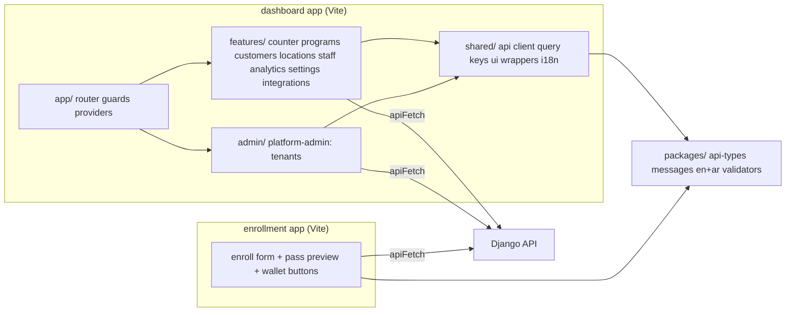
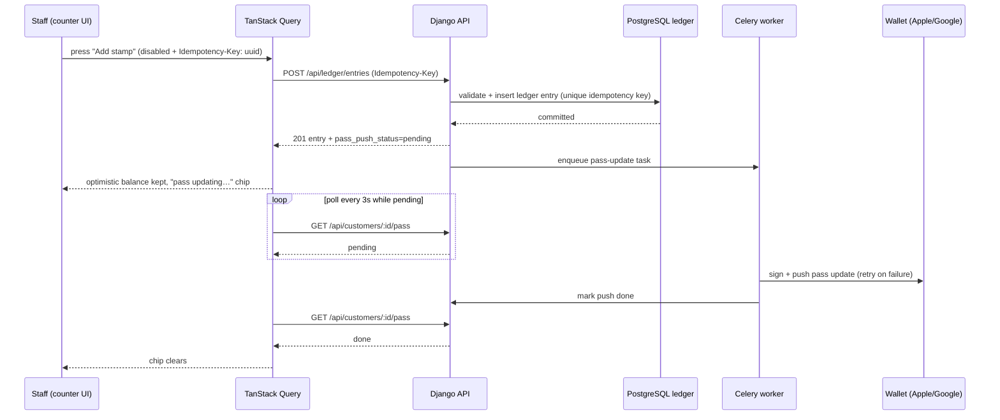

# Frontend architecture, i18n and RTL conventions

Worker: cartographer (task t_b2a5b5a6). Status: complete. Inputs: briefs `plan/briefs/common.md`, `plan/briefs/frontend.md`; functional evidence from `output/FINAL_REPORT.md` (clean-room: no Loopy Loyalty UI, text, or API shapes are copied). Visual design language is owned by the separate "Airbnb" design skill — this file defines everything else.

## 1. App shape and repository layout

Three surfaces, all clients of the single Django API, all React + TypeScript built with Vite:

| Surface | Audience | Notes |
|---|---|---|
| Merchant dashboard | Tenant owner, location manager, staff (stamper) | Authenticated SPA. Staff land on the earn/redeem counter, not settings. |
| Platform-admin area | Us (platform admins) | Same SPA, routes under `/admin/*`, reachable only with the platform-admin role. MVP screens: create tenant + tenant owner + first location, list tenants, inspect a tenant. No public signup page exists anywhere in the MVP. |
| Enrollment page | End customers on a phone | A separate tiny app, no auth for the customer, bilingual from day one, optimized for first paint on mobile data. It renders the pass preview, the enrollment form the program defines, and "Add to Apple Wallet" / "Add to Google Wallet" buttons. |

Repository layout:

```
repo/
  frontend/
    dashboard/        # merchant dashboard + platform-admin area (one Vite app)
      src/
        app/          # router, providers, guards, layout shells
        features/     # one folder per feature (see §8)
        shared/       # api client, query keys, i18n, ui wrappers, utils
        admin/        # platform-admin feature module
      e2e/            # Playwright specs live with the app
    enrollment/       # the public enrollment app (its own Vite build, shared packages via tsconfig paths)
      src/
    packages/         # workspace-local shared code: types (API DTOs), i18n message catalogs, form validators
      api-types/      # generated or hand-written types mirroring DRF serializers
      messages/       # en.json, ar.json shared by both apps
  backend/           # Django project (backend brief)
```

Package manager: **pnpm** with a pnpm workspace (`frontend/pnpm-workspace.yaml`). One toolchain for both apps; the enrollment app ships a separate minimal bundle and never imports dashboard-only code — the lint rule `no-restricted-imports` enforces the boundary. Node LTS, Vite for both apps.

## 2. Routing, auth, and role guards

Library: **React Router** (declarative/data router). Auth uses the mechanism the backend brief chooses (session cookie vs token); the frontend treats it as one contract in `shared/api/client.ts` — `GET /api/auth/me` returns the current user with `role` and `location_ids` scope. If the backend lands on a session cookie, it is `SameSite=Lax` + CSRF token header; the client never stores or sends a tenant id the server is expected to trust. Every request is authenticated; the server derives tenant and location scope (common brief, fixed).

Route map (dashboard):

- `/login` — public, redirects if already authenticated.
- `/counter` — default home for the `staff` role. The earn/redeem counter (§6).
- `/programs`, `/programs/:programId` (overview), `/programs/:programId/edit/*` (design, details, locations, enrollment-form, support tabs).
- `/customers`, `/customers/:customerId` (profile + ledger history).
- `/locations`, `/staff`, `/analytics`, `/settings/*`, `/integrations` (API credentials + webhooks for the MVP seam).
- `/admin/tenants`, `/admin/tenants/new`, `/admin/tenants/:tenantId` — platform admin only.

Location context: the **active location id lives in the URL** as a search param (`?loc=<id>`), not only in session state, so a manager deep-linked by a colleague sees the same scope. A `LocationSwitcher` in the top bar writes it; a `useActiveLocation()` hook reads it. The client sends it only as a *filter the server is asked to enforce* — the server re-derives the user's permitted locations and rejects ids outside them (never trusts it for authorization).

Route guards: a `<RequireRole roles={[...]}>` wrapper plus a `usePermissions()` hook from `GET /api/auth/me`. Guards show a "not authorized" page, never redirect silently. Role → landing page mapping: platform_admin → `/admin/tenants`; owner/manager → `/analytics` (or `/programs` for MVP release 1); staff → `/counter`. Route guards are UX only; the API is the authority.

## 3. Data access

**Typed API client.** One `apiFetch` wrapper in `shared/api/client.ts`: base URL from env, credentials include, CSRF header, JSON error normalization into a typed `ApiError` (status, code, field errors from DRF, `detail`). DTO types live in `packages/api-types` and mirror the DRF serializers; the backend brief is asked to publish serializer schemas (OpenAPI via drf-spectacular) so types can be generated — until then they are hand-written in one place.

**TanStack Query for all server state** (docs: https://tanstack.com/query/latest). No Redux/Zustand for server data. Justification: the dashboard is read-heavy with shared entities (programs, customers, locations) rendered on several screens; Query's cache-key deduplication, background refetch, and invalidation-after-mutation are exactly the needed machinery, and its mutation/invalidation model keeps the server the source of truth.

Query key convention — a key factory per entity in `shared/api/keys.ts`:

```ts
export const qk = {
  programs:        { all: ['programs'] as const,
                     detail: (id: string) => ['programs', id] as const },
  customers:       { all: ['customers'] as const,
                     list: (f: CustomerFilter) => ['customers', 'list', f] as const,
                     detail: (id: string) => ['customers', id] as const },
  ledger:          { list: (customerId: string) => ['customers', customerId, 'ledger'] as const },
  passStatus:      { detail: (customerId: string) => ['customers', customerId, 'pass'] as const },
  locations:       { all: ['locations'] as const },
};
```

Rules:

- Invalidation after every mutation, keyed at the narrowest level that can change (prefix matching does the rest).
- **Optimistic updates only for the stamp action** (§6), where a failed stamp must roll back visibly. Everywhere else: mutation → invalidate → refetch. (Prefer invalidation before optimistic updates; the counter is the one screen where latency is felt at a till.)
- Error handling: query errors render the feature's error state; mutation errors surface a toast with a retry action and the human message from the API (`detail` localized server-side or mapped by code client-side).
- `staleTime` defaults: 60s for dashboards/analytics, 0 for the counter's customer lookup. `refetchOnWindowFocus: true` (counter users tab back in mid-shift).
- "Pass update pending": after a ledger mutation succeeds, the API returns `pass_push_status: 'pending' | 'done' | 'failed'`. The UI polls `qk.passStatus.detail(customerId)` with `refetchInterval: (q) => q.state.data?.status === 'pending' ? 3000 : false`. **Poll only; no websocket/SSE in the MVP** — no evidence the counter needs sub-second push, and the ledger write already committed before the poll starts.

## 4. State, forms, and validation

**Form library: React Hook Form + Zod.** Zod schemas are the shared contract: one schema file per form lives in the feature folder and is used by RHF's `zodResolver` on the client. Where the same rules exist in the DRF serializer (max length, min stamp count, required enrollment fields), the plan is: backend brief defines serializer validation in Django (authority), and the frontend keeps a **mirrored Zod schema** in `packages/api-types/validators/<entity>.ts` next to the DTO, with a comment pointing at the serializer. Full single-source generation (drf-spectacular OpenAPI → zod codegen) is noted as a follow-up; until the API surface is stable the mirror is explicit and reviewed in PRs.

Client state rules (one home per kind of state):

| State | Home |
|---|---|
| Server data | TanStack Query cache only |
| Form state | React Hook Form (uncontrolled, no mirror into app state) |
| URL state (filters, active location, tab) | React Router search params |
| Ephemeral UI (modal open, hover) | local `useState` |
| Cross-feature client state (active language) | i18next instance; nothing else global |

**Double-tap-safe stamp action.** The stamp button: (1) disables on first press (`isPending` from the mutation, not a manual boolean), (2) generates a **client idempotency key** (`crypto.randomUUID()`) at press time and sends it as `Idempotency-Key` header with `POST /api/ledger/entries`; the backend dedupes on it (common brief: idempotency uniqueness in the DB). A retry after a network failure reuses the *same* key so a replayed press cannot double-stamp. The button re-enables only on settled outcome, and a timeout without response shows "stamp sent — checking" and queries the ledger before letting the user try again.

## 5. i18n and RTL

Library: **i18next + react-i18next** (https://www.i18next.com, https://react.i18next.com). Both apps share catalogs in `frontend/packages/messages/{en,ar}.json`.

- Languages: `en` and `ar` from day one, on the dashboard and the enrollment page. Default per browser; a persisted user preference (localStorage key `lang`) overrides. Arabic is fully translated — no machine-English fallback in shipped UI; missing key in CI fails the build (`i18next-parser` + a check script comparing en/ar key sets).
- Key conventions: dot-namespaced by feature, `feature.context.message`, e.g. `counter.search.placeholder`, `program.design.stampCount.label`, `enroll.form.submit`. No interpolated prose split across keys; placeholders as `{{name}}`. No HTML in messages.
- **Arabic pluralisation**: i18next Intl plural rules — Arabic has six forms (`zero/one/two/few/many/other`, https://www.i18next.com/translation-function/plurals). All counted strings use `{count}` plural suffixes; e.g. `counter.stampsRemaining_other` / `_zero` / `_one` / `_two` / `_few` / `_many`.
- **RTL**: `dir` set on `<html>` from the active language (`document.documentElement.dir = i18n.language === 'ar' ? 'rtl' : 'ltr'`). All layout uses **CSS logical properties** (`margin-inline-start`, `padding-inline`, `inset-inline-start`, `text-align: start`, border-inline; MDN: https://developer.mozilla.org/en-US/docs/Web/CSS/Guides/Logical_properties_and_values) — physical `left`/`right` are banned by a stylelint rule except in the pass *preview*, which mirrors Apple/Google's fixed pass rendering. Directional icons (arrows, chevrons) flip via `[dir='rtl']` selectors or the `dir` attribute on the icon component; symmetric icons never flip.
- **Formatting**: always the `Intl` APIs, never string templates:
  - Money: `Intl.NumberFormat(locale, { style: 'currency', currency, minimumFractionDigits: 3, maximumFractionDigits: 3 })` for KWD (3 decimals, common brief); the tenant's currency comes from the API, other GCC currencies honoured (BHD also 3 dp — the formatter reads digits from the currency, KWD enforced where we default).
  - Stamp/point counts: integers, `Intl.NumberFormat(locale)` — no decimals ever, no currency symbols.
  - Dates/times: `Intl.DateTimeFormat(locale, { timeZone })` where `timeZone` is the **location's** time zone from the API (default `Asia/Kuwait`). UI never formats timestamps in the browser's local zone for merchant data; analytics ranges use the location zone.
- Both apps lazy-load the non-active catalog; the enrollment page keeps its bundle under budget (§9) by shipping only its own message namespace.

## 6. The counter (staff earn/redeem screen)

The hardest screen; behavior spec (informed by the mapped product's stamp flow, redesigned clean-room):

1. **Find the customer** — three entry modes, all one keystroke away:
   - **Scan**: camera barcode scan of the wallet pass (BarcodeDetector API where available, manual fallback) fills the customer code.
   - **Search**: debounced (300 ms) search by name/phone/code via `GET /api/customers` lookup query `qk.customers.list({ q })`; recent customers cached at `qk = ['counter', 'recent']` (last 10 stamped, per staff user, from the API).
   - **Code**: paste/type the pass code printed on the pass.
   Selecting a customer loads `qk.customers.detail(id)` + `qk.ledger.list(id)` + `qk.passStatus.detail(id)` in parallel.
2. **Act** — the customer card shows balance (stamps toward target, or points, per the program's rule set) and eligible rewards. Primary buttons: **Add stamp / Add points** and **Redeem**. Each is a mutation with the idempotency-key treatment from §4; the pressed button disables and shows a spinner ≤ 400 ms (beyond that: "still working…" text, still disabled).
3. **Flaky network** rules:
   - Optimistic increment with rollback on error: the balance snaps back and a toast shows the failure with a **Retry (same idempotency key)** — never a fresh key, so a retry can't double-apply.
   - Request timeout 10 s. On timeout: mark the entry "sent, unconfirmed", re-query the ledger; if the entry appears, show success; if not, offer retry. The UI never silently re-sends.
   - Offline (navigator offline or repeated failures): banner "offline — stamps will be queued", entries queue in IndexedDB with their idempotency keys and replay on reconnect, each surfacing its own outcome. (Queue UI is stretch for MVP release 1; the banner + disabled state is the floor.)
   - **Pass update pending**: after a confirmed ledger write, the balance shows a small "pass updating…" chip driven by the `passStatus` poll (§3) that clears on `done` or turns into "pass update failed — customer may need to open the wallet" on `failed`. The stamp itself is already safe: the ledger is the source of truth.
4. Design notes: one-hand phone/tablet layout, thumb-zone primary actions, no hover-only affordances, works at 320 px width and on a counter tablet in landscape.

## 7. Pass design configuration

What is configurable in the MVP (content the *tenant* sets, distinct from our design system):

- Brand colours on the pass (background/foreground), logo and icon images, and the fields the pass style allows (barcode format, header/primary/secondary fields, relevant-date text). Colours are the one place a tenant sets brand identity — that is pass content, not dashboard style.
- Per style: store card adds stamp-target or points-rule fields; coupon adds offer/validity text; generic adds free text fields. Event ticket / boarding pass fields exist in the schema (common brief) but their editor screens arrive in their later phase — the form components are built against the shared `passStyle` discriminated union so adding a style adds fields, not a new pipeline.

Flow: upload (logo/icon/stamp imagery) → `POST /api/uploads` which returns a storage key + URL (S3-compatible object storage via the API only; the client never gets S3 credentials) → design form holds the keys → **live preview** component renders the pass from the current form state (Apple-style and Google-style previews side by side) → publish (`POST /api/programs/:id/publish`) makes it the issued design. Draft edits after publish create the next version; the worker pushes updates to issued passes (backend brief). Image constraints (size, formats) are validated client-side before upload and server-side again.

## 8. Component architecture

Folder per feature:

```
src/features/<feature>/
  routes/        # route components + guard wiring
  components/    # feature components
  api/           # feature query/mutation hooks (useFeatureX)
  forms/         # RHF forms + Zod schemas
  messages.d.ts  # (optional) typed keys for this feature's namespace
```

Design-skill consumption: the Airbnb design skill ships **primitives** (`Button`, `Input`, `Dialog`, `Table`, `Card`, `Toast`, `Field`, `Select`, `Tabs`, `Spinner`). Features never restyle a primitive's look — they compose. One `src/shared/ui/` re-export layer adds the app-level contracts (loading/empty/error states, RTL-safe icon wrappers, form field wiring) so the design skill can be swapped without touching feature code. Every primitive accepts the standard props contract; nothing in `features/` uses raw HTML inputs for anything a user types into.

Accessibility rules (dashboard and enrollment):

- Keyboard: every flow operable by keyboard; visible focus ring never suppressed; logical tab order matches visual/reading order (which flips correctly under RTL because layout is logical).
- ARIA: labels on all inputs (via `Field`), `aria-live="polite"` for toasts and for the counter balance change, dialogs real modals (focus trap + escape + return focus), tables use `<table>` semantics, scan status announced.
- Loading/empty/error: every query-backed view renders the three states through one `<QueryState>` component — skeleton, empty (with a next action, e.g. "create your first program"), error (message + retry). No component invents its own spinner.
- Responsive: dashboard works ≥ 320 px (counter is mobile-first); admin/analytics desktop-first with a usable tablet layout; enrollment mobile-only-first with desktop pass-through.

Naming: components `PascalCase` files matching component name; hooks `useX`; query keys only from `qk`; message keys only via the typed `t` with namespace — string-literal free-text `t('...')` is lint-banned outside the feature's own namespace file.

## 9. Testing and quality

- Unit/component: **Vitest + React Testing Library** (user-centric queries, no implementation details). Colocated `*.test.tsx`. Target: all forms, the counter's mutation/idempotency logic, formatting helpers (money/KWD 3dp, Arabic plurals, time zones) fully covered.
- E2E: **Playwright** in `dashboard/e2e/`: the golden journeys — login by role, stamp → reward → redeem (with network throttled and offline cases), program create → design → publish, enrollment on a phone viewport in `ar` (RTL screenshots compared), tenant provisioning in admin.
- Lint/format: ESLint (typescript-eslint strict) + Prettier + stylelint with the logical-properties rule (§5) and the cross-app import ban (§1).
- Type strictness: `strict: true`, `noUncheckedIndexedAccess: true`, no `any` in app code (`@typescript-eslint/no-explicit-any` error). API DTOs are the only `unknown`-boundary; parse with the Zod validators where input is untrusted.
- Performance budgets (CI-checked with bundlesize): enrollment first-load JS ≤ 150 KB gzip, LCP ≤ 2.5 s on a mid-tier phone on 3G; dashboard initial route ≤ 300 KB gzip, route-level code splitting, images lazy.
- i18n CI: en/ar key parity check fails the build.

## 10. Diagrams

Frontend module structure:



Stamp button to wallet pass data flow:



## Proposed decisions

### PD-FE-1: pnpm workspace, two Vite apps, shared packages via TS paths
- Context: three surfaces (dashboard+admin, enrollment) with shared types and message catalogs.
- Options: (a) one monorepo app with route-level splitting; (b) two apps + shared workspace packages; (c) three apps.
- Proposal: (b) — dashboard (incl. platform-admin routes) and enrollment as separate Vite builds, shared `packages/api-types` and `packages/messages`.
- Consequences: enrollment keeps a tiny bundle with no dashboard imports (lint-enforced); backend/OpenAPI work lands in api-types once; admin needs no separate deploy.

### PD-FE-2: TanStack Query for all server state; poll (no websocket) for pass-push status
- Context: shared server entities across screens; "pass updating" feedback needed at the counter.
- Options: Redux Toolkit Query; SWR; raw fetch + context; websockets for pending status.
- Proposal: TanStack Query with a key-factory (`qk`), invalidation after mutations, polling (`refetchInterval`) only while `pass_push_status === 'pending'`.
- Consequences: no client tenant/ledger duplication; backend must expose a cheap pass-status endpoint; realtime infra deferred until evidence demands it.

### PD-FE-3: React Hook Form + Zod, schemas mirrored with DRF serializers (OpenAPI generation later)
- Context: shared validation rules between DRF serializers and forms; double validation wanted.
- Options: Formik; RHF+Yup; single-source codegen from OpenAPI now.
- Proposal: RHF + Zod, mirrored validators in `packages/api-types/validators/`, move to drf-spectacular-driven generation once the API stabilizes.
- Consequences: backend brief should publish OpenAPI; PR review checks mirror drift until codegen lands.

### PD-FE-4: Client idempotency key on every ledger mutation; optimistic update only at the counter
- Context: double-tap and flaky-shop-network stamp safety; the ledger is the source of truth.
- Options: disable-only; server-side dedupe by request hash; client UUID key.
- Proposal: `crypto.randomUUID()` sent as `Idempotency-Key` on stamp/redeem POSTs, reused verbatim on retry; optimistic UI with visible rollback only on the counter.
- Consequences: backend adds unique constraint on `(tenant, idempotency_key)` and returns the existing entry on replay (common brief already requires this); retries are safe everywhere, including the future tenant API.

### PD-FE-5: i18next + react-i18next; RTL via dir attribute + CSS logical properties everywhere
- Context: bilingual EN/AR day one, full RTL, KWD 3-decimal money, per-location time zones.
- Options: FormatJS/react-intl; LinguiJS; i18next.
- Proposal: i18next with six-form Arabic plurals (https://www.i18next.com/translation-function/plurals), stylelint-banned physical direction properties (MDN logical properties: https://developer.mozilla.org/en-US/docs/Web/CSS/Guides/Logical_properties_and_values), all formatting through `Intl` with the API-supplied currency/timezone.
- Consequences: CI key-parity gate enforces complete Arabic; pass *previews* are the single RTL exception (wallets fix pass rendering); no hand-rolled date/number formatting anywhere.

### PD-FE-6: Active location in the URL (`?loc=`), server-enforced scope
- Context: staff/manager location scoping must be shareable and never client-trusted.
- Options: location in session only; location in URL path; location in search param.
- Proposal: search param + `LocationSwitcher`; API re-validates the requested location against the user's permitted set.
- Consequences: deep links and browser refresh keep scope; backend brief must accept a location filter and enforce it server-side.

### PD-FE-7: One `<QueryState>` loading/empty/error contract and composed design-skill primitives
- Context: Airbnb design skill owns visuals; features must not restyle primitives or invent spinners.
- Options: per-feature states; one shared contract layer.
- Proposal: `shared/ui` re-export layer over design-skill primitives; mandatory skeleton/empty/error states; accessibility rules (keyboard, ARIA, focus) defined in §8.
- Consequences: design-skill changes stay out of feature code; Playwright checks state transitions, not pixels (except enrollment RTL snapshots).

Skill drafts: `plan/skill-drafts/react-frontend.md` and `plan/skill-drafts/i18n-rtl.md` (written by this task; the chair finalises into `plan/skills/`).

