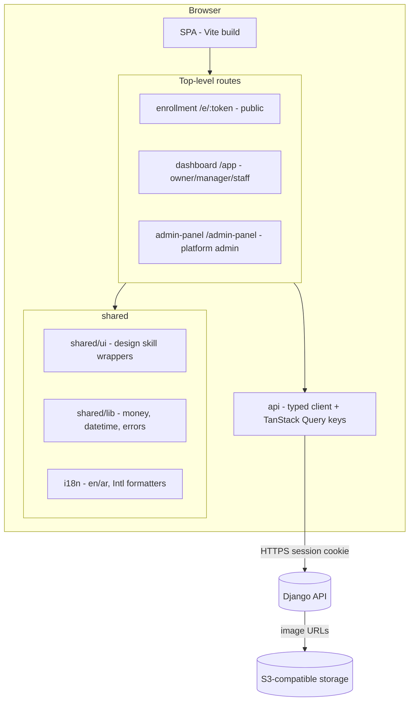
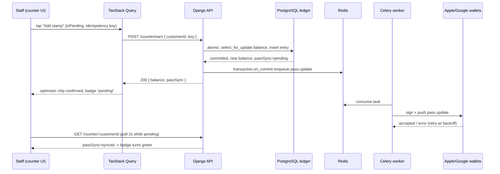

# Frontend architecture, i18n and RTL conventions

Cartographer's plan deliverable. Everything visual (colours, typography, spacing, component look) comes from the owner's separate "Airbnb" design skill; this document defines everything else. Stack input is fixed: React + TypeScript + Vite, one Django API, no direct database access from the browser.

## 1. App shape, repository layout, package manager

Three browser surfaces, all clients of the same Django API:

1. **Merchant dashboard** (`/app`) — for tenant owner, location manager, and staff (stamper). Authenticated. The stamper's home screen is the earn/redeem counter.
2. **Platform-admin area** (`/admin-panel`) — for us. Create a tenant, its owner user, and the first location. No public signup page exists anywhere in the MVP. Route-guarded to the platform-admin role only.
3. **Enrollment page** (`/e/:enrollmentToken`) — public, unauthenticated, phone-first, bilingual EN/AR from day one. Starts pass issuance (save to Apple Wallet / Google Wallet).

A separate customer mobile app is out of MVP; the wallet pass is the customer surface. Public signup and billing screens are last-phase only and are not routed, scaffolded, or hinted at in the MVP build.

**Repository layout** (monorepo, two top-level trees):

```
repo/
  frontend/
    package.json          # pnpm workspace root (single package; simple)
    vite.config.ts
    tsconfig.json
    index.html
    src/
      main.tsx
      app/                # router setup, providers, AppShell
      api/                # typed API client (see §3)
      features/           # one folder per feature (see §8)
        counter/
        programs/
        customers/
        locations/
        staff/
        enrollment/
        platform-admin/
        analytics/
        settings/
      shared/             # cross-feature primitives (lib, hooks, ui wrappers)
        ui/               # thin wrappers over design-skill components
        lib/              # money.ts, datetime.ts, id.ts, errors.ts
        hooks/
      i18n/               # i18next setup, locales/en, locales/ar, formatters
      styles/             # global CSS logical-property tokens (no colours)
    e2e/                  # Playwright specs mirroring features/
  backend/                # linker's domain; frontend never imports from it
  .cursor/skills/         # convention skills (chair finalises)
  .claude/skills/
```

- **Package manager: pnpm.** Fast, strict node_modules layout (catches phantom dependencies), first-class monorepo workspace support, good Vite integration. Escape hatch: npm if the team objects — nothing in the design depends on pnpm beyond lockfile discipline.
- **One Vite build for all three surfaces.** The enrollment page is a route in the same SPA, but code-split (`React.lazy`) so a phone downloads only the enrollment chunk plus shared vendors, not the dashboard. If the enrollment chunk ever exceeds its performance budget (§9), the escape hatch is to split it into a second Vite entry point in the same package — the module structure below makes that a config change, not a rewrite.
- Node LTS, TypeScript `strict: true` (plus `noUncheckedIndexedAccess`).

## 2. Routing, context, auth, guards

**Library: React Router v7 (data-mode off; we already have TanStack Query for server state — its loaders would duplicate that concern).**

Route tree (top level, all under the same SPA):

```
/login                      # dashboard login (Django session)
/e/:enrollmentToken         # public enrollment (no auth)
/app                        # auth-guarded shell (sidebar, location switcher)
  /counter                  # stamper home; default landing for role=staff
  /programs                 # list
  /programs/:programId      # detail (design, rules, locations, enrollment link)
  /customers                # list, filters
  /customers/:customerId    # pass status, ledger history
  /analytics                # basic analytics
  /settings                 # tenant settings, staff management
/admin-panel                # role=platform_admin only
  /tenants                  # list, create tenant + owner + first location
  /tenants/:tenantId
```

- **Tenant/location context: session, not URL.** The authenticated session response includes `{ user, role, tenant, locations, activeLocationId }`. The server derives tenant from the user; the client never sends a tenant id the server trusts. The active location lives in the session slice and is switchable from the shell's location switcher; switching writes a `PATCH /api/v1/session/active-location` (server validates the user's location scope) and invalidates location-scoped query keys.
- **Auth mechanism: Django session cookies (CSRF-protected), not JWT.** Rationale for the backend brief: browser-only clients, first-party Vite app on the same domain, no third-party API consumers in MVP, and sessions kill a whole class of token-storage bugs. The frontend's contract with the backend brief: `POST /api/v1/auth/login`, `POST /api/v1/auth/logout`, session cookie read by `GET /api/v1/session` on boot; the API client reads the `X-CSRFToken` cookie into a header on every mutating request. (PD-FE-1; the backend worker makes the final call — if the backend brief picks JWT, only the api-client's `auth.ts` changes, by design.)
- **Route guards by role** in a `RequireRole` wrapper around route elements: `staff` sees `/counter` (and read-only customer lookup); `manager` adds programs/customers/analytics for its locations; `owner` adds settings and staff management; `platform_admin` sees only `/admin-panel`. Guards are UX, not security — the API enforces permissions; the guards just avoid showing screens the API would 403.
- **Boot sequence:** render shell skeleton → `GET /api/v1/session` → hydrate query cache with session → route decision. A 401 on session boots to `/login`; on the public enrollment route a 401 is ignored.
- Stamper lands on `/counter` after login; owner/manager land on `/programs`.

## 3. Data access

**Typed API client + TanStack Query v5.**

- **API client** (`src/api/`): a thin `fetch` wrapper, no Axios. Modules per resource (`programs.ts`, `customers.ts`, `counter.ts`, …) exporting typed functions. Request/response types are hand-written in `src/api/types.ts` mirroring DRF serializers — the backend brief specifies serializers as the write boundary; we keep a single `types.ts` per resource and a checklist item in the backend PR template to flag serializer changes that break it. (Generating types with e.g. `openapi-typescript` from a DRF-generated OpenAPI schema is the escape hatch once the API stabilises; hand-written first keeps day-one velocity and review simplicity.)
- **TanStack Query v5** for all server state. Justified over RTK Query/SWR: strongest invalidation model, first-class mutation/optimistic-update story (v5's `variables`-based optimistic pattern — https://tanstack.com/query/v5/docs/react/guides/migrating-to-v5), suspense hooks, and an object-signature API that types cleanly.
- **Query key conventions** (arrays, hierarchical, most-generic-first so `invalidateQueries` on a prefix works):
  - `['session']`
  - `['tenant', tenantId, 'locations']`
  - `['programs', { scope: 'all' | locationId }]`, `['programs', programId]`
  - `['customers', { q, locationId, programId, page }]`, `['customers', customerId]`
  - `['ledger', customerId, { page }]`
  - `['counter', customerId]` — the customer's live pass state for the counter screen
  - `['analytics', { programId, range }]`
- **Cache invalidation:** mutations declare exactly which keys they touch. Earn/redeem invalidates `['counter', customerId]`, `['customers', customerId]`, `['ledger', customerId]`. No global "invalidate everything".
- **Optimistic updates only where a rollback is visible and safe.** The stamp button is optimistic (append a pending stamp chip to the counter UI, v5 `isPending` pattern); on error the mutation rolls back and shows a toast with retry. **Redeem is NOT optimistic** — it must show the server's authoritative response (new balance, reward granted); a double redeem is worse than a slow button.
- **Error handling:** the API client throws a typed `ApiError` with stable `code` from the backend's error model; a top-level mutation-error handler maps codes to i18n messages and toasts. Query errors render the feature's error state, never a silent blank.
- **Pass-update pending:** after earn/redeem succeeds, the API response includes `passSync: 'pending' | 'synced' | 'failed'` (per backend brief — Celery pushes asynchronously). The counter screen polls `['counter', customerId]` with `refetchInterval` (2s, capped ~30s) while `passSync === 'pending'`, then stops. **No websocket/SSE layer** — the evidence (Loopy Loyalty counter behaviour, see /Users/fahad/council/output/technical/reports.md) shows staff tolerate a short pending indicator; polling one key is enough. Escape hatch: if the counter measurably needs sub-second push confirmation later, add SSE then, behind the same `usePassSyncStatus` hook so only the hook changes.

## 4. State, forms, validation

- **Server state:** TanStack Query, exclusively. Nothing fetched goes into React context or Redux.
- **Client state:** React's built-ins only — `useState`/`useReducer` for local UI, a tiny Zustand store *only* for cross-cutting client concerns (active language override, theme if the design skill has one). No Redux in the MVP; if a screen later needs complex shared client state, reach for Zustand slices first.
- **Forms: React Hook Form + Zod resolvers** (`@hookform/resolvers/zod` — https://react-hook-form.com/ts). Zod is the single validation vocabulary.
- **Sharing field rules with DRF serializers:** for each write endpoint the Zod schema lives in `src/features/<feature>/schemas/<thing>.schema.ts` and is written from the DRF serializer spec (field names, required, min/max, choices). Contract, not codegen: the serializer is the authority; the Zod schema mirrors it; a Playwright form test per feature catches drift (submit an invalid value the serializer rejects and assert the UI blocks it first). Escape hatch: when the OpenAPI schema stabilises, generate Zod schemas from it and delete the hand-mirrored ones.
- **Double-tap safety on the stamp action** (three layers, in order):
  1. The button disables on `mutation.isPending` — no second tap starts a second request.
  2. Every earn/redeem mutation sends an idempotency key (client-generated `crypto.randomUUID()` created once per intent, i.e. per button arm, not per retry) in the `Idempotency-Key` header the backend brief requires.
  3. On network-flaky failure the UI shows "Not confirmed — retry" reusing the SAME key, so the backend's idempotency uniqueness (a DB constraint) makes a retry safe. The UI never auto-retries earn/redeem; a human taps retry.

## 5. i18n and RTL

**Library: i18next + react-i18next** (not next-intl — no Next.js; not react-intl — react-i18next has the maturest ecosystem for standalone SPAs and first-class Arabic plural support: https://www.i18next.com/translation-function/plurals).

- **Locales:** `src/i18n/locales/en.json`, `ar.json` — flat namespaces per feature (`"counter.title"`, `"programs.form.nameLabel"`). Default language: Arabic if the tenant's locale says so, else English; the shell has an EN/AR toggle that writes the user preference (per-user setting) and re-renders instantly.
- **Key conventions:** `feature[.subComponent].key`, camelCase keys, no interpolation by string concat — always i18next interpolation `{name}`. Never hard-code user-visible strings; the lint rule bans string literals in JSX text position (ESLint `react/jsx-no-literals` configured to allow i18n keys).
- **Arabic pluralisation:** i18next implements CLDR plural rules natively — Arabic has six forms (`zero, one, two, few, many, other`) and i18next selects them from `{count}` (https://www.i18next.com/translation-function/plurals). Stamp/points strings must always pass an integer `count` and provide all six Arabic forms; a unit test enforces that every key ending in `_plural` in `ar.json` has all six suffixes (`_zero`, `_one`, `_two`, `_few`, `_many`, `_other`).
- **RTL:**
  - `document.documentElement.dir` = `rtl` when active language is Arabic; set once in the language-change handler.
  - **Logical CSS properties only** in all styles (`margin-inline-start`, `padding-inline-end`, `inset-inline-start`, `border-inline`, `text-align: start`). Physical properties are banned by lint rule (`stylelint` declaration-property-value-allowed-list / a simple grep CI check). No `margin-left`, no `left:`.
  - No transform/flip hacks on layout. The design skill's components must also use logical properties — noted as a requirement on the design-skill consumer pattern (§8).
  - **Mirrored icons:** directional icons (arrows, chevrons, "back") flip in RTL via `[dir="rtl"] .icon-flip { transform: scaleX(-1); }`; symmetric icons never flip. A `FlipInRtl` wrapper handles the rare icon-font case.
  - Language and direction are never inferred from a path segment; they are session/user state.
- **Number/currency/date formatting with `Intl`** (`src/shared/lib/money.ts`, `datetime.ts`):
  - Money: `Intl.NumberFormat(locale, { style: 'currency', currency: tenantCurrency, currencyDisplay: 'narrowSymbol' })`. KWD (like all GCC currencies) formats with 3 decimals automatically via ISO 4217 rules; never format money by hand or with `toFixed` — the API sends money as minor-unit strings/ints and the client converts via the ISO 4217 exponent (KWD 1000 → 1.000).
  - Stamps/points: `Intl.NumberFormat(locale)` with no fraction digits — integers from the API, never derived from money.
  - Arabic numerals: default to `ar` locale with Latin digits (`ar-KW` renders Arabic-Indic by default; we standardise on Latin digits for consistency with pass barcodes and staff habit — use `ar-KW-u-nu-latn`). Decision recorded as PD-FE-5.
  - Dates/times: `Intl.DateTimeFormat(locale, { timeZone: location.timeZone ?? 'Asia/Kuwait', dateStyle: 'medium', timeStyle: 'short' })`. Location time zone comes from the session/locations payload; analytics and ledger timestamps render in the *active location's* zone with the zone's name shown. Relative times use `Intl.RelativeTimeFormat`.
- **The enrollment page is bilingual from day one:** one page, a language toggle at the top, defaulting to the browser locale (fall back to the tenant's default). Both `en.json` and `ar.json` ship in the enrollment chunk.

## 6. The counter (staff earn/redeem screen)

The hardest screen. Phone/tablet-first, one-hand-usable, works offline-ish.

**Flow:**

1. **Find the customer.**
   - **Scan the pass**: barcode/QR camera scan via the BarcodeDetector API (fallback: a small library such as `@zxing/library` where unsupported) — decodes to an enrollment/pass token, `POST /api/v1/counter/lookup { token }`.
   - **Search**: typeahead on name/phone/email — `GET /api/v1/customers?q=`, debounced 300ms.
   - **Code**: staff types a short customer code shown on the pass.
   All three resolve to the same customer view; scan is the happy path (Loopy Loyalty evidence: the counter is a scanner-first screen — see /Users/fahad/council/output/technical/reports.md).
2. **See the state.** Customer card: name, avatar initial, program, current stamps/points, progress to the next reward, `passSync` badge (synced / pending / failed), last activity.
3. **Act — add a stamp or points.** Big primary button ("Add stamp" / "Add 10 points"). Disabled while `isPending` (double-tap guard §4), optimistic chip appears immediately, idempotency key per arm. On success: haptic-style confirmation, updated balance, and the pass-sync badge flips to "pending → syncing to phone".
4. **Redeem a reward.** Shows the reward list the customer qualifies for; staff taps one; confirmation step ("Redeem free coffee — confirm?") because redeem is destructive. Server-authoritative: no optimistic redeem. On success the ledger entry appears and the balance drops.
5. **Manual adjustment** (manager/owner only, not stamper): +/− with a mandatory reason, routed through the same ledger service.

**Flaky-network behaviour (shop counter reality):**

- **Offline / request failing:** the mutation hangs → after 4s the UI shows "Not confirmed. Check your connection." with **Retry (same key)** and **Cancel**. Cancel does NOT assume success — it clears the pending chip and shows a "verify balance" hint; the safe assumption at a counter is "unknown", never "probably worked". If the device is fully offline (`navigator.onLine === false`), the screen shows a persistent offline banner and disables the action button entirely — no local queue in MVP, because a queued stamp that later fails silently is worse at a counter than asking the customer to wait. Escape hatch: a local outbox with the idempotency key is the natural later upgrade and is safe to add because the key design already supports it.
- **Pass update pending:** the ledger commit is already done (server responded), so the balance shown is truth; only the *phone pass* lags. The badge "Updating on phone…" polls per §3 until `synced`, or turns into "Update queued — will retry" on `failed` (backend retries with backoff; staff needs no action, but the customer list shows the pass state so support can see a stuck pass).
- **Wrong customer:** a "This isn't them" undo affordance within 10 seconds (manager reversal through the ledger service — reversals are ledger entries, not edits; backend brief).

## 7. Card design (pass content designer)

What is configurable in MVP — this is *content*, not our design system:

- **Colours**: the one place a tenant sets brand — background colour, label colour, foreground colour (the pass's own three-colour model). Freeform colour pickers with hex input; the pass preview applies them live.
- **Images**: logo (strip for store cards), icon, background/thumbnail where the pass style takes one. Upload → `POST` to the API → API stores in S3-compatible object storage and returns the URL; client shows an upload progress state; images are per-tenant assets, never in the frontend bundle.
- **Text fields**: header/title, per-field labels and values by pass style (MVP: store card, coupon, generic), relevant-date fields.
- **Barcode**: format (QR, PDF417, …) and custom value option.
- **Relevant locations**: pick from tenant locations; visible on the preview ("pass appears on lock screen near …").

**Preview and publish:** a live pass preview component renders the field values and colours in a pass-shaped frame (our own rendering — not Apple's or Google's assets, per clean-room rules). The design is a **draft until published**: the publish action (`POST /api/v1/programs/:id/publish`) is a service call (backend brief) that versions the design; already-issued passes get the new design on next sync. Save draft vs Publish are separate, explicit buttons. Asset upload uses a dedicated endpoint with size/type validation surfaced as field errors.

## 8. Component architecture

- **Design skill consumption pattern:** features never restyle raw CSS for chrome. They import primitives from `src/shared/ui/` — `Button`, `Input`, `Card`, `Modal`, `Table`, `Toast`, `Icon` — which are thin typed wrappers around the Airbnb design skill's primitives. The wrapper is the only place design tokens are referenced, so a design-skill change touches one folder. Feature folders contain composition, data, and logic; no feature may define colours, fonts, or spacing values (lint ban on hex literals / px spacing outside `shared/ui` and `styles/`).
- **Folder per feature** (`src/features/<name>/`):
  ```
  features/counter/
    routes/        # route elements
    components/    # feature-specific composition
    hooks/         # useCustomerLookup, useStamp, usePassSyncStatus
    schemas/       # zod schemas
    api.ts         # resource client functions (re-exported from src/api or local)
    i18n keys in src/i18n/locales/en.json under "counter."
  ```
- **Naming:** components `PascalCase.tsx` one default export per file; hooks `useX`; files kebab-case for non-components; no abbreviations except id, url, api.
- **Accessibility rules:** every interactive element keyboard-reachable with visible focus (design-skill focus tokens); modal focus trap + Esc + return focus; form inputs have programmatic labels (`aria-invalid`, `errorId` linkage); tables get proper `th/scope`; icon-only buttons have `aria-label` (i18n'd); the counter's primary actions are ≥44px touch targets; colour contrast is the design skill's responsibility, our wrapper enforces `aria-*` correctness; `lang` and `dir` attributes stay in sync on `<html>`.
- **Loading/empty/error states are part of every data screen:** a shared `<QueryBoundary query={...}>` renders skeleton → error (with retry) → empty (with CTA) → children. No feature hand-rolls its own three-state rendering.
- **Responsive:** the counter is designed at 360–830px widths first (phone portrait, tablet portrait) — that is its primary form factor; the dashboard (programs, customers, analytics) is desktop-first with a tablet layout; the location switcher collapses into a bottom sheet on small screens. No separate mobile app.

## 9. Testing and quality

- **Unit/component: Vitest + Testing Library** (`jsdom`). Feature folders own their tests: hooks tested with `renderHook` + Query client wrapper; forms tested through user events (`@testing-library/user-event`), not `fireEvent` — RTL queries by role/label, which enforces the a11y rules for free. Money/date/i18n formatters have table-driven unit tests including the KWD-3-decimals and Arabic-plural cases.
- **E2E: Playwright** (`e2e/`), against a seeded local Django (docker-compose from the backend brief). Core journeys, no more: login by role; scan-or-search → stamp → pending badge → synced; redeem with confirmation; enrollment page (both languages, RTL screenshots); platform-admin creates tenant. E2E asserts the double-tap guard (fast double click = one ledger entry, via the idempotency key).
- **Lint/format:** ESLint (typescript-eslint strict, react-hooks, jsx-a11y) + Prettier; Stylelint for the logical-property/RTL rules; CI runs lint, typecheck, unit, e2e (backend brief runs the Django side).
- **Type strictness:** `strict`, `noUncheckedIndexedAccess`, no `any` without an inline justification comment; API response types are non-nullable once inside `useSuspenseQuery`-style flows.
- **Performance budgets (CI-checked with Lighthouse on the enrollment page and a dashboard route):** enrollment chunk ≤ 150 KB gzipped JS, LCP < 2.5s on 4G mid-tier phone; dashboard initial ≤ 300 KB gzipped, route chunks lazy; no list renders > 200 rows unvirtualised.

## 10. Diagrams

### Frontend module structure



### Stamp data flow



## Proposed decisions

### PD-FE-1: Session-cookie auth (CSRF) over JWT for the browser clients
- Context: React dashboard, admin area, and public enrollment page all talk to one first-party Django API on the same site.
- Options: (a) Django sessions + CSRF — simplest, server can revoke, no token storage in JS, same-site cookie Just Works; (b) JWT in localStorage — enables pure third-party API consumers, but adds refresh plumbing, XSS-exposed storage, and revocation pain for zero MVP benefit.
- Proposal: session cookies; the API client is the only place auth is touched (a `csrf` header helper), so switching to JWT later is a one-file change.
- Consequences: backend must serve API and SPA on the same site (or configure CSRF/cookie scope); enrollment endpoints stay unauthenticated and rate-limited anyway; no change to DB; the last-phase public API is a separate token-auth surface for third parties.

### PD-FE-2: TanStack Query v5 as the sole server-state layer
- Context: every screen is a read/write against the Django API; counter needs pending-state polling and one optimistic pattern.
- Options: (a) TanStack Query — purpose-built cache/invalidation/mutation model, object-signature API types cleanly (https://tanstack.com/query/v5/docs/react/guides/migrating-to-v5); (b) RTK Query — good but couples us to Redux for client state we don't otherwise need; (c) SWR — weaker mutation/optimistic story.
- Proposal: TanStack Query v5, hierarchical key convention (§3), no other server state anywhere.
- Consequences: backend must return stable, invalidatable resource shapes (it does — one API); polling for pass-sync replaces any realtime infra in MVP; a later SSE layer hides behind `usePassSyncStatus` only.

### PD-FE-3: React Hook Form + Zod, mirrored to DRF serializers by contract
- Context: program design, staff forms, platform-admin tenant creation all need validation shared with the backend.
- Options: (a) RHF + Zod schemas hand-mirrored from serializer specs, drift caught by Playwright form tests; (b) generate Zod from a DRF-emitted OpenAPI schema (openapi-typescript / orval) — better guaranteed sync, but heavy day-one tooling while the API churns weekly.
- Proposal: (a) now; flip to generation when the API stabilises (explicit, dated escape hatch).
- Consequences: backend PR checklist gains "serializer changed? tell frontend"; Zod becomes the shared validation vocabulary also used for response-shape runtime guards on the enrollment page (untrusted public input).

### PD-FE-4: i18next + react-i18next with full CLDR Arabic plurals
- Context: EN/AR with full RTL from day one, including enrollment.
- Options: (a) i18next — mature standalone-SPA i18n, native CLDR plural engine including Arabic's six forms (https://www.i18next.com/translation-function/plurals); (b) FormatJS/react-intl — ICU-first but heavier React integration for our needs.
- Proposal: i18next, flat feature-namespaced keys, six Arabic plural suffixes enforced by unit test, logical CSS properties enforced by lint.
- Consequences: translators get JSON files, not ICU strings (fine for two locales); the design skill must use logical properties — flagged to the chair as a requirement on the Airbnb skill.

### PD-FE-5: Latin digits in Arabic UI, `ar-KW-u-nu-latn`
- Context: Arabic-Indic numerals are traditional in `ar` locale, but pass barcodes, receipt printers, and staff habit in Kuwaiti retail favour Latin digits; mixed rendering (badge count vs balance) is worse than either pure choice.
- Options: (a) Latin digits everywhere (`ar-KW-u-nu-latn`); (b) Arabic-Indic digits (`ar-KW` default).
- Proposal: (a) Latin digits in the Arabic UI, standardised through `money.ts`/`datetime.ts` so a future per-tenant override is one formatter flag.
- Consequences: formatters own the digit rule (no raw `toLocaleString` in features); translation strings never embed numbers, only `{count}`.

### PD-FE-6: No offline outbox in MVP; "unknown, not assumed" failure UX at the counter
- Context: shop Wi-Fi is flaky; a stamp is money.
- Options: (a) local outbox queue replaying via idempotency keys; (b) explicit failure UI: disable when offline, "Not confirmed — Retry (same key)" on timeout, never assume success.
- Proposal: (b) for MVP; the idempotency-key-per-intent design makes adding (a) later safe without protocol change.
- Consequences: backend idempotency-key uniqueness must be a DB constraint (backend brief already requires); staff training note ("if unsure, look at the balance, don't re-stamp blind").

### PD-FE-7: One SPA, three route groups, lazy enrollment chunk
- Context: enrollment must be fast on a phone; dashboard is heavy; admin area is rarely used.
- Options: (a) single Vite build, three route groups, `React.lazy` chunks; (b) three separate apps/entries; (c) separate enrollment micro-site.
- Proposal: (a), with the enrollment chunk held to a 150 KB gz budget; split to a second entry only if the budget breaks.
- Consequences: shared i18n/UI code serves all surfaces for free; deployment stays one static bundle behind Django; CI performance check gates the enrollment chunk.
