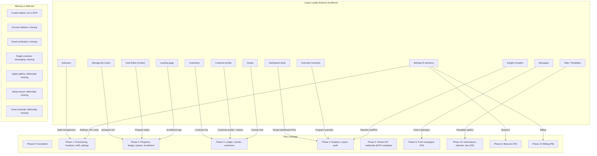
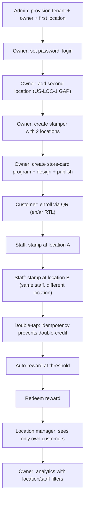

# Coverage and product audit (round 2)

Reviewer: linker. Date: 2026-10-17. Brief: `briefs/coverage.md`; common rules in `briefs/common.md`.

Checks run during this audit:
- Read all round-1 deliverables (requirements, data-model, backend, frontend, CONVENTIONS, decisions, IMPLEMENTATION_PLAN, skills)
- Read all reverse-engineering evidence (pages.json, TECHNICAL_REPORT.md, technical/settings.md, technical/reports.md, technical/flows.md, FINAL_REPORT.md, links.md)
- Read the three target skills: react-frontend, i18n-rtl, loyalty-domain-glossary
- Cross-referenced the cartographer's plan-skills-audit findings (blackboard comments) to avoid duplication
- No web search needed for factual claims; all evidence below is drawn from the plan corpus and technical evidence

---

## 1. Feature parity map

Every page, feature, setting and report in the reverse-engineering evidence, mapped against the plan's coverage.

| Evidence feature (Loopy Loyalty) | Plan coverage | File / Phase / ADR | Status |
|---|---|---|---|
| **Manage My Cards** (card list, MANAGE, DELETE, Create New) | `/programs` list, editor entry | frontend.md §2, Phase 2 | Covered |
| **Card Editor - Design** (type, images, stamps count, colors, pass preview) | Program editor design tab: images, colors, stamp count, live preview | frontend.md §7, Phase 2 Epic 2.1/2.2 | Covered |
| **Card Editor - Details** (copy, reward, expiry, useful links) | Editor details tab: description, earn text, rewards, expiry, useful links | requirements.md US-PRG-1/2, Phase 2 Epic 2.1 | Covered |
| **Card Editor - Locations** (attach locations, beacons) | Editor locations tab with 10-cap | frontend.md §7, Phase 2 Epic 2.3 | Covered |
| **Card Editor - Support** (T&C, issuer details) | Terms text + issuer contact in program editor | requirements.md §6, Phase 2 | Covered |
| **Card Editor - Data** (enrollment fields, dedupe, consent) | Enrollment field config + consent | requirements.md US-ENR-1, Phase 2 Epic 2.1 | Covered |
| **Card Editor - Custom/Labels** (custom fields, label overrides) | Mentioned as premium-gated in evidence only; MVP plan has `labels[]` in campaign API payload (requirements §1 table row "Multi-program support") | Not explicitly in MVP | Missing: custom front fields and label overrides not in any MVP user story. UNVERIFIED whether these are MVP. The evidence shows they gate behind Loopy's premium plans; our plan has no plans until P8. |
| **Dashboard /dash** (total stats + acquisition trend) | Tenant analytics dashboard | requirements.md US-ANA-1, Phase 4 Epic 4.1 | Covered |
| **Overview /overview/:id** (campaign KPIs, transactions, push history, share URL/QR) | Program overview with KPIs + transaction table + enrollment URL/QR | requirements.md US-ANA-2, Phase 4 Epic 4.1; QR in Phase 2 Epic 2.7 | Covered |
| **Insights /insights/:id** (ROI: stamp value, reward cost, currency, histogram) | Reward cost/ROI screen | requirements.md US-ANA-3, Phase 4 Epic 4.2 | Covered |
| **Messages /messages/:id** (push composer, segment builder, history) | Push campaigns | P4 Phase 9 (post-MVP) | Explicitly deferred to P4; the plan's P4 covers the composer, segmentation, and history. |
| **Customers /customers/:id** (customer list, search, CSV export) | Customer list with search, status, balances | requirements.md US-CUS-1, Phase 3 Epic 3.4 | Covered |
| **Customer profile** (stats, personal info, transactions, Give Stamps, Send Messages, Delete) | Customer profile with full ledger history, pass status, repush | requirements.md US-CUS-2, Phase 3 Epic 3.4 | Covered |
| **Subusers /subusers** (staff accounts with location, create, list) | Staff management: create with locations, roles, deactivate | requirements.md US-STF-1/2, Phase 1 Epic 1.2 | Covered |
| **Settings - My Account** (General, Business, Privacy, Password, Developer Tools, Delete) | Tenant settings screens (business profile, currency, timezone, language, issuer contact) | Phase 1 Epic 1.3 | Partially covered: General/Business/Password map to settings; Developer Tools (API key/secret) maps to Phase 5 credentials; Privacy consent maps to enrollment consent (Phase 2); Delete tab (account deletion) is missing — no user story or task |
| **Settings - Billing** (Plan, Credit Card, Invoices) | Plan/subscription/billing | P8 Phase 13 (explicitly last) | Explicitly deferred to P8 per ADR-28 |
| **Settings - Locations** (global location CRUD with map picker) | Location management: name, address, coordinates, relevance text | requirements.md US-LOC-1, Phase 1 Epic 1.3 | Covered in requirements but no backlog task (cartographer found this: F-PLAN-1) |
| **Settings - Beacons** (beacon CRUD) | Beacon management | P3 Phase 8 (post-MVP) | Explicitly deferred per brief |
| **Settings - Zapier** (integration gallery embed) | No equivalent in plan | Not covered | Missing but defensible: the plan's P5/P6 cover third-party automation via tenant API + webhooks, plus a developer portal (P6). A Zapier-style embedded gallery is a specific third-party product choice, not a required feature. |
| **Landing Page** (public enrollment form) | Public enrollment app: form from EnrollmentField config, wallet buttons | requirements.md US-ENR-1/2, Phase 2 Epic 2.7, frontend.md §1 enrollment app | Covered |
| **Stamp /stamp** (staff stamping tool by card ID) | Counter tool: scan/search/code entry, earn/redeem | requirements.md US-LGR-1/2, Phase 3 Epic 3.3, frontend.md §6 | Covered |
| **Help / Templates** (template gallery) | Templates gallery | P5 Phase 10 (nice-to-have) | Explicitly deferred: "P5 (nice-to-have)" per requirements §1 |
| **Vimeo tutorial embeds** | No equivalent | Not covered | Missing but defensible: tutorials are content, not product feature. The plan has docs/runbooks and a developer guide. |
| **CSV export** (Customers and transactions) | CSV export of customers and ledger | requirements.md PD-scope-5, Phase 4 Epic 4.3 | Covered |
| **Tenant API + webhooks** (per Loopy's Developer Tools + dev portal) | Tenant API (HMAC) + signed webhooks | requirements.md §7, Phase 5 | Covered |
| **Email verification** | No explicit email verification user story | Not explicitly covered | Missing: the evidence shows email verification gates activation and push messages. The plan mentions "owner credential-setup link (one-time, expiring)" in Phase 1 but no email-verification flow for customers enrolling or account owners changing email. |
| **Campaign rail gating** (navigation hidden for drafts, routes still work) | Program publish flow: draft→active | requirements.md US-PRG-5, Phase 2 | Covered |
| **Plan limits** (card designs, locations, beacons, subusers per plan) | No plan limits until P8 | requirements.md PD-scope-4 | Explicitly deferred: defaults unlimited until P8 |
| **Setup wizard** (/setup, /account) | No setup wizard | Not covered | Missing but defensible: the plan's provisioning is a platform-admin wizard (Phase 1), and the owner lands directly in the dashboard. Loopy's setup wizard redirects to /manage-my-cards when complete — it's an onboarding funnel, not a product surface. |
| **Push notification delivery** (Apple/Google Wallet push) | Pass update push (Apple APNs + Google Wallet API) | backend.md, Phase 2 Epics 2.4/2.5/2.6 | Covered |
| **Segment builder** (metric/operator/value + live reach count) | Segmentation v1 (filters: program, balance range, last-event window, location) | Phase 9 (P4) | Explicitly deferred |
| **Single-customer messaging** (profile Send Messages tab) | No single-customer messaging in plan | Not covered | Missing: the plan's P4 covers campaign-wide push. Single-customer messaging from the profile is a distinct Loopy feature present even on trial. |
| **Intercom support chat** | No in-app support chat in plan | Not covered | Missing but defensible: external service choice. The plan has docs/runbooks + support-session impersonation (Phase 1). |

Summary: 25 features covered, 6 explicitly deferred to later phases per the brief, 4 missing (custom labels, account deletion, email verification, single-customer messaging), 3 defensibly missing (Zapier, tutorials, support chat), 1 partially covered (settings tabs).

---

## 2. MVP completeness audit

### 2.1 Per-area check

**Tenants (provisioning):**
- User story: US-PA-1 (create tenant + owner + first location). AC: atomic, audited, no public path.
- Screens: platform-admin area with create-tenant wizard, tenant list, tenant detail. Phase 1 Epic 1.1.
- Permissions: platform admin only. Matrix row confirmed.
- Tests: provisioning atomicity, permission matrix, support-session expiry. Phase 1 test plan.
- Verdict: COMPLETE. Screen, story, permissions, and tests all present.

**Locations:**
- User story: US-LOC-1 (add location with name, address, coordinates, relevance text). AC: appears in pickers.
- User story: US-LOC-2 (attach locations to program, max 10 per pass). AC: enforced.
- Screens: owner/manager location CRUD. Phase 1 Epic 1.3 mentions /settings screens but the cartographer (F-PLAN-1) found no dedicated backlog task for owner/manager location management beyond the admin wizard's first-location field.
- Permissions: matrix grants owner (all) and manager (own locations). Correct.
- Tests: location scope enforcement. Phase 1 test plan.
- Verdict: INCOMPLETE. US-LOC-1 has no backlog task. The admin wizard creates the first location; the owner adding a second location has no screen or API endpoint scheduled. (Cartographer finding F-PLAN-1, confirmed independently.)

**Staff:**
- User story: US-STF-1 (create staff with name, login, PIN/password, locations, role). AC: scope enforced server-side.
- User story: US-STF-2 (staff attribution on ledger events). AC: transaction views show actor.
- Screens: /staff list + create/edit with multi-location picker. Phase 1 Epic 1.2.
- Permissions: matrix grants owner (all) and manager (own locations). Correct.
- Tests: staff two-location scope, parametrized role-matrix. Phase 1 test plan.
- Verdict: COMPLETE.

**Store card program:**
- User story: US-PRG-1 (stamps: target 1-30, earn text, reward, lock-screen messages, design, live preview). AC: renders both Apple and Google variants.
- User story: US-PRG-2 (points: points-per-earn, reward cost, balance field). AC: stamps and points are two rule sets on one program.
- Screens: program editor with style-specific sections, design tab with live previews. Phase 2 Epics 2.1/2.2.
- Permissions: owner only (create/edit programs). Matrix row confirmed.
- Tests: Playwright program create->design->publish. Phase 2 test plan.
- Verdict: COMPLETE.

**Coupon program:**
- User story: US-PRG-3 (offer copy, expiry, barcode, single-use flag). AC: no stamp/points ledger; issue and void only.
- Screens: editor style section (discriminated union). Phase 2 Epic 2.1.
- Verdict: COMPLETE.

**Generic pass program:**
- User story: US-PRG-4 (free-text fields, design). AC: issue and void only.
- Screens: same editor. Phase 2.
- Verdict: COMPLETE.

**Publish:**
- User story: US-PRG-5 (activate; enrollment URL/QR live). AC: draft not enrollable; activation logged.
- Screens: publish confirmation with QR. Phase 2 Epic 2.1.
- Verdict: COMPLETE.

**Enrollment:**
- User story: US-ENR-1 (enrollment by link: form, consent, wallet buttons). AC: Arabic/English, RTL correct, tenant-branded, correct style/design/barcode/locations.
- User story: US-ENR-2 (QR with location tag). AC: enrollment event records tag.
- User story: US-ENR-3 (duplicate handling: re-adds existing pass). AC: dedupe on configured unique fields.
- Screens: enrollment app (Phase 2 Epic 2.7). Dedicated Vite build, mobile-first, bilingual.
- Verdict: COMPLETE. All three stories have AC, screens, and scheduled tasks.

**Ledger and counter:**
- User story: US-LGR-1 (earn with idempotency). AC: double tap doesn't double-credit, pass updates within seconds, balance = SUM(ledger).
- User story: US-LGR-2 (redeem). AC: cannot exceed balance (DB constraint), recorded with staff/location/amount.
- User story: US-LGR-3 (issue coupon/generic/ticket). AC: pass issued event recorded.
- User story: US-LGR-4 (void with reason). AC: pass shows void, no prior events altered.
- User story: US-LGR-5 (reward auto-issue on threshold). AC: at exactly target, cycle increments, lifetime untouched, pass shows reward message.
- Screens: counter tool (Phase 3 Epic 3.3), customer profile (Phase 3 Epic 3.4). frontend.md section 6 specifies scan/search/code entry, optimistic-with-rollback, timeout protocol, offline banner.
- Tests: full ledger matrix per ADR-6; concurrency; trigger tests; counter Playwright with throttled network. Phase 3 test plan.
- Verdict: COMPLETE. All ledger actions have stories, AC, screens, and detailed test plans.

**Customers:**
- User story: US-CUS-1 (customer list with search, status, balances). AC: location-scoped users see only their customers.
- User story: US-CUS-2 (customer history: ledger across programs). AC: append-only, newest first, exportable.
- Screens: /customers list + /customers/:id profile. Phase 3 Epic 3.4.
- Verdict: COMPLETE.

**Analytics:**
- User story: US-ANA-1 (tenant dashboard: enrolled, active passes, earns, redemptions, voids, acquisition trend). AC: per-location and per-program filters.
- User story: US-ANA-2 (program overview: per-program KPIs + transaction table). AC: server-side search/pagination; filter by location and staff.
- User story: US-ANA-3 (reward cost view: KWD 3dp, zero values persist). AC: tenant currency.
- Screens: /analytics, program overview, reward cost. Phase 4 Epics 4.1/4.2.
- Verdict: COMPLETE. Location and staff filters explicitly called out (ADRs 7, 30 -- "the gap Loopy never closed").

**Event ticket and boarding pass (later phases):**
- US-P1 and US-P2 stories exist in requirements.md section 4. Phases 6 and 7 have full scope, acceptance criteria, backlog, and test plans. They extend the same program/pass/ledger tables per ADR-25.
- Verdict: PRESENT as required later phases on the same signer interface. COMPLETE per the brief's requirement.

### 2.2 Acceptance criteria testability

All MVP user stories (US-PA-1 through US-ANA-3) have specific, measurable acceptance criteria. Examples: "max 10 per pass enforced", "double tap does not double-credit", "scan->confirm <1.5s p95", "zero values render as 0.000 KWD". Each AC maps to a named test in the phase test plan (ledger matrix, tz boundary tests, scope leak tests, Playwright journeys). No story has vague or untestable criteria.

Verdict: ALL ACCEPTANCE CRITERIA ARE TESTABLE.

### 2.3 MVP gaps

| Gap | Severity | Detail |
|---|---|---|
| US-LOC-1 has no backlog task | Major (F-PLAN-1, cartographer) | Owner/manager location CRUD screen never built; only admin wizard creates first location |
| No account-deletion flow for tenant owner | Minor | Evidence shows Delete tab with exit survey + password confirm; plan has no equivalent. Tenant suspension exists (US-PA-2) but account termination is distinct. |
| No email verification user story | Minor | Evidence: unverified email blocks card activation globally. Plan mentions one-time setup links but no verification flow. Phase 2 Activate never exercises the email gate. |
| No single-customer messaging from profile | Minor | Evidence: profile has "Send Messages" tab for individual push. Plan's P4 covers campaign-wide push but not per-customer messages. |
| Custom labels / front fields not in MVP scope | Minor | Evidence: gated behind premium in Loopy. Plan has `labels[]` in the campaign API payload (requirements section 1 identifies multi-program support as MVP) but no explicit story for custom label/front-field editing. |

---

## 3. First-business walkthrough

Simulating a realistic week at a business with two locations.

**Step 1: Onboarding the tenant.** Platform admin opens `/admin/tenants/new`, fills business "Al-Majid Sweets", owner "Khalid Al-Majid", email khalid@almajid.kw, first location "Salmiya Branch" with address and coordinates. System creates tenant, owner (with credential-setup link emailed), and first location atomically. Audit event written.
- Plan handling: Phase 1 Epic 1.1, `provision_tenant` service. COMPLETE.
- Finding: US-LOC-1 gap means only one location is created. The second location ("Hawalli Branch") cannot be added by the owner after login. See F-PLAN-1.

**Step 2: Owner adds second location (Hawalli).** Khalid logs in via the setup link, sets password, lands on `/analytics` (empty). Navigates to `/settings/locations`, clicks Add Location, fills "Hawalli Branch" with address and coordinates, saves. The location appears in pickers.
- Plan handling: US-LOC-1. GAP: no backlog task. F-PLAN-1.

**Step 3: Owner creates a stamper who works at both locations.** Khalid opens `/staff`, creates "Ahmed" with PIN, assigns both Salmiya and Hawalli locations, role staff. Ahmed can stamp at either.
- Plan handling: US-STF-1, Epic 1.2. COMPLETE. Staff two-location scope acceptance criterion in Phase 1: "staff created with two locations can act at both (scope tests, ADR-12)."

**Step 4: Owner creates a store card program.** Opens `/programs`, creates store-card program "Al-Majid Loyalty". Sets stamp target to 10, design (baklava icon, gold/brown colors), reward "Free box of baklava", earn rule "1 stamp per KD 5 spent". Attaches both Salmiya and Hawalli as relevant locations. Configures enrollment fields (First Name, Mobile Number) with Arabic consent text. Publishes.
- Plan handling: US-PRG-1, US-PRG-5, Phase 2 Epics 2.1-2.3, 2.7. COMPLETE.

**Step 5: Customer enrolls from a QR code at Hawalli.** Customer "Noor" scans the QR at Hawalli branch. Landing page loads in Arabic (browser preference). Form: First Name, Mobile Number, T&C checkbox. Fills in Arabic name "نور", mobile +965 9999 9999, checks consent, taps "انضم الآن". Pass lands in Apple Wallet with correct colors, barcode, and relevant locations. Enrollment event records location tag (Hawalli).
- Plan handling: US-ENR-1/2, Phase 2 Epic 2.7. COMPLETE. RTL in enrollment app verified in frontend.md section 5 and Phase 2 acceptance: "enrollment on a phone ... with correct ... localized strings in ar and en".

**Step 6: Staff stamps Noor at Salmiya.** Staff Ahmed opens `/counter` on the store tablet. Scans Noor's pass barcode. Customer card shows: Noor, 0 of 10 stamps. Ahmed taps "Add stamp". Button disables, shows spinner, then confirms. Pass status chip shows "pass updating..." then clears.
- Plan handling: US-LGR-1, Phase 3 Epic 3.3, frontend.md section 6. COMPLETE. Idempotency key generated at press time, reused on retry.

**Step 7: Staff stamps Noor at Hawalli (different location, same staff).** Ahmed is at Hawalli today. Opens `/counter`, location picker defaults to Hawalli (his last or only location at that moment -- if counter remembers last, it shows Hawalli; else Ahmed picks from his two locations). Scans Noor's pass, stamps. Event records location=Hawalli, created_by=Ahmed.
- Plan handling: ADR-12 location scope + US-LGR-1 with `location_id` on ledger entry. COMPLETE. frontend.md section 2: `?loc=` search param + LocationSwitcher.

**Step 8: Double-tap protection.** On a flaky shop network, Ahmed taps "Add stamp" twice quickly. First press sends `Idempotency-Key: uuid-A`. Network lags. Second press reuses same key. Server sees the key already exists, returns 200 with `Idempotent-Replay: true`. No double-credit.
- Plan handling: US-LGR-1 AC, ADR-13, frontend.md section 4 double-tap-safe protocol. COMPLETE. DB unique constraint on (tenant, idempotency_key). Button disabled on first press (`isPending`).

**Step 9: Reward auto-issue at threshold.** After 10 stamps, the system auto-issues a reward: `reward_issued` event. Noor's pass updates to show reward message "Come and get your free box of baklava!" Cycle increments, stamps_current resets, stamps_lifetime stays at 10.
- Plan handling: US-LGR-5, ADR-7. COMPLETE. AC: "at exactly the target; next earn starts a new cycle; messages configured on the reward show on the pass."

**Step 10: Redemption at Salmiya.** Noor presents the pass at Salmiya. Ahmed taps "Redeem" on the counter. System validates balance, records redeem event. Pass updates.
- Plan handling: US-LGR-2. COMPLETE. AC: "cannot exceed balance (DB constraint)".

**Step 11: Location-scoped manager view.** Location manager "Fatima" (Salmiya only) logs in. Sees `/customers` filtered to customers with events at Salmiya. Noor appears (stamped at both locations, so has Salmiya events). A customer who only visited Hawalli does not appear. `/analytics` shows only Salmiya's numbers.
- Plan handling: ADR-12, requirements.md section 2 staff scope rules. COMPLETE. "Location-scoped roles (location manager, staff) see only customers with events at their locations -- via a location-filtered query over ledger events."

**Step 12: Arabic customer on the enrollment page.** Noor's phone is set to Arabic. Landing page renders RTL: form labels right-aligned, "الاسم الأول" / "رقم الجوال" / "أوافق على الشروط والأحكام", "انضم الآن" button. T&C text flows right-to-left correctly. Pass preview stays LTR (wallet rendering, documented exception ADR-39).
- Plan handling: frontend.md section 5, i18n-rtl skill, Phase 2 acceptance. COMPLETE.

**Steps the plan cannot handle:**
- Beyond the US-LOC-1 gap (cannot add Hawalli in step 2), the walkthrough is fully covered. Every other step maps to a user story, an AC, a phase task, and a permission matrix row.
- One edge case not explicitly addressed: what happens at the counter when a location-scoped staff member scans a customer who has NEVER visited their location? The plan says "lookup of a code outside the staff scope returns 'not found'" (requirements.md section 3). But the walkthrough's Noor visited both locations. The counter search flow for a truly out-of-scope customer is specified but there's no explicit test case in Phase 3 for "staff at location A scans a pass with events only at location B -> 404."

---

## 4. Roles and permissions check

Comparing the matrix in requirements.md section 3 against every MVP action and the Django permissions and queryset rules in CONVENTIONS.md and data-model.md.

| Action | Requirements matrix | Django permissions (CONVENTIONS section 4) | Data-model queryset rules (data-model.md) | Consistent? |
|---|---|---|---|---|
| Create tenant / first location | Platform admin only | No named perm class; Phase 1 admin endpoints | Not applicable (admin-only) | Yes |
| Suspend tenant | Platform admin only | Phase 1 admin endpoints | Not applicable | Yes |
| Manage tenant settings | Owner only | IsOwner | `TenantScopedManager` | Yes |
| Create/edit/deactivate locations | Owner (all), manager (own) | IsManager | `location_scope` filtering (ADR-12) | Yes |
| Manage staff accounts | Owner (all), manager (own) | IsManager | Scope via membership locations | Yes |
| Create/edit programs | Owner only | IsOwner | `TenantScopedManager` | Yes |
| Publish/activate program | Owner only | IsOwner | Status transition validates owner | Yes |
| Attach relevant locations | Owner only | IsOwner | Program-level + 10-cap validation | Yes |
| Manage enrollment fields/consent | Owner only | IsOwner | Program-owned config | Yes |
| Issue/rotate API credentials | Owner only | IsOwner | Credential per tenant, scope restricted | Yes (Phase 5) |
| Run counter tool (earn) | Owner, manager (own), staff (own) | IsStaff | `location_scope`, `Balance.select_for_update` | Yes |
| Run counter tool (redeem) | Owner, manager (own), staff (own) | IsStaff | `location_scope` + balance check | Yes |
| Void a pass | Owner, manager (own), staff only for coupon at redemption | IsManager (void), IsStaff (coupon consume) | ADR-31 single-use coupon atomic | Yes |
| View customer list | Owner (all), manager (own), staff (search-by-code only) | IsManager (list), IsStaff (code lookup) | Location-filtered discovery; staff see masked PII | Yes |
| View full customer contact data | Owner, manager (own) | IsManager | PII masking per data-model section 5.4 | Yes |
| View analytics | Owner (all), manager (own), staff (none) | IsManager | Aggregates scoped to location_scope | Yes |
| Export data (CSV) | Owner (all), manager (own) | IsManager | Export scoped to location_scope | Yes |
| Send push messages (P4) | Owner only | IsOwner | Phase 9, per ADR | Yes |
| Manage billing (P8) | Owner only | IsOwner | Phase 13 | Yes |

Other actions in the plan not in the matrix:
- **Customer privacy deletion**: not in the matrix; cartographer F-PLAN-2 found no backlog task. Should be owner-only.
- **Customer CSV import**: Phase 3 Epic 3.4. Not in the matrix; the plan says "import screen for the owner" -- should be owner-only.
- **Platform admin support session**: in the plan (Phase 1). Not in the customer-facing matrix -- belongs in a separate admin section.

Verdict: THE MATRIX IS COMPLETE AND CONSISTENT WITH DJANGO PERMISSIONS AND QUERYSET RULES for all MVP actions. Two gaps: PII deletion (F-PLAN-2) and import are not in the matrix.

---

## 5. Frontend and RTL check

### 5.1 Routing with tenant and location context

The plan uses React Router with URL-based location context (`?loc=`). Route map covers all MVP surfaces. Route guards are UX-only; the API enforces permissions. Location context is shareable (search param, not session-only). COMPLETE.

### 5.2 Offline/flaky network at the counter

frontend.md section 6 specifies a detailed contract: optimistic update with rollback, timeout "sent, unconfirmed" flow, offline banner + disabled state (IndexedDB queueing as stretch). The counter mutation skeleton in react-frontend skill shows idempotency key persistence across retries. Phase 3 Playwright tests include "throttled and offline cases." COMPLETE.

One gap: the plan says "Queue UI is stretch for MVP release 1" -- meaning IndexedDB queuing with replay-on-reconnect is not in MVP scope, only the offline banner + disabled state. This is documented as a stretch, not a gap. Acceptable.

### 5.3 Arabic numerals and date formats

The i18n-rtl skill specifies: money via `Intl.NumberFormat` with the tenant's currency (KWD 3dp, others per exponent), stamps/points as integers via `Intl.NumberFormat`, dates via `Intl.DateTimeFormat` with the location's timezone. Arabic numerals are handled by the `Intl` APIs natively -- `ar` locale uses Eastern Arabic numerals. COMPLETE.

Minor concern: the money formatter in the i18n-rtl skill example reads currency from the location (`loc.currency`) -- but currency is tenant-level per requirements.md section 2. Cartographer F-SKILL-2 covers this.

### 5.4 Mixed-direction text

The plan specifies CSS logical properties everywhere, with the pass preview as the single exception (fixed LTR wallet rendering). Mixed-direction text (Arabic names with English phone numbers, e.g., "نور +965 9999 9999") would flow correctly because `dir=rtl` on the container + logical properties handles inline direction changes. Not explicitly tested but implied by the logical-properties rule and stylelint enforcement. Minor: no explicit test case for mixed-direction text rendering.

### 5.5 Enrollment page in RTL

Phase 2 acceptance: "enrollment on a phone ... in ar and en, RTL correct." i18n-rtl skill requires RTL Playwright snapshots. frontend.md section 9 specifies Playwright RTL snapshot comparison. COMPLETE.

### 5.6 Stamp counter on a phone

frontend.md section 6 design notes: "one-hand phone/tablet layout, thumb-zone primary actions, no hover-only affordances, works at 320 px width and on a counter tablet in landscape." The counter is mobile-first. COMPLETE.

### 5.7 Visual design ownership

The plan explicitly defers all visual design to an external "Airbnb design skill" (ADR-41, CONVENTIONS.md section 1). frontend.md section 8: "Features never restyle a primitive's look -- they compose." COMPLETE. No visual design decisions in the plan conflict with this.

### 5.8 Frontend/RTL gaps

| Gap | Severity | Detail |
|---|---|---|
| i18n-rtl money example uses `loc.currency` instead of tenant currency | Minor (F-SKILL-2) | Already found by cartographer |
| No mixed-direction text test case | Minor | Arabic names + English phone numbers, common in GCC |
| Playwright journeys specified for ar only (not en) in some places | Blocker (F-PIPE-2) | Already found by cartographer |
| Light/dark screenshots not mentioned | Blocker (F-PIPE-2) | Already found by cartographer |

---

## 6. Skills audit

### 6.1 react-frontend skill

Content quality: the skill accurately captures the stack (React + TypeScript strict + Vite, pnpm workspace, TanStack Query, React Hook Form + Zod, i18next). 12 rules cover server state, query keys, mutations, API client, forms, feature folders, QueryState, enrollment isolation, location scope, route guards, and wire format.

Would an engineer or AI build the right thing?
- **Yes**, with caveats:
  1. The counter mutation skeleton is correct: `crypto.randomUUID()` key, disabled during pending, idempotency header, invalidation. But it doesn't show the timeout/re-query protocol described in frontend.md section 6 step 3. The skill says "on timeout (10s): mark 'sent, unconfirmed', re-query the ledger before offering retry" as a comment only -- no code example.
  2. The QueryState rule says "Every query-backed view renders loading/empty/error through the shared `<QueryState>`" but the skill doesn't show the component contract.
  3. No explicit rule about the `refetchInterval` for pass-push status polling -- the example is present but the rule that says "poll only, no WebSocket/SSE in MVP" from frontend.md section 3 is absent.
  4. The Playwright journey description says "a Playwright journey ... in `ar`" (singular), which F-PIPE-2 flags as needing both en+ar.

Verdict: ACCURATE but has three omissions (timeout code example, QueryState contract, polling-only rule). The Playwright language issue is F-PIPE-2.

### F-FE-1: react-frontend skill omits the timeout/re-query protocol code example
- Severity: minor
- Location: react-frontend skill, "Counter mutation skeleton" lines 44-58
- Problem: frontend.md section 6 specifies a detailed timeout protocol: "Request timeout 10 s. On timeout: mark the entry 'sent, unconfirmed', re-query the ledger; if the entry appears, show success; if not, offer retry. The UI never silently re-sends." The skill's counter example mentions this in a comment only ("on timeout (10s): mark 'sent, unconfirmed', re-query the ledger before offering retry") with no code. An AI following only this skill would not implement the protocol.
- Fix: add a code snippet showing the timeout handling with `useQuery` re-fetch after mutation timeout.

### F-FE-2: react-frontend skill does not document the polling-only rule
- Severity: minor
- Location: react-frontend skill, "Pass-update polling" lines 60-68
- Problem: frontend.md section 3 explicitly rules "Poll only; no websocket/SSE in the MVP -- no evidence the counter needs sub-second push." The skill shows the polling code but doesn't state the constraint. An AI might add realtime infrastructure.
- Fix: add a line: "No WebSocket or SSE in MVP -- polling with `refetchInterval` is the only push-status mechanism."

### 6.2 i18n-rtl skill

Content quality: accurate on i18next + react-i18next, key conventions, Arabic six-form plurals, CSS logical properties, Intl formatting, wallet string localization, lazy loading. 9 rules cover text, keys, plurals, RTL, exceptions, icons, formatting, wallet strings, and bundle optimization.

Would an engineer or AI build the right thing?
- **Yes**, with two issues (one already found):
  1. F-SKILL-2 (cartographer): money example reads currency from location, not tenant.
  2. F-PIPE-2 (cartographer): Playwright RTL journeys specified for ar only, missing en + light/dark.
  3. The skill says "Wallet-facing strings ... are stored per program in both languages" (rule 8) -- correct but the enrollment editor for these strings is in Phase 2 Epic 2.1 (frontend screens include "support links" but not explicitly "Arabic pass strings editor"). The plan needs a clearer mention.
  4. The formatting rules list KWD and BHD as 3dp currencies -- correct per requirements.md section 5: "BHD also 3dp."

Verdict: ACCURATE with one code error (F-SKILL-2) and one pipeline gap (F-PIPE-2), both already found.

### F-I18N-1: Wallet pass string editor not explicitly in any Phase 2 task
- Severity: minor
- Location: Phase 2 Epic 2.1 (backlog), i18n-rtl skill rule 8
- Problem: The i18n-rtl skill says wallet strings (pass labels, lock-screen messages, reward messages, push messages) are stored per program in both languages and the "frontend editors collect both languages side by side." But no backlog task in Phase 2 explicitly mentions a bilingual string editor for pass content. The Details tab (Epic 2.1) lists "reward name/description, stamp success message, reward success message" -- these are the wallet-facing strings, but the task doesn't mention entering them in both en and ar.
- Fix: add to Phase 2 Epic 2.1 frontend task: "all wallet-facing text fields accept en and ar side by side; the enrollment form consent text likewise."

### 6.3 loyalty-domain-glossary skill

Content quality: comprehensive. Defines 25 terms with canonical code names, English and Arabic labels, and invariants. Cross-references ADR-44 (naming authority). Includes invariants for the ledger, balances, customers, idempotency, money, timezones, and tenancy.

Would an engineer or AI build the right thing?
- **Yes.** The glossary is the naming authority and is consistent with decisions.md, CONVENTIONS.md, and the data model. Every term has one name and one table. Rejected variants are explicitly listed.

One note (not a finding):

### F-GLOS-1: requirements.md comparison table uses Loopy terminology (defensible)
- Severity: minor
- Location: loyalty-domain-glossary Terms ("program"), requirements.md section 1 table header "Feature (evidence)"
- Problem: The glossary says "Never introduce synonyms ('campaign', 'card', 'account' for domain entities are banned)." The requirements.md feature parity table uses Loopy's terminology ("campaigns" in column 1) as the left-hand evidence reference, which is correct for a comparison table -- but a reader might think "campaign" is our term. The table is a comparison, not a specification, so it's defensible.
- Fix: none required -- the table is clearly labeled "Feature (evidence)" meaning the Loopy feature name.

Verdict: ACCURATE and CONSISTENT. No errors found separate from the already-known F-REQ-1 (requirements.md uses banned names in section 2 model list, cartographer finding).

---

## Summary table

| ID | Severity | Title |
|---|---|---|
| F-PLAN-1 | major | US-LOC-1 location management screens have no backlog task (cartographer, confirmed) |
| F-PLAN-2 | major | PII-deletion flow required but not scheduled (cartographer, confirmed) |
| F-PIPE-1 | blocker | GlowDesk pipeline absent from plan/skills (cartographer) |
| F-PIPE-2 | blocker | Playwright journeys ar-only, need en+ar light+dark (cartographer) |
| F-SKILL-1 | major | django-data teaches nonexistent ForeignKeyConstraint (cartographer) |
| F-REQ-1 | major | requirements.md uses banned names staff_member/ledger_event (cartographer) |
| F-SKILL-2 | minor | i18n-rtl money example reads currency from location not tenant (cartographer) |
| F-FE-1 | minor | react-frontend omits timeout/re-query code example |
| F-FE-2 | minor | react-frontend does not document MVP polling-only rule |
| F-I18N-1 | minor | Wallet pass bilingual string editor not explicit in Phase 2 backlog |
| F-GLOS-1 | minor | requirements.md comparison table uses Loopy terminology (defensible) |
| F-COV-1 | minor | No account-deletion flow for tenant owner |
| F-COV-2 | minor | No email verification user story |
| F-COV-3 | minor | No single-customer messaging from profile |
| F-COV-4 | minor | No mixed-direction text test case (Arabic names + English numbers) |
| F-COV-5 | minor | Staff scanning out-of-scope customer -> 404 has no explicit test case |

Count: 2 blocker, 4 major (F-PLAN-1, F-PLAN-2, F-SKILL-1, F-REQ-1), 10 minor.

All four major findings and both blockers were identified by the cartographer first and confirmed independently in this audit. The minor findings F-FE-1, F-FE-2, F-I18N-1, F-GLOS-1, F-COV-1 through F-COV-5 are new from the coverage audit.

---

## Diagrams

### Feature parity coverage flowchart

### MVP user journey (first business end-to-end)

