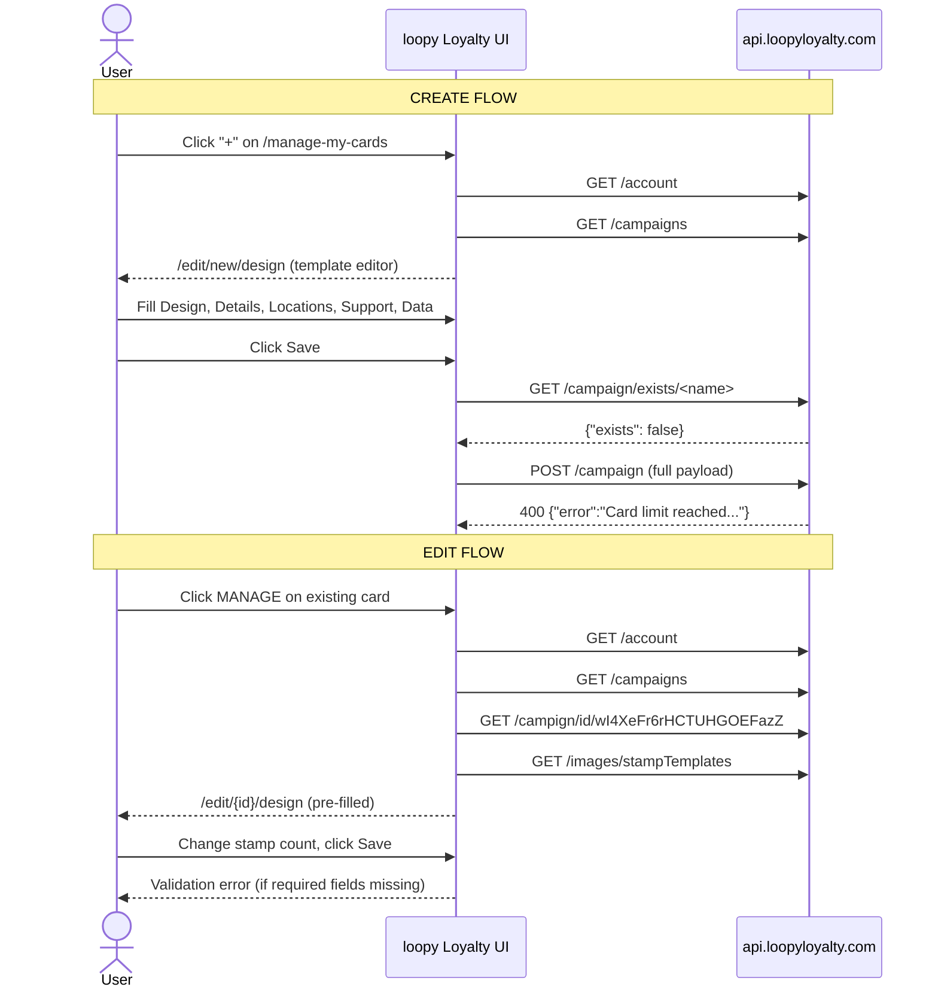
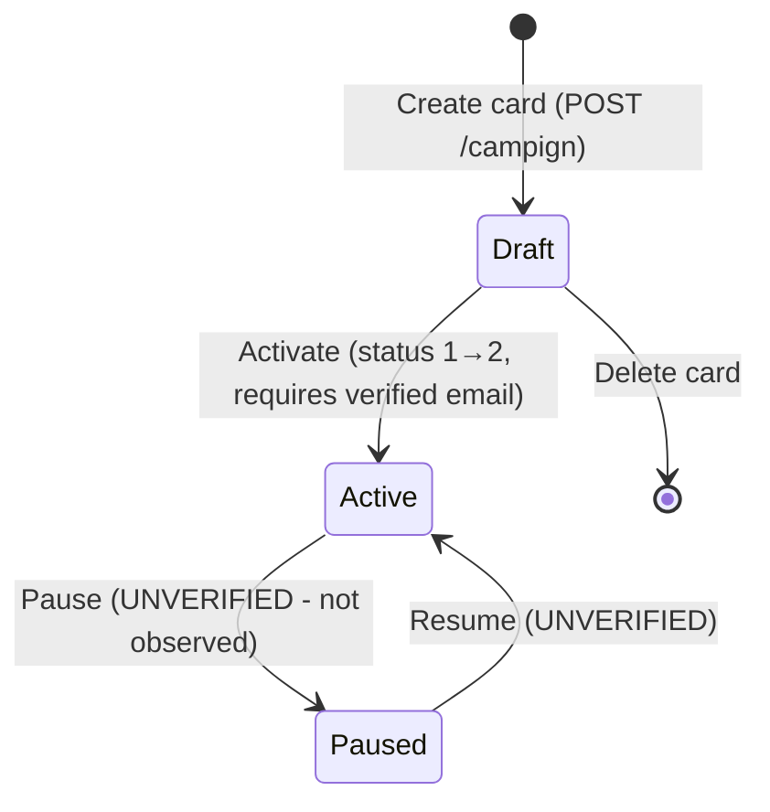
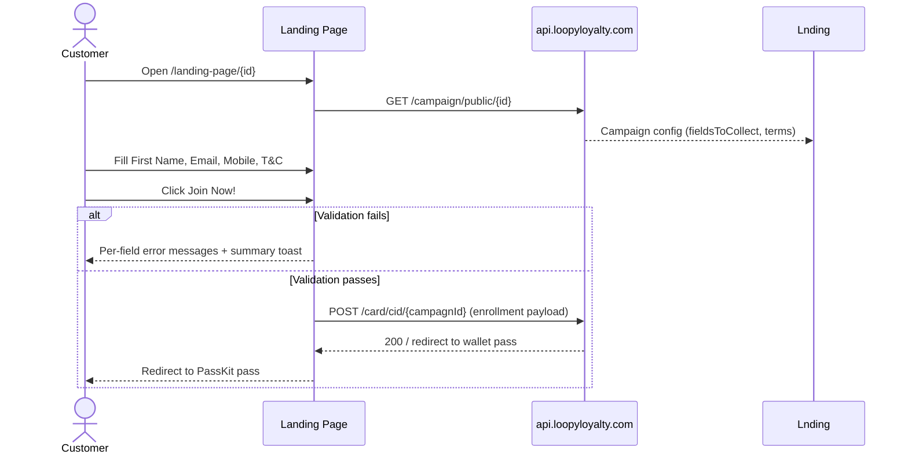
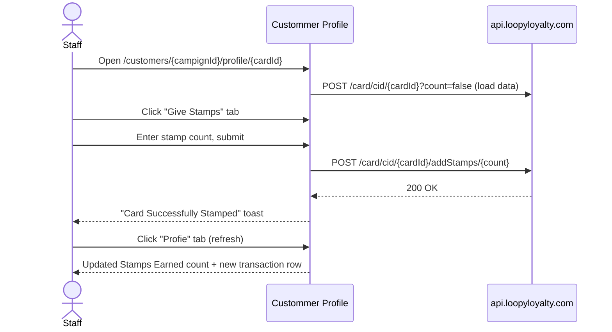
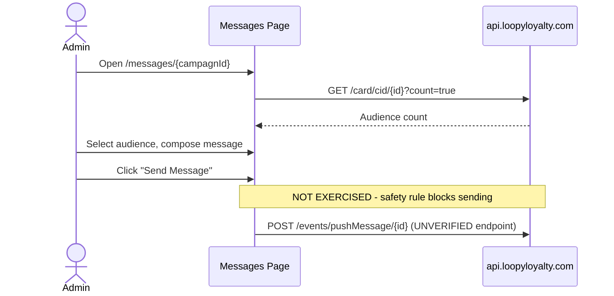
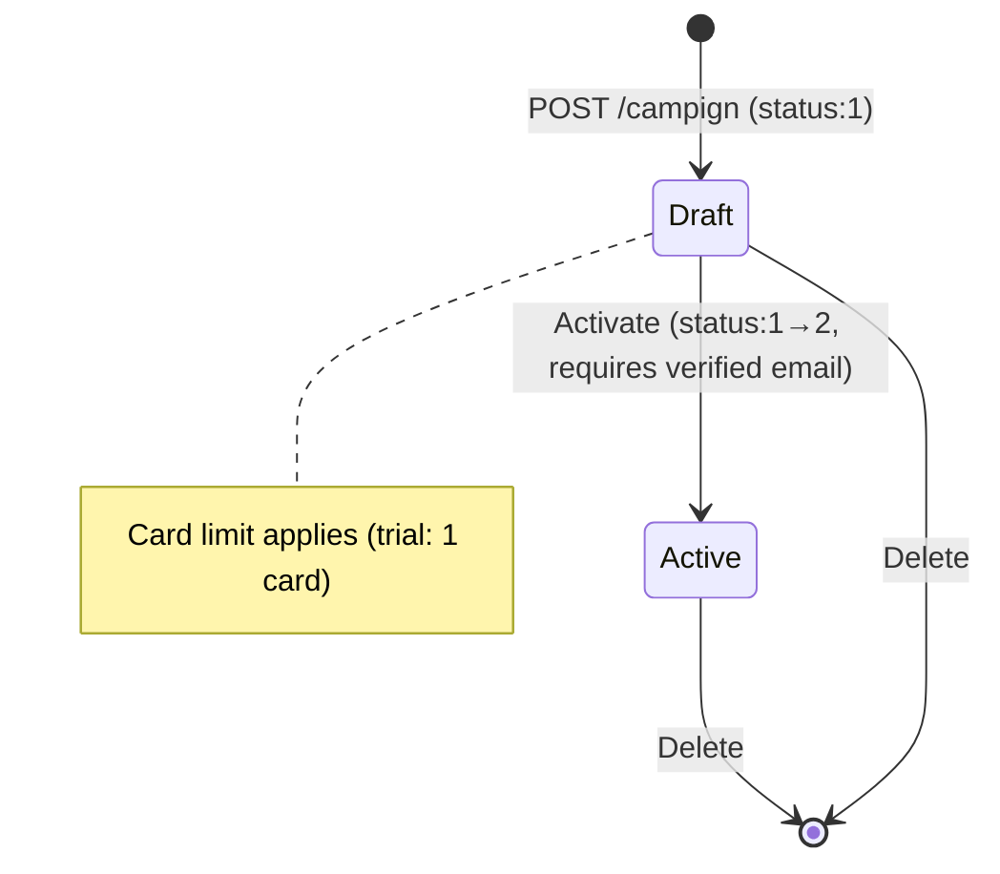
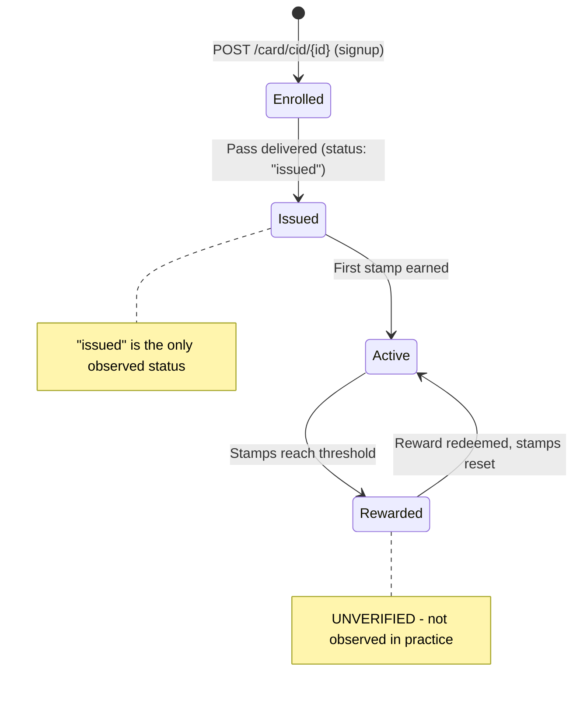
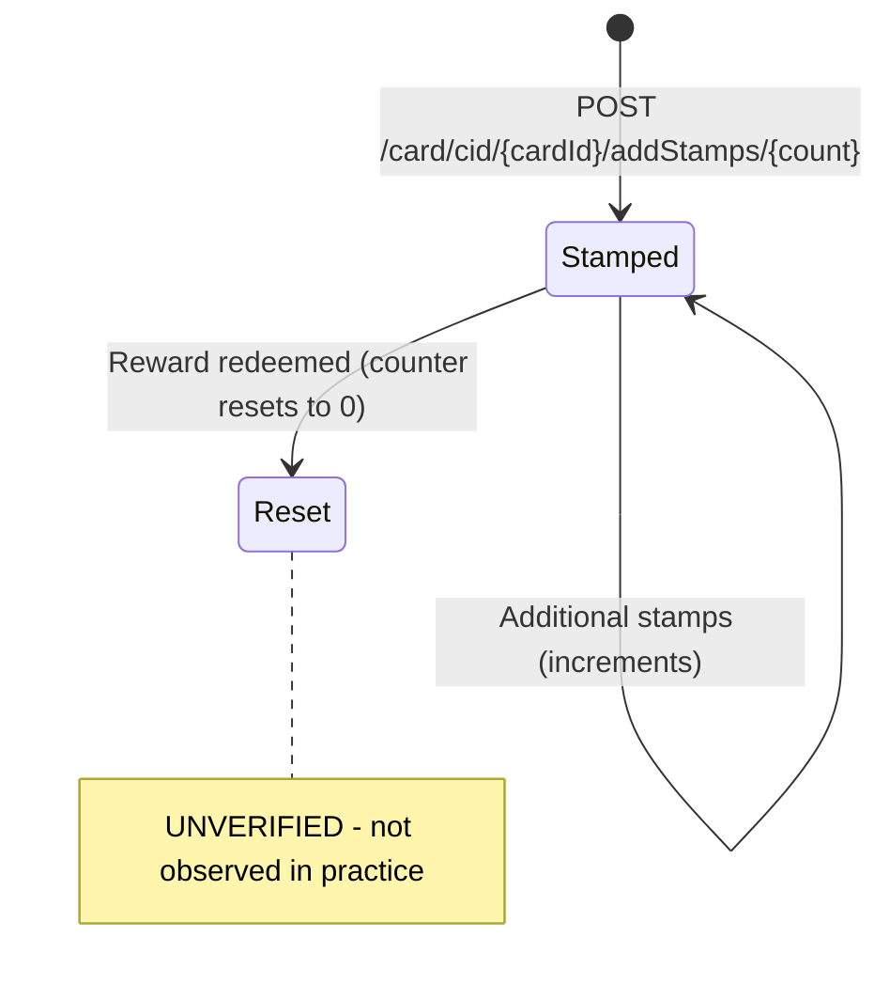

# Loopy Loyalty — Create and Edit Flows

Generated: 2026-10-17 by linker (Hermes Agent)
Account: ibefehdi (trial, 15 days remaining, email unverified)
Source: Live exploration via Playwright

## Flow 1: Program / Card

### 1.1 Create a new stamp card

#### Steps

1. From /manage-my-cards, click the "+" (Create New Card) button → navigates to /edit/new/design
2. The card editor loads with default template values
3. Configure Design tab:
   - Type: Single Reward (default) / Multi Reward
   - Images: Icon upload (87x87, square), Logo upload (480x150, min height 150px)
   - Stamps: dropdown 1-30 (default 10), Pick/Upload Stamped Image, Pick/Upload Un-stamped Image, "Use Stamped Image" checkbox
   - Colors: Card (Background, Text), Background, Stamp Circle, Stamp tabs with color pickers + text inputs
4. Navigate to Detailstab (/edit/new/details):
   - Card description (textbox)
   - How your customers earn 1 stamp (textbox)
   - Business Name (textbox)
   - Reward Details: Reward Name (textbox), Description (textbox), Stamp success message (textbox, must include {#}), Reward success message (textbox)
   - Expiry: None / Fixed date / Fixed period after signup
   - Useful Links table: Text, Link, Type (Url/Phone/Email/Address), with add/delete rows
5. Navigate to remaining tabs: Locations, Support,Data, Custom(premium)
6. Click "Save" or "Save & Preview" → opens "Save Card Design" dialog
   - Name field (textbox, placeholder "Enter a name"), required
   - Note: "This name is for internal use only. Note: this cannot be changed after you save your card."
   - Validation (empty submit): "Please provide the card name in the correct format."
7. Enter name and click "Save Card"

#### API Sequence (observed)

1. GET /account → 200 (auth check, called multiple times)
2. GET /campains → 200 (list campaigns for context)
3. GET /images/stampTemplates → 200 (stamp image presets)
4. GET /campain/exists/<name> → 200 (name avaialbility check, returns {"exists": false})
5. POST /campain → 200/400

#### Create attempt result

**BLOCKED**: POST /campign returned 400 with:
```json
{"error":"Card limit reached. Would you like to {{upgradeLink}} your account to enable more card designs?"}
```
The trial account allows only 1 card design. Existing "COUNCIL TEST" card (wI4XeFr6rHCTUHGOEFazZ) consumes the limit.

#### POST /campign request body (observed)

```json
{
  "organisationName": "ibefehdi",
  "business": {
    "AupCheckFailed": false,
    "AupCheckProcessed": true,
    "addressLine1": "",
    "country": "",
    "email": "ibefehdi@gmaill.com",
    "name": "ibefehdi",
    "phone": "",
    "taxId": "",
    "website": "https://ibefehdi.com"
  },
  "id": "new",
  "type": "single",
  "description": "Collet stamps for cool rewards!",
  "design": {
    "backgroundColor": "#5c4da0",
    "textColor": "#ffffff"
  },
  "baseStripImage": {
    "width": 1125,
    "height": 432,
    "padding": 40,
    "totalStamps": 10,
    "stampImage": "bagel",
    "unstampImage": "bagel",
    "backgroundColor": "#401A6B",
    "backgroundOpacity": 1,
    "stampColor": "#FFFFFF",
    "stampOpacity": 1,
    "unstampColor": "#FFFFFF",
    "unstampOpacity": 0.25,
    "placeholders": true,
    "placeholderColor": "#6B1D5E",
    "placeholderOpacity": 1,
    "placeholderBorderColor": "#177BE3",
    "placeholderBorderOpacity": 1,
    "rewardsPlaceholders": true,
    "rewardBorderColor": "#EBFF10",
    "rewardBorderOpacity": 1,
    "rewardBackgroundColor": "#808548",
    "rewardBackgroundOpacity": 1,
    "rewardPositions": 0,
    "imageType": "svg"
  },
  "terms": "<default T&C template text>",
  "collectValue": "Spend $5 to get 1 stamp.",
  "rewards": [{
    "rewardName": "Free coffee",
    "rewardText": "You will get a free coffee after collecting 8 stamps.",
    "stampLockscreenMessage": "Only {#} more stamps until your reward!",
    "rewardLockscreenMessage": "Come and get your free coffee today!",
    "stampsRequired": 10
  }],
  "links": [{
    "href": "https://loopyloyalty.com",
    "description": "Visit our website",
    "type": 0
  }],
  "fieldsToCollect": [
    {"name": "First Name", "type": "text", "required": true},
    {"name": "Email Address", "type": "email", "required": true},
    {"name": "Mobile Number", "type": "tel", "required": true}
  ],
  "locationsText": "113 Concord Road, Wayland MA, 01778",
  "labels": [],
  "stampsRequiredForNextRewardReplacement": "stampsRequiredForNextReward",
  "consentEnabled": false,
  "consentText": "I agree that my personal data can be used...",
  "consentCheckboxEnabled": false,
  "customFrontFields": [{
    "label": "STAMPS REQUIRED UNTIL NEXT REWARD",
    "fieldToDisplay": "stampsRequiredForNextReward"
  }],
  "expiry": {"noExpiry": true},
  "enableTerms": true,
  "name": "COUNCIL TEST Stamp Card 2",
  "status": 1
}
```

### 1.2 Edit existing card

#### Steps

1. From /manage-my-cards, click MANAGE on COUNCIL TEST card → /edit/wI4XeFr6rHCTUHGOEFazZ/design
2. Card editor loads with existing data:
   - Stamps: 10 selected (dropdown)
   - Stamped Image: "bagel" preset + uploaded file
   - Un-stamped Image: "bagel" preset + uploaded file
   - Icon and Logo: uploaded files
   - Colors: Card Background #5c4da0, Text #ffffff
3. Change stamp count dropdown from 10 to 8
4. Click "Save" → error toast: "Please make sure to fill out the required fields in the form correctly."
5. The Save button on existing cards does NOT open the name dialog (only for new cards). On existing cards, save goes through immediately if validation passes.

#### Buttons on existing card editor

- **Save**: Persists changes silently (no dialog for existing cards)
- **Save & Preview**: Generates a preview
- **Activate**: Changes campaign status from draft (1) to active (2). **BLOCKED** on this account due to unverified email.

#### Validation rules

- Design tab: "Please make sure to fill out the required fields in the form correctly." — triggered when required image selections are missing
- Name dialog (new cards only): "Please provide the card name in the correct format." — triggered on empty name



### 1.3 Card editor tabs — form field inventory

#### Designtab

| Field | Type | Options/Notes |
|-------|------|---------------|
| Type | radio | Single Reward / Multi Reward |
| Icon | file upload | 87x87 px, square, required for save |
| Logo | file upload | 480x150 px, min height 150 px |
| Stamps count | combobox | 1-30, default 10 |
| Stamped Image | preset picker OR file upload | "bagel" and other presets; min 200x200 px |
| Un-stamped Image | preset picker OR file upload | Same presets; min 200x200 px |
| Use Stamped Image | checkbox | Uses stamped image for un-stamped too |
| Card Background | color picker + rgb() textbox | |
| Card Text | color picker + rgb() textbox | |
| Background | color picker + rgb() textbox | (tab) |
| Stamp Circle | color picker + rgb() textbox | (tab) |
| Stamp | color picker + rgb() textbox | (tab) |

#### Details tab

| Field | Type | Required | Validation |
|-------|------|----------|------------|
| Card description | textbox | no | placeholder "e.g. Collect stamps for cool rewards!" |
| How customers earn 1 stamp | textbox | no | |
| Business Name | textbox | no | |
| Reward Name | textbox | no | placeholder "e.g. Free box of donuts" |
| Description | textbox | no | |
| Stamp success message | textbox | conditional | MUST contain {#} placeholder |
| Reward success message | textbox | no | |
| Expiry | radio | no | None / Fixed date / Fixed period after signup |
| Useful Links: Text | textbox | no | per-row |
| Useful Links: Link | textbox | no | per-row |
| Useful Links: Type | combobox | no | Url / Phone / Email / Address |

### Design: Card lifecycle (stateDiagram)



---

## Flow 2: Location

### Completed in seed.md (2026-10-17)

Already exercised by prior linker run. Key API: POST /locatin → 201. See /Users/fahad/council/output/technical/seed.md for details.

One existing COUNCIL TEST locaton exists: "COUNCIL TEST Location" at "221B Baker St, London NW1 6XE" (geocoded to Hong Kong).

### Location form fields (from Settings > Locations > Add Location)

| Field | Type | Notes |
|-------|------|-------|
| Search | textbox with Google Maps autocomplete | Search for address |
| Name | textbox | Internal name |
| Address to display | textbox | Shown on pass |
| Display on card | toggle/checkbox | Controls visibility |

---
## Flow3: Customer Enrollment

### Landing page form fields

URL: /landing-page/{campaingId}
API: GET /campaign/public/{id} → 200 (loads landing page config)

| Field | Type | Required | Validation message |
|-------|------|----------|--------------------|
| First Name | textbox | yes | "This field cannot be empty" |
| Email Address | textbox (email) | yes | "Please enter a valid email address (e.g. yourname@example.com)" |
| Mobile Number | textbox (tel) | yes | "Please enter a valid telephone number" |
| Country code | combobox | yes | "United States: +1" default; many country options |
| T&C checkbox | checkbox | yes | "You must agree to our terms and conditions to proceed." |

Summary validation toast: "The form is not valid. Please fill in the required fields and/or adjust the incorrect fields and try again."

Phone format: (XXX) XXX-XXXX (US format shown by default)

T&C text displayed inline on the form.

### Enrollment API sequence

1. GET /campaign/public/{id} → 200 (loads landing page data)
2. POST /card/cid/{campaignId} (UNVERIFIED — enrollment via Angular form did not comlete via JS value setting; the seeder confirmed this works with native Playwright fill())

#### Enrollment result

8 customers enrolled by seed run (Alice through Helen). One additional enrollment attempt (Iris) did not complete due to phone validation not triggering properly with JS value setting.

### Customer profile page

URL: /customers/{campignId}/profile/{cardId}

Tabs:
- **Profile**: Personal Info (email, first name, mobile), Card Status, Stamps/Rewards counts, Latest Transactions table (Event, Quantity, Date and Time colums), Pass URL (loyalty.is/{cardId})
- **Send Messages**: Individual customer message (UNVERIFIED)
- **Give Stamps**: Stamp issuance form
- **Delete Customer**: Delete action



---

## Flow 4: Earn (Stamp)

### Stamp page

URL: /stamp
API: POST /card/cid/{cardId}/addStamps/{count}

**BLOCKER from seed.md**: The /stamp page passes `undefined as the stamp count (POST /card/cid/{cardId}/addStamps/undefined), causing a 500 error for draft campigns. This works only after campaign activation.

**WOARKROUND discovered by cartographer**: The customer profile "Give Stamps" tab correctly passes the count parameter and works even for draft campaigns.

### Customer profile stamp flow

From /customers/{campignId}/profile/{cardId} → Give Stamps tab:
- UI provides a stamp count input
- API: POST /card/cid/{cardId}/addStamps/{count} → 200 OK
- Response: "Card Successfully Stamped" toast
- Transaction recorded in customer profile Latest Trasactions
- Pass counter updates

### Stamp API detail (from seed.md)

- Endpoint: POST /card/cid/{cardId}/addStamps/{count}
- Count is a path parameter (not query or body)
- Success: 200 OK
- Error (draft + /stamp page): 500 (undefined count)



### Stamped customer — proagation check

After giving 1 stamp to COUNCIL TEST Alice (cartogapher, 2026-10-17):
- Customer profile Stamps Earned: 1 ✓
- Customer list /customers/{id}: Stamps Earned column shows 1 ✓
- Overview /overview/{id}: KPIs show stamp counts (UNVERIFIED)
- Dashboad /dash: Stamps Issued shows 1 ✓ (from seed.md observation?)

---

## Flow 5: Redeem

**NOT EXERCISABLE**: Redemption requires a customer to reach the reward threshold (10 stamps). With only 1 stamp on Alice and 8 others at 0, threshold not reached. Additionally:
- Stamp issuance limited by manual clicking
- No bulk stamp tool observed
- Redeem dialog would require reaching the threshold first

### Documented from UI inspection (UNVERIFIED)

- Redeem flow likely accessed from customer profile or /stamp page
- Reward threshld = stampsRequired from campaign config
- API endpoint pattern: UNKNOWN (not observed, would require activated campaign)

---

## Flow6: Staff User (Subuser)

### Navigation

URL: /subusers (left rail icon, marked with premium icon)
- Page IS directly accessible on trial (not gated from view)
- **Create Subuser dialog opens on trial without premium blocking** (verified 2026-10-17)
- The left-rail icon shows a premium badge but the page and dialog are accessible

### Create Subuser dialog (observed live)

Header: "Create a New Subuser"

| Field | Type | Required | Validation | Notes |
|-------|------|----------|------------|-------|
| Username | textbox | yes | "Please enter a value for this field." | Prefixed with "ibefehdi+" |
| Password | textbox | yes | "Please enter a password of at least 6 characters." | |
| Notes | textbox | no | (Optional placeholder) | |
| Location | combobox | no | None | Global locations list populated |

Buttons: Cancel / Create Subuser

Summary validation: "Form is invalid" toast on empty submit.

### Subuser list table

Columns: Profile, Username, Created, Notes, Location, Status
Empty state: "No data available in table"
Pagination: Show 10/25/50/100 entries, search box

### API calls observed

- GET /subusers → 200 (list subusers, empty on trial)
- GET /locations → 200 (populates location dropdown)

### Create attempt result

**NOT CREATED**: The JS value setting bypassed Angular validation (same issue as landing page). No POST to /subusers was observed. The dialog UI allows filling fields and clicking Create, but Angular validation rejects values set via JS.

### Plan description from UI

"Create subusers to track stamps and rewards issued & redeemed by each staff member. You can create up to 10 subusers with the Growth plan and up to 50 subusers with the Ultimate plan."

### Safety assessment

Per safety rules: "create a COUNCIL-TEST stamper if the UI allows it. If the UI says this changes billing or subscription cost, stop and document instead."

The dialog opens without any billing/subscription warning. The plan description mentions subuser limits per plan tier but does not say creating subusers changes billing. A POST to /subusers likely returns a plan-limit error (similar to card limit) or successfully creates one on the trial.

---

## Flow7: Campaign / Message

### Messages page (observed live)

URL: /messages/{campaignId}
API: GET /card/cid/{id}?count=true (audience count)

Header: "Send Messages to Customers"
Description: "These messages will appear on the lock screen and under 'Latest Updates' on your customers' digital stamp card."

### Form fields

| Field | Type | Notes |
|-------|------|-------|
| Who? | radio | All of my customers (default) / A segment of my customers |
| Message | textbox | Placeholder: "It's Taco Tuesday! Drop by for all you can eat tacos and beer from 7-10pm." |
| Ideas | static text | 4 example messages shown (Taco Tuesday, jazz set, champagne, hair wash) |

Best practice hint: "Keep your message short and sweet (~ 90 characters)."

### Premium gating

Right sidebar shows "Unlock for more" — premium messaging features are restricted. The basic "All customers" message composer is accessible.

### Buttons

- **Send Message**: Sends immediately. Only button available.
- **No "Save as Draft" option**: The UI has only "Send Message". Draft functionality does not exist.

### Push Message History

Table below composer: Date, Message, Segment, Reach columns.
Empty state: "No data available in table"



---

## Prpagation Matrix

Where each record type appears across pages:

| Record | /manage-my-cards | /dash | /customers/{id} | /customers/{id}/profile/{cardId} | /overview/{id} | /messages/{id} | /settings |
|--------|:---:|:---:|:---:|:---:|:---:|:---:|:---:|
| Campaign | card tile, DRAFT badge | aggregate stats | header | header | KPIs | header | - |
| Customer | - | enrollment count | table row | full profile | - | audience count | - |
| Stamp | stamp count on tile | stamps issued total | stamps earned col | stamps earned + trnsactions | stamps issued KPI | - | - |
| Reward | - | rewards issued/redeemed | rewards columns | rewards counts | rewards KPIs | - | - |
| Location | - | - | - | - | - | - | table + map |
| Beacon | - | - | - | - | - | - | table |
| Subuser | - | - | - | - | - | - | - |
| Message | - | - | - | - | push history table | composer + history | - |

---

## Validation Rules Summary

| Form | Field | Rule | Message |
|------|-------|------|---------|
| Save Card dialog | Name | Required, non-empty, correct format | "Please provide the card name in the correct format." |
| Card Editor (Save) | Images/required fields | All required fields filled | "Please make sure to fill out the required fields in the form correctly." |
| Landing Page | First Name | Required, non-empty | "This field cannot be empty" |
| Landing Page | Email Address | Required, valid email | "Please enter a valid email address (e.g. yourname@example.com)" |
| Landing Page | Mobile Number | Required, valid phone format | "Please enter a valid telephone number" |
| Landing Page | T&C | Required, checked | "You must agree to our terms and conditions to proceed." |
| Landing Page | Form | All fields valid | "The form is not valid. Please fill in the required fields and/or adjust the incorrect fields and try again." |
| Stamp success msg | {#} placeholder | Must contain {#} | "You must include {#} in your stamp success message." |

---

## Lifecycles

### Campaign lifecycle



### Customer lifecycle



### Stamp lifecyle



## Blockers and Limitations

1. **Card creation blocked**: Trial plan limits to 1 card design. POST /campign returns 400: "Card limit reached."
2. **Email unverified**: Blocks campaign activation (draft→active). Required for /stamp, /messages, rewards.
3. **/stamp page broken for draft**: Passes `undefined` as stamp count → 500 error. Customer profile "Give Stamps" tab works.
4. **No message draft capability**: Only "Send Message" button. No save/schedule functionality.
5. **Subusers are premium-gated**: Create dialog blocked by subscription prompt.
6. **Redemption not exercisable**: Requires reaching reward threshold (10 stamps), no bulk stamp tool.
7. **Landing page phone validation**: Strict format validation (US format by default). JS value setting bypasses Angular validation.

## API Endpoints Exercised

| Method | Endpoint | Status | Flow | Notes |
|--------|----------|--------|------|-------|
| GET | /account | 200 | All | Auth/session check, called excessively |
| GET | /campains | 200 | 1, edit | List campaign cards |
| GET | /campaign/id/{id} | 200 | 1, edit | Single campaign detail |
| GET | /campaign/exists/{name} | 200 | 1 | Name availability; returns {"exists":bool} |
| POST | /campaign | 400 | 1 | Create card; rejected: card limit |
| GET | /campaign/public/{id} | 200 | 3 | Landing page config |
| POST | /card/cid/{id}?count=false | 200 | 3,4 | Customer list |
| POST | /card/cid/{cardId}/addStamps/{count} | 200/500 | 4 | Stamp; 200 from profile, 500 from /stamp |
| GET | /images/stampTemplates | 200 | 1 | Stamp image presets |
| GET | /locations | 200 | 2 | Global locations list |
| POST | /location | 201 | 2 | Create location (see seed.md) |