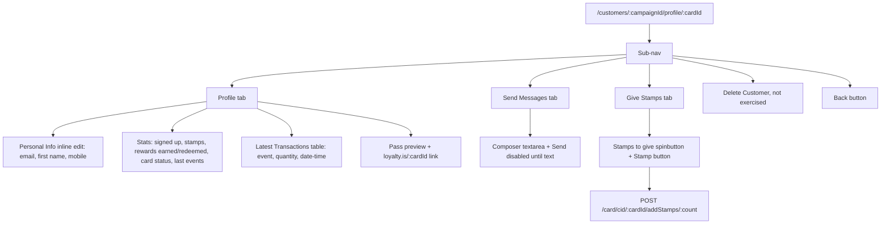

# Gaps resolved: deep pass over the first survey's misses

Run date: 2026-10-17. Member: cartographer. Baseline: FINAL_REPORT.md / pages.json / review.md (read-only, unchanged).
Campaign in play: COUNCIL TEST, id `wI4XeFr6rHCTUHGOEFazZ` (draft). Seeded data from the linker run present: 1 location (COUNCIL TEST Location), 8 enrolled customers, 2 stamps issued total.
New screenshots this run: /Users/fahad/council/output/technical/screenshots/ (customer-profile.png, settings-beacons.png, messages-segment.png, messages-segment-full.png, insights-live.png).

## 1. Resolved items table

| Item | Old status | New status | Evidence |
|---|---|---|---|
| Create New Card destination (§7E) | UNRESOLVED conflict | CONFIRMED `/edit/new/design` (Cartographer right, Linker wrong) | Controlled click of the "+" tile button on /manage-my-cards navigated to https://app.loopyloyalty.com/edit/new/design (live URL, this run). No campaign record created (nothing saved; navigated away without Save). |
| /beacons endpoint (§7D) | UNVERIFIED | CONFIRMED. `GET /beacons` (list), `GET /beacons/uuid/:value` (duplicate check, fires on modal submit), `POST /beacon` (singular) => 201 Created | Live Settings > Add Beacon flow, this run. Created "COUNCIL TEST Beacon" (logged in test-records.md). |
| CSV export flow / /csv-verify/:file | orphan, invisible | FOUND. Export buttons exist on /customers/:campaignId (button above heading) and /overview/:campaignId (small icon button next to "Latest Transactions"). Both open a "Premium Feature" modal: CSV Exports available with the Ultimate plan; links to docs (export-data-in-csv-format, how-to-try-out-premium-features-during-your-free-trial); buttons "Upgrade my Account" / "Cancel". No export request fired (gated). The router's /csv-verify/:file presumably serves the post-export step — still UNVERIFIED as a route. | Live clicks on both buttons, this run |
| /customers/:campaignId/profile/:cardId | route-only | CONFIRMED live, fully documented (see §4) | Opened for 8 seeded cards, this run |
| Stamping flow end-to-end | UNVERIFIED (API 500 via /stamp) | CONFIRMED working via the customer profile "Give Stamps" tab: `POST /card/cid/:cardId/addStamps/:count` => 200, toast "Card Successfully Stamped", counters/transaction/pass all update. The /stamp page's 500 (addStamps/undefined) is a /stamp-page bug, not an API limitation. | Gave Alice 1 stamp, this run (logged in test-records.md) |
| Editor Data tab runtime error | PARTIAL (Verifier hit it once) | CONFIRMED persistent/reproducible: "[ll2 Error] Cannot read properties of undefined (reading 'backgroundColor')" error overlay renders on every load of /edit/:id/data for this campaign, blocking the form. Form detail continues to rest on the first survey's screenshots. | Two loads this run (fresh navigation), same overlay |
| Settings isOpen JS error | CONFIRMED | Still present, but it is a toast, not a blocking overlay — all Settings sections (tabs, plans, locations, beacons, Zapier) remained fully interactive | Live /settings this run |
| Card DELETE confirm flow | never exercised | still UNVERIFIED — not executed (would destroy the only campaign) | — |
| /subuser/:subuserId | route-only | still UNVERIFIED — no subusers exist; Create Subuser not submitted | — |
| /invoice/:invoiceId | route-only | still UNVERIFIED — invoices list empty, nothing links to it | — |
| Activation unlocks | UNVERIFIED | still UNVERIFIED — email still unverified; Activate not pressed | — |
| Multi Reward flow | UNVERIFIED | still UNVERIFIED — radio observed on /edit/new/design (Single Reward default checked / Multi Reward), never selected+saved | — |
| Template click creates campaign | UNVERIFIED | still UNVERIFIED — not clicked (creates state; no COUNCIL-TEST naming possible) | — |

Correction to baseline FINAL_REPORT.md §2.6/§3.1: the overview "Card URL" displayed as `https://loyalty.is/` with empty suffix in this run's snapshot (link + Copy link + QR present). Earlier survey recorded `https://loyalty.is/<id>`. Possibly the campaign-id suffix renders only for activated campaigns or intermittently — treat the share URL value as UNVERIFIED-variant, the control itself confirmed.

## 2. Global chrome

Controls actually on screen on every container page (verified on /manage-my-cards, /edit/new/design, /subusers, /customers/:id, /settings, /overview/:id, /messages/:id, /insights/:id, /dash this run):

- Left icon rail: My Cards, insights/graph icon, users/subusers icon (badge "1" style dot seen on trial), Start (rocket), Settings. Campaign-tool rail items (Overview/Insights/Messages/Customers/Edit) render only with a live campaign in view; with the draft selected they are absent, yet direct URLs to /overview/:id, /messages/:id, /insights/:id, /customers/:id all render with data (see §4) — the "disabled rail" is a navigation gate, not an access gate.
- Top bar: logo image (clickable), trial banner "15 days left on trial" + Upgrade Now (/settings), cards icon link (/manage-my-cards), help icon link (http://docs.loopyloyalty.com/), "Your Cards" dropdown (#simple-dropdown).
- "Your Cards" dropdown (opened live): "Your Cards:" heading; one entry per campaign (pass thumbnail, name, status emphasis e.g. "COUNCIL TEST - DRAFT"; clickable, selects the in-view campaign); separator; "Create New Card"; separator; Dashboard (/dash); Settings (/settings); Logout (not exercised).
- "In view: COUNCIL TEST" — a top-bar text (not a dropdown) that appears on campaign-scoped pages when a campaign is selected. Not clickable in this state.
- Persistent alert: "You haven't verified your email address. Resend verification email." (link not exercised).
- Global search: NONE exists. The only search inputs are per-table DataTables searches (Overview transactions, Push history, Subusers, Customers, profile transactions, Insights transactions). CONFIRMED by absence across all pages this run.
- Notifications: NONE (no bell/menu anywhere).
- Help: top-bar icon to docs.loopyloyalty.com only; no in-app help widget. Per-feature "Learn more" links and per-editor-tab "Watch video tutorial: ..." links exist (e.g. "Designing your Card" on /edit/new/design — first time documented).
- Setup checklist: none.

## 3. List page actions

### /manage-my-cards (card tiles)
- Add: "+" tile button (no label) -> /edit/new/design (CONFIRMED this run).
- Options/kebab: none. Row actions per tile: MANAGE (editor), DELETE (destructive, not exercised). No bulk actions, filters, sorting, or export. API: GET /campaigns.

### /subusers
- Add: "Create Subuser" button opens modal "Create a New Subuser": Username* (fixed prefix "ibefehdi+", placeholder "e.g. staff1, john, restaurantA"), Password*, Notes (optional), Location combobox fed by GET /locations (shows "COUNCIL TEST Location"); Cancel / Create Subuser. NOT submitted (would create a login credential record).
- Table (DataTables): columns Profile (sortable, default asc), Username, Created, Notes, Location, Status; Show 10/25/50/100 entries; Search box; pagination Previous/Next; empty state "No data available in table" / "Showing 0 to 0 of 0 entries".
- No row actions, bulk actions, or export (no rows exist; row actions UNVERIFIED).
- API: GET /account, GET /campaigns, GET /subusers, GET /locations.

### /customers/:campaignId
- Export: icon button above the "Customers" heading opens the Ultimate-gated CSV Premium modal (see §5).
- Table columns: (actions), First Name, Email Address, Mobile Number, Signup Date (y-m-d, sortable), Card Status, Stamps Earned, Rewards Earned, Rewards Redeemed (all sortable). Show 10/25/50/100; Search; First/Previous/1/Next/Last pagination.
- Row action: "Actions" link in first column -> /customers/:campaignId/profile/:cardId.
- No bulk selection, no filters, no column menu.
- API: GET /account, GET /campaigns, GET /campaign/id/:id, POST /card/cid/:id?count=false.

### /overview/:campaignId
- KPIs Customers Signed Up / Stamps Issued / Rewards Issued / Rewards Redeemed (live values 8/2/0/0 with seeded data — page fully functional on a DRAFT campaign).
- Latest Transactions: Date and Time (sortable), Customer (link to profile), Event, User (attribution shows "ibefehdi"); Show entries, Search, pagination. Small icon button next to the heading = CSV export (Ultimate-gated modal).
- Push Message History table: Date, Message, Segment, Reach (empty state).
- Your Card URL: link + Copy link + QR (value anomaly noted in §1). Tip text about Apple Wallet scanner. Three docs links (save card / stamp / promote).
- API: GET /account, GET /campaigns, GET /campaign/id/:id, POST /events/analytics/transactions/:id, GET /events/pushHistory/:id, GET /events/analytics/all/:id.

### /messages/:campaignId
- Composer: "Who?" radios — "All of my customers" / "A segment of my customers". Segment UI (revealed live): metric combobox (Current Stamp Amount / Lifetime Stamps Earned / Rewards Earned / Rewards Redeemed), operator combobox (Greater than / Less than / Equal to / Greater than = to / Less than = to), value spinbutton, and a live reach count ("This message will reach 6 customers."). Message textarea + ~90-char best-practice hint + 4 example ideas. "Send Message" button (NOT exercised — would send push to customers).
- Push Message History table (Date, Message, Segment, Reach; empty state).
- API: GET /account, GET /campaigns, GET /campaign/id/:id, GET /card/cid/:id?count=true (audience count).
- Right-side "Unlock for more" widget with account name — premium teaser panel.

### /insights/:campaignId
- Revenue vs reward-cost summary ("driven $0.00 in revenue and cost $0.00* in rewards. You have broken even."; "*$0.00 worth of rewards have already been claimed, with $0.00 outstanding").
- All time stats: same four KPIs (8/2/0/0).
- Currency combobox (~120 ISO currencies, USD default).
- Stamp Value ($ input) and Reward Cost ("#1 : $" input) with Submit — value inputs that drive the ROI math.
- Activity chart (Group by: Day/Month — no Year here, unlike /dash) and Stamp Count Histogram.
- Transactions table (same shape as Overview's, Customer links to profiles).
- API: GET /account, GET /campaigns, GET /campaign/id/:id, GET /events/analytics/all/:id, GET /events/analytics/stampTotals/:id, POST /events/analytics/transactions/:id.

### /dash
- Total statistics KPIs (8/2/0/0 live), Acquisition chart Group by Day/Month/Year, Rewards Overview.
- No "In view" selector (account scope). No table, no export.
- API: GET /account, GET /campaigns, GET /events/analytics/all/:id?groupBy=.

### /settings
- My Account tabs: General (Username disabled "ibefehdi", First Name*, Last Name*, Email*, Update), Business, Privacy, Password, Developer Tools, Delete (not exercised).
- Billing tabs: Plan (Starter US$25 / Growth US$69 / Ultimate US$95; Month-to-Month / Billed Annually per card; "Subscribe to X Monthly" buttons — NOT clicked; includes-lists per plan: 1/3/10 card designs, 1/3/10 locations, 1/3/10 beacons, 3/10/50 subusers, Label text customisation, Unique customer enrollments, Data Export; charge warning for post-trial), Credit Card (Stripe, not exercised), Invoices (empty).
- Locations: table (Location link to Google Maps, Display Address, actions: Edit and Delete icon buttons — not exercised) + Add Location + Google Maps picker.
- Beacons: Add Beacon modal (Name of Beacon, UUID, Major, Minor; validation "Please enter a valid uuid." — all-zero UUID rejected — and "Please enter a minor."). Created COUNCIL TEST Beacon via POST /beacon 201.
- Zapier: 3 workflow cards (Mailchimp add, Google Sheets enrollments, Google Sheets stamps) rendered TWICE (bug confirmed); links out to zapier.com create-zap templates 19506/19501/19502; "Create from scratch" / "learn more".
- APIs: GET /account, GET /campaigns, GET /locations, GET /beacons, GET /beacons/uuid/:value, POST /beacon; third-party: Stripe (js.stripe.com, api.stripe.com consumers/sessions/lookup, hCaptcha), Zapier (api.zapier.com/elements), Google Maps.

### /help (templates)
- Template gallery + resources, unchanged from baseline (not re-clicked; template click would create a campaign). API: GET /images/stampTemplates.

## 4. Detail views

### Customer profile `/customers/:campaignId/profile/:cardId` (route-only in baseline; now fully live)
- Reached from: Customers table "Actions" link; Overview/Insights transaction "Customer" links.
- Sub-nav tabs: Profile, Send Messages, Give Stamps, (spacer), Delete Customer; Back button.
- Profile tab: stats block (Signed Up, Stamps Earned, Rewards Earned, Rewards Redeemed, Card Status "issued", Last Stamp/Reward Earned/Redeemed); Personal Info section with inline-edit (Email Address, First Name, Mobile Number) — edit affordance (pen icon) toggles inputs; "View this customers pass:" -> https://loyalty.is/:cardId; Latest Transactions table (Event, Quantity, Date and Time; sortable, search, Show entries); right panel = live pass preview with STAMPS REQUIRED UNTIL NEXT REWARD counter and PDF417 barcode.
- Give Stamps tab: "Give this customer stamps" — current stamp count, "Stamps to give:" spinbutton (default 1), Stamp button. Worked on the draft campaign: POST /card/cid/:cardId/addStamps/:count => 200.
- Send Messages tab: single-customer composer (textarea with example placeholder, ~90-char hint, 4 ideas, Send disabled until text) + link to docs sending-messages-to-an-individual-customer; right side "Unlock for more" premium teaser. NOT sent.
- Delete Customer: not exercised (destructive).
- API: GET /account, GET /campaigns, GET /campaign/id/:id, GET /card/:cardId?includeEvents=true.

### Campaign editor tabs
Baseline coverage stands. New detail this run (from /edit/new/design):
- Per-tab "Watch video tutorial: <Tab topic>" link (Design tab: "Designing your Card").
- Design: Type radio (Single Reward default / Multi Reward); Icon 87x87 square; Logo 480x150 (min height 150, max width height x 3.2); stamp count select 1-30 (default 10 on new); Pick Stamped/Un-stamped Image galleries (preset "bagel" etc.) OR upload (min 200x200) OR "Use Stamped Image" checkbox; Colors as tabbed pickers — Card (Background, Text), Background, Stamp Circle, Stamp — each with rgb() text input.
- Save / Save & Preview always; Activate only on saved campaigns (not exercised).
- Data tab: persistent crash overlay on /edit/:id/data (see §1).

### Subuser, invoice, location/beacon detail
- /subuser/:subuserId: UNVERIFIED (no rows). /invoice/:invoiceId: UNVERIFIED (empty invoices). Locations/Beacons have no detail pages — inline Edit/Delete row actions in Settings only.

## 5. Gated features

- CSV Export (Customers table button; Overview transactions button): "Premium Feature" modal — "Unlock CSV Exports - available with the Ultimate plan." + docs links + "Upgrade my Account" / Cancel. Note the inconsistency: every plan card in Settings (incl. Starter) lists "Data Export" in its includes, but the actual export UI is gated to Ultimate.
- Label customisation / editor Custom tab, Unique Customer Enrollments (Data tab): premium per plan includes (baseline; not re-tested).
- "Unlock for more" teaser widget beside the pass preview on /messages/:id and the customer-profile Send Messages tab.
- Plan Subscribe buttons (Starter/Growth/Ultimate, monthly/annual toggle) — documented, not clicked (billing).
- Single-customer messaging from the profile appears unrestricted in UI; delivery unverified.

## 6. Diagrams

Global navigation:

```mermaid
flowchart TD
    TB["Top bar"] --> MC["/manage-my-cards"]
    TB --> DOCS["docs.loopyloyalty.com"]
    TB --> DROP["Your Cards dropdown"]
    DROP --> CAMP["Campaign entry: selects in-view campaign"]
    DROP --> NEW["Create New Card -> /edit/new/design"]
    DROP --> DASH["/dash"]
    DROP --> SET["/settings"]
    DROP --> OUT["Logout"]
    TBTRIAL["Trial banner Upgrade Now"] --> SET
    RAIL["Left rail"] --> MC2["My Cards"]
    RAIL --> SUB["/subusers"]
    RAIL --> HELP["Start -> /help"]
    RAIL --> SET2["Settings"]
    RAIL --> DASH2["Insights icon -> /dash"]
    MC --> MANAGE["MANAGE -> /edit/:id/design"]
    MC --> EDITNEW["Plus -> /edit/new/design"]
    MC --> DEL["DELETE, not exercised"]
    HELP --> TPL["Template click creates campaign, UNVERIFIED"]
    SUB --> CREATSUB["Create Subuser modal, not submitted"]
    SET --> LOC["Locations add/edit/delete"]
    SET --> BEA["Beacons: Add Beacon -> POST /beacon"]
    SET --> PLAN["Plan subscribe, not clicked"]
    CUST["/customers/:id"] --> PROF["/customers/:id/profile/:cardId"]
    PROF --> GIVE["Give Stamps -> POST /card/cid/:cardId/addStamps/:count"]
    PROF --> SEND1["Send Messages tab, not sent"]
    PROF --> PASSVIEW["loyalty.is/:cardId"]
    CUST --> CSVE["CSV export button, Ultimate gated"]
    OVW["/overview/:id"] --> CSVE2["Transactions CSV export, Ultimate gated"]
    OVW --> PROF2["Transaction Customer links"]
    OVW --> LND["Card URL / QR -> loyalty.is"]
    MSG["/messages/:id"] --> SEG["Segment selector with live reach count"]
    MSG --> SENDALL["Send Message, not exercised"]
```

Customer profile detail view:

## API endpoint summary (new this run)

- POST /beacon (singular) — create beacon, 201
- GET /beacons — list beacons, 200
- GET /beacons/uuid/:value — duplicate check, 200
- GET /card/:cardId?includeEvents=true — customer profile data + events, 200
- POST /card/cid/:cardId/addStamps/:count — issue stamps, 200
- (gated, not fired) CSV export endpoints behind the Ultimate modal

No tokens, cookies, or personal values recorded. FINAL_REPORT.md, pages.md/json, links.md, review.md untouched.
