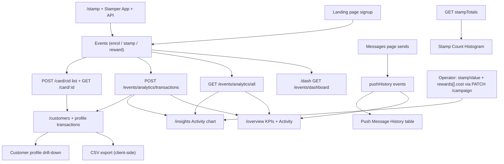
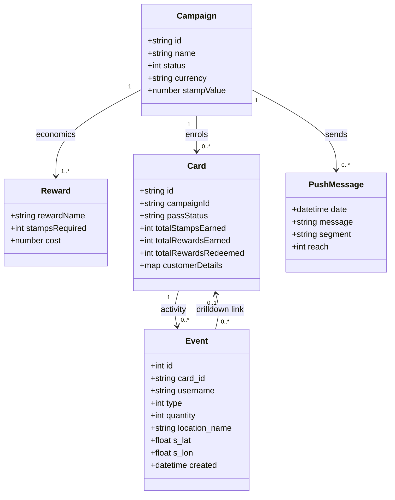

# Reports & Analytics — Deep Technical Pass (Loopy Loyalty)

Author: cartographer (task t_8592fdb6). Date: 2026-10-17.
Baseline: /Users/fahad/council/output/pages.md, pages.json, links.md, review.md (read-only).
Test campaign: "COUNCIL TEST" (id wI4XeFr6rHCTUHGOEFazZ, status 1 = draft) with 8 seeded customers (seed.md).

## Product shape

Loopy Loyalty has NO report library or saved views. It has a statistics home (/dash, account-level) plus three per-campaign analytics views (Overview, Insights, Customers) and one drill-down (customer profile). There are no favourites, no scheduled email reports, no report builder, no date-range or location or staff filters anywhere in analytics. The only filters that exist are: time grouping (Day/Month/Year) and server-side table search.

## Catalogue

| # | View | Category | Route | Gated | Export |
|---|------|----------|-------|-------|--------|
| 1 | Dashboard (Total statistics + Acquisition + Rewards Overview) | Account-level stats | /dash | No | None |
| 2 | Overview (per campaign) | Campaign health | /overview/:campaignId | Route reachable for draft; rail entry gated until activation | None |
| 3 | Insights (per campaign) | ROI / finance | /insights/:campaignId | Route reachable for draft; rail entry gated until activation | None |
| 4 | Customers (per campaign) | Customer list | /customers/:campaignId | Route reachable for draft | CSV (client-side) |
| 5 | Customer profile (drill-down) | Single-customer history | /customers/:campaignId/profile/:cardId | Reachable from transaction rows | None |
| 6 | Push Message History (table on Overview AND /messages/:campaignId) | Messaging log | /overview/:campaignId, /messages/:campaignId | Same as Overview | None |

All exports in the entire analytics surface: exactly one — the CSV download button on the Customers list (see §4). Plan feature list in Settings mentions "data export"; no other export UI exists. UNVERIFIED: any export via developer API (developer.loopyloyalty.com).

## 1. Dashboard — /dash

- Route: `/dash`. Nav: top-bar "Dashboard" link. Account-level (not campaign-scoped).
- Purpose: aggregate KPIs across all campaigns + acquisition trend.
- UI structure (snapshot deep-dash.yml; screenshot reports-deep-dash.png):
  - "Total statistics" header with an icon button (refresh, UNVERIFIED — click produced no network call).
  - 4 KPI tiles: Customers Enrolled (8), Stamps Issued (0), Rewards Issued (0), Rewards Redeemed (0).
  - "Acquisition" section: Group by combobox (Day / Month / Year, Day default) + an icon button beside it (no visible effect; UNVERIFIED).
  - "Rewards Overview" section: rendered with heading only in this account (zero rewards data; empty state).
  - Four Vimeo tutorial embeds on the page (player.vimeo.com/video/227213226, 227050025, 227060638, 227072189) — returned 401 in headless browser; video content UNVERIFIED.
- API: `GET https://api.loopyloyalty.com/events/dashboard?groupBy=day` → 200.
  - Response observed: `{"enrol":{"2026-10-17":8}}` — object keyed by period, per event type ("enrol"; stamp/reward keys presumably appear when nonzero — UNVERIFIED).
  - Selecting "Month" fires `GET /events/dashboard?groupBy=month` → `{"enrol":{"2026-10":8}}`. Year not exercised (same pattern expected, UNVERIFIED).
  - NOTE: this corrects links.md, which wrote "/events/dashboard?groupBy=day" as called-from /dash but ALSO implied a generic "/events" endpoint; the dashboard endpoint is `/events/dashboard`, distinct from the campaign-scoped `/events/analytics/*`.
- Entities: read-only aggregation over enrolment/stamp/reward events across all campaigns.
- Links out: Upgrade Now → /settings; account nav links. No drill-down from KPI tiles (none clickable).

## 2. Overview (per campaign) — /overview/:campaignId

- Route: `/overview/:campaignId`. Nav: campaign rail "Overview" (enabled only for live campaigns; direct URL works for drafts — confirmed by verifier and re-confirmed here).
- Purpose: live campaign health snapshot + activity log.
- Features (baseline pages.md §9 confirmed; API re-verified this run):
  - KPIs: Customers Signed Up, Stamps Issued, Rewards Issued, Rewards Redeemed.
  - "Latest Transactions" DataTable: columns Date and Time (sortable, default desc), Customer, Event, User; entries-per-page 10/25/50/100; server-side search; pagination (First/Previous/1/Next/Last).
  - "Push Message History" table: Date, Message, Segment, Reach (empty in this account: `{"events":[]}`).
  - Share block: card URL https://loyalty.is/<campaignId>, Copy link, QR code, how-to links.
- API (this run, all 200):
  - `GET /campaigns`, `GET /campaign/id/:campaignId` (page context).
  - `POST /events/analytics/transactions/:campaignId` — request body (DataTables server-side protocol):
    `{"draw":1,"start":0,"length":10,"search":"","order":{"column":"created","dir":"desc"}}`
    Response: `{"draw":1,"recordsTotal":8,"recordsFiltered":8,"data":[{...event rows...}]}`.
    Event row fields: `id:int`, `uuid:string`, `card_id:string`, `username:string` (acting user), `type:int` (0 = "Signed up" per UI), `quantity:int`, `location_name:string`, `reward_name:string`, `s_lat/s_lon: nullable float` (stamper GPS), `ip`, `ua`, `referrer`, `created: ISO-8601`.
  - `GET /events/analytics/all/:campaignId?groupBy=undefined` — note the literal `groupBy=undefined` bug (AngularJS uninitialized binding) on this page; response `{"enrol":{"2026-10-17":8}}`.
  - `GET /events/pushHistory/:campaignId` → `{"events":[...]}` (fields beyond the empty array UNVERIFIED).
- Entities read: campaign, card, event, push message.
- Links out: Customer cells link to `/customers/:campaignId/profile/:cardId`; share URL → landing page; docs links.
- Screenshot: reports-deep-overview.png (also baseline screenshots/overview.png).

## 3. Insights (per campaign) — /insights/:campaignId

- Route: `/insights/:campaignId`. Nav: campaign rail "Insights" (gated until activation; direct URL works).
- Purpose: "Track sales you've generated from your digital stamp cards" — ROI view.
- Significantly richer than the baseline survey recorded (pages.md §10 missed most of it). Full structure (snapshot reports-deep-insights*.yml; screenshot reports-deep-insights.png):
  - Header: summary sentence "Your program has driven $X in revenue and cost $Y* in rewards. You have broken even." + footnote "*$X worth of rewards have already been claimed, with $Y outstanding".
  - "All time stats": Customers Signed Up, Stamps Issued, Rewards Issued, Rewards Redeemed + refresh icon button.
  - Revenue inputs (form):
    - Currency selector (combobox, ~117 ISO currencies, "US Dollar: USD" default).
    - Stamp Value: numeric spinbutton ($ 00.00) — estimated revenue per stamp.
    - Reward Cost: one numeric spinbutton per reward, labelled "#1 : $" (multi-reward campaigns presumably get #2, #3... — UNVERIFIED, only single-reward draft available) + Submit button.
    - Submit writes via `PATCH /campaign/:campaignId` with the full campaign object; relevant fields `stampValue: number` and `rewards[].cost: number` (verified by setting 1.23 / 2.34, then reverting to 0 — see test-records.md).
  - "Activity" chart section: Group by combobox (Day / Month only — no Year here, unlike /dash) + icon button. Selecting Month fires `GET /events/analytics/all/:campaignId?groupBy=month`.
  - "Stamp Count Histogram" section (data from stampTotals; refresh icon button). Observed data: `{"stampTotals":[[0,8]]}` = 8 customers holding 0 stamps (pairs of [stampCount, customerCount]).
  - "Transactions" DataTable (same server-side protocol as Overview): columns Date and Time (sortable), Customer (link → profile), Event, User; Show 10/25/50/100 entries; Search; pagination; "Showing 1 to 8 of 8 entries".
- API summary (all observed 200):
  - `GET /campaigns`, `GET /campaign/id/:campaignId`
  - `GET /events/analytics/all/:campaignId?groupBy=day|month` → `{"enrol":{...}}` (period-keyed counts)
  - `GET /events/analytics/stampTotals/:campaignId` → `{"stampTotals":[[stampCount, customerCount], ...]}`
  - `POST /events/analytics/transactions/:campaignId` (DataTables protocol, see §2)
  - `PATCH /campaign/:campaignId` (stampValue / rewards[].cost / currency write)
- Entities: campaign (write: economics config), card, event.
- Links out: customer profile drill-downs; no export.
- Screenshot: reports-deep-insights.png.

## 4. Customers (per campaign) — /customers/:campaignId

- Route: `/customers/:campaignId`. Nav: campaign rail "Customers".
- Purpose: enrolled customer list with loyalty standing.
- Features (snapshot page-2026-10-17T07-59-00-528Z.yml; screenshot reports-deep-customers.png):
  - CSV export button (download icon, top right of heading): `ng-click="vm.exportCsv()"` — client-side CSV generation from loaded table data, no network request observed (export click produced zero API calls). Filename/format details UNVERIFIED (headless download not captured).
  - DataTable columns: Actions (link per row), First Name, Email Address, Mobile Number (masked in UI: +120****0107), Signup Date (y-m-d, sortable), Card Status (sortable; "issued"), Stamps Earned, Rewards Earned, Rewards Redeemed (all sortable).
  - Show entries 10/25/50/100; server-side Search (typed "Alice" → POST with `"search":"Alice"`, draw incremented); pagination.
- API: `POST /card/cid/:campaignId?count=false` — request body `{"dt":{"draw":N,"start":0,"length":10,"search":"...","order":{"column":"created","dir":"desc"}}}`. Response contains card rows (baseline: POST list endpoint; field names in profile response below).
- Links out: every row's Actions → customer profile.
- Screenshot: reports-deep-customers.png.

## 5. Customer profile (drill-down) — /customers/:campaignId/profile/:cardId

- Route reached by clicking a Customer link in Overview/Insights transactions or Actions in Customers.
- Purpose: single customer's loyalty history and per-customer ops.
- Features (snapshot page-2026-10-17T07-58-52-757Z.yml; screenshot reports-deep-customer-profile.png):
  - Tabs/actions: Profile, Send Messages, Give Stamps, Delete Customer, Back.
  - Stats: Signed Up timestamp, Stamps Earned, Rewards Earned, Rewards Redeemed, Card Status (with info tooltip), Last Stamp Earned / Last Reward Earned / Last Reward Redeemed.
  - Personal Info (collapsible + edit chevron): Email Address, First Name, Mobile Number (masked).
  - "View this customers pass": link to https://loyalty.is/:cardId.
  - Pass preview: strip image, "STAMPS REQUIRED UNTIL NEXT REWARD: 10", PDF417 barcode, carousel buttons.
  - "Latest Transactions" DataTable: Event (sortable), Quantity, Date and Time; entries-per-page; search; pagination.
- API: `GET /card/:cardId?includeEvents=true` → 200. Response: `{"card":{...},"events":[...]}`.
  - Card fields: `id`, `uid`, `campaignId`, `passStatus` ("issued"), `stripImage` (design object), `totalStampsEarned:int`, `totalRewardsEarned:int`, `totalRewardsRedeemed:int`, `customerDetails` (map of collected fields → values), `object:"card"`, `createYear/Month/Day`, `createTime`, `updateTime`.
  - Events: same event shape as §2.
  - Note: masking of the mobile number is UI-only; the API returns the full number (field-level PII, values not recorded here).
- Entities: card, customerDetails (from Data tab config), event.
- Links out: loyalty.is pass URL; tab actions (Send Messages / Give Stamps / Delete Customer — not exercised; destructive/impactful flows avoided).
- Screenshot: reports-deep-customer-profile.png.

## 6. Push Message History

- Same table component appears on /overview/:campaignId and /messages/:campaignId.
- Columns: Date, Message, Segment, Reach. Data: `GET /events/pushHistory/:campaignId` → `{"events":[]}` (empty this account; row fields UNVERIFIED).
- Source entity: push messages sent from the Messages page (segments: all customers vs a segment).
- No export, no filters.

## Data lineage

- "Customers Enrolled / Signed Up" ← enrol events (event type 0, created at landing-page signup) ← /landing-page/:campaignId form (fields from campaign.fieldsToCollect).
- "Stamps Issued" ← stamp events (quantity, location_name, s_lat/s_lon, username = acting subuser) ← /stamp tool, Stamper App, or API.
- "Rewards Issued / Redeemed" ← reward events ← stamping completes a card / redemption at POS.
- Acquisition chart ← `GET /events/dashboard?groupBy=day|month|year` (account-wide enrol counts per period).
- Insights revenue/cost ← operator-entered `campaign.stampValue` and `campaign.rewards[].cost` (PATCH /campaign/:id) × event counts; "claimed vs outstanding" from reward issue/redeem events.
- Stamp Count Histogram ← `GET /events/analytics/stampTotals/:campaignId` ([stampCount, customerCount] pairs).
- Transactions tables ← `POST /events/analytics/transactions/:campaignId` (DataTables server-side: draw/start/length/search/order).
- Customers list ← `POST /card/cid/:campaignId?count=false` (cards with customerDetails).
- CSV export ← client-side serialization of the loaded Customers table (no API).
- Push history ← `GET /events/pushHistory/:campaignId` ← messages sent on /messages/:campaignId.

## Gating / permissions notes

- The campaign rail disables Overview/Insights/Messages/Customers while the selected card is a draft, but all routes load directly by URL with zero data restrictions observed (draft campaign showed real seeded customer rows). Gating is navigational, not a data-permission boundary. UNVERIFIED for live campaigns only features (segments, redemption).
- No plan-gating observed on any analytics view in this trial account. Data export is listed as a plan feature (Settings → Plan); the Customers CSV button was present and functional on trial.
- No role/staff-member filter exists anywhere in analytics, despite subusers being the acting "User" on events.

## Diagrams

## Corrections to baseline

- pages.md §10 (Insights) missed: Stamp Value / Reward Cost inputs + Submit (PATCH /campaign/:id), Currency selector (writes campaign.currency), Activity chart group-by, Stamp Count Histogram, Transactions table with drill-downs. Documented here.
- links.md misspelled/misattributed endpoints ("/events/dashboard?groupBy=day" vs its API table "/events/dashboard"); confirmed exact paths: `/events/dashboard`, `/events/analytics/all/:id`, `/events/analytics/stampTotals/:id`, `/events/analytics/transactions/:id`, `/events/pushHistory/:id`, `/card/cid/:id`, `/card/:cardId?includeEvents=true`.
- New finding: `?groupBy=undefined` literal sent by /overview (AngularJS binding bug).
- New finding: Customers CSV export button (vm.exportCsv()) — client-side, no API.
- New finding: analytics routes are not data-gated for draft campaigns (navigational gating only).
- New finding: /dash embeds four Vimeo tutorial videos.
