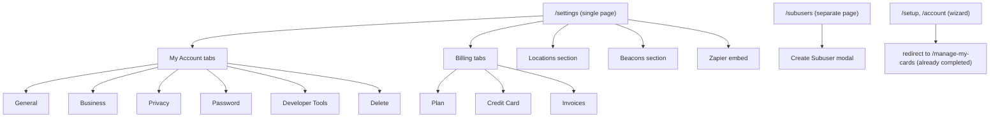

# Settings & Setup deep pass (Loopy Loyalty dashboard)

Run date: 2026-10-17. Member: cartographer (task t_a237cfa4). Baseline: pages.md §14 / FINAL_REPORT.md (read-only, unchanged).
Account in play: trial plan (`plan:"trial"`, `limit:1`, `trialDuration:15`, `status:"setup"` per GET/PATCH /account), email unverified.
Campaign: COUNCIL TEST (draft), id wI4XeFr6rHCTUHGOEFazZ. 1 location, 1 beacon, 0 subusers exist.
New screenshots this run: `screenshots/settings-deep-general.png`, `screenshots/subusers-deep.png` (stored in /Users/fahad/council/screenshots/, copied to technical/screenshots/).

## Settings tree

There is no salon-style settings tree. All settings live on ONE page, /settings, rendered as vertical stacked sections; "My Account" and "Billing" are angular-ui tab groups (all tabs' inputs are present in the DOM at once, only one visible). Staff/permissions (subusers) and the setup wizard live on separate routes.

Reachability of /settings: top-bar "Settings" link, left-rail gear icon, top-bar trial banner "Upgrade Now" link, "Your Cards" dropdown > Settings. ui-router state `settings` (from survey). SPA route — no separate URLs per tab (stays /settings; tabs are in-page).

## 1. My Account

### General tab
- Fields (input name / label / type):
  - `username` "Username (cannot be changed)" text, DISABLED. Value class: account username.
  - `firstName` "First Name*" text, required.
  - `lastName` "Last Name*" text, required.
  - `email` "Email*" email input, required.
- Save: "Update" button -> `PATCH /account` with the FULL account object (see payload below), then `GET /account` refresh. 200 OK.
- PATCH /account observed payload/response field names: `MailSubscriptions`, `business` {AupCheckFailed, AupCheckProcessed, addressLine1, country, email, name, phone, taxId, website}, `businessBilling` (same shape as business), `discounts[]`, `email`, `expiry` (RFC3339), `firstName`, `id`, `intercomId`, `lastName`, `limit` (int), `plan` ("trial"), `ref`, `secret` (API secret — not reproduced here), `status` ("setup"), `stripeInformation` {}, `subscribed` (bool), `trialDuration` (15), `username`.
- Affects: name shown in app; `business` block feeds Business tab and invoice/billing address defaults.

### Business tab
- Fields: `businessName` "Business Name*" text req; `website` "Website*" text req; `addressLine1` "Address Line 1*" req; `addressLine2` "Address Line 2"; `city` "City*" req; `stateProvinceRegion` "Region"; `zip` "Zip"; Country* select (~250 countries, currently empty value).
- Save: same "Update" -> PATCH /account (business fields ride along in `business` object).
- Affects: business identity on invoices / billing address prefill (businessBilling mirrors business). Current values: business name = username string, website set; address fields empty.

### Privacy tab
- Field: `toggle` checkbox "Subscribed*" with marketing-consent paragraph ("information provided on sign up ... opt out at any time ... request permanent deletion").
- Save: "Update" -> PATCH /account (writes `subscribed` / `MailSubscriptions`).
- Affects: marketing consent only; no other UI observed consuming it. Not toggled this run (evidence: baseline screenshots settings-privacy.png).

### Password tab
- Fields: `currentPassword` "Current Password" (Show/Hide toggle), `newPassword` "New Password" (id newPassword), `confirmNewPassword` "Confirm Password". Validation list shown: "8 characters minimum", "1 number".
- Save: "Update" (NOT exercised — safety rule: no password changes).
- Affects: account login credentials only.

### Developer Tools tab
- Alert text: works out of the box with "Stamper App for iOS and Android"; API for POS/CRM integration; support email link.
- Fields: "API Key" text DISABLED; "API Secret" text DISABLED (values visible in DOM; not reproduced). Link: https://developer.loopyloyalty.com (API documentation).
- No save action (read-only display). Affects: external integrations (Zapier, Stamper App, custom POS/CRM) authenticate with this key/secret pair.

### Delete tab (viewed, NOT executed)
- Copy: exit-survey request; checkboxes `technology` "Technology is hard to understand", `interest` "Customers not interested", `features` "Not enough features"; free-text "Other please specify"; `password` confirm; warning "all of your personal information and customer data will be lost"; "Delete" button (btn-danger).
- Affects: destroys the whole account. STOP rule respected.

## 2. Billing

### Plan tab
- Copy: "Try out any plan. No commitment. Cancel anytime."
- Three plan cards, each with a Month-to-Month / Billed Annually combobox and a Subscribe button:
  - Starter US$25/mo: 1 card design, 1 location, 1 beacon, 3 subusers, label text customisation, unique enrollments, data export. Button "Subscribe to Starter Monthly".
  - Growth US$69/mo: 3 card designs, 3 locations, 3 beacons, 10 subusers, same feature list.
  - Ultimate US$95/mo: 10 card designs, 10 locations, 10 beacons, 50 subusers, same feature list.
- Warning: "unless you are in your free trial, clicking on Subscribe ... will immediately charge your credit card".
- Subscribe NOT clicked (safety rule). Stripe JS/hcaptcha assets load with the page (js.stripe.com, api.hcaptcha.com, merchant-ui-api.stripe.com/elements/wallet-config) — subscription checkout is Stripe-based. Actual subscribe endpoint UNVERIFIED (would charge).
- Affects: plan limits enforced server-side for card designs, locations, beacons, subusers, CSV export (see Gated settings).

### Credit Card tab
- "Credit or debit card" Stripe Elements iframe (card number / MM/YY / CVC; Link autofill button).
- Own fields: `addressLine1` "Billing Address Line 1*", `addressLine2`, `city` "City*", `stateProvinceRegion` "Region", `zip`, Country* select (~250 options), `phone` "Mobile Number" (country-code combobox, e.g. "United States: +1", + masked textbox) with helper text (subscription issue notifications), `taxId` "Tax ID" (shown on invoice).
- Save: "Update Payment Details" (NOT exercised — payment-provider change is a stop rule).
- Affects: card charged by any plan subscription; tax id appears on invoices.

### Invoices tab
- Empty state: "You have no invoices." Table data source: `GET /invoices` (200, fired when tab shown). Invoice detail route /invoice/:invoiceId remains UNVERIFIED (nothing links to it).

## 3. Locations section (/settings)
- Copy: "Display lock screen messages when customers are near your location(s)."
- Table columns: Location (link -> maps.google.com/?q=lat,lon), Display Address, actions (pencil edit, trash delete). "Add Location" button (pull-right).
- Add New Location modal (uib-modal, size lg): `Location Name` ("Enter a location name"); `Search for location by address` (Google Maps geocode search, map with Pegman/Street View/satellite); "Advanced" disclosure -> `Latitude`/`Longitude` spinbuttons (prefilled 22.287614/114.148313 from map centre); `Address to display` ("Address that will be displayed on your card"). Footer: Create Location / Cancel.
- Edit modal = same fields prefilled + Note: "changes made to this location will be updated on all of your card designs that use this location." Footer: Save Location / Cancel.
- Create API: `POST /location`; observed payload (limit-rejected, but complete): `{name, lat, lon, address, alt, addressOnCard, message, isAppleWalletEnabled, isAndroidPayEnabled}`. Response 400: `{"error":"Location limit reached. Would you like to {{upgradeLink}} your account to enable more locations?"}` — note unrendered i18n placeholder bug.
- Load API: `GET /locations`. Location entity fields observed: `id, uid, name, lat, lon, address, addressOnCard, showAddressOnCard, object:"location"`.
- Affects: card designs that reference the location (Locations tab of card editor), lock-screen messages (iBeacon/geofence message on the customer pass), and the subuser Location dropdown.

## 4. Beacons section (/settings)
- Copy: "Display lock screen messages when your customers are in proximity to your bluetooth beacon(s). Learn more."
- Table columns: Name, UUID, Major, Minor, actions (pencil, trash). "Add Beacon" button.
- Add New Beacon modal: `name` "Name of Beacon", `uuid` "UUID", `major` spinbutton, `minor` spinbutton. On submit the UI runs a uniqueness check `GET /beacons/uuid/<entered value>` — observed path used the beacon NAME (`/beacons/uuid/COUNCIL-TEST%20Beacon%202`), then the UUID field was auto-replaced with a generated UUID (v5-style, e.g. e357d59e-6abb-5113-bc52-a14431a7f8da) before POST.
- Create API: `POST /beacon` payload `{name, uuid, major, minor}` -> 400 `{"error":"Beacon limit reached. Would you like to {{upgradeLink}} your account to enable more beacons?"}` (unrendered placeholder bug; Starter/trial limit 1 reached).
- Edit modal: same 4 fields prefilled from row. Load API: `GET /beacons`.
- Affects: beacon-triggered lock-screen message on customer passes (Apple/Android wallet `message` field of locations/beacons).

## 5. Zapier section (/settings)
- Embedded Zapier widget (iframe/api.zapier.com `GET /elements/zap-templates/?...&service_slugs=Loopy-Loyalty`, `GET /elements/apps/Loopy-Loyalty/`). Three featured workflows, duplicated twice in DOM (mobile/desktop variants):
  - "Add new Loopy Loyalty customers to a Mailchimp list" (template 19506, Mailchimp + Loopy Loyalty)
  - "Save Loopy Loyalty customer enrollments as Google Sheets rows" (template 19501)
  - "Log new Loopy Loyalty stamps to a Google Sheets spreadsheet" (template 19502)
- Links: "Create a workflow from scratch" (zapier.com/webintent/create-zap), "Learn more about Zapier" (zapier.com/how-it-works). Outbound only; no state in the app.

## 6. Subusers (/subusers, staff & permissions)
- Route /subusers (left-rail users icon). Heading copy: "Create subusers to track stamps and rewards issued & redeemed by each staff member. You can create up to 10 subusers with the Growth plan and up to 50 subusers with the Ultimate plan." (No Starter mention — Starter allows 3 per Plan tab, but see gating below.)
- DataTables grid: columns Profile (avatar), Username, Created, Notes, Location, Status; per-table "Show N entries" (10/25/50/100) and "Search:" box; pagination Previous/Next; empty state "No data available in table", "Showing 0 to 0 of 0 entries".
- Create Subuser modal: `username` "Username*" (displayed with fixed prefix "<owner-username>+" — subuser logs in as owner+suffix); `password` "Password*"; `label` "Notes" (optional); `#locationId` "Location" select populated from GET /locations. Footer: Create Subuser / Cancel.
- Create API: `POST /subuser` payload `{username, password, label, locationId, location:{...full location object}}` -> 403 `{"error":"The trial version does not allow for creating subusers. Please upgrade your account to one of our premium plans."}`. So subusers are trial-gated entirely (stronger than the plan-limit message).
- Load API: `GET /subusers`. Row detail route /subuser/:subuserId remains UNVERIFIED (no subuser can exist on trial).
- Affects (would-be): per-staff stamp/redeem attribution ("track stamps and rewards issued & redeemed by each staff member").

## 7. Setup wizard (/setup, /account)
- Both direct navigations 302/redirect to /manage-my-cards — the onboarding states (ui-router `setup.*`, incl. setup.account) are completed and unreachable for this account.
- Caveat: API `GET /account` still reports `status:"setup"` and email is unverified — the redirect is driven by something else (email/campaign setup progress), exact condition UNVERIFIED.

## API endpoints observed this run (api.loopyloyalty.com)

| Method | Path | Where | Status seen | Purpose |
|---|---|---|---|---|
| GET | /account | every settings view + after each save | 200 | account object (profile, business, plan, limits) |
| GET | /campaigns | settings load | 200 | campaign list for chrome |
| GET | /locations | settings load, subuser modal | 200 | location entities |
| GET | /beacons | settings load | 200 | beacon entities |
| GET | /invoices | Invoices tab | 200 | invoice list (empty) |
| GET | /subusers | /subusers load | 200 | subuser list (empty) |
| GET | /beacons/uuid/:value | Add Beacon submit | 200 | beacon UUID uniqueness check (called with beacon NAME — bug) |
| POST | /beacon | Add Beacon submit | 400 | create beacon (limit reached) |
| POST | /location | Add Location submit | 400 | create location (limit reached) |
| POST | /subuser | Create Subuser submit | 403 | create subuser (trial-blocked) |
| PATCH | /account | General/Business/Privacy Update | 200 | save full account object |

Third-party on /settings: Google Maps JS (map picker, GetViewportInfo), Stripe (js.stripe.com v3, r.stripe.com, m.stripe.com, merchant-ui-api wallet-config, api.stripe.com consumers/sessions/lookup, hCaptcha for Stripe), Zapier elements API, Google Analytics (UA-56934929-1 + G-TTHRRGSK6D), MS Clarity (CSP-blocked).

## Safe edits performed (all logged in test-records.md)

1. General tab: firstName temporarily set to "COUNCIL-TEST", Update -> PATCH /account 200 (payload captured); immediately reverted to "Fahad" -> second PATCH /account 200, verified field value "Fahad" post-revert. No other fields changed (payload diff was firstName only).
2. Add Beacon "COUNCIL-TEST Beacon 2" (major 2/minor 2): POST /beacon 400 plan-limit — NO record created.
3. Add Location "COUNCIL-TEST Location 2": POST /location 400 plan-limit — NO record created.
4. Create Subuser "ibefehdi+council-test": POST /subuser 403 trial-blocked — NO record created, no invite sent.
No toggles flipped, no deletions, no billing/password/plan interactions. Existing COUNCIL TEST Location/Beacon records were only opened in edit modals, then Cancelled without saving.

## Gated / unavailable settings

- Beacon create: plan limit (1 on current plan) — 400 with unrendered `{{upgradeLink}}` placeholder.
- Location create: plan limit (1) — 400 with unrendered `{{upgradeLink}}` placeholder.
- Subuser create: blocked entirely on trial — 403.
- Plan Subscribe buttons: not exercised (would charge a card outside trial) — endpoint UNVERIFIED.
- Update Payment Details: not exercised (payment-provider stop rule).
- Password change, account Delete: not exercised (stop rules). Delete tab has no confirm-dialog beyond password field.
- /setup, /account wizard: unreachable (redirect).
- CSV export (elsewhere in app) gated to Ultimate per gaps.md.

## Known defects observed on settings pages

- "[ll2 Error] Cannot set property isOpen of [object Object] which has only a getter" toast on /settings load (non-blocking; all tabs/sections interactive). Matches gaps.md.
- i18n placeholders `{{upgradeLink}}` leak raw into error toasts for beacon/location limit errors.
- Add Beacon uniqueness check GET /beacons/uuid/:name uses the beacon NAME, not the UUID, then silently replaces the UUID field with a generated UUID.
- Beacon UUID auto-generation: submitted uuid differs from what the user typed (prefilled standard iBeacon UUID was overwritten).
- Zapier workflow cards duplicated in DOM (two identical lists render).

## Diagrams

Settings tree: see "Settings tree" above.

Settings -> affected features:

```mermaid
flowchart TD
  PLN["Plan limits (Starter/Growth/Ultimate)"] --> CARDS["card designs count"]
  PLN --> LOCN["locations count"]
  PLN --> BCON["beacons count"]
  PLN --> SUBC["subusers count"]
  PLN --> EXP["CSV export (Ultimate)"]
  GEN["General profile PATCH /account"] --> INV["business block -> billing address / invoices"]
  CC["Credit Card tab"] --> SUBSCR["plan subscription charging"]
  TAX["Tax ID field"] --> INV2["tax id on invoices"]
  LOC["Location records"] --> EDITLOC["card editor Locations tab"]
  LOC --> LSM["lock-screen message near location (passes)"]
  LOC --> SUBLOC["subuser Location dropdown"]
  BCR["Beacon records"] --> BSM["lock-screen message near beacon (passes)"]
  DT["Developer Tools API key/secret"] --> API["POS/CRM + Zapier + Stamper App auth"]
  PRIV["Privacy consent"] --> MKT["marketing consent only"]
  DEL["Delete tab"] --> DEST["destroys account + all customer data"]
  PW["Password tab"] --> LOGIN["account login"]
  SETUP["/setup wizard (completed)"] --> HOME["redirects to /manage-my-cards"]
```

